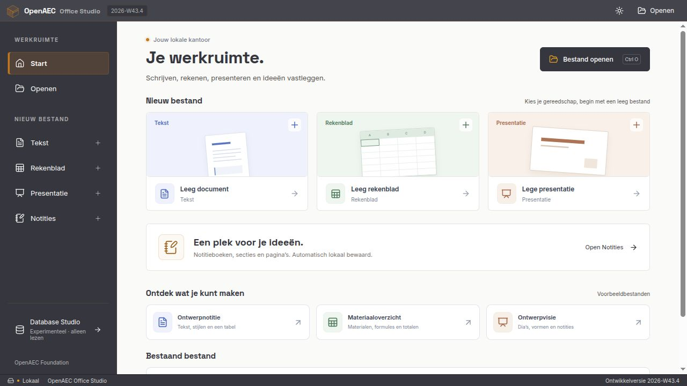
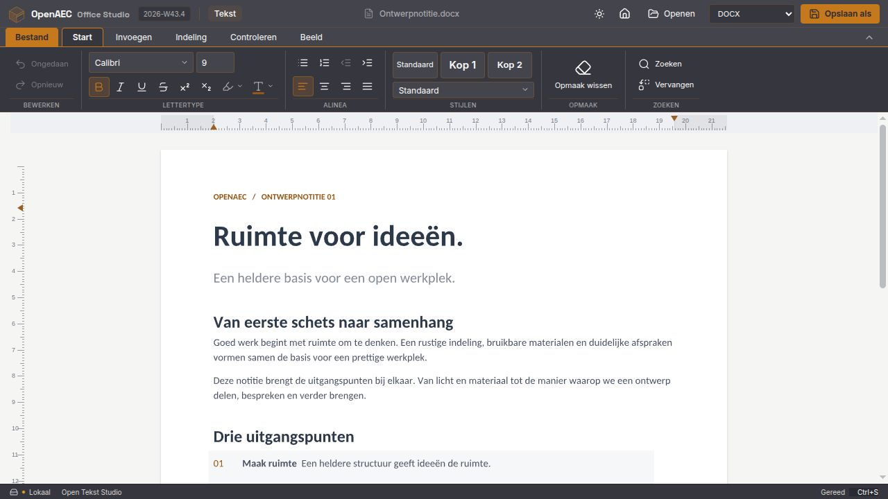
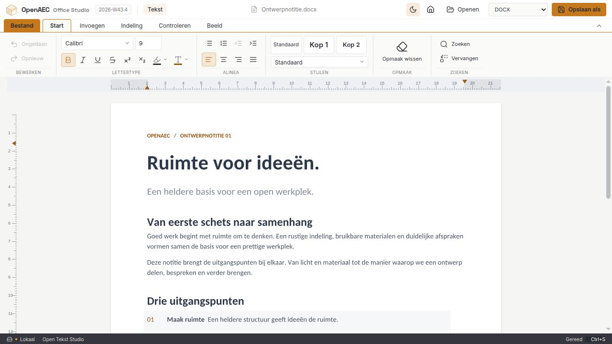
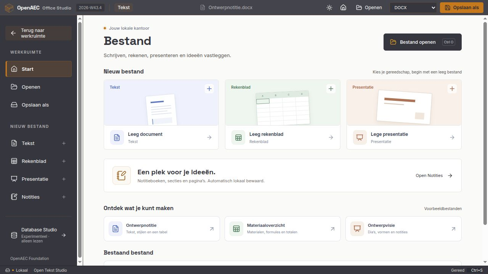
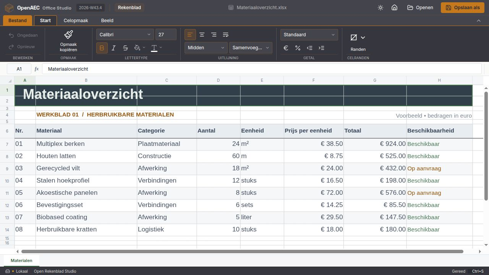
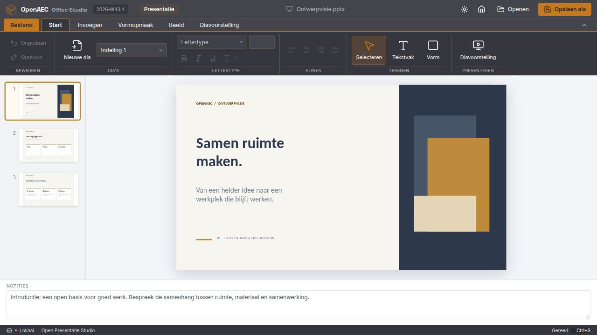
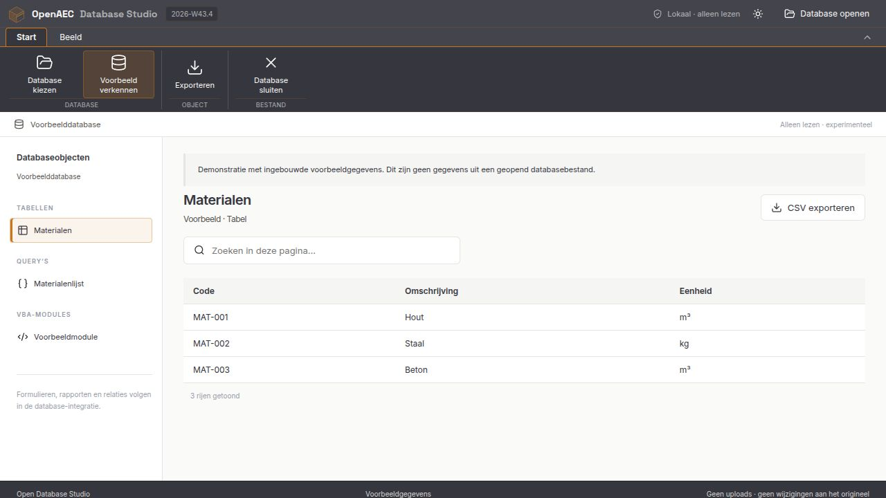
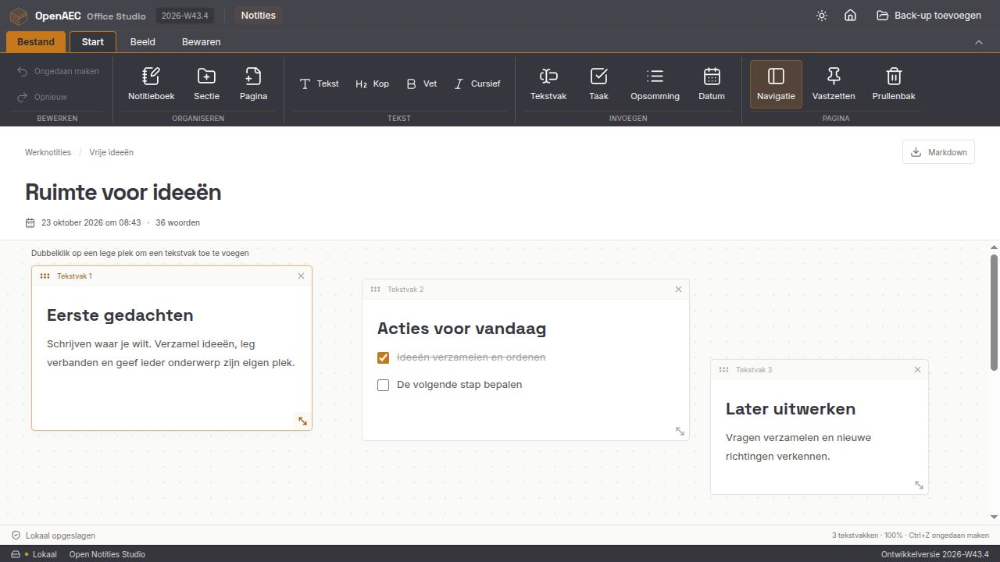
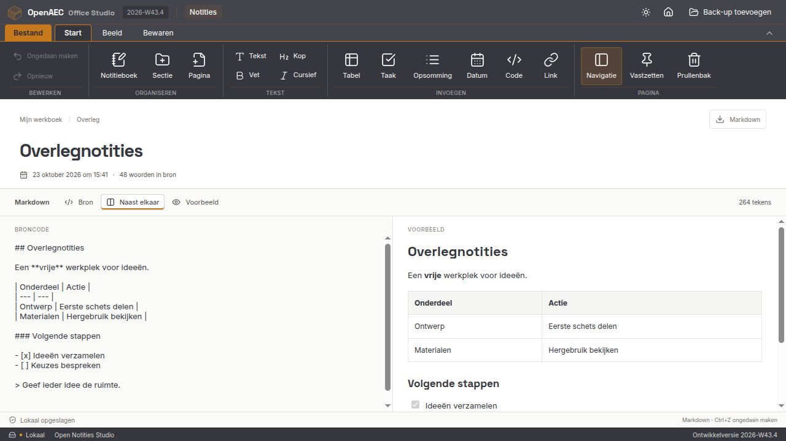

# Open Office Studio

Open-source kantoortoepassingen van het OpenAEC-ecosysteem voor tekstverwerking, rekenbladen, presentaties en notities.

Actuele bronversie: **2026-W43.4** (`2026.43.4`). Zie [versieafspraken](docs/versies.md).

**[Open Database Studio](apps/database-studio)** is nu ook een afzonderlijke desktopapp voor oude MDB- en ACCDB-databases, met een eigen venster en installers. Tekst, Rekenblad, Presentatie en Notities zijn onderdeel van de kantooromgeving.



## In beeld

Werkelijke schermafbeeldingen van de lokale productiebuild, met de eigen [voorbeeldbestanden](docs/voorbeelden). De interface heeft een gedeelde ribbon, contextuele opdrachten en een lokaal bestandsmenu. Deze beelden tonen de ontwikkelversie; ze zijn geen verklaring van volledige formaatcompatibiliteit.

De beelden zijn op 24 oktober 2026 vastgelegd uit bronversie **2026-W43.4**. De interface volgt het officiële [OpenAEC-stijlboek](docs/ontwerp/openaec-stijl.md), met Forge- en Light-weergave, een compact lint en het OpenAEC-symbool. De zon-/maanknop wisselt de appweergave; documenten en het vrije notitiecanvas blijven licht. Het lint kan worden ingeklapt; het bestandsmenu bedekt de volledige werkruimte. De drie voorbeelden zijn rechtstreeks vanuit het startscherm te openen. Alle negen beelden staan in het [schermafbeeldingenoverzicht](docs/screenshots).

### Open Tekst Studio

Paginaweergave met tekstopmaak, alineastijlen en documentnavigatie. Kies bovenin **Markdown (.md)** en **Opslaan als** om tekst, koppen, lijsten, links en tabellen als Markdown te bewaren. Dit werkt ook in de browser, zonder conversieruntime. Paginaopmaak en ingesloten afbeeldingen vragen daarnaast om een DOCX; Markdown bevat bij afbeeldingen een leesbare verwijzing.



<details>
<summary>Licht thema en bestandsmenu bekijken</summary>





</details>

### Open Rekenblad Studio

Rekenblad met formulebalk, rij- en kolomkoppen, celopmaak en berekende materiaaltotalen.



### Open Presentatie Studio

Dia’s, vormen, tekst en sprekersnotities in één werkruimte.



### Open Database Studio — experimenteel

Opent MDB- en ACCDB-bestanden lokaal en alleen lezen, met kolomtypen en paginering. Het beeld toont de zelfstandige database-app met het gedeelde OpenAEC-lint en de ingebouwde voorbeeldgegevens. De query- en modulevermeldingen horen bij die demonstratie; query’s en VBA uit echte bestanden uitlezen of uitvoeren, formulieren en bewerking ontbreken nog.



### Open Notities Studio

Een vrije pagina met tekstvakken die je zelf plaatst, sleept en groter of kleiner maakt. Ieder tekstvak kan alinea’s, koppen en taken bevatten. Notitieboeken en secties houden alles bij elkaar. Met zoom, inklapbare navigatie, ongedaan maken, automatisch lokaal opslaan, back-ups en Markdown-export. Oudere notities blijven leesbaar. Zie [werking en opslag](docs/notities.md).



Vanaf **2026-W43.4** kan iedere notitiesectie **Canvas** of **Markdown** zijn. Markdown heeft een broneditor, direct voorbeeld, tabellen, takenlijsten en `.md`-import/export. Bij omzetten blijft de oorspronkelijke sectie behouden.



## Modules

- **Open Tekst Studio** — teksten schrijven, opmaken en opslaan.
- **Open Rekenblad Studio** — tabellen, formules en celopmaak bewerken.
- **Open Presentatie Studio** — dia’s maken, vormgeven en presenteren.
- **Open Notities Studio** — notitieboeken, secties, pagina’s, takenlijsten, zoeken en lokale opslag.

- **Open Database Studio** — experimentele MDB/ACCDB-tabelbrowser, alleen lezen, met zoeken en CSV-export per pagina. Query’s, formulieren en VBA ontbreken nog. Deze module heeft de laagste prioriteit.

## Status

Een lokale React-werkruimte met drie aangesloten kantoorengines en een Tauri-desktopbasis is beschikbaar. Nieuw, openen en opslaan als zijn aangesloten. De suite is nog een ontwikkelprototype.

DOCX, XLSX en PPTX werken rechtstreeks. De desktopversie kan met een **afzonderlijk geïnstalleerd conversieprogramma** ook ODF en oudere formaten omzetten en PDF exporteren; stel het in met `OPENAEC_CONVERSIE_PROGRAMMA` (zie [Conversieprogramma instellen](docs/formaten.md#conversieprogramma-instellen)). De runtime wordt nog niet met onze installers meegeleverd. Er zijn routes voor 81 invoerextensies; dit betekent niet dat elk bestand of elk formaat al correct werkt. Zie de [formaatmatrix en beperkingen](docs/formaten.md).

De [corpusproef](docs/tests/2026-10-21-formaten.md) gebruikt 1.566 openbare bestanden met vastgelegde bronrevisies en hashes. De engines voltooiden 571 rechtstreekse en 775 geconverteerde open-/opslag-/heropenproeven; Database Studio las 79 databases. Weigeringen, tijdslimieten en de beperkte visuele controle staan eveneens in het verslag. De [browserproeven van 0.4.1](docs/tests/2026-10-21-browser.md) bevestigen opslag, annuleren, foutbehoud en echte MDB/ACCDB-pagina’s, inclusief een hierbij gevonden en herstelde browserfout. Voor eerdere bedieningstests: [ribbon en editors](docs/tests/2026-10-21.md), [opslagbeveiliging](docs/tests/2026-10-21-opslag.md).

De [GUI-controle van 0.4.3](docs/tests/2026-10-22-gui.md) controleert de vier werkruimtes, het bestandsmenu, bewerken en echte downloads. Bewaarde DOCX-, XLSX- en PPTX-bestanden zijn daarnaast met onafhankelijke lezers gecontroleerd. Daarbij zijn de laagvolgorde van het bestandsmenu, de algemene database-openknop en de donkere databaseweergave hersteld.

De ontwikkeling met screenshots staat in [pull request #10](https://github.com/OpenAEC-Foundation/open-office-studio/pull/10). De [bouwcontroles](https://github.com/JanAdriaan891/open-office-studio/actions/workflows/desktop.yml) maken pakketten voor Windows x64, Linux x64 en macOS ARM64. Een geslaagde build vervangt geen installatie- en gebruikerstest.

De [downloadbare testreleases](https://github.com/JanAdriaan891/open-office-studio/releases) bevatten een Windows-installer, Linux-DEB/AppImage, macOS-ARM64-DMG en SHA256SUMS. Vanaf 0.4.2 pakt de bouwstraat de Windows- en Linux-installers ook uit: zij controleert de programma-architectuur, WebView2, Linux-bibliotheken en snelkoppelingen. Dit is nog geen schone installatie of native bedieningstest.

## Opbouw

- `packages/documenten` — tekstverwerking.
- `packages/rekenbladen` — tabellen en formules.
- `packages/presentaties` — dia’s en presentatieweergave.

## Eerste ontwikkelstappen

1. Nederlandse editorbediening en de functionele acceptatieproeven afronden.
2. Native opslag, herstel en installers op alle doelplatformen testen.
3. Formaatgetrouwheid, grote bestanden en distributie van de conversieruntime afronden.

## Onderzoek

- [Routekeuze en licentieafweging](docs/onderzoek/README.md)
- [Bestaande Y-app-integratie](docs/onderzoek/integratie.md)

## Controles

Python 3.10 of nieuwer, zonder aanvullende pakketten:

```bash
python3 -m unittest discover -s tests -v
```

Zie de [testmatrix](docs/onderzoek/testmatrix.md) voor het vergelijken van DOCX-, XLSX- en PPTX-pakketten.

## Desktopontwikkeling

- [Functionele eisen en vergelijking met andere editors](docs/ontwerp/functionele-lat.md).
- `pnpm dev`: lokale kantooromgeving.
- `pnpm build`: TypeScript en productiebuild.
- `pnpm test`: adapter- en exportcontroles.

- `pnpm test:engines`: documenten wijzigen, opslaan en opnieuw openen met de echte engines.
- `pnpm desktop:dev`: Tauri-desktopomgeving.
- `pnpm desktop:build`: native pakket voor het huidige platform.
- `pnpm database:dev`, `pnpm database:build`, `pnpm database:desktop:build`: de afzonderlijke database-app ontwikkelen en bouwen.
- `pnpm versie:week 2026-10-23 1`, `pnpm versie:check`: weekversie instellen en controleren.
- `python scripts/controleer-installers.py --platform linux --rapport .local/pakketcontrole-Linux.json`: gebouwde DEB en AppImage controleren; vereist Python 3.11+, dpkg, squashfs-tools en ldd. Gebruik op Windows `--platform windows` met 7-Zip voor de NSIS-installer en de gebundelde WebView2-bestanden.
- [Testverslag en resterend werk](docs/tests/2026-10-21.md).
