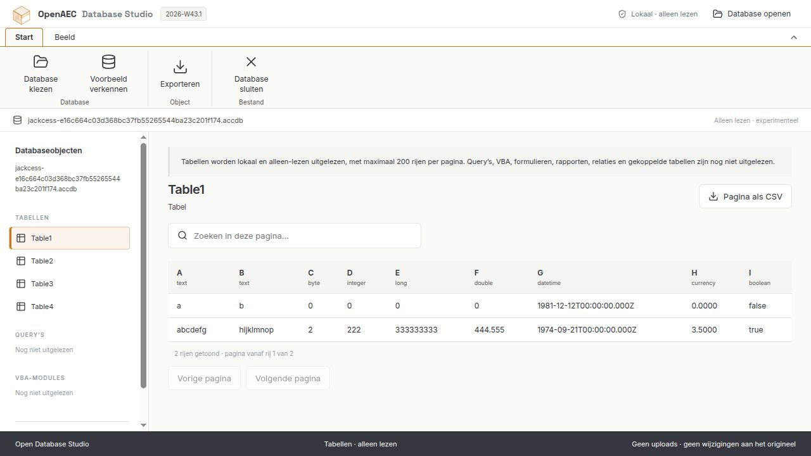

# Open Database Studio

Afzonderlijk te installeren React/Tauri-app voor het lokaal openen van oude MDB- en ACCDB-databases. Heeft een eigen programma (`open-database-studio`), venster, pictogram en applicatie-id (`org.openaec.database-studio`). De kantooromgeving hoeft niet geïnstalleerd te zijn.



## Werkt nu

- MDB/ACCDB via Database openen of Ctrl+O kiezen.
- Gebruikerstabellen, kolomtypen en gegevens lokaal lezen in een aparte worker.
- Maximaal 200 rijen per pagina; zoeken en CSV-export gelden voor de geladen pagina.
- In de desktopapp CSV opslaan met een native dialoog en een volledige, atomaire schrijfactie. De bron blijft ongewijzigd. In de browser wordt een download aangevraagd.
- Een ongeldige database weigeren en de eerder geopende tabel behouden.
- Lichte en donkere weergave, een inklapbaar lint en ingebouwde demonstratiegegevens.

De app is alleen lezen. Query-editor, formulieren, rapporten, relaties, gekoppelde tabellen, VBA-extractie en VBA-uitvoering zijn nog niet beschikbaar. SQL- en BAS-export betreffen uitsluitend de ingebouwde voorbeelden. Niet alle versies, encrypties en veldtypen zijn ondersteund. Zie ook de [parserbeperkingen](../../packages/database/README.md).

## Ontwikkelen en bouwen

Voer vanuit de repositoryhoofdmap uit:

```bash
pnpm install --frozen-lockfile
pnpm database:dev
pnpm database:build
pnpm database:desktop:dev
pnpm database:desktop:build
```

`database:dev` gebruikt poort 1430. De frontend heeft een eigen HTML-ingang en eigen `dist` in deze map. De productiecontrole weigert ingebouwde kantoorengines; de database-app levert alleen de benodigde parser, UI en licenties mee.

De [bouwstraat](../../.github/workflows/database.yml) maakt eigen Windows-x64-, Linux-x64- en macOS-ARM64-pakketten. Windows bundelt de WebView2-bootstrapper en loader. Windows- en Linux-pakketten worden uitgepakt en gecontroleerd. Native dialoogbediening en een schone installatie vereisen afzonderlijke controles.

## Versies

De gedeelde [weekversie](../../versie.json) is zichtbaar in de app. `2026.43.1` betekent week 43 van 2026, eerste uitgave. Zie [weekversies instellen](../../docs/versies.md).
