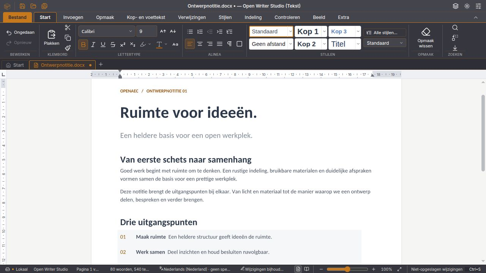
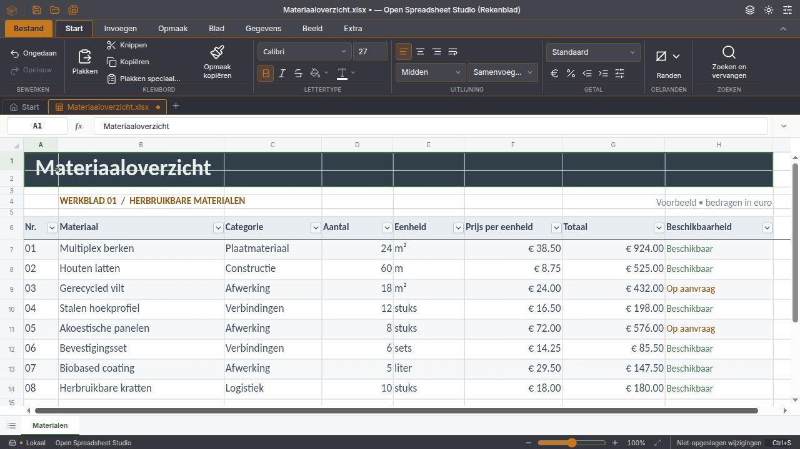
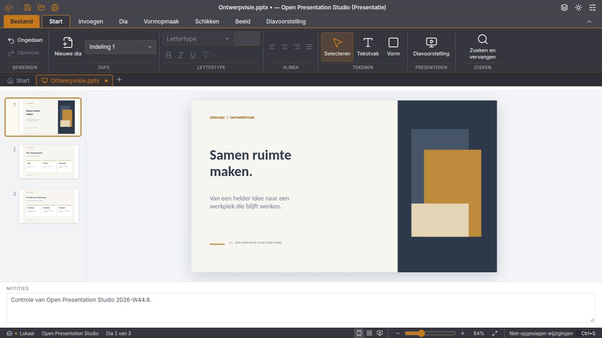
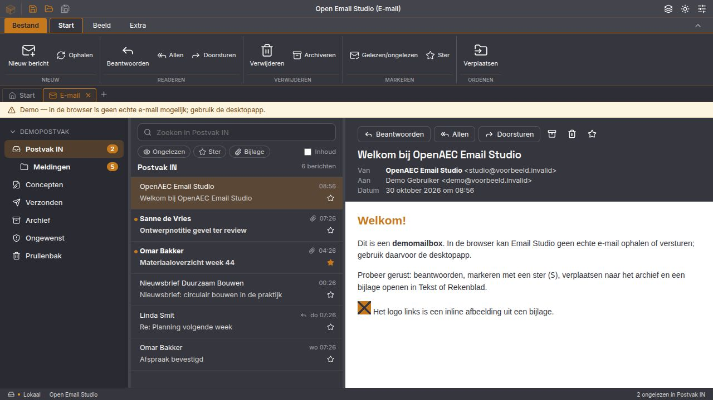
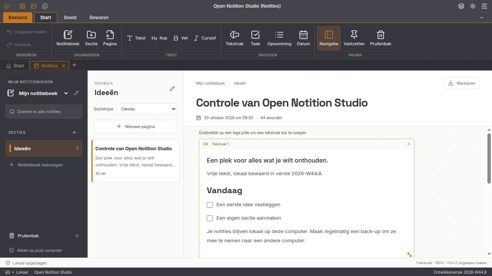

# De suite en zelfstandige studio's

Vanaf **2026-W44.8** levert dezelfde broncode zeven afzonderlijke installaties op:

| App | Werkruimte bij openen | Programmanaam |
| --- | --- | --- |
| Open Office Studio | De volledige suite | `open-office-studio` |
| Open Writer Studio | Tekstdocumenten en het eigen startscherm | `open-writer-studio` |
| Open Spreadsheet Studio | Rekenbladen en het eigen startscherm | `open-spreadsheet-studio` |
| Open Presentation Studio | Presentaties en het eigen startscherm | `open-presentation-studio` |
| Open Email Studio | Meteen het e-mailtabblad | `open-email-studio` |
| Open Notition Studio | Meteen de notitieboeken | `open-notition-studio` |
| Open Database Studio | De bestaande zelfstandige database-app | `open-database-studio` |

Alle zeven volgen dezelfde weekversie. Iedere installatie heeft een eigen applicatie-id, programmabestand en webview-profiel. De installers zijn afzonderlijk te kiezen; de suite blijft alle modules aanbieden. Writer, Spreadsheet en Presentation registreren alleen hun eigen documentsoorten. De vijf nieuwe apps zijn gerichte uitvoeringen van dezelfde code, met dezelfde editors en Rust-backend; de webbundels bevatten nog gedeelde onderdelen. Dit is geen nieuwe native Rust-interface of volledige opsplitsing van alle afhankelijkheden.

**Notities overzetten:** Office en Notition gebruiken gescheiden lokale profielen. Exporteer in de suite eerst een `.openaec-notities`-back-up en kies in Notition **Back-up toevoegen**. Bestaande notities worden niet automatisch gekopieerd. Ook e-mailaccounts worden niet automatisch van de suite naar de aparte e-mailinstallatie overgezet; stel deze opnieuw in. E-mail behoudt de ingebouwde document- en databaseweergaven voor bijlagen. In de browser werkt alleen de gemarkeerde demomailbox.

De gerichte apps gebruiken geen automatische updater voor de volledige suite: zo kan een Writer-installatie niet door een Office-installer worden vervangen. Werk ze voorlopig bij met de bijbehorende nieuwe installer. In Office is de updater pas beschikbaar nadat zijn publieke ondertekeningssleutel is ingesteld.

## Bouwen

```sh
pnpm desktop:build
pnpm database:desktop:build
pnpm studio:build writer --bundles deb,appimage
pnpm studio:build spreadsheet --bundles nsis
pnpm studio:build presentation --bundles dmg
pnpm studio:build email --bundles deb,appimage
pnpm studio:build notition --bundles deb,appimage
```

Kies bundels die bij het huidige bouwplatform passen. `--frontend` bouwt uitsluitend de browsercode naar `dist-studios/<studio>`. De vijf gerichte native builds verzamelen hun eigen pakketten in `dist-installers/<studio>`. Zij erven versie, beveiligingsbeleid, pictogrammen en Windows-WebView2-voorzieningen van de desktopbasis. De namen en identiteiten staan in [assets/studios.json](../assets/studios.json); [studio-config.mjs](../scripts/studio-config.mjs) maakt de platformconfiguratie. Daarvoor gebruiken we de eigen `identifier` en `mainBinaryName` uit de [Tauri-configuratie](https://v2.tauri.app/reference/config/).

## Vrijgave

De releasebouw maakt Windows x64 (NSIS), Linux x64 (DEB en AppImage) en macOS Apple Silicon (DMG) voor iedere app: **28 installers**. Windows gebruikt Authenticode en WebView2 met ingebouwde bootstrapper; macOS gebruikt Developer ID en notarisatie. Linux-bestanden en de checksums krijgen losse OpenPGP-handtekeningen met de bestaande OpenAEC-sleutel.

Publicatie wordt geweigerd als een app of platform ontbreekt, een pakketrapport de verkeerde app of versie noemt, of een bestand niet meer overeenkomt met de gecontroleerde hash en grootte. De release bevat veertien Windows-/Linux-pakketrapporten en `SHA256SUMS`. Een geslaagde bouw of pakketcontrole bewijst geen volledige native bediening; lees ook de [vrijgavecontrole en bekende beperkingen](tests/2026-10-30-vrijgavecontrole.md).

## In beeld

Echte schermafbeeldingen van de vijf gerichte browserbuilds, op 30 oktober 2026. De documenten en mailbox bevatten uitsluitend eigen of fictieve voorbeeldgegevens.











De bouwstraat bewaart iedere app direct na het bundelen met `node scripts/verzamel-studio.mjs <sleutel>`. Een volgende Tauri-build kan de gedeelde bundelmap opruimen. Pakketcontroles en publicatie lezen daarom uitsluitend `dist-installers/<sleutel>/`.
