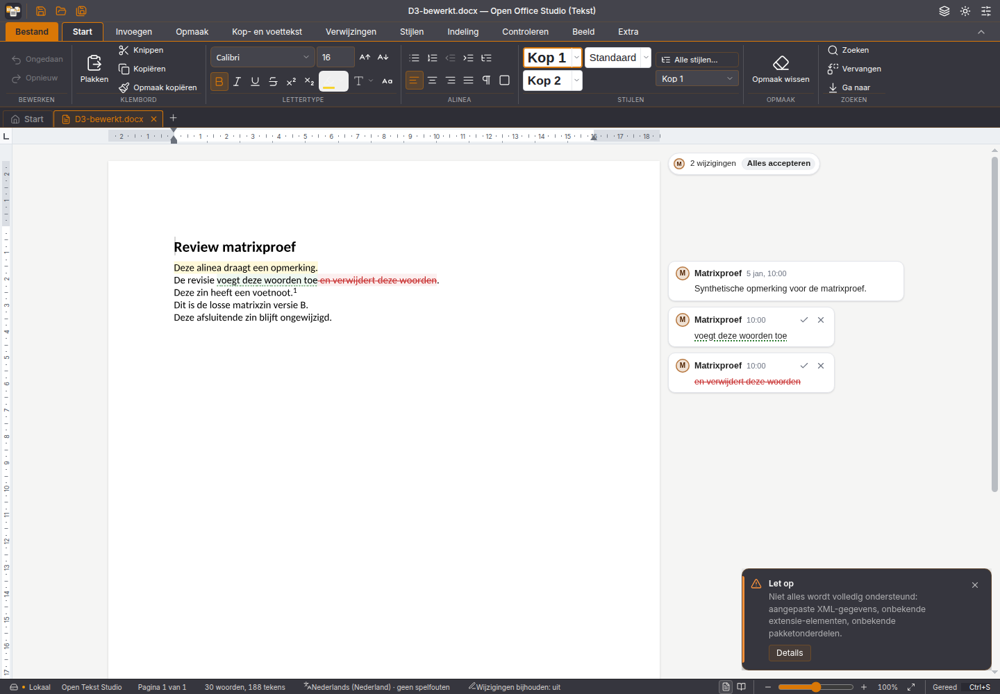

# DOCX-behoud: productiekern, native Writer en oorspronkelijke browseradapter

Onderdeel van #2. De proeven gebruiken de eigen synthetische D1–D3-bestanden;
dit is geen vrijgave voor willekeurige praktijkdocumenten. De aanvullende
P1–P3-rondgangen bewaken de bestaande presentatiekern.

## Gevonden en herstelde fout

De gepubliceerde Writer 2026-W45.3 bewaart bij D3 de voetnoot en zijn id, maar
verliest na de wijziging `losse matrixzin versie A` → `losse matrixzin versie B`
de tekenstijl `Voetnootmarkering` van de verwijzing. De oorspronkelijke
browseradapter bewaart die stijl wel. Alleen nootaanwezigheid en tekst tellen
was dus onvoldoende: de oude matrixproef slaagde ondanks dit opmaakverlies.

De oorzaak zit in `ordinaryContentForItem` van de vastgezette JavaScript-SDK:
de `noteRef`-projectie schreef wel de verwijzing, maar geen runopmaak.
Bovendien handelde `buildParagraphContent` verwijzingen vóór de revisie- en
koppelingsmarkeringen af. Daardoor verdween ook de omhullende revisie of
koppeling wanneer het documentdeel volledig werd opgebouwd.

De gerichte, bewaakte broncorrectie in `scripts/tekstengine-compatibiliteit.ts`
gebruikt de bestaande formatter en bewaart verwijzingen binnen revisies en
koppelingen. Dezelfde correctie wordt geladen in de app, de opslagworker en
de geïsoleerde SDK-proeven. De geïnstalleerde npm-pakketten en beide
WASM-kernen worden niet gewijzigd. Een gewijzigde of dubbel aanwezige
SDK-aansluiting stopt de bouw.

De onafhankelijke Python-controle vergelijkt nu per onderdeel, nootsoort en
id ook de echte `w:rPr`-structuur. De matrix faalde vóór de correctie op de
D3-editorbewerking en slaagt daarna. Dit is een vergelijking voor deze
beperkte tekstbewerkingen; geen algemene semantische opmaakvergelijker.

## Bronnen en vergelijkingsroute

| Route | Vastgezette bron | Werkelijk uitgevoerd |
| --- | --- | --- |
| Native Writer | Publieke v2026.45.3-DEB; programma-SHA256 `159e80d9ab685600efb1cd0d5ef6631707371043a62f6912da811edb5a8632cc` | D1–D3 openen, zonder bewerking opslaan, via Alles vervangen bewerken, opslaan, sluiten en beide kopieën heropenen |
| Huidige productiekern | `@betteroffice/docx` en `docx-react` 0.5.1 met de productiecorrecties | D1–D3 via documentmodel en editorsessie; daarnaast P1–P3 via PresentationHandle: 18 rondgangen |
| Oorspronkelijke Y-app-adapter | [Ongewijzigde adapter](https://github.com/OpenAEC-Foundation/Y-app-ERPNext/blob/cc51488bed97d251cb5c98ff91d5a0d56a49fd0a/packages/frontend/src/components/office/WordEditor.tsx); Folio React 0.26.0, core 0.58.5, DOCX core 0.36.2 | Echte browserinvoer, zes echte downloads en heropenen van precies die bytes |
| Gebouwde Office-browserapp | Productiebundel met de nieuwe broncorrectie | D3 via Vervangen → Alles vervangen, Opslaan als DOCX, echte download en heropenen in een lege sessie |

Het **wortellockfile** van Y-app-commit
`cc51488bed97d251cb5c98ff91d5a0d56a49fd0a` bepaalt alle referentieversies;
het oude frontend-lockfile bevat deze editor niet. Het proefscript vergelijkt
versie, tarball-URL en integriteit van iedere transitieve afhankelijkheid met
dat wortellockfile. Het downloadt de vier adapterbestanden ongewijzigd en
controleert hun SHA256, evenals de oorspronkelijke MIT-licentie. De drie
Folio-pakketten zijn Apache-2.0; hun meegeleverde LICENSE- en NOTICE-bestanden,
inclusief de oorspronkelijke MIT-vermelding, blijven in de aparte installatie.
Er wordt geen Folio-runtime aan Office toegevoegd.

De oorspronkelijke adapter is al onafhankelijk van bestandsopslag:
`bytes`, `name`, `locale`, `onReady({serialize})`, `onChange`, `onSave`, `onError`.
De huidige Office-editor heeft dezelfde scheiding via `bytes`, `naam`,
`registreer`, `gewijzigd`, `opslaan` en `fout`; de opslagketen staat erbuiten.
Dit is een vergelijking van beide implementaties, geen bewijs dat de engines
voor ieder document uitwisselbaar zijn. De referentiehost vult alleen de
bestandselectie, serialisatieafnemer en ontbrekende hostopmaak in.

## Resultaten en grenzen

- D1: kop-/voettekstrelaties, briefpapierlogo en paginanummerveld blijven
  aanwezig. De browserreferentie herschrijft ook kop- en voettekst-XML;
  packageverschillen zijn daarom afzonderlijk gerapporteerd.
- D2: beide tabellen, afbeelding en twee secties met liggende sectie blijven
  aanwezig. De screenshots tonen het begin van de eerste pagina; de native
  vervolgbeelden tonen slechts een deel van de tweede pagina. Een volledige
  visuele vergelijking van de liggende pagina staat nog open.
- D3: opmerkingen, invoeg-/verwijderrevisies, voetnoot, custom XML, onbekende
  pakketdelen en het onbekende element blijven behouden in de gemeten gevallen.
  De nieuwe productieroute bewaart ook de verwijzingsstijl.
- De browserreferentie meldt gereed één keer per geopende editor; openen en
  serialiseren geven geen vals wijzigingssignaal. De werkelijke bewerking
  geeft een wijzigingssignaal. Het aanroepen van `serialize` roept de
  hostopslag niet opnieuw aan. Runtimeverkeer naar externe domeinen is
  geblokkeerd en de proef registreerde geen externe aanvragen of exceptions.
- De referentieproef gebruikt de opslagknop van de proefhost als afnemer van
  `serialize`. De volledige Ctrl+S-keten van de oorspronkelijke Y-app en een
  live opslagverbinding zijn hiermee niet bewezen.
- De nieuwe productie-browserdownload is onafhankelijk als OOXML gecontroleerd
  en in een lege browsersessie heropend. De nieuwe correctie is hiermee nog
  geen opnieuw uitgebrachte of native geteste installer. De publieke
  v2026.45.3-installers blijven ongewijzigd.

De native bron- en resultaatbeelden en de zes referentiebeelden zijn visueel
bekeken. Ze zijn geen pixelvergelijking of volledige paginavrijgave.

## Controles herhalen

```sh
python3 -m unittest discover -s tests -v
pnpm exec vitest run src/tekst/pagina/nootopmaak-engine.test.ts
OOS_MATRIX_ZONDER_CONVERSIE=1 node scripts/test-matrix-documenten.mjs
OOS_CHROMIUM=/pad/naar/chromium node scripts/test-tekstreferentie.mjs
```

De referentieproef vereist netwerk voor de vastgezette bron en installatie;
de browser zelf mag alleen de eigen lokale server benaderen. Optioneel:
`OOS_DOCX_REFERENTIE_UIT` kiest een **nieuwe** proefmap, `NPM_CLI` kiest een
npm-CLI-bestand wanneer `npm` niet als programma beschikbaar is. Bestaande
proeven en het gedeelde `node_modules` worden niet overschreven. Beide
browserprocessen en servers van de uitgevoerde proeven zijn afgesloten.

De volledige Office-set slaagde met 1.941 tests en 7 bestaande overslagen;
52 Python-proeven, typecontrole en productiebuild slaagden eveneens.
De aparte nootproef controleert twee soorten noten, vijf contexten en beide
opslagroutes over twee bewerkingen en heropeningen, plus bronbewaking en
bewust gewijzigde verwijzingskleur.

## Bewijsbestanden

- [Bronfixtures](documentmatrix-2026-11-06/bron/manifest.json).
- [Native Writer-resultaten](documentmatrix-2026-11-06/writer-2026.45.3/rapport.json)
  en [programma-identiteit en bediening](documentmatrix-2026-11-06/writer-2026.45.3/native-bewijs.json).
- [Referentiebronnen](documentmatrix-2026-11-06/yapp-browser/bronnen.json),
  [browserrapport](documentmatrix-2026-11-06/yapp-browser/rapport.json) en
  [callbacks](documentmatrix-2026-11-06/yapp-browser/bediening.json).
- [Productierondgangen](documentmatrix-2026-11-06/productiekern/rapport.json)
  en [geladen modules](documentmatrix-2026-11-06/productiekern/engines.json).
- [Werkelijke productie-browseropslag](documentmatrix-2026-11-06/browser-productie/rapport.json)
  en [heropenen zonder bestaand tabblad](documentmatrix-2026-11-06/browser-productie/heropenen.json).



Issue #2 blijft open voor de ontbrekende volledige paginavergelijking en de
overige nog niet bewezen adapter-/opslagcriteria. Deze metingen bewijzen geen
algemeen verliesvrije verwerking van DOCX, ODF of een praktijkcorpus.
