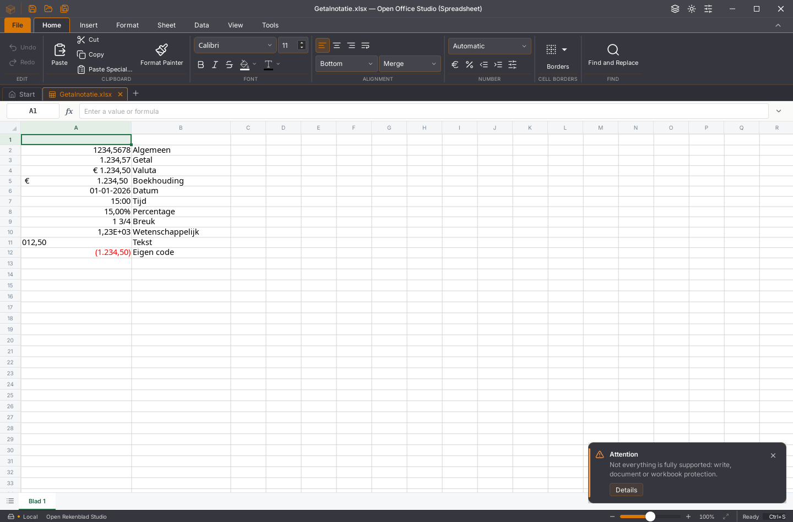
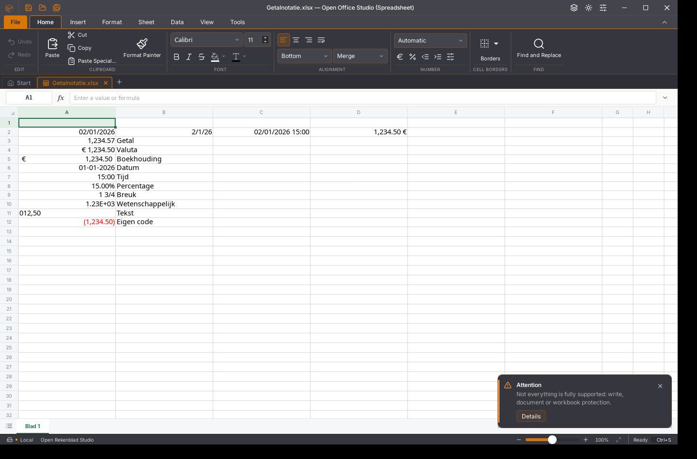

# Werkmapregio en getalnotatie — lopende herstelronde

#64 blijft open; [PR #164](https://github.com/OpenAEC-Foundation/open-office-studio/pull/164)
is een concept. De kern en interface zijn aangesloten in deze branch. De
openbare installers van 2026-W45.1 en 2026-W45.2 zijn ongewijzigd.

## Afwijking en herstel

De oorspronkelijke appkern (`385e2c53…`) gaf `1,234.50` voor de waarde 1234,5
met code `#,##0.00`, ook met een Nederlandse LCID. De Nederlandse datumcode
`[$-413]dddd d mmmm yyyy` leverde Engelse woorden. Het voorbeeldvenster had
een afzonderlijke benadering en kon daardoor afwijken van het raster. De
[synthetische werkmap](getalnotatie-kern-tegenproef-2026-11-06.xlsx) en
[kernlezing](getalnotatie-kern-tegenproef-2026-11-06.json) leggen dit vast.

De formatter ondersteunt nu tien bestandsregio’s: de negen actieve
interfaceregio’s en en-US. Alleen cijferdelen krijgen regionale
scheidingstekens; aangehaalde tekst blijft intact. Expliciete LCID-/taaltags
bepalen de datumwoorden. Franse groepering gebruikt een smalle vaste spatie;
de UTF-8-offsets en opvulgeometrie blijven correct. Notatiecodes en opgeslagen
numerieke waarden blijven in standaardnotatie. Bestaande expliciete
notatiecodes worden bij een regiowissel behouden.

De verborgen globale constante `_OpenAEC_NumberLocale` bewaart de regio.
Alleen een bekende, letterlijk aangehaalde tag wordt als instelling gelezen.
Een onbekende waarde blijft behouden; een zichtbare gebruikersnaam wordt
niet stil overschreven. Lokale namen gelden niet als bestandsinstelling. De
instelling is verborgen en beschermd in Naam beheren. Bestaande zichtbare of
lokale gebruikersnamen met dezelfde naam blijven beheerbaar.

De app voegt bij laden een beginregio toe als het bestand die nog niet heeft.
Daarna verandert een interfacetaalwissel de bestandsregio niet. De
initialisatie bewaart overige pakketonderdelen bytegelijk, respecteert
XML-voorvoegsels en levert bij twee systeemklokken gelijke bytes.

## Invoer en venster

Cel- en gewone formulebalkinvoer gebruiken de regionale kernparser.
Uitgebreide formulebalk en externe plaktekst geven expliciet
`localized: true` aan de batch mee. Bestaande canonieke `setCellInputs`-aanroepen
blijven ongewijzigd. Waarde en afgeleide datum-/procentnotatie horen bij één
Undo-stap. De oude nabehandeling met timers is verwijderd.

Plakken respecteert de tekstnotatie van het doel en laat overgeslagen cellen
ongemoeid. Interne kopieën gebruiken getypeerde waarden, ook tussen regio’s.
Canonieke HTML-getalvelden (`x:num`/`sdval`) worden afzonderlijk van regionale
tekst gelezen. Speciaal plakken en filtervoorwaarden lezen de bron met
dezelfde kern, regio en datumoorsprong, in een afzonderlijke lege werkmap.
Numerieke filtergrenzen worden eenmaal vastgelegd en canoniek bewaard.

Celeigenschappen › Getal biedt de bestandsregio naast alle elf categorieën.
Regio en celnotatie worden samen als één wijziging opgeslagen, met een
versiecontrole op het oorspronkelijke doelblad. Het venster leest de exacte
opgeslagen code, ook voor lege opgemaakte cellen. Voorbeelden gebruiken de
werkelijke kern met afzonderlijke werkmappen voor datumstelsel 1900 en 1904;
er wordt niets in het gebruikersbestand gewijzigd. Negatieve kleuren,
haakjes, datumtaal en boekhouding volgen dezelfde formatter als het raster.

## Bron en herbouw

De [regiopatch](../../patches/rekenbladengine-werkmapregio.patch) wordt na de
lange-ketenspatch op de vastgezette bron toegepast. De
[patchcontrole](getalnotatie-patchcontrole-2026-11-06.json) verifieert alle
21 gewijzigde bronbestanden van de eerdere revisie na toepassen zonder fuzz. De productiecontrole
bewaakt beide patchhashes, oorspronkelijke en aangepaste WASM en het volledige
JS/WASM-contract. De npm-pakketten blijven ongewijzigd.

De eerder aangesloten kern was 7.693.158 bytes, SHA-256
`a46812258ad5efcc54d0cba42bdfc21b99b4f3c873d3e9d701098f7712ee8f07`.
Een schone herbouw uit het gecontroleerde bronarchief met beide patches
levert bytegelijk deze kern; zie het
[herbouwbewijs](getalnotatie-kernherbouw-2026-11-06.json). De 21 imports en
95 exports blijven gelijk. De eerste uitvoering bereikte de gelijke
kernbytes, maar miste Node op PATH bij de contractcontrole. Een tweede schone
uitvoering met de vastgezette Node op PATH slaagt volledig.

Zeven [echte JS/WASM-proeven](getalnotatie-regionale-batch-wasm-2026-11-06.json)
controleren regio-isolatie, LCID in beide richtingen, TEXT, invoer,
Undo/Redo, bewaren/heropenen, legacytekst en de regionale batchvlag door de
bestaande pakket-JS. De oorspronkelijke kern faalt zes van deze zeven proeven.
Herhalen: `node scripts/proef-werkmapregio.mjs kern.wasm uitvoermap`.

De eerste kandidaat (`1df70b43…`) is afgekeurd: de brede controle vond dat
bestaande tekst `1/15` zonder regio bij ongewijzigd vastleggen een datum kon
worden. Die route gebruikt weer de oorspronkelijke parser. Zie de
[regressietegenproef](getalnotatie-wasm-legacy-tegenproef-2026-11-06.json).
De gecorrigeerde regiobasis slaagde in
[2.403 native kernproeven](getalnotatie-volledige-kernnacontrole-2026-11-06.json),
met zestien bestaande gevallen overgeslagen. De latere batchuitbreiding heeft
acht extra gerichte proeven; alle 46 betrokken werkmap-/invoer-/exportproeven
slagen. De [volledige laatste set](getalnotatie-regionale-batch-kernproeven-2026-11-06.json)
slaagt in **2.411 proeven**, 80 testsets, met zestien bestaande gevallen
overgeslagen en nul mislukkingen. Clippy
met `-D warnings` en de volledige bronformatcontrole slagen.

## App- en native controle

De eerste aansluitronde slaagt in 127 gerichte appproeven in acht bestanden.
De aanvullende HTML-nacontrole slaagt in 34 proeven: de bestaande
engine-integratie, regionale invoer en klembordlogica. Deze sets overlappen.
Een oude Nederlandse HTML-proef moest de bestandsinitialisatie expliciet
meenemen; de gewenste datumweergave is nu `01-02-2026`.

De volledige appnacontrole heeft 1.865 geslaagde proeven en tien bestaande
gevallen overgeslagen. Twee bestaande Writer-proeven raakten hun grens van
5 seconden tijdens gelijktijdige kerncontroles; er was geen mislukte
inhoudelijke assertie. De rustige nacontrole van beide
volledige testbestanden slaagt in alle 45 proeven, zonder gewijzigde deadlines
of verwachtingen. Daarmee zijn alle 1.867 unieke proeven gecontroleerd; zie
[appnacontrole](getalnotatie-appnacontrole-2026-11-06.json). Typecontrole, vertaalcontrole
en beide productiebouwen slagen.

De [native tussencontrole](getalnotatie-native-tussencontrole-2026-11-06.json)
gebruikt een echte Tauri-binary, eigen Xvfb/DBus/XDG-profielen en een afzonderlijke
inspectorpoort. De geladen editor- en kernbytes zijn uit de draaiende app
opgehaald en vergeleken met de productiebouw. Het gebruikersscherm en
gebruikersklembord zijn niet gebruikt.

- Elf categorieën zichtbaar, met Nederlandse cijfers en rode haakjes.
- Regiowissel nl-NL → en-US verandert de weergave; Undo herstelt de regio.
- `12,5` en `1-1-2026` via de formulebalk; `15%` via F2-celinvoer.
- Eigen code `0.000" m"` met kernvoorbeeld gewijzigd en toegepast.
- Ctrl+S, tab sluiten en dezelfde XLSX via de native bestandskiezer heropenen:
  bestandsregio en-US, eigen code, datum en procent blijven behouden.
- Onafhankelijke ZIP/XML-lezing vindt 12,5, 46023 en 0,15 terug; alle elf
  oorspronkelijke waarden en notatiecodes blijven behouden.

De [bewaarde synthetische XLSX](getalnotatie-native-tussencontrole-2026-11-06.xlsx)
is controleerbaar zonder de app. Deze native tussencontrole gaat vooraf aan de
HTML-getalcorrectie. De [laatste native nacontrole](getalnotatie-native-invoerroutes-2026-11-06.json)
controleert productie-editor `ff4aacb8…` en dezelfde kern opnieuw: uitgebreid
invoerveld, echt native HTML-klembord (tekst én HTML opgevraagd), regionale
getallen, canonieke HTML-getalvelden, datum, procent, formule, één Undo/Redo,
Ctrl+S en heropenen via Recente bestanden. De
[bewaarde XLSX](getalnotatie-native-invoerroutes-2026-11-06.xlsx) is onafhankelijk
met ZIP/XML gecontroleerd. In een te smalle datumkolom worden opvultekens
getekend; de volledige datum en juiste numerieke waarde blijven behouden.

## Aanvullende audit: ingebouwde datums en behoud van celcodes

De vorige kern (`a4681225…`) gaf bij ingebouwde datumcode 14 nog `1/1/26`
in een Nederlandse werkmap. Invoer `1-2-2026` in zo’n cel kon als 2 januari
worden gelezen. De [tegenproef met de werkelijke JS/WASM-koppeling](getalnotatie-ingebouwde-datums-tegenproef-2026-11-06.json)
slaagt in zeven en faalt in drie gevallen. Ook een expliciete lage valutacode
kon verloren gaan door de vaste impliciete tabel.

De nieuwe kern volgt de bekende bestandsregio voor ingebouwde codes 14 en 22.
Een Nederlandse ingebouwde datum toont `01-02-2026`, een Amerikaanse
`02/01/2026`. De numerieke waarde blijft 46054. Eigen codes zoals `m/d/yy`
blijven in hun oorspronkelijke volgorde staan. Expliciete codes bij lage
valuta-id’s worden uit het bestand gelezen. Zonder herkende regio blijft de
oude interpretatie behouden. De gekozen korte datumcodes gebruiken een
Gregoriaanse kalender en vier jaarcijfers.

Het getalvenster bewaart de oorspronkelijke ingebouwde id en gemengde
celnotaties wanneer uitsluitend de regio wordt gewijzigd. Een ongewijzigd
venster maakt geen geschiedenis. Aangepast begint bij de effectief getoonde
code. Een ongeschikte code meldt de benadering van de kern en kan niet worden
toegepast. Een onbekende regio wordt zichtbaar als bestaande instelling;
alleen een expliciete keuze mag die vervangen. Speciaal plakken en
filtervoorwaarden gebruiken dan eveneens de oorspronkelijke invoerroute.

De actuele kern heeft **7.693.941 bytes**, SHA-256
`cfa8112fb6c1f057c03587dfc87a968ab665904632a9d1adae6907156819ce69`.
De [nieuwe patchcontrole](getalnotatie-ingebouwde-datums-patchcontrole-2026-11-06.json)
verifieert 23 bronbestanden zonder fuzz. De [schone geordende herbouw](getalnotatie-ingebouwde-datums-kernherbouw-2026-11-06.json)
levert bytegelijk deze module. De complete JS/WASM-interface blijft gelijk.
Alle [tien JS/WASM-proeven](getalnotatie-ingebouwde-datums-wasm-2026-11-06.json)
slagen; daarnaast slagen 54 gerichte native kernproeven, Clippy en bronformatcontrole.
De voorafgaande aantallen en kernhashes hierboven beschrijven de eerdere revisie.

De [nieuwe appnacontrole](getalnotatie-ingebouwde-datums-appnacontrole-2026-11-06.json)
controleert **1.874 unieke actieve proeven**, met tien bestaande gevallen
overgeslagen. Vijf tests bereikten 5000 ms tijdens gelijktijdige builds; de
rustige herhaling van alle vijf volledige bestanden slaagt in 60 proeven.
Geen deadline of verwachting is verruimd. Type-, vertaal- en productiecontrole
slagen. De definitieve editorchunk heeft SHA-256
`155f4dea9a0b65b5f2f518efb93eaedf598f31abb51fdcd94b336e3194c91608`.

De [nieuwe native controle](getalnotatie-ingebouwde-datums-native-2026-11-06.json)
verifieert de geladen editor- en kernbytes, F2-invoer `1-2-2026`, regiowissel
op een gemengde selectie, één Undo/Redo, een ongeschikte eigen code, bewaren
en heropenen. Onafhankelijke ZIP/XML-lezing bevestigt codes 14, 22, de eigen
code `m/d/yy`, expliciete valutacode 5 en alle vier numerieke waarden. Een aanvullende vergelijking bevestigt bij
alle 24 fixturecellen exact behoud van type, waarde, formule, notatie-id en
eigen code. Een
[tweede bewaarproef](getalnotatie-onbekende-regio-bewaard-2026-11-06.xlsx)
behoudt een onbekende regio bij uitsluitend een celcodewijziging; expliciet
kiezen en één Undo zijn afzonderlijk gecontroleerd. Beide native testprofielen
zijn volledig afgesloten. Na deze native controle is uitsluitend het
scheidingsteken in de hint voor een onbekende regio gelijkgetrokken met de
bestaande Engelse kernterugval; de bewerkingsroutes zijn gelijk. De aanvullende
type- en productiebouw slagen; de nieuwe editorhash is
`8a1e40ca6b54b7263a9030cfe9a8162289462e571d67649ef6245b446a07e169`. De [bron](getalnotatie-ingebouwde-datums-bron-2026-11-06.xlsx)
en [bewaarde werkmap](getalnotatie-ingebouwde-datums-bewaard-2026-11-06.xlsx)
zijn zelfstandig controleerbaar.

Onderbouwing van impliciete en expliciete nummerformaten:
[Open XML NumberingFormat](https://learn.microsoft.com/en-us/dotnet/api/documentformat.openxml.spreadsheet.numberingformat)
en [MS-OI29500 §2.1.712](https://learn.microsoft.com/en-us/openspecs/office_standards/ms-oi29500/17d11129-219b-4e2c-88db-45844d21e528).

## Resterende acceptatie

De eerste brede kernronde stopte met signaal 143, zonder afgeronde eindtelling;
die geldt niet als geslaagd. De [volledige nacontrole](getalnotatie-ingebouwde-datums-kernnacontrole-2026-11-06.json)
met twee testthreads slaagt in **2.419 proeven**, 81 sets, met zestien bestaande
gevallen overgeslagen en nul mislukkingen. De lokale acceptatie is daarmee groen.
De zes platformchecks van de eerdere commit `c368e593` zijn groen; de definitieve
revisie moet nog alle zes platformchecks doorlopen. De zes issuecriteria
blijven onafgevinkt tot die gezamenlijke acceptatie is bewezen. PR #164 blijft
concept en #64 blijft open.
