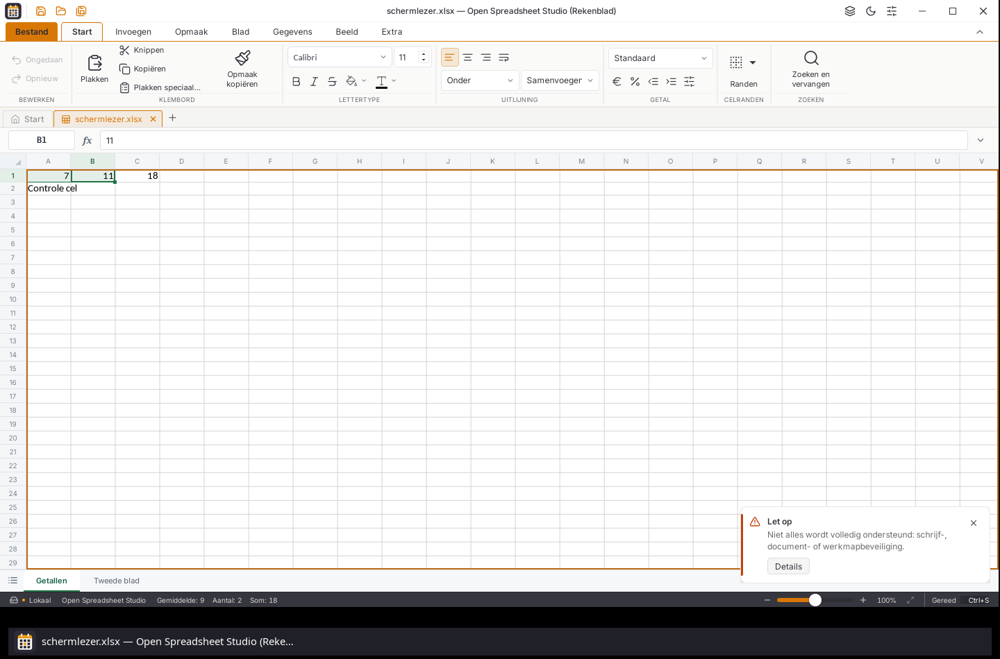

# Reële schermlezercontrole van het rekenblad — 6 november 2026

Deze controle betreft de bestaande Tauri/web-editor, de externe adaptermelding
[#3](https://github.com/OpenAEC-Foundation/open-office-studio/issues/3), de
celfocus uit [#24](https://github.com/OpenAEC-Foundation/open-office-studio/issues/24)
en de naamvaknavigatie uit [#58](https://github.com/OpenAEC-Foundation/open-office-studio/issues/58).
De brede toegankelijkheidsmelding #24 blijft open. Ook #58 blijft open zolang
de snelle naamvakinvoer onder belasting niet is afgetekend. NVDA en VoiceOver zijn hier
niet uitgevoerd. De afzonderlijke native Rust-interface en de SDK-worker- en
viewercomponenten vallen buiten deze correctie.

## Reproductie in de gepubliceerde installer

De daadwerkelijke Spreadsheet-DEB uit de openbare uitgave v2026.45.4 is gestart
in een eigen X11-bureaublad en gebruikersprofiel. De uitvoerbare bestandsbytes
hebben SHA256 `fcbdd4ab4b501acdd634e06832b42795259441e4dfeff70b78dd48e01468fe7c`.
Ook voor deze vergelijking zijn de echte Orca 51.1, AT-SPI 2.58.6 en de
werkende eSpeak NG-spraakmodule gebruikt.

1. Open [de synthetische fixture](../../tests/fixtures/schermlezer.xlsx).
2. Ga met F6 door titelbalk, lint en documentbalk naar het raster.
3. Rechts, Rechts, Omlaag selecteren B1=11, C1=18 en de lege C2. Orca spreekt
   geen van die celadressen of waarden uit. De focus staat op een `div` zonder
   rasterrol of toegankelijke naam; de bestaande celspiegel staat ernaast.
   De andere F6-regio's worden door dezelfde schermlezer wel uitgesproken.
4. Typ C1000 in het naamvak en druk op Enter. Het naamvak toont C1000, maar
   `scrollTop` blijft 0 en er is geen zichtbare selectie. Pas Rechts maakt
   D1000 zichtbaar en vergroot de virtuele scrollruimte.

De fixture bevat A1=7, B1=11, C1=`SUM(A1:B1)` en A2=`Controle cel`; het tweede
blad heeft A1=`Tweede bladtekst`. De onafhankelijke verwachting is 7+11=18.
De oorspronkelijke XML en het gebruikte bereik A1:C2 zijn apart geïnspecteerd.
De fixturehash is `91d670fde8ae9d7aa19a9607420ea9692917522cc8e894bfa512cdcff36ff2c3`.

## Correctie

Het bestaande raster krijgt de juiste rol, een naam met het actieve werkblad
en echte focusbare cellen. De celspiegel staat binnen de canvaslaag; de
virtuele spacer blijft het eerste element. De transparante cellen gebruiken
de echte celrechthoeken en zoom, zodat hun toegankelijkheidsgeometrie
samenvalt met de zichtbare cellen. Editor- en bladgebonden ids voorkomen dat
focus op een cel uit een ander document of blad terechtkomt.

Focus volgt de bewegende focuscel, ook bij een selectie met een ander anker.
Een invoerveld, dialoog of andere vensterregio houdt zijn eigen focus. Tijdens
een viewportwissel ontvangt het raster de toetsen totdat de nieuwe cel er
werkelijk is. Een focusrand blijft ook na een muisklik in het naamvak zichtbaar;
de hier gebruikte WebKit-versie paste `:focus-visible` daarna niet betrouwbaar
toe op de programmatisch gefocuste cel. De rand staat in een aparte
bovenliggende laag binnen de bestaande celspiegel. Een berekende outline op
de scrollcontainer of het canvas zelf bleek overschilderd en leverde geen
zichtbare focuspixels op. De PNG-controle moet de werkelijke rand terugvinden.

De publieke `selectCells`-route vergroot vóór het scrollen de bestaande spacer
voor beide selectiehoeken. Zo worden ook doelen buiten het gebruikte bereik
zichtbaar. Een uitgestelde sprong controleert nog steeds werkmap, blad en
selectie. Selecties worden inhoudelijk vergeleken: de SDK kopieert ze, waardoor
een vergelijking op objectidentiteit onterecht iedere sprong zou weigeren.
De bronhash en eenduidige vervangingen weigeren een ongecontroleerde SDK-versie.

## Werkelijke native proef

Alle native deelproeven slagen in een schoon profiel. De pixelcontrole vindt
7.172 focuspixels bij celnavigatie en 7.172 na de sprong via het naamvak;
de bijbehorende rand beslaat 1400 × 577 pixels.
Een voorafgaande versie met alleen outlines leverde nul focuspixels op en
wordt dus uitdrukkelijk niet als zichtbare focus afgetekend.

De productie-Spreadsheet-interface is ingebed in een afzonderlijk Tauri-programma
met de bestaande Rust-main en dezelfde vastgezette afhankelijkheden. Dit is een
lokale proefbuild; deze correctie zit nog niet in de historische W45.4-downloads.
De programmabytes, bronbestanden en daadwerkelijk geladen
AT-SPI-bibliotheken staan in het [machineleesbare bewijs](rekenblad-schermlezer-controle.json).

Toetsen worden via X11 geleverd. De WebKit-inspector wordt uitsluitend gebruikt
om DOM, focus, geometrie en zichtbare selectie te lezen; de werkmap wordt niet
via een testhaak gewijzigd. Orca's eigen spraakuitvoer moet per beweging het
verwachte adres en de waarde bevatten. Daarnaast worden ontvangen celteksten
in Speech Dispatcher en daadwerkelijk gegenereerde PCM-audioblokken gecontroleerd.
De audio gaat naar ALSA `null`, zonder geluid op het gewone bureaublad.

| Bediening | Vereiste celtekst |
| --- | --- |
| Rechts | B1, 11 |
| Rechts | C1, 18 |
| Omlaag | C2, leeg |
| Home | A2, Controle cel |
| Omhoog | A1, 7 |
| Shift+Rechts | B1, 11, geselecteerd |

Aanvullend worden F2, typen en annuleren, F6 naar de statusbalk en terug,
naamvak C1000, volgende rij/kolom, Ctrl+Home en Ctrl+PageDown/PageUp beproefd.
Het naamvak wordt ook gecontroleerd met A998:C1000 en verwijzingen naar beide
werkbladen. De drie lege standaardrijen van dat bereik zijn bij 100% zoom
3 × 15 pt × 96/72 = 60 CSS-pixels hoog. Daarmee wordt een onterecht afgeknipte
meercelselectie niet als geslaagd geteld.

De uiteindelijke bron slaagt voor 169 testbestanden: 1.954 geslaagd,
10 overgeslagen en geen mislukkingen (139,55 seconden, exitcode 0).
De 14 gerichte tests gebruiken de echte kern en controleren onder meer
geometrie, meercelselecties, gekopieerde selecties, gescheiden ids en de
weigering van een andere bron of dubbele patch. Typecontrole, productiebuild
en de afzonderlijke native bouw slagen.

Uitgevoerde opdrachten:

```sh
node node_modules/vitest/vitest.mjs run --maxWorkers=2
node node_modules/typescript/bin/tsc --noEmit
VITE_STUDIO_VARIANT=spreadsheet node node_modules/vite/bin/vite.js build
python3 scripts/controleer-rasterfocus.py docs/screenshots/test-rekenblad-schermlezer-2026-11-06.png
```

De pixelcontrole geeft voor de voorafgaande onzichtbare outlineversie
exitcode 1 en voor de uiteindelijke native schermafbeeldingen exitcode 0.
Het eigen programma, de schermlezer en het X11-bureaublad zijn na de
uiteindelijke proef normaal afgesloten (harnas-exitcode 0).



## Omgeving en grenzen

- GTK 3.24.41, WebKitGTK 2.52.6, Speech Dispatcher 0.12.0-rc2 en eSpeak NG 1.51.
- Orca 51.1 en AT-SPI 2.58.6 zijn uit gecontroleerde officiële bronarchieven in
  een eigen prefix gebouwd. Hun bronadressen en SHA256 staan in het bewijs.
  De geïnstalleerde bibliotheken en schermlezer zijn niet vervangen.
- Orca 46.1 is afzonderlijk onderzocht. Zijn WebKit-handler slaat focusmeldingen
  van tabelcellen expliciet over; eerdere kandidaten leverden daar geen
  geslaagde celuitspraak op. De uitslag met 51.1 bewijst geen ondersteuning
  van 46.1, NVDA of VoiceOver.
- WebKitGTK 2.52.6 geeft de aanvullende `aria-rowindextext`/`aria-colindextext`
  hier niet door. De celadressen worden correct uitgesproken, maar de extra
  fysieke tabelposities tellen de koprij en kopkolom mee. De tekstalternatieven
  volgen [WAI-ARIA 1.3](https://www.w3.org/TR/wai-aria-1.3/#aria-colindextext);
  zij worden niet als een bewezen herstel van die backendbeperking afgetekend.
- Een snelle naamvakinvoer tijdens gelijktijdige belasting verloor in één
  verkennende proef twee tekens. De uiteindelijke native proef wacht op
  focusoverdracht en gebruikt gecontroleerde toetsintervallen. Dat bewijst
  niet dat snelle invoer onder belasting is hersteld.
- Een vroege harnasstart viel vóór de celproef uit. Een latere lokale volledige
  testrun eindigde met code 143, evenals één langdurig niet gepolld harnas;
  deze zijn niet als volledige geslaagde controles geteld. Achtergebleven
  eigen proefprocessen zijn gecontroleerd en afgesloten. De afgetekende resultaten
  verwijzen naar nieuwe, afzonderlijk voltooide runs.
