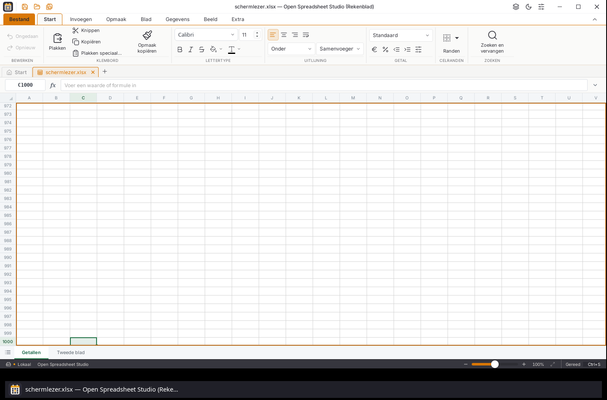

# Naamvakinvoer na een bezoek aan de statusbalk

## Aanleiding en afbakening

Dit vervolgt #58, #24 en #28 op de bestaande Tauri-app na #181. De
parallelle native UI-migratie valt buiten deze wijziging. De openbare
installers van W45.4 blijven ongewijzigd.

De eerdere native proefbouw van #181 verloor bij snelle invoer soms de
eerste twee tekens van `C1000`. Dit is onafhankelijk herhaald na F2,
bewerken/annuleren, F6 naar de zoomknoppen en Shift+F6 terug. Het naamvak
had DOM-focus, maar ontving alleen de drie nullen. Orca ontving de C en 1
wel. Daarom worden geen ontbrekende tekens in het invoerveld verzonnen of
opnieuw aangeboden.

Met dezelfde oorspronkelijke proefbouw en fixture:

| Omgeving | Directe invoer | Na F2 en F6 |
| --- | --- | --- |
| Schermlezer uitgeschakeld | 16/16 | 18/18 |
| Orca 51.1, AT-SPI 2.58.6, zonder debuglog | 16/16 | 9/18 |
| Orca 51.1, AT-SPI 2.62.1 | 16/16 | 0/18 |

De oorspronkelijke proefbouw heeft SHA-256
`e167a698732e254ca8469675b320f68ed1cd022a435bcf5e1e0acfacf9faa267`.
Dit zijn gerichte reproducties; zij bewijzen niet dat iedere gemiste toets
in andere toepassingen dezelfde oorzaak heeft.

## Wijziging

De zoomknoppen worden vanaf het renderen een benoemde werkbalk. De echte
AT-SPI-boom toont `tool bar: Zoom`. Orca herkent de knop Uitzoomen daardoor
als afstammeling van een werkbalk en houdt de focusmodus aan, in plaats van
bij dit tussenstation naar de bladermodus te gaan. Alleen achteraf de
DOM-rol wijzigen was in een afzonderlijke verkenning onvoldoende.

De knoppen ondersteunen links/rechts, Home en End met de bestaande
focushelpers van het lint. Uitgeschakelde bedieningselementen worden
overgeslagen. De schuif houdt zijn eigen toetsen en blijft met Tab
bereikbaar. De bestaande Tab-volgorde blijft behouden; dit is geen
verklaring dat de hele app aan het
[W3C-werkbalkpatroon](https://www.w3.org/WAI/ARIA/apg/patterns/toolbar/)
voldoet of dat er overal slechts één Tab-stop per werkbalk bestaat.

Een echte toetsenproef vond tevens dat de schuif bij 100% vastzat: de
native stap van 0,5 werd door het vastklikken van de muisschuif steeds
teruggezet naar dezelfde waarde. De vier pijltjestoetsen gebruiken nu
dezelfde begrensde zoomstappen van tien procentpunt als de plus- en
minknoppen. Home en End blijven de native schuifbediening voor de
uiterste standen. De muisbediening behoudt het vastklikken bij 100%.

## Native proef

Fixture: `tests/fixtures/schermlezer.xlsx`, SHA-256
`91d670fde8ae9d7aa19a9607420ea9692917522cc8e894bfa512cdcff36ff2c3`.
Alle documenten, profielen, vensters, X11-schermen, schermlezers en
spraakdiensten zijn afzonderlijke synthetische proeven. Het gewone
bureaublad en de browser worden niet bediend.

Er worden echte toetsen en muisklikken via X11 aangeboden. De WebKit-inspector
leest uitsluitend DOM-focus, waarden, rollen en toets-/invoergebeurtenissen;
hij vult het naamvak niet en roept geen selectiemethode aan.

De directe reeks bevat zestien gevallen: 0, 100, 500 en 2.500 ms tussen
klikken en typen, toetsintervallen van 30 en 150 ms, met en zonder twee
begrensde CPU-workers. De foutreeks bevat achttien gevallen: F2, `13`,
annuleren, F6, Shift+F6, naamvak aanklikken, Ctrl+A, `C1000` met 30 ms
toetsinterval; wachttijd 0, 100 of 500 ms, drie herhalingen per combinatie,
met en zonder belasting. Iedere afzonderlijke uitkomst wordt bewaard.

De eerste werkbalkbouw slaagt 16/16 en 18/18 met Orca 51.1 en AT-SPI
2.58.6. Deze bouw ontdekte vervolgens de vastzittende zoomschuif en is
daarom geen bewijs voor herstelde schuifbediening. Zijn programmahash is
`0b28ea05e5d4032d90dfe62a72c5ecfd8745ea9b02ea489b924d886a78b4067f`.

De tweede native bouw heeft programmahash
`3ee5a3bf53c3830fecaa1d4ca126ca7042c1c2a3ed28727a12fc4d709f963ac0`;
de bronhash van `src/status/Statusbalk.tsx` is
`20d911397bf77c622df76f7c0d7dcf118bf54f1978e38151d9800e45b3166610`.
Daar slagen beide naamvakreeksen eveneens (16/16 en 18/18), nu met
AT-SPI 2.62.1. De toetsencontrole vond vervolgens een tweede probleem:
Home naar 10% laat de app een zeer grote toegankelijke celspiegel
opbouwen. Een inspectoraanvraag overschreed vijftien seconden; de
schermlezer meldde een niet-reagerend proces. End naar 500% herstelde
de bereikbaarheid. De app was niet afgesloten of opnieuw gestart.

De celspiegel wordt daarom nu afzonderlijk gevirtualiseerd: bij meer dan
duizend zichtbare cellen worden maximaal veertig rijen en vijfentwintig
kolommen rond de focuscel doorgegeven. De actieve cel blijft aanwezig;
het venster volgt ook een selectie binnen een sterk uitgezoomde viewport.
De gewone kleine viewport blijft ongewijzigd. De volledige tekenlaag,
celgeometrie, selectie, rekenwaarden, tabbladen en opgeslagen bestanden
worden niet ingekort.

De gerichte tests vergelijken echte formule-/getalwaarden uit een grote
tekenlijst en controleren dat de oorspronkelijke metadata niet verandert.
Ze controleren ook verschoven, niet-aaneengesloten rij-/kolomindexen en
focus aan de begin- en eindrand. De nieuwe native toetsenproef controleert
naast de schuifgrenzen ook 45 rijstappen bij 10% en echte celspraak buiten
het aanvankelijke spiegelvenster.

De definitieve reeksen en toetsencontrole worden afzonderlijk vastgelegd in
het machineleesbare proefverslag.

Vroege toetsencontroles stopten door fouten in de proefopzet. Escape op
een rastercel verlaat bij Orca bedoeld de focusmodus; Ctrl+Home gaat dan
naar het document. F6 focust bovendien eerst het naamvak, niet de cel.
De gecorrigeerde proef begint daarom met een echte klik in het naamvak
en annuleren vanuit dat invoerveld, controleert de schermlezerfocusmodus
en reset naar 100%. Een eerste opname van de reeks van 45 pijlen was te
vroeg; de eindpositie wordt nu gedurende een begrensde periode gevolgd.
Deze onvoltooide pogingen tellen niet als geslaagde controles. De opgeslagen
toets-/invoersporen bevestigen afzonderlijk dat alle achttien gevallen
van de naamvakreeks werkelijk F2, invoer `13` en annuleren doorlopen;
die reeds geslaagde reeks wordt niet door deze proefopzetfout geraakt.

De volledige native werkbalkproef slaagt daarna met 28 vastgelegde stappen:
alle vier schuifpijlen rond 100%, Home naar 10%, End naar 500%,
werkbalkpijlen en Home/End, Tab, F6 terug naar het raster en reset naar 100%.
Bij 10% bevat de spiegel 1.000 cellen en antwoordt de Home-controle na
1.025 ms, inclusief 900 ms vaste toetswachttijd. Na 45 echte pijltoetsen
omlaag heeft B46 focus en wordt `B46, leeg` werkelijk uitgesproken; de
hele reeks inclusief het aanbieden van de toetsen duurt 8.792 ms.

## Definitieve bouw en controles

De definitieve native proefbouw heeft SHA-256
`e1d4e3896b656d15fee48a59ad32affe5c0d17c4a02f6483dff3a05bb4775c8c`.
De afzonderlijke bronhashes, alle invoergevallen, ontvangen tekentoetsen,
echte celbewerkingen en werkbalkstappen staan in
[het machineleesbare verslag](statuswerkbalk-focus-controle.json).

Beide naamvakreeksen slagen opnieuw op deze bouw: 16/16 directe en 18/18
gevallen na F2 en F6, met Orca 51.1 en de werkelijke AT-SPI 2.62.1-bibliotheken.
De echte bewerking en het annuleren zijn per geval in de DOM-gebeurtenissen
gecontroleerd. C en 1 bereiken nu het naamvak.

De volledige app-suite slaagt met 169 bestanden, 1.957 tests en tien bestaande
skips (`vitest run --maxWorkers=2`, 227,72 seconden). Een eerdere run met
meer gelijktijdige testworkers en de aparte CPU-belastingsproef kreeg vier
time-outs bij bestaande notentests. De definitieve run gebruikt dezelfde
testtijdslimieten; er zijn geen verwachtingen of tijdslimieten versoepeld.
Typecontrole, de productie-webbouw en de geïsoleerde native bouw slagen ook.

De aanvullende native controle slaagt voor F2, `13`, annuleren naar `7`,
F6 heen/terug, C1000 direct in beeld, D1000/D1001 en beide bladwissels.
Ook A998:C1000 (de volledige selectiehoogte van 60 px) en naamvakverwijzingen
naar beide werkbladen slagen. De onafhankelijke PNG-controle vindt 7.892
focuspixels in een vak van 1.400 × 577 px. De eigen proefprocessen zijn
na de controles normaal afgesloten.

## Grenzen

Deze controles worden op Linux met Orca uitgevoerd. Zij vervangen geen
NVDA- of VoiceOver-proef. De resterende brede toegankelijkheidseisen van
#24 en de module-informatie en instellingen van #28 blijven open.
De bestaande beperking van Orca 46.1 en de aanvullende fysieke
tabelposities van WebKit worden door deze wijziging niet opgelost.
