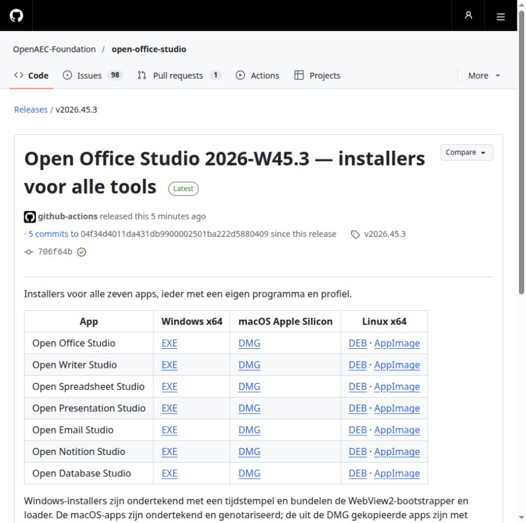

# Vrijgavecontrole Office 2026-W45.3

[De uitgave is openbaar op GitHub](https://github.com/OpenAEC-Foundation/open-office-studio/releases/tag/v2026.45.3)
sinds 6 november 2026, 14:43:36 UTC. Alle zeven apps hebben vier downloads:
Windows x64 EXE, macOS Apple Silicon DMG, Linux x64 DEB en AppImage. Dit zijn
28 installers, aangevuld met handtekeningen, checksums en pakketrapporten:
60 geüploade assets. GitHub toont daarnaast twee automatische bronarchieven.

## Bron en ondertekende bouw

De [normale ondertekende uitgaverun](https://github.com/OpenAEC-Foundation/open-office-studio/actions/runs/42227749859)
is geheel geslaagd. De bouwbron is `04f34d4011da431db9900002501ba222d5880409`.
PR #174 is samengevoegd als `706f64bcc01691c581d392904fad5635d2d0ae12`;
de geannoteerde tag wijst naar die mergecommit. Beide commits hebben exact
dezelfde Git-tree: `1f54fed7e87fde348f9835435378ac2910877dc6`.
De gepubliceerde installers zijn na deze controle niet herbouwd of vervangen.

- Windows: alle zeven installers, programma's en aangemaakte uninstallers
  zijn in de ondertekende uitgave gecontroleerd, inclusief Authenticode,
  tijdstempel, eigen icoonframes en gebundelde WebView2-voorzieningen.
- macOS: de zeven apps zijn ondertekend en genotariseerd. De gekopieerde apps
  slagen voor codesign, Gatekeeper en het notarisatieticket. Onafhankelijk
  uitpakken van alle zeven werkelijk gedownloade DMG's bevestigt versie,
  programma-id, ARM64-programma en bytegelijke app-/volume-iconen.
- Linux: de veertien gedownloade pakketten en de checksums hebben geldige
  OpenPGP-handtekeningen. Vastgezette vingerafdruk:
  `13F6D414ADEE4ED4CD09AC60601D86C93C504D29`.
- Alle 60 assets zijn werkelijk gedownload en gecontroleerd. De checksumlijst
  dekt 58 bestanden; vijftien OpenPGP-handtekeningen zijn gecontroleerd. Alle
  28 publieke installerlinks leveren HTTP 200 en de verwachte bestandsgrootte.

De [releasemetagegevens](uitgave-2026-45-3/release.json),
[hash- en handtekeningcontrole](uitgave-2026-45-3/controle.json),
[publieke links](uitgave-2026-45-3/publieke-downloads.json),
[macOS-inhoud](uitgave-2026-45-3/mac-inhoud.json),
[Windows-icoonframes](uitgave-2026-45-3/windows-iconen.json) en
[Linux-inhoud](uitgave-2026-45-3/linux-inhoud.json) leggen dit vast.

## Werkelijke starts van alle Linux-pakketten

Iedere normale DEB en AppImage is afzonderlijk gestart met eigen XDG,
D-Bus, Xvfb, Openbox en taakbalk. Zowel de normale programmastart als de
lichte weergave en het venster Over zijn gecontroleerd waar beschikbaar.
De hash van `/proc/<pid>/exe` is vergeleken met het programma uit precies
dat uitgepakte pakket. Ook de geladen scriptbytes, beeldmerkbytes en het
32×32 RGBA-venstericoon zijn met de betreffende bron vergeleken.

DEB- en AppImage-programma's hoeven onderling niet bytegelijk te zijn:
linuxdeploy past de bibliotheekzoekroute aan voor de AppImage. Daarom telt
de eigen pakkethash per formaat. Alle veertien proefapps en X-servers zijn
afgesloten. De screenshots hieronder zijn alle veertien visueel bekeken.

| App | DEB | AppImage |
| --- | --- | --- |
| Office | [Beeld](uitgave-2026-45-3/office-deb.png) | [Beeld](uitgave-2026-45-3/office-appimage.png) |
| Writer | [Beeld](uitgave-2026-45-3/writer-deb.png) | [Beeld](uitgave-2026-45-3/writer-appimage.png) |
| Spreadsheet | [Beeld](uitgave-2026-45-3/spreadsheet-deb.png) | [Beeld](uitgave-2026-45-3/spreadsheet-appimage.png) |
| Presentation | [Beeld](uitgave-2026-45-3/presentation-deb.png) | [Beeld](uitgave-2026-45-3/presentation-appimage.png) |
| Email | [Beeld](uitgave-2026-45-3/email-deb.png) | [Beeld](uitgave-2026-45-3/email-appimage.png) |
| Notition | [Beeld](uitgave-2026-45-3/notition-deb.png) | [Beeld](uitgave-2026-45-3/notition-appimage.png) |
| Database | [Beeld](uitgave-2026-45-3/database-deb.png) | [Beeld](uitgave-2026-45-3/database-appimage.png) |

De [veertien startcontroles](uitgave-2026-45-3/native.json) bevatten de eigen
programma-, script- en beeldhashes, venstericooncontrole en afsluitstatus.

## Afbakening en issue-administratie

De acht criteria van de zes beeldmerkissues #165–#170 zijn afgetekend; deze
issues zijn gesloten als voltooid. De controles betreffen pakketidentiteit,
ondertekening, downloaden en de werkelijke Linux-starts. Ze bewijzen geen
volledige inhoudelijke werking van alle kantoormodules. Brede issues zoals
PDF-export #37 en noten #51 blijven open voor hun resterende criteria.
Het parallelle native Rust-UI-traject #116 valt buiten deze uitgave.

