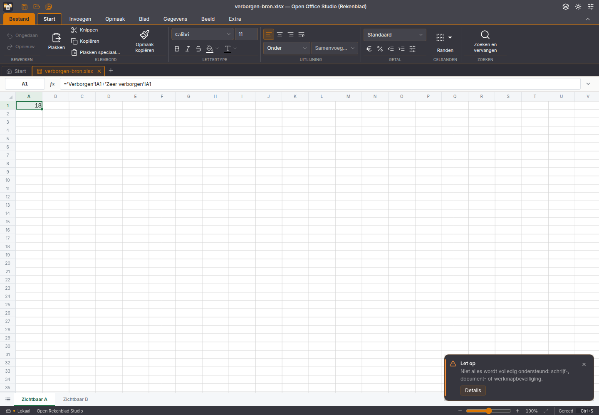
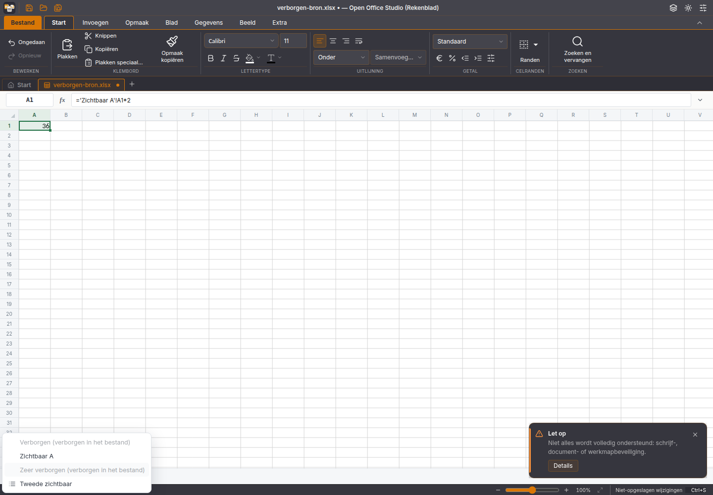
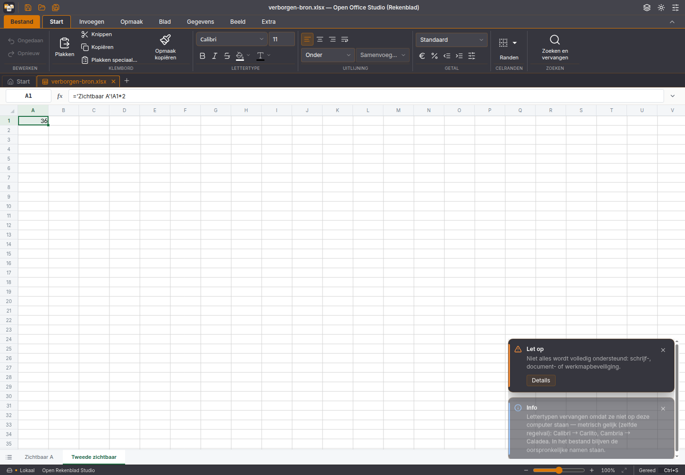

# Verborgen werkbladen: tabrij, navigatie en bestandsbehoud

Gerichte verbetering voor #3 en #61. De bestaande Tauri-/browsereditor toonde
`hidden` en `veryHidden`-bladen als gewone tabs. De rekenkern bewaarde de staten
al; de fout zat in de tabweergave en de indexkeuze van de bediening.

De editor leest nu uitsluitend de bladcatalogus via `readCells({ranges: []})`,
koppelt de zichtbaarheid aan stabiele blad-id's en rendert alleen zichtbare
tabs. Elke tab houdt zijn echte werkmapindex. Dat voorkomt dat dubbelklik,
rechtermuismenu of navigatie het verkeerde blad bewerkt wanneer verborgen
bladen tussen de zichtbare staan. Bij een verborgen actieve bronkeuze wordt het
eerste zichtbare blad gekozen. Structurele bewerkingen en Undo/Redo blijven
aan zichtbare bladen gekoppeld. Het laatste zichtbare blad verwijderen wordt
geweigerd, ook wanneer verborgen bladen overblijven.

Verborgen gegevens blijven in de werkmap en in de formuleberekening. De lijst
met alle bladen benoemt ze en weigert activering. De broncorrectie is begrensd
op de exact gecontroleerde SDK-versie; een gewijzigde bron stopt de bouw.

## Proef

De synthetische werkmap heeft vier bladen: verborgen invoer 7, zichtbaar A met
7+11=18, zeer verborgen invoer 11 en zichtbaar B met 18×2=36. De oorspronkelijke
actieve index wijst op het eerste verborgen blad. Een onbekend XML-onderdeel
is toegevoegd om bestandsbehoud los van de zichtbaarheid te controleren.

In de echte productiebundel, bediend via muis en toetsenbord:

1. Alleen A en B verschijnen als tabs, met echte indices 1 en 3; A toont 18.
2. B toont 36; dubbelklik hernoemt B en laat het tussenliggende verborgen blad
   ongemoeid.
3. De lijst Alle bladen toont beide verborgen bladen uitgeschakeld. Een klik
   op het verborgen item verandert de actieve zichtbare tab niet.
4. Opslaan levert een echte XLSX-download op. Een nieuw, leeg browserprofiel
   opent die download en toont twee zichtbare tabs en de formulewaarde 36.
5. Een onafhankelijke ZIP/XML-controle bevestigt de vier oorspronkelijke
   zichtbaarheidsstaten, verborgen waarden 7 en 11, formules en opgeslagen
   uitkomsten 18 en 36, de juiste nieuwe naam en het onbekende XML-onderdeel.

[Inhoudscontrole](verborgen-bladen-2026-11-06/inhoudcontrole.json),
[heropencontrole](verborgen-bladen-2026-11-06/heropencontrole.json),
[bron](verborgen-bladen-2026-11-06/bron.xlsx) en
[werkelijke download](verborgen-bladen-2026-11-06/hernoemd-opgeslagen.xlsx).

## Controles en begrenzing

35 gerichte controles zijn geslaagd, waaronder acht nieuwe proeven op de echte
rekenkern: zichtbare indices, behoud na bewerking, uitsluitend weergavekeuze,
ongeldige werkmap zonder zichtbaar blad, verplaatsen/Undo/Redo, verwijderen
van het laatste zichtbare blad, juiste keuze na verwijderen en de bronpoort.
De volledige toepassingssuite telt 1.925 geslaagde en 10 overgeslagen tests;
167 bestanden zijn groen op de oorspronkelijke basis. Na opname van de
nootopmaakcorrectie uit #177 zijn 1.946 tests geslaagd en twee bestaande
nootproeven tijdens gelijktijdig bouwen op hun tijdslimiet gestuit. Beide
bestanden zijn daarna ongewijzigd serieel herhaald: alle 19 proeven zijn
geslaagd, met de oorspronkelijke tijdslimiet. Samen zijn daarmee alle 1.948
actieve tests afgedekt; 10 blijven overgeslagen. Typecontrole en productiebouw
op deze nieuwe basis zijn eveneens geslaagd. De
[opruimcontrole](verborgen-bladen-2026-11-06/cleanup.json) bevestigt dat beide
eigen browsers en servers afgesloten zijn.

De bestaande schrijver bewaart `activeTab` en `tabSelected` bij een andere
bladkeuze. De proef controleert daarom bytebehoud van alle overige gegevens,
zonder te beweren dat de volledige ZIP bytegelijk is na een weergavewijziging.

Deze wijziging voegt nog geen Verbergen, Zichtbaar maken, tabkleuren, slepen,
groepsbewerking of kopiëren tussen werkmappen toe. De brede issues #3 en #61
blijven open. Dit betreft de gebruikte synchrone editorroute; andere SDK-
weergavevarianten worden hiermee niet als opgelost aangemerkt. Deze wijziging
is voorbereid na de bouw van W45.4 en zit niet in die installers.
