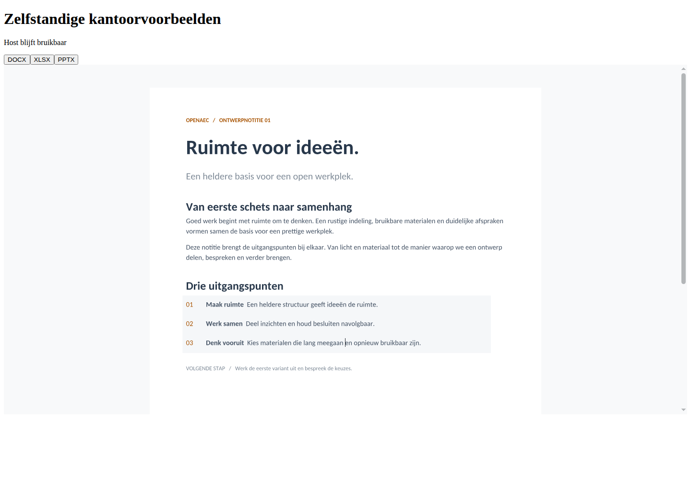
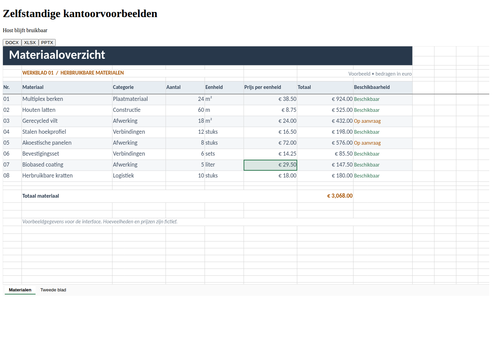
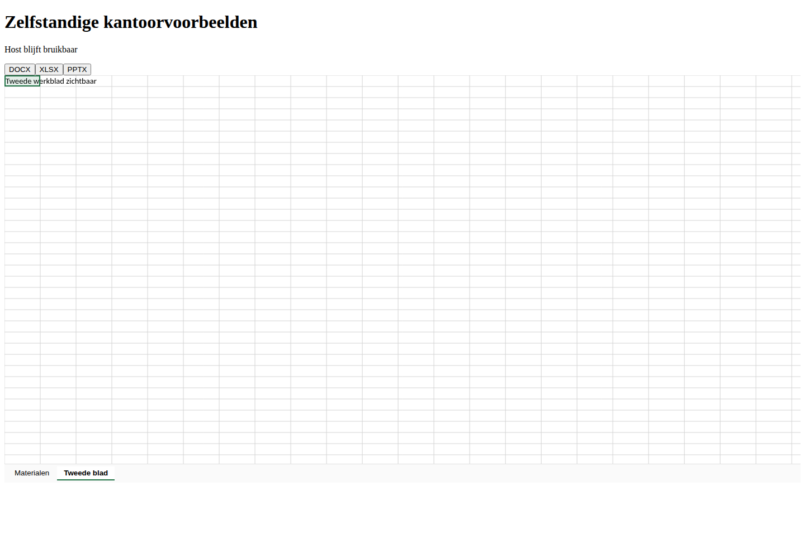
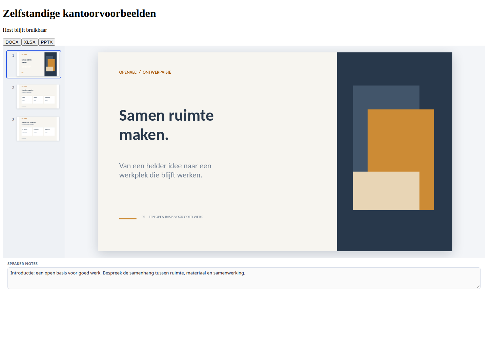
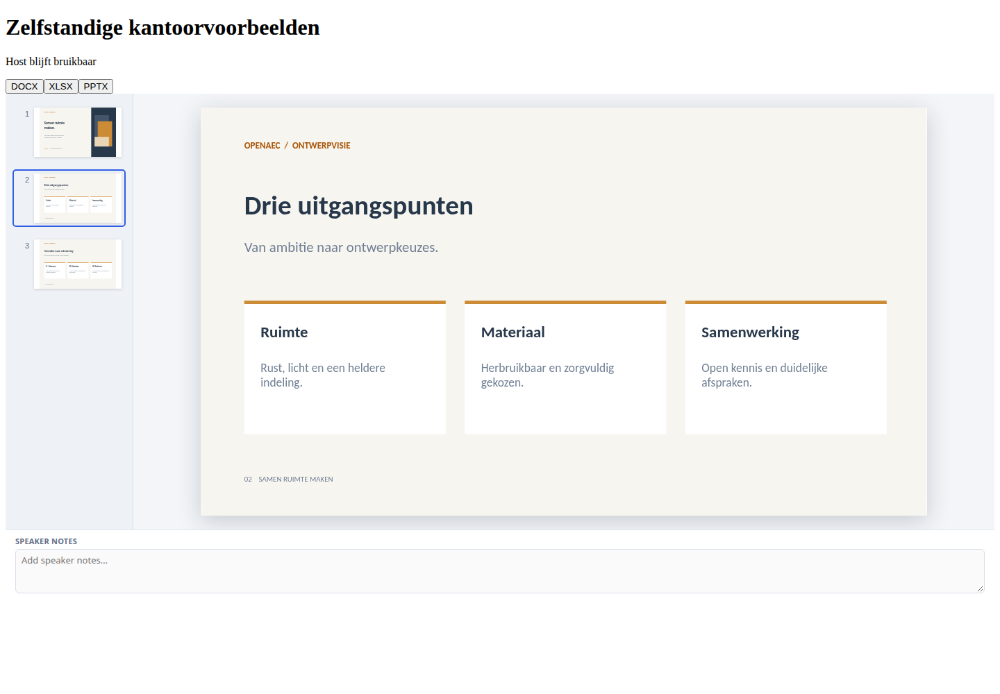

# Zelfstandig voorbeeldpakket — 6 november 2026

Onderdeel van [issue 108](https://github.com/OpenAEC-Foundation/open-office-studio/issues/108).
De [aansluiting voor Y-next](../herbruikbare-kantoorvoorbeelden.md) en het
[pakketcontract](../../packages/voorbeeld/README.md) beschrijven de scope.

## Uitvoering

`node scripts/bouw-voorbeeld.mjs` bouwt de externe React-component,
TypeScript-declaraties en de drie luie renderers met WASM, fonts en licenties.
`node scripts/test-voorbeeld.mjs` maakt daarna een echte npm-tarball, pakt die
uit en bouwt een losse Vite-host met uitsluitend de pakketdistributie en de
React-runtime van de host. Een eigen statische HTTP-server en een nieuw
Chromium-profiel voeren de proef uit. Er draait geen Office-server of
Tauri-proces en er wordt geen bestaand gebruikersprofiel gebruikt.

Het HTTP-verkeer wordt op de testserver gemeten, inclusief WASM-verzoeken uit
workers. De responsen zijn ongecomprimeerd; gzip-omvang in het rapport is
afzonderlijk berekend en is geen claim over de ingestelde productiehosting.
De browser voert echte muisklikken en toetsen in. De screenshots zijn visueel
gecontroleerd.

Ook de volledige UI-typecontrole slaagt. De appreeks met
`pnpm exec vitest run --maxWorkers=2` slaagt in 1.908 proeven over 165 bestanden.
Tien bestaande gevallen zijn overgeslagen: zeven hebben externe corpusdata
nodig en drie de hier niet gebouwde spelling-WASM. De acht pakketproeven zijn
allemaal uitgevoerd. De licentiekopie voor de gewone Office- en databasebouw
slaagt eveneens; de standaardroutes blijven beschikbaar.

De hostcomponent is 2.159 bytes gzip. De tarball is 58.988.484 bytes; uitgepakt
105.734.727 bytes, inclusief alle engine-, font- en licentiebestanden. In deze
lokale uitvoering zijn de eerste openingen als volgt gemeten:

| Voorbeeld | Naar `gereed` | HTTP-bytes inclusief bron | Berekend gzip |
| --- | ---: | ---: | ---: |
| DOCX | 2.479 ms | 33.883.028 | 11.876.678 |
| XLSX | 864 ms | 11.410.747 | 4.422.095 |
| PPTX | 685 ms | 8.672.137 | 3.443.266 |

Deze tijden horen bij deze machine, Chromium en de meegeleverde documenten.
Het zijn geen resultaten op een telefoon of een beperkt netwerk. De
afzonderlijke assetverzoeken, eerste status en pakket-SHA256 staan in het
JSON-rapport.

## Vastgelegde controles

- DOCX: inhoud en opmaak zichtbaar; read-only textarea; typen en verwijderen
  wijzigen de zichtbare documentinhoud niet.
- XLSX: gegevens zichtbaar; beide werkbladen bereikbaar; tweede blad toont
  een eigen celwaarde; typen en verwijderen veranderen de gegevens niet.
- PPTX: drie dia's zichtbaar; tweede dia aanklikbaar; inhoud blijft behouden
  bij typen/verwijderen en de presentatornotities zijn niet bewerkbaar.
- De bronbuffer blijft bytegelijk en wordt niet losgemaakt door overdracht.
- Een gesloten voorbeeld haalt geen renderer-, WASM- of fontbestanden op;
  ieder document laadt uitsluitend de eigen WASM-kernen.
- ODT en OLE geven `conversie`; gewone tekst geeft `onbekend`; beschadigde
  DOCX geeft `fout` met een zichtbare melding.
- Zowel opgegeven als werkelijke bestandsgrootte wordt begrensd.
- Een geweigerde bron, ontbrekend frame en omgeleid frame eindigen met `fout`.
- Een private bijlage wordt zonder testsessie geweigerd en met diezelfde
  sessie correct weergegeven; het pakket kent geen account of bijlage-URL.
- Een verwisselde bron wordt afgebroken. Een bron die afbreken negeert mag
  later de huidige spreadsheet niet vervangen. Verwijderen sluit het frame.
- Ook statische hosting onder `/y/` toont de spreadsheet. Botsende CSS uit de
  host verbergt geen canvas of renderer in het frame.
- Acht inhouds-/protocolproeven, waaronder een uitpakbom, controleren de
  herkenning voordat een engine wordt geladen.

De ruwe samenvatting van alle 17 browsergevallen staat in
[controle.json](voorbeeldpakket-2026-11-06/controle.json). Dit is een
gerichte proef met de bestaande referentiedocumenten en gecontroleerde
foutgevallen; geen claim dat ieder mogelijk kantoordocument dezelfde
weergave of laadtijd heeft. Y-next zelf is hiermee nog niet uitgerold.

## Beelden

