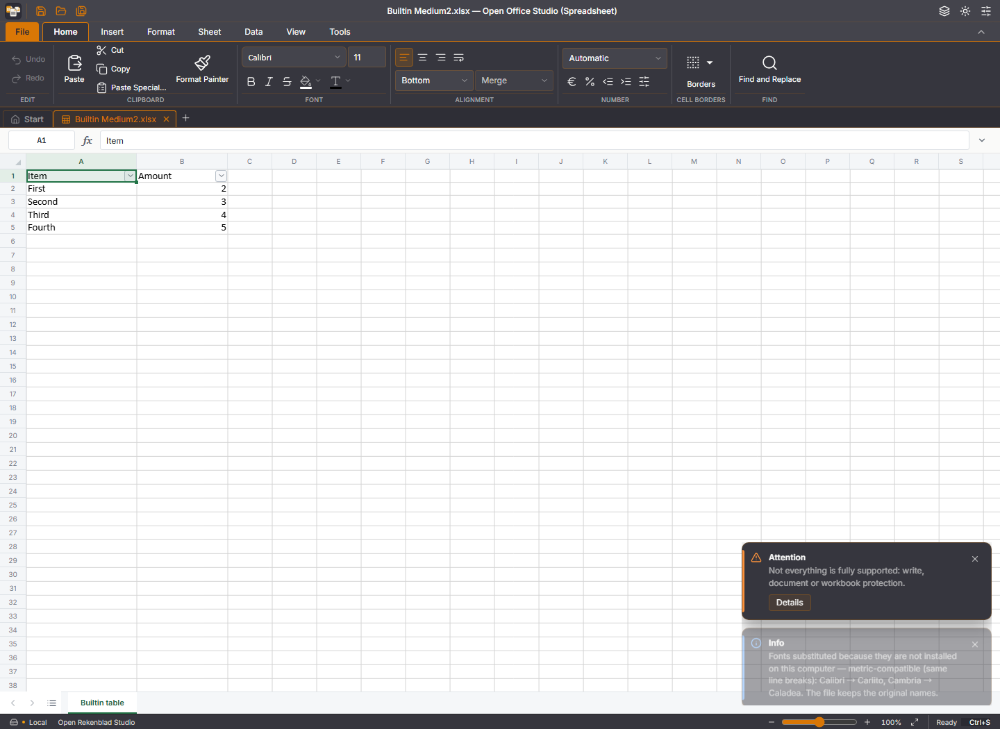
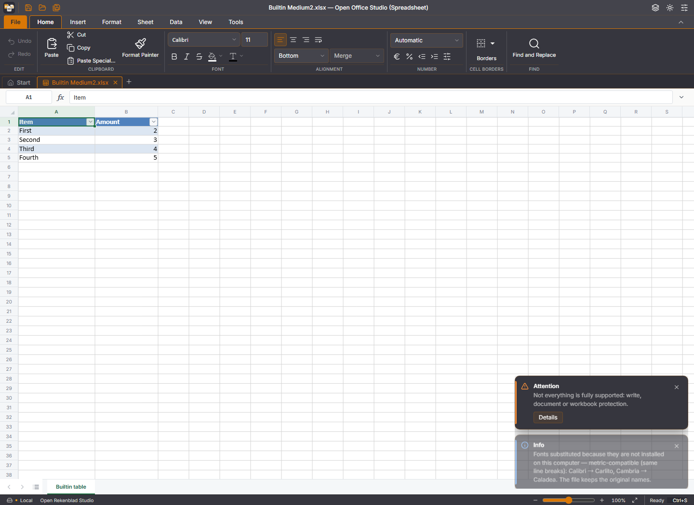

# Ingebouwde tabelstijlen — #322

## Afbakening en bron

De tabellaag kon alleen expliciete workbook-DXFs vinden. Een gewone ingebouwde stijlnaam zoals TableStyleMedium2 leverde daardoor geen font-/vulprojectie op. De nieuwe fallback resolveert uitsluitend de fontkleur, vetmarkering en effen vulkleur van de zestig standaard tabelstijlen. Een expliciete eigen definitie heeft voorrang; onbekende namen blijven behouden.

De feitelijke regio-/kleurverwijzingen zijn reproduceerbaar afgeleid uit de officiële ECMA-376 Part 1, vijfde editie december 2016, Annex D: `OfficeOpenXML-SpreadsheetMLStyles.zip/presetTableStyles.xml`, SHA256 `74c6cf73d551bb2bd33a51690d4922095260b6647b2a38fcbc0d6da6c6275d7e`. Herkomst en hash staan ook in `ingebouwdeTabelstijlFeiten.json`. `scripts/genereer-tabelstijl-feiten.py` controleert die bronhash en haalt alleen de ondersteunde feiten op; de bron wordt niet tijdens bouwen of testen gedownload. Regenereren gaf een identiek uitvoerbestand.

De Annex D-preset-ID's zijn één-gebaseerd, in tegenstelling tot custom workbook-DXFs. De generator behandelt dit expliciet. Twee afwijkende geneste labels in de gepinde standaardbijlage (Light14 met een spatie en Dark9 met toevoeging 2) worden gecontroleerd tegen hun canonieke buitenste presetnamen. De fallback schrijft geen stijldefinities naar het document: tijdelijke DXF-XML gaat naar de bestaande openbare thema-/tintlezer. Het gedeelde parserbestand, de native patches en de vendorbytes veranderen niet.

[Officiële ECMA-distributie](https://ecma-international.org/publications-and-standards/standards/ecma-376/). [Microsoft: ingebouwde stijlen volgen het workbook-thema](https://learn.microsoft.com/en-us/office/vba/api/excel.tablestyles).

## Onafhankelijke reproductie

Een synthetische openpyxl-werkmap bevat BuiltinSales in A1:B5, Medium2, kopregel en rijbanden. De default-cellen zijn expliciet als stijl 0 opgeslagen om lookup onafhankelijk van #324 te testen. Dezelfde fixture staat in `src/rekenblad/testdata/tabelstijl-medium2.xlsx`.

Op de schone productiebron `141740777df8c7035e564319c8525bfc1285d663` faalt de browserproef bij de eerste kopcontrole: zwart/niet-vet in plaats van wit/vet. Alle fills zijn wit, hoewel de tabel en filterpijlen aanwezig zijn. De vaste browserfixture heeft expliciete stijl0, zodat deze fout ook zonder het tweede probleem reproduceert.

| Baseline | Met font-/vulfallback |
| --- | --- |
|  |  |

De oorspronkelijke variant zonder s-attribuut raakt tevens de onafhankelijke bestaande guardfout #324. Die is afzonderlijk geregistreerd en toegewezen aan a1ac. Deze wijziging past de guard niet aan; gecombineerde verificatie gebeurt na diens zelfstandige oplevering.

## Controle

- Acht nieuwe echte-WASM-proeven: Medium2 op scherm/profiel/afdruk, Light/Dark, sparse facetovererving, het echte workbook-thema, optieflags, directe celopmaak, latere CF-projectie, eigen definities en onbekende namen. Versie, Undo en opgeslagen bytes blijven gelijk na renderen.
- 29 gerichte tests in vijf bestanden slagen: nieuwe gevallen, bestaande tabelprojectie, tabelbewerkingen, gedeelde DXF-lezer en renderregistratie. TypeScript en productiebuild slagen.
- Zes productie-browserstappen slagen, nul JavaScript-fouten. Controleert echte screenshotpixels van de kopkleur; gewone celinvoer B2=6; Ctrl+S via het browser-opslagvenster en download; daarna heropenen met waarde6. Tabel- en stylesheet-XML blijven tekstueel identiek. Themawissel, Light/Dark, rijbanden uit en onbekende stijlnaam zijn eveneens gecontroleerd.
- De verwachte rode baselineproef en groene browserrapportage staan naast de screenshots. Lokale uitvoer: `.local/builtin-tests-final.log`, `.local/builtin-tsc-v2.log`, `.local/builtin-build.log`, `.local/builtin-browser-baseline-red.log` en `.local/builtin-gui-final.log`.

Herhalen: de vijf gerichte Vitest-bestanden met `--configLoader runner --maxWorkers=1`; productiebuild naar `.local/dist-builtin`; vervolgens `node scripts/test-rekenblad-ingebouwde-tabelstijlen-gui.mjs`. De browserproef kan met OFFICE_TEST_DIST op een andere vastgelegde build worden gericht.

De PR-CI vergelijkt hetzelfde voorgestelde samenvoegpunt op Windows, Linux en macOS; de bijbehorende exacte SHA's, resultaten en eventuele wachtrij staan bij de PR. De gewone Chromium-route is lokaal getest. Native bediening van deze stijlgevallen op de drie desktopplatforms is nog niet uitgevoerd; pakketbouw bewijst die bediening niet.

Deze levering gaat over font-/vulfacetten. Borderplaatsing, #324 en bredere sluiting van #73 worden hiermee niet als afgehandeld verklaard. Geen wijziging aan main of de bevroren kandidaat.
