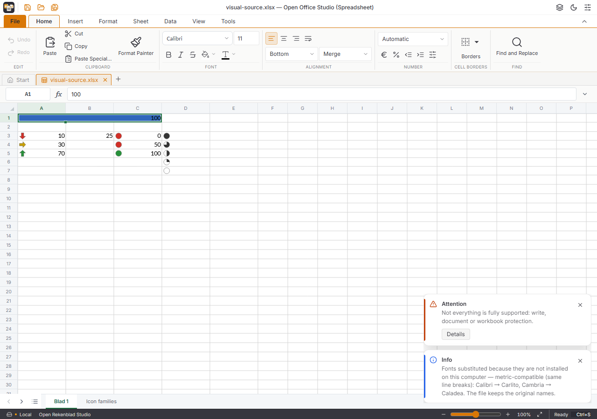
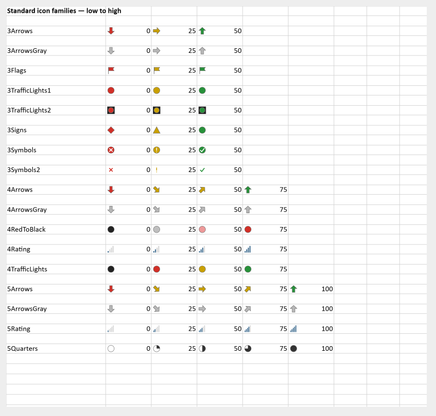

# Visuele voorwaardelijke opmaak — 10 november 2026

Vervolg op de DXF-weergave uit PR #277, bronbasis
`74bd7432b79b9fb4ee580f42a592beee0769e140`. Dit werk blijft buiten de reeds
bevroren Windows-integratiekandidaat en is bedoeld voor een volgende integratie.
De overkoepelende spreadsheetmelding #67 blijft open.

## Afgebakende fouten

| Issue | Zelfstandig gereproduceerde fout | Herstel |
| --- | --- | --- |
| #292 | Een formule als CFVO-grens levert geen visuele cellen op. | Lees de formulegrenzen eenmaal via de bestaande alleen-lezen formulevragen, in het oorspronkelijke werkblad. |
| #293 | Vier/vijf pictogramniveaus worden drie categorieën. | Behoud de oorspronkelijke set en iedere niveau-index, ook bij omkeren. |
| #294 | `gte="false"` behandelt gelijkheid anders dan `gte="0"`. | Verwerk beide XML-booleaanse schrijfwijzen, inclusief `true`/`1`. |
| #295 | De klassieke databalk negeert min/max en `minLength`/`maxLength`. | Interpoleer binnen de bronwaarden en lengtegrenzen; standaard 10/90. |
| #296 | Onder meer `4Rating` verschijnt als cirkels. | Teken de 17 standaardfamilies als herkenbare, lettertype-onafhankelijke vectoren. |
| #299 | Een databalk op A1:C1 gebruikt alleen de eerste kolom. | Gebruik de oorspronkelijke volledige samenvoegingsrechthoek. |

De meldingen onderscheiden onafhankelijk gereproduceerd ontwikkelgedrag van
gebruikersmeldingen en installerresultaten. Open en gesloten duplicaten zijn
voor registratie onderzocht; integratiechat 1 heeft de claims.

## Controle

- Windows x64, Node 24.22.1, pakket 2026.45.4, SDK 0.5.1.
- **63 gerichte tests in vier bestanden geslaagd**: 35 visuele regressies,
  10 regelbeheertests, 10 bestaande weergavetests en 8 DXF-tests.
  De vier afzonderlijke regressies van de gedeelde DXF-parser slagen eveneens.
- Dezelfde 63 tests slagen met de gedeelde achtpatch-rekenkern
  `52b25be9f50cb30215a547d5ee074eefc00c8a3726b19c0a3dc83870fda91cfa`
  via `OOS_REKENBLAD_WASM`; de geleverde vendorbestanden zijn niet gewijzigd.
- TypeScript en de normale geminificeerde Vite-productiebuild slagen. Alleen
  de bestaande waarschuwing over grote bundeldelen blijft zichtbaar.
- De echte productie-interface in Chromium doorloopt openen, wijzigen van B3,
  aanpassen van de formule-afhankelijke pictogrammen, Undo, Save as/download en
  heropenen in een nieuw browserprofiel. Geen JavaScript-paginafouten.
- Een onafhankelijke Python-stdlib-controle vergelijkt de bron en de werkelijke
  download: alle 21 groepen met bronregels, celwaarden/formules, samenvoegingen
  en een onbekend binair pakketdeel blijven behouden. Alle XML-delen parsen.
- Alle 17 families zijn in het echte canvas visueel bekeken. De tests gebruiken
  daarnaast de gewone, geprofileerde en print-displaylijsten. De mergeproef
  controleert al deze drie routes en behoud van versie/geschiedenis.

De onafhankelijke voorproef tegen de bronbasis mat een databalk van
58,01172 px op een samengevoegde cel van 192,03516 px. Het herstel tekent
186,03516 px: de volledige breedte minus de bestaande marge van 6 px.
De productieproef met bredere kolommen tekent 303,01172 px.





## Herhalen

```powershell
pnpm exec vitest run src/rekenblad/voorwaardelijke-visueel.test.ts src/rekenblad/voorwaardelijke-opmaak.test.ts src/rekenblad/voorwaardelijke-weergave.test.ts src/rekenblad/voorwaardelijke-dxf.test.ts --configLoader runner --maxWorkers 1
pnpm exec tsc --noEmit
pnpm exec vite build --configLoader runner --outDir .local/visual-build
node scripts/proef-voorwaardelijke-visueel.mjs
python scripts/controleer-voorwaardelijke-visueel.py
```

Gebruik een bestaande Python 3-installatie; op deze Windows-machine is de
Python-runtime van de geïsoleerde LibreOffice-testinstallatie gebruikt. Het
browser-script maakt zijn eigen synthetische werkboek en browserprofielen.
Het gebruikt geen geopende gebruikersdocumenten of geïnstalleerde desktopapp.
Er is geen volledige combinatestsuite herhaald; die hoort bij integratie.

## Implementatie en grenzen

De formulegrenzen gebruiken dezelfde stabiele werkbladidentiteit en klok als
de overige voorwaardelijke opmaak. Lokale namen winnen van globale namen.
Formulefouten, niet-numerieke resultaten en de bestaande limiet van 8192 UTF-8
bytes per formule produceren geen verzonnen nulwaarde. Tekenen verandert
geen invoer, geschiedenis of opgeslagen bronregels. Gewoon typen gebruikt de
bestaande metadatacache; er komt geen save-ronde per toetsaanslag bij.

De gedeelde kleurlezer verwerkt ook bronkleuren van visuele regels, inclusief
thema/tint en geïndexeerde kleuren; hiervoor is een werkelijke-kernregressie
toegevoegd. Nieuwe databalkpresets schrijven expliciet lengtes 0/100 zodat
hun bedoelde volledige bereik ook in andere lezers expliciet blijft.

De 17 families zijn eigen functionele vectorvormen, geen kopieën van Office-
afbeeldingen of pixelidentieke verlopen. Onbekende families blijven in het
bestand maar krijgen geen verzonnen verkeerslicht. Bronwaarden blijven
beschikbaar; `showValue=false/0` verbergt alleen de weergegeven celwaarde.
Pictogrammen reserveren ruimte in de normale numerieke tekstlay-out.

Uitgebreide x14-families, aangepaste pictogramsubstituties, negatieve databalk-
kleuren/assen, verlopen en een keuzedialoog voor alle families vallen buiten
deze fixes. Dit is geen claim dat alle voorwaardelijke opmaak of ODS-import
gereed is. Een native Windows-herproef van de volgende gecombineerde build
en het samenvoegen blijven bij de bestaande integratie- en Windows-chats.

Referenties: [klassieke DataBar-interpolatie](https://learn.microsoft.com/en-us/dotnet/api/documentformat.openxml.spreadsheet.databar?view=openxml-3.0.1),
[ST_IconSetType](https://learn.microsoft.com/en-us/openspecs/office_standards/ms-xlsx/bfdf00a5-4e49-4b00-8803-32250e1683c2),
[CFVO](https://learn.microsoft.com/en-us/dotnet/api/documentformat.openxml.spreadsheet.conditionalformatvalueobject?view=openxml-3.0.1).
