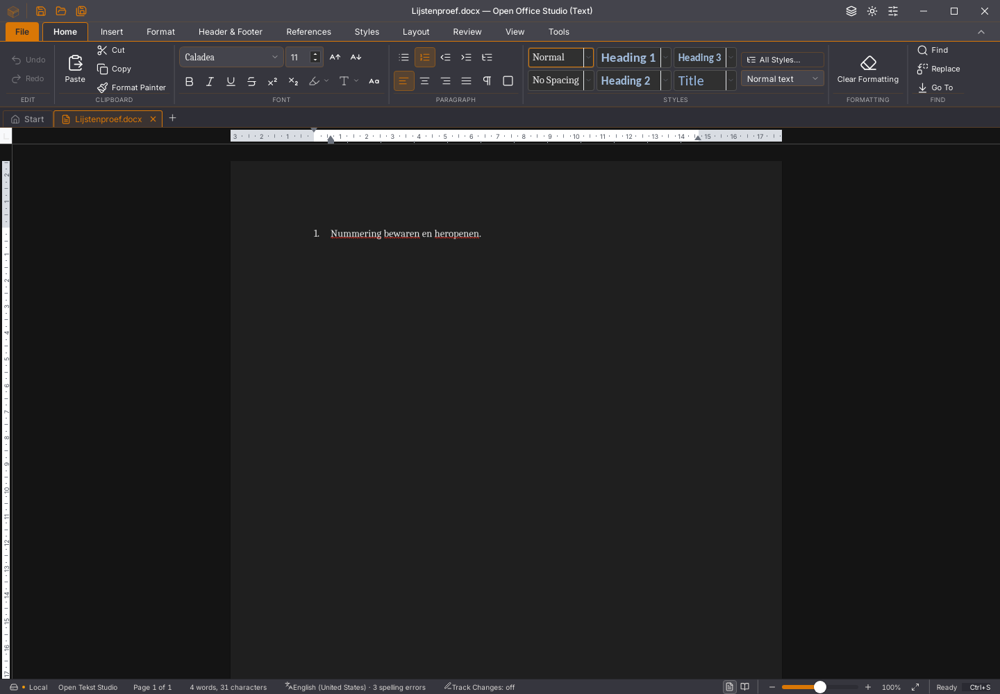

# Writer: lijstsoort behouden bij bewaren

Issue [#141](https://github.com/OpenAEC-Foundation/open-office-studio/issues/141)
is op de bewaarde Linux-binary 2026.45.19 minimaal gereproduceerd. In een eigen
nieuw document zijn alleen gewone tekst, Bullets, Numbering en bewaren gebruikt.
De lintstatus geeft nummering aan, terwijl het bewaarde DOCX verwijst naar
`numId=2 → abstractNumId=6 → numFmt=bullet`. Andere opmaak, tabellen en opmerkingen
zijn niet nodig voor deze reproductie.

## Correctie

De gepinde React-enginepatch bepaalt de lijstsoort uit de documentdefinitie en
haar niveau-override. Lijstnummers zijn lokale verwijzingen; nummer 1 of 2 heeft
geen vaste betekenis. De basisopdrachten kiezen een passende bestaande
instantie, behouden een passende huidige instantie en proberen aan te sluiten
op de voorafgaande lijst. De volledige selectie wordt vóór het schrijven
voorbereid. Verouderde markering-, lettertype- en tellergegevens worden bij het
wisselen vervangen. Een uitgeschakelde lijst bewaart expliciet `numId=0`, ook
wanneer de alineastijl een lijst voorschrijft. De lintstatus gebruikt de
opgeloste lijstsoort.

De bewerking blijft in de bestaande Rust/Wasm-documentgeschiedenis. Bestaande
lijstdefinities worden niet herschreven en het document wordt niet herladen.
Het kiezen van de definitie gebruikt voorlopig de compatibiliteitsuitlezing
van de sessie; dit is geen afgeronde migratie van deze planner naar de gedeelde
native Rust-kern en geen snelheidsacceptatie.

## Proeven

De zeven gerichte Vitest-proeven gebruiken de werkelijk geïnstalleerde patch
en de echte Rust/Wasm-sessie. Ze controleren:

- Bullets → Numbering → Bullets met onafhankelijke teruglezing van de werkelijk
  bewaarde OOXML-keten en een nieuwe sessie per heropening;
- afwijkende ids, waaronder een decimale lijst met id 1 en een bullet met id 88,
  met bytegelijk behoud van `word/numbering.xml` en een andere Romeinse lijst;
- een niveau-override, startwaarde 7, verborgen markering, expliciet niet vet,
  lettergrootte en kleur, met één undo/redo-stap over meerdere alinea’s;
- een geïmporteerde bullet met id 2 uitschakelen en `numId=0` bewaren;
- een stijlgebonden lijst blijvend onderdrukken na bewaren/heropenen;
- niets schrijven wanneer een geselecteerd niveau geen passende definitie heeft;
- lintstatus zonder vaste aannames over ids.

`scripts/test-writer-lijsten-native.py` gebruikt de echte muis en toetsen in een
eigen D-Bus-/Xvfb-/XDG-omgeving. Alleen het eigen programma wordt beëindigd.
Op 45.19 slaagt Bullets en faalt Numbering op de bewaarde definitie. Dezelfde
proef controleert op de kandidaat ook undo/redo, heropenen in een nieuw native
proces, terugwisselen en uitschakelen. Op de definitieve 45.20-binary slagen
alle zeven stappen. GUI- en consolefoutenlijsten zijn in beide processen leeg.
Dezelfde bewaarde binary heeft SHA256
`fb998cdb8d342197632e575310b00775e05f401d4c0b3201b58432958385bce1`.

De volledige frontendronde slaagt met 1.628 tests in 148 bestanden. Ook de 47
Python-tests, TypeScript, weekversiecontrole, module-opdrachten en native
Linux-productiebouw slagen. De [ruwe gegevens](2026-11-03-writer-basislijsten.json)
bevatten de bronpatch-hash, beide lijstproeven en de aparte
500-paginaregressiecontrole. De eerste 500-paginaronde bewaart acht geslaagde broncontroles, maar haar
omhullende sessie eindigt met afsluitcode 143. Een afzonderlijk vastgelegde
herhaling slaagt voor alle acht stappen en eindigt met code 0, met lege GUI-
en consolefoutenlijsten vóór en na heropenen. Beide rapporten blijven bewaard.
Dit is geen vergelijkende optimalisatieproef.

## Resterende grenzen

Het live aanmaken van ontbrekende lijstdefinities, uitgebreide stijlkoppelingen,
alle aangepaste symboolletters, lijstvervolg met Enter en de volledige
lijstdialoog-/geschiedenisroute blijven open. Bij een ontbrekende passende
bestaande definitie schrijft de basisopdracht niets en verwijst zij naar de
lijstkeuze; dit vervangt de vereiste volledige functionaliteit niet.

De native beelden tonen nog een verschil in inspringing tussen de live
genummerde alinea en dezelfde alinea na heropenen. De lijstsoort en tekst blijven
behouden; de volledige visuele en inspringingsgelijkheid is niet bewezen.

Windows-hertest, de oorspronkelijke gebruikersdocumenten en de volledige
platform-/corpusmatrix zijn niet door deze Linux-proef bewezen. #141, #122,
#123 en #46 blijven open. Invoer-/selectievertraging en groot plakken zijn
hiermee niet opgelost. Geen migratie-acceptatievlag wordt afgevinkt.
