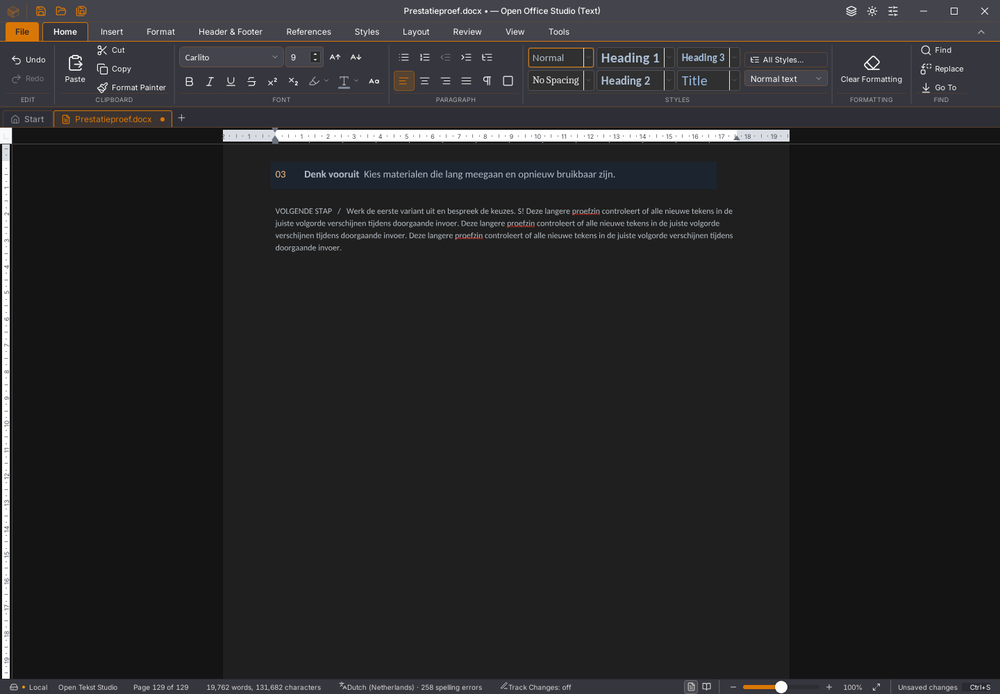

# Writer: encodercache in de echte desktop afgewezen

De afzonderlijke kandidaat **45.50 / alpha58 wordt niet in de app opgenomen**.
De eerdere synthetische kernwinst van 16% levert in de fysieke Linux-invoerproef
juist gemiddeld **6,25% meer wachttijd** op. De bruikbare app blijft 45.49 /
alpha57. Geen release, nieuwe download, gesloten issue of migratievlag.

De kandidaat komt uit een afzonderlijk archief van `c9118b61`. De vier kernbronnen
zijn gecontroleerd tegen de getoetste replicacache, uitsluitend zonder negentien
meetregels en de extra proefmodule. Alle 2.442 gecontroleerde applicatiebronnen
zijn bytegelijk aan die revisie of de bedoelde cache-/versiepatch. De kopie heeft
een eigen beschrijfbare Cargo-target; referentiebinaries, oorspronkelijke targets,
gebruikersprofielen en documenten blijven behouden.

De bouwpoorten slagen: **1.850 frontendtests in 179 bestanden**, tien expliciet
overgeslagen tests, TypeScript, kantoorengines, tien opdrachten, weekcontrole,
**28 ongefilterde native kernregressies**, desktopbouw en **112 Python-tests**.
De tien overgeslagen tests zijn geen geslaagde functiedekking. De definitieve
Python-ronde na hernoemen van de GUI-helper slaagt eveneens.

Vier fysieke ronden gebruiken echte toetsen, één eigen vaste bron en eenzelfde
tekst. Geen ScriptProfiler tijdens deze metingen. Exacte controle omvat alle
1.537 verhalen en 3.329 alinea-/celteksten. Alle foutlijsten blijven leeg.
De documentuitsnede van 820×740 pixels heeft in alle ronden nul afwijkende RGB-
pixels, met uitsluitend de bekende cursorzone uitgesloten. Geen volledige
UI-pixelpariteit. Het kandidaatbeeld is ook visueel bekeken.

| Ronde | Volledig getekende tekst | Native piek-RSS |
|---|---:|---:|
| Referentie A | 23.724 ms | 353.856 KiB |
| Cache A | 25.645 ms | 360.200 KiB |
| Cache B | 25.127 ms | 366.348 KiB |
| Referentie B | 24.061 ms | 356.960 KiB |

Gemiddeld 23.892,5 versus 25.386,0 ms: **1,062509×**. De gemiddelde gesamplede
native geheugentop is circa 7,68 MiB hoger. RSS is procesresident geheugen;
metingen van de hele eigen procesboom omvatten ook de testomgeving en tellen
gedeelde pagina's dubbel. Geen PSS, harde cache-RAM-grens of lekbewijs. Het
geheugengewicht van 32 MiB blijft een boekhoudgrens, geen proces-RSS-limiet.

De bestaande echte toetsenproef slaagt ook: typen met vertraagde antwoorden,
Undo/Redo, Shift-selectie en vervangen terwijl een antwoord vaststaat, bewaren
vóór dat antwoord met onafhankelijk teruggelezen DOCX, sluiten zonder opslaan,
een nieuw document openen en het oude antwoord later vrijgeven. Dit is geen
acceptatie van alle oude stabiliteitsproblemen.

De aanvullende optionele fasemeting slaagt inhoudelijk op beide binaries.
Zij meet 69 versus 73 native groepen, 7.840 versus 8.508 ms beperkte Rust-
binnentijd, en 10.577 versus 11.929 ms binnen de eigen koppeling. De volledige
geïnstrumenteerde rasterduur is 27.027 versus 46.419 ms. Dit zijn twee aparte
geïnstrumenteerde ronden; zij vervangen de vier passieve ronden niet en bewijzen
geen volledige oorzaak. De snellere synthetische voorbereiding is hier niet
teruggevonden. Meer groepen kunnen extra werk geven, maar bronhergebruik en
SDK-publicatie moeten eerst daadwerkelijk worden gecontroleerd.

Vier opzetafkeuringen blijven bewaard:

- Eén bestaande PDF-lettertypetest overschrijdt de ongewijzigde limiet van vijf
  seconden. Gerichte herhaling en beide volledige frontendherhalingen slagen;
  geen oorzaak of productfix bewezen, geen tijdgrens/assertie versoepeld.
- De eerste proeflocatie valt onder de bovenliggende native workspace. Alleen
  de eigen map is verplaatst; het oorspronkelijke workspace-manifest blijft gelijk.
- De Rust-testaanroep wijst daarna naar de desktopworkspace. Zij is naar de
  daadwerkelijke native workspace gecorrigeerd. De vijf geslaagde frontendpoorten
  worden na broncontrole met oorspronkelijke logs/herkomst hergebruikt.
- Een eigen `gui.py` overschaduwt het inspectiepakket. De import faalt vóór de
  appstart; hernoemen naar `fysiek.py` herstelt dit, zonder appwijziging.

[Bronnen, binarieshashes, bouw-/GUI-/RSS-/fasedata en afkeuringen](2026-11-06-writer-desktopcache.json)
bevatten 105 gecontroleerde bewijsbestanden. Kandidaat-ELF
`49da87a4…` is ook afzonderlijk onder `afgekeurd` behouden. Niets gepubliceerd.
De scripts staan in `native/onderzoek/writer-desktopcache` en zijn uitsluitend
voor deze bronvaste Linux-onderzoeksopzet.

De uitgebreide 500-pagina-/herstel-/twintig-GC-/font-/rijke-plak-/lijstproeven en
meerdere grote documenten zijn niet uitgevoerd op deze reeds voor snelheid
afgewezen kandidaat. De oorspronkelijke workertraps en lijstbewaarfout blijven
open. Geen Windows/macOS-/editieacceptatie of volledige Rust-interface.

Volgende concrete stap: tijdens echte GUI-invoer begrensde metadata vergelijken
van de vorige voorstelbytes/basis/client met het volgende native verzoek,
zonder documentinhoud te loggen. Zo vaststellen of het sterke bronhergebruik uit
de synthetische proef daadwerkelijk optreedt. Daarna SDK-publicatie/tekenen en
pakketgroepering aanpakken; deze cache niet blind promoveren.
