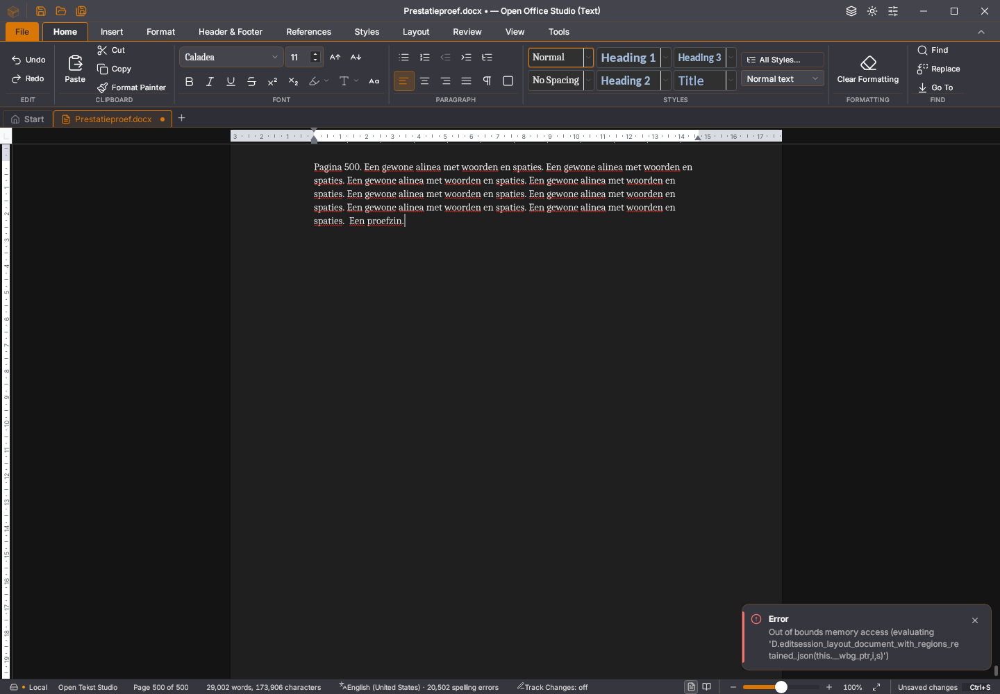

# Writer: geheugen- en opstartafkeuringen onderzoeken

Er zijn twee verschillende Linux-afkeuringen. Geen van beide is met deze
testinfrastructuur als opgelost aangemerkt.

- De [45.20-zeveneditieproef](https://github.com/OpenAEC-Foundation/open-office-studio/actions/runs/41658755587)
  meldt een Wasm-panic in `dlmalloc-0.2.14`, bij `validate_size`:
  `psize >= size + min_overhead`. De stack bereikt de behouden paginalayout.
  De afgekeurde raw binary heeft SHA256
  `19a96ed27a705534f3d64cc7debd0ad32fe5e65cb7c63b4d5bb70b59900b908b`.
  De oorzaak is niet vastgesteld; dit is geen bewezen gewoon geheugentekort.
- De [45.21-desktopproef](https://github.com/OpenAEC-Foundation/open-office-studio/actions/runs/41668303628)
  behoudt alle 500 bronalinea’s na typen, selectie, undo/redo en onafhankelijk
  teruggelezen bewaring. Ook zoom en 500 → 501 → 500 pagina’s slagen. Na
  stoppen en opnieuw starten blijft de editor echter ongereed. Het foutbeeld
  toont een herstelvenster en `getDocument cannot read the document
  synchronously in a viewer session; use readParagraphs or
  exportStructuredWithPages`. De afgekeurde binary heeft SHA256
  `7e2d3eb8d87025e9a8fd250c3874fe1b80f50486add8cec8a093bcaf205b1a37`.

De eerste melding bewijst niet dat de tweede dezelfde oorzaak heeft. De
herstart in deze proef beëindigt alleen het eigen proces; het herstelvenster
wordt niet automatisch weggeklikt. De fout vóór dat venster en de
opstartvolgorde moeten nog nader onderzocht worden.

Inmiddels is ook de [45.21-zeveneditieproef](https://github.com/OpenAEC-Foundation/open-office-studio/actions/runs/41668389174)
op Linux afgekeurd op dezelfde allocatorassertie als 45.20. Deze 45.21-route
gebruikt exact dezelfde binary, testscriptbytes en gegenereerde beginbron als
de aparte 45.21-desktoproute die bij heropenen faalt. Windows en macOS zijn in
de zeveneditieproef geslaagd; publiceren is overgeslagen. De twee negatieve
Linux-uitkomsten blijven staan. Er is geen bewezen reparatie.

## Exacte foutcontext

De oorspronkelijke workflows bewaarden het rapport en beelden, maar bij een
afkeuring niet de raw binary. De opgehaalde gewone 45.20-desktopbinary heeft
SHA256 `9fcfc84099deb9d7039229ac9850bdbbb93ef4d2ab8be64eda621f511f6a9916`;
de devbinary heeft `52e0336c2a48679addc3a1709fe1ff2e3a441c4f47131827d14c5f55f71ebb5c`.
Deze zijn geen exacte reproductie van de afgekeurde raw binary. Verpakken kan
de executable wijzigen; herkomst uit dezelfde commit bewijst geen bytegelijkheid.

`scripts/bewaar-writer-foutcontext.py` bewaart voortaan bij afkeuring:

- De raw binary, uitsluitend als haar checksum gelijk is aan het afgekeurde
  rapport. Een andere binary wordt geweigerd vóór de uitvoermap wordt gemaakt.
- Het negatieve rapport, de eigen gegenereerde proefbron, vaste log en
  foutafbeelding, met checksums. De DOCX is de toestand na de proef, niet
  noodzakelijk de oorspronkelijke bron.
- Het testscript als zijn checksum overeenkomt, inspectiehulpmiddelen,
  runtimepakketten en bibliotheekkoppelingen. Een afwijkend script wordt
  expliciet als niet beschikbaar gemeld.
- Hoogstens één begeleidende AppImage, duidelijk gescheiden van het bewijs
  voor de exacte raw binary. Omgevingsvariabelen worden alleen via een vaste
  lijst gelezen; er komt geen volledige omgevingsdump in het pakket.

Zeven nieuwe Python-proeven controleren onder meer een verkeerde binary,
checksums binnen het archief, ontbrekende/groene rapporten, een afwijkend
testscript, meerdere AppImages en de begrenzing van meegenomen proefbestanden.
Alle 54 Python-proeven slagen. Een bestaande echte negatieve lokale
registerproef is met de bijbehorende 45.20-binary verzameld; de andere
CI-checksum wordt terecht geweigerd. Dit bewijst de verzamelroute, geen herstel
van de oorspronkelijke applicatiefout.

## Herhaalbare geheugenbelasting

De gewone native 500-paginaproef krijgt optionele extra geheugenrondes.
Iedere ronde gebruikt echte selectie, Backspace, undo, redo, undo en Right.
De laatste Right-keyup is de verwerkingsgrens, zodat de eerste undo niet als
einde van de hele toetsreeks kan gelden. Vervolgens worden alle bronalinea’s
en de GUI-/consolefouten gecontroleerd. Met `--geheugen-gc` moet WebKit de
expliciete garbagecollection-opdracht accepteren; een fout wordt niet overgeslagen.
De gewone bewaar-/heropen- en paginaregistercontroles blijven staan.

De lokale 45.21-binary doorstaat twintig rondes met garbagecollection en
daarna alle acht bronstappen, inclusief onafhankelijk bewaren en een nieuw
proces. Beide foutenlijsten zijn leeg. De invoer-/spellingmeting vraagt
4.677 ms: de ernstige snelheidsklacht is hiermee niet opgelost. De
[ruwe gegevens](2026-11-03-writer-geheugenonderzoek.json) bewaren deze groene
proef en beide oorspronkelijke negatieve CI-rapporten naast elkaar.

Daarnaast doorstaat de volledig uitgepakte 45.21-dev-AppImage via haar eigen
AppRun twintig extra rondes met garbagecollection en alle acht gewone
bron-/bewaar-/heropenstappen. De werkelijke vensterbinary komt op checksum
overeen met de devpakketproef (`aa382d182e95649f99eb917d6cbce7f9243f967624c134a0f7f8f7d318f81fad`).
De geladen bibliotheekpaden verwijzen naar de uitgepakte AppImage. Een
afzonderlijke versieopvraag van die eigen bibliotheek bevestigt WebKit
**2.50.4**, in plaats van alleen de hostversie te veronderstellen. De private
proefadapter wijzigt alleen repository-/importpaden, het dev-profiel en de
vastlegging van het werkelijke vensterproces; alle publieke controles blijven
staan. Deze groene lokale runtimeproef reproduceert de CI-panic nog niet en
wordt niet als herstel gepresenteerd. FUSE en andere distributies zijn hiermee
niet getest.

De aanvullende workflow `writer-geheugen.yml` bouwt op dezelfde Ubuntu 22.04
als de afgekeurde Linux-route, draait eerst de gewone proef en daarna de
extra belasting. Zij bewaart bij de eerste afkeuring de exacte binary.
De bestaande suite-/editiecontroles blijven verplicht. Deze onderzoeksroute
publiceert geen release en vervangt geen platform- of migratieacceptatie.
Een opstarttimeout bewaart voortaan ook de zichtbare fouttekst en console
terwijl de inspectieverbinding nog bestaat; de oorspronkelijke afkeuring
blijft een afkeuring.

## Gerichte CI-afkeuring en lokale reproductie

De [eerste onderzoeksronde](https://github.com/OpenAEC-Foundation/open-office-studio/actions/runs/41675196274)
faalt bij de gewone heropencontrole, vóór de extra belasting. Het
[foutpakket](https://github.com/OpenAEC-Foundation/open-office-studio/actions/runs/41675196274/artifacts/13251436441)
is opgehaald; alle binnenste en buitenste controlesommen kloppen. De raw binary
is exact de eerder genoemde 45.21-binary (`7e2d3e…`). Het pakket bewaart ook
de juiste testscriptbytes, de eigen DOCX en WebKit/JSC 2.50.4 op Ubuntu 22.04.
De nieuwe opstartgegevens tonen de componentstack terwijl het herstelvenster
openstaat. De extra geheugenrondes zijn terecht niet uitgevoerd na deze afkeuring.

De exacte CI-binary is vervolgens in een eigen runtimekopie lokaal gestart
met de meegeleverde WebKit 2.50.4. De echte vensterproceshash is gecontroleerd.
De gewone lokale heropenproef slaagt aanvankelijk. Een afzonderlijke gerichte
proef wacht na de pagina-/undo-controle 32 seconden op de eigen periodieke
herstelkopie en start daarna alleen het eigen proces opnieuw. Die proef faalt
met hetzelfde herstelvenster, dezelfde viewersessiefout en dezelfde
`U7e`-componentstack als CI. Er zijn geen gebruikersdocumenten of bestaande
appvensters bij betrokken.

Via het door deze exacte binary geleverde JavaScript-asset is `U7e` gekoppeld
aan `StijlenBeheer`; zijn hook `k8e` is `useDocumentStaat`. Die observer roept
`getDocument` ook aan als de bewerksessie ontbreekt. Het herstelvenster maakt
de editor tijdelijk alleen-lezen. De aansluiting van deze observer en de
andere statuslezingen moet worden gerepareerd en gericht hertest. Een legitiem
herstelvenster blokkeert op zichzelf invoer; een renderfout erachter is wel een
applicatiefout. Het venster wegklikken en vervolgens een groene proef melden
zou daarvoor onvoldoende herstelbewijs zijn. De allocatorpanic blijft een
afzonderlijk onopgelost onderzoekspunt.

## 45.23: afkeuring tijdens de extra geheugenbelasting

De [45.23-onderzoeksronde](https://github.com/OpenAEC-Foundation/open-office-studio/actions/runs/41690550985)
slaagt voor de herstelstart: elf bronstappen, een echte periodieke kopie en
beide herstelkeuzes. De daaropvolgende extra selectie-/Backspace-/undo-/redo-/
GC-proef faalt al na de eerste ronde. Alle 500 alinea’s zijn nog bronexact,
maar de GUI en console melden een Wasm-geheugentoegang buiten bereik bij
`editsession_layout_document_with_regions_retained_json`. Dat is terecht een
afkeuring: correcte broninhoud bewijst geen geldige nieuwe weergave.

De verbeterde foutverzameling heeft de exacte raw binary, het juiste testscript,
eigen DOCX, foutafbeelding en runtimegegevens bewaard. Het
[foutpakket](https://github.com/OpenAEC-Foundation/open-office-studio/actions/runs/41690550985/artifacts/13257283924)
is opgehaald; de archiefchecksum en alle interne checksums zijn gecontroleerd.
De ELF-checksum is
`a06234925cfa4fd6f8bbc1d3619c8fbd3cfb4b4659d8465435f6b5faa318db96`.
De runner gebruikt WebKitGTK/JSC `2.50.4-0ubuntu0.22.04.1`.

Dezelfde ELF en bytegelijke publieke proef zijn lokaal met de afzonderlijke
WebKit 2.50.4 gestart. Twintig extra geheugen-/GC-rondes, alle acht gewone
bronstappen, bewaren en heropenen slagen. De werkelijk gestarte ELF en geladen
bibliotheekpaden zijn gecontroleerd. Andere hostbibliotheken, OS en timing zijn
daarmee niet gelijk aan CI. Deze groene hertest reproduceert de afkeuring niet
en bewijst geen herstel. Een eerste eigen launcheropzet miste zijn vereiste
desktopbestand en stopte vóór de app; die opzetfout telt niet als productproef.

De geslaagde brede 45.23-desktopbouw en de gecontroleerde devdownload blijven
bewijs binnen hun eigen omvang. De devbinary verschilt van de afgekeurde
gewone binary. De relatie tussen deze nieuwe geheugenfout, de oudere
allocatorpanic en de afzonderlijke SkSL-rendererafkeuring is niet vastgesteld.
Geen van deze problemen is gesloten. De [gegevens](2026-11-03-writer-geheugen-45.23.json)
bewaren de negatieve en positieve uitkomsten naast elkaar.
