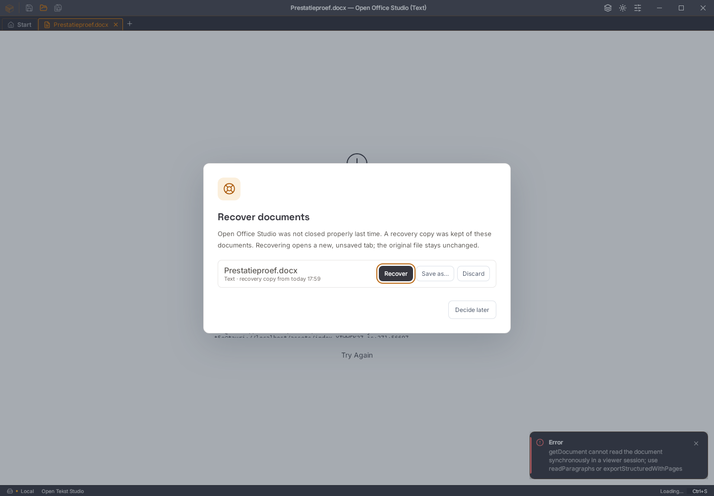
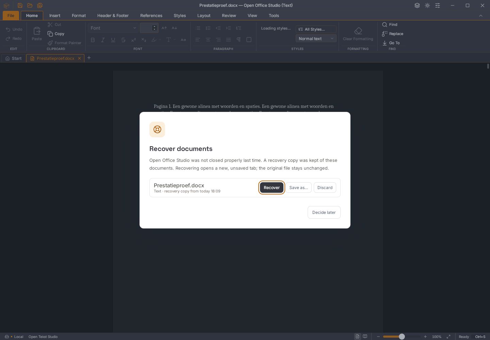
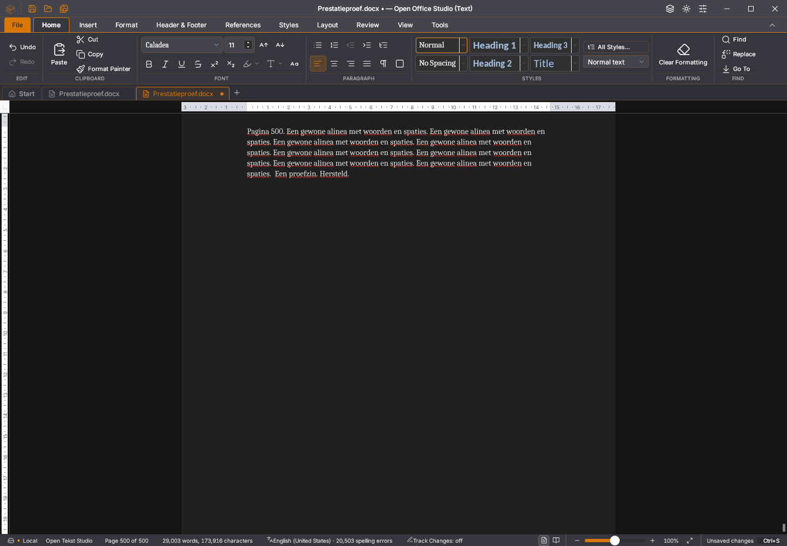

# Writer 45.22: starten met een herstelkopie

45.21 kan bij het openen van het herstelvenster een renderfout krijgen:
`getDocument cannot read the document synchronously in a viewer session`.
De exacte afgekeurde CI-binary is lokaal gereproduceerd. De automatische
herstelkopie blijft bestaan, maar het stijlenpaneel laat de editor achter
het venster vastlopen. Het [vooronderzoek](writer-geheugenonderzoek.md) bewaart
de oorspronkelijke CI-afkeuringen en de koppeling met `useDocumentStaat`.

De stijlenobserver leest de synchrone documentkopie nu alleen wanneer de
bewerkbare sessie beschikbaar is. Het herstelvenster mag de editor tijdelijk
in viewersessie houden. Een uitgestelde stijllezing blijft gebonden aan haar
oorspronkelijke sessie; na een korte onderbreking wordt de stijlenbron opnieuw
opgehaald. De statuskoppeling vraagt niet langer een documentkopie op om te
testen of de editor klaar is. De documentbewerking en styling zijn niet gewijzigd.

Vijf gerichte unitproeven controleren wachten op de sessie, normale
stijlaanpassing zonder opnieuw lezen per letter, een laat timerantwoord,
documentwisseling en een herstelvenster tussen twee koppelrondes.

## Echte herstelstartproef

De native 500-paginaproef heeft een expliciete optie `--herstelstart`. Zij
wacht op een echte periodieke herstelkopie van de app in haar eigen tijdelijke
profiel. De kopie wordt onafhankelijk als DOCX gelezen en moet exact de
verwachte bron bevatten. Alleen de eigen testprocessen worden gestopt.

Bij de volgende start controleert de proef eerst de GUI-/consolefouten, nog
vóór een knop wordt aangeklikt. De oude 45.21-binary wordt precies daar
terecht afgekeurd. Het venster wegklikken verbergt de fout dus niet.

De 45.22-proef doorloopt drie processen en controleert:

- **Later beslissen:** de herstelkopie blijft bestaan, de statusbalk toont
  weer de juiste 500 pagina’s en tekentelling; verder typen en werkelijk
  opslaan met Ctrl+S behouden alle alinea’s.
- **Herstellen:** de oudere kopie wordt in een afzonderlijk document geopend,
  terwijl de inmiddels verder bewerkte bron haar inhoud houdt. Verder typen
  en onafhankelijk teruggelezen export van de herstelde kopie werken.
- Alle oorspronkelijke bron-, selectie-/Backspace-, undo-/redo-, bewaar-,
  paginagrens- en registercontroles blijven actief.

Beide volledige native proeven slagen: met de meegeleverde WebKit **2.50.4**
en met host-WebKit **2.52.6**, op dezelfde Linux-pc. De GUI- en
consolefoutenlijsten zijn leeg. De exacte kandidaatbinary heeft SHA256
`fbf4b9d0b49a46cd7fd00ed8febd4e7c8a9675cff0e7662fff65b4a67d6dc8d5`.
Een aanvullende strenge WebKit-2.50.4-hertest controleert ook de volledige
bronchecksums vóór en na Herstellen en export. De oudere aangeboden kopie
blijft na vervolgbewaring bytegelijk; de oorspronkelijke verder bewerkte bron
blijft na Herstellen en export bytegelijk. Deze hertest slaagt eveneens.
De [gegevens](2026-11-03-writer-herstelstart.json) bevatten de negatieve en
positieve rapporten, proces-/scriptchecksums en de pixelvergelijkingen.

## Bedienings- en visuele grenzen

Start en Kop- en voettekst blijven in twee lintuitsneden van **1440 × 122**
pixels pixelgelijk: beide vergelijkingen hebben nul afwijkende pixels.
Dit betreft deze linten bij dezelfde bron en runtime, geen volledige visuele
suite- of Rust-migratieacceptatie.

1.633 frontendtests in 149 bestanden, 54 Python-tests, TypeScript, weekversie,
de bestandsopdrachten voor alle drie documentmodules en de native
Linux-productiebouw slagen. De zeven native lijststappen slagen opnieuw op de
bevroren kandidaatbinary.

Acht rijke plakrondes behouden 129 pagina’s, 256 tabellen, 1.793
bodyalinea’s en 1.536 cellen. Bewaren na ronde één, verder bewerken,
onafhankelijk teruggelezen DOCX, sluitkeuze Niet opslaan en een nieuw
document slagen. De GUI- en consolefoutenlijsten blijven leeg. De laatste
plakactie duurt nog 64.307 ms; groot plakken blijft te traag.

De aparte allocatorpanic in de Wasm-layout is hiermee **niet bewezen opgelost**.
Ook de snelheid is nog onvoldoende: de twee herstelproeven meten 7.941 ms
(WebKit 2.50.4) en 4.390 ms (host-WebKit 2.52.6) voor invoer en spelling van
veertien tekens. Deze stap is geen versnelling of vergelijking tussen platforms.
Windows-/macOS-GUI, alle formaten, overige herstelkeuzes en de volledige
suite-/editieacceptatie blijven afzonderlijke vereisten. Er is geen issue of
migratievlag gesloten; alle tien gebieden en dertig vlaggen blijven open.
