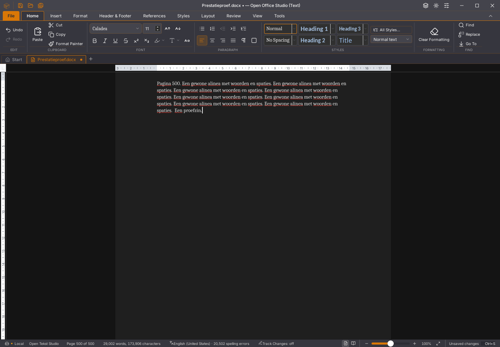

# Writer 45.23: incrementele leeslaag

Writer vraagt nu de volledige toegankelijkheidsspiegel van de bestaande renderer
aan. Die route kan haar DOM-eenheden bijwerken. De eerder gekozen tekstspiegel
bouwt eerst een volledige boom en verwijdert vervolgens de opmaak; bij een
wijziging maakt hij die opnieuw. Niet-actieve pagina’s blijven dezelfde
vereenvoudigde terugvalroute gebruiken. Documentinhoud, opslag en de zichtbare
canvasrenderer worden niet door deze keuze vervangen.

De volledige spiegel bevat meer DOM-elementen. In de gerichte proef met tekst,
een interne link en Arabische leesrichting zijn dat 66 elementen tegenover 18
in de tekstvariant. Dat is een afweging: incrementeel bijwerken van actieve
pagina’s tegenover een grotere leeslaag. Toegankelijkheid is hiermee niet
volledig goedgekeurd; het ontbrekende bladwijzerdoel en de per letter opgebouwde
link blijven bestaande gebreken.

## Vier native metingen

Vier geïsoleerde native Linux/WebKit-proeven draaien achtereenvolgens op dezelfde
pc, zonder gelijktijdige eigen bouw- of GUI-proef. Ze gebruiken dezelfde
500-paginabron en veertien echte toetsen met 20 ms tussenruimte. De meting wacht
op verwerkte invoer én spellinggolven; onafhankelijke broncontroles volgen apart.

| Ronde | Spiegel | Invoer en spelling | Geometriemetingen |
| --- | --- | --- | --- |
| A1, 45.22 | tekst | 3.952 ms | 6.399 |
| B1, 45.23 | volledig/incrementeel | 3.653 ms | 5.276 |
| B2, 45.23 | volledig/incrementeel | 3.125 ms | 4.587 |
| A2, 45.22 | tekst | 3.772 ms | 5.797 |

Gemiddeld is de gemeten tijd ongeveer 12% lager in deze beperkte reeks. Twee
metingen per versie op één pc bewijzen geen algemene snelheidswinst, hoge FPS of
oplossing voor de oorspronkelijke invoer-/selectievertraging. Ook de nieuwe
tijden zijn nog te hoog. De wijziging behoudt de bestaande renderer en wordt
als kleine vervolgstap opgenomen; de prestatieacceptatie blijft open.

Alle vier rondes slagen voor typen, selectie/Backspace, undo/redo, onafhankelijk
teruggelezen bewaren en heropenen in een nieuw proces. Alle 500 bronalinea’s
blijven exact. De paginaregistratie blijft correct bij 115% zoom, na een nieuwe
pagina en na undo van 501 naar 500 pagina’s. GUI- en consolefouten zijn leeg.

## Aanvullende controles

- Native herstelstart: elf bronstappen, echte periodieke kopie, Later en apart
  Herstellen slagen; de originele bronbytes blijven behouden.
- Acht rijke plakrondes: 129 pagina’s, 256 tabellen, 1.793 bodyalinea’s en 1.536
  cellen. Bewaren en verder bewerken, onafhankelijke inhoud-/opmaakcontrole,
  Niet opslaan en een nieuw document slagen. De laatste plakactie vraagt nog
  **65.243 ms**; grote-plakprestatie is niet goedgekeurd.
- Zeven lijststappen, acht interne/externe klembordstappen en zeven
  kleurstappen slagen met echte native vensters, bewaren en een nieuw proces.
- De browser-GUI behoudt de linktekst, leesrichting en bronbladwijzer en toont
  het tabelvoorbeeld op de juiste plaats bij 100% en 150% zoom. Het voorbeeld
  voegt geen tabel aan de bron toe.
- 1.633 frontendtests in 149 bestanden, 56 Python-tests, TypeScript, weekversie,
  module-opdrachten en de native Linux-productiebouw slagen.

De Start- en kop-/voettekstlintuitsneden van 1440 × 122 pixels zijn elk
pixelgelijk aan 45.22. Het volledige venster na typen heeft drie afwijkende
pixels linksboven in het vensterpictogram; het documentvlak is in dit beeldenpaar
gelijk. Dit is geen visuele acceptatie van de gehele suite.

De [meetgegevens](2026-11-03-writer-incrementele-spiegel.json) leggen de exacte
binary-/script-/bronchecksums, bronstappen, aanvullende proeven en beeldvergelijking
vast. De geteste kandidaatbinary heeft SHA256
`6a3972595d3cc337a979bed30f29f0d5989619ea003e41ab4d31536fa826021f`.
Nieuwe platform- en editiecontroles volgen afzonderlijk na push. De
[Linux-rendererafkeuring van 45.22](writer-renderer-opstart.md) en de eerdere
allocatorpanic blijven open. Geen issue of migratievlag is hiermee gesloten.
