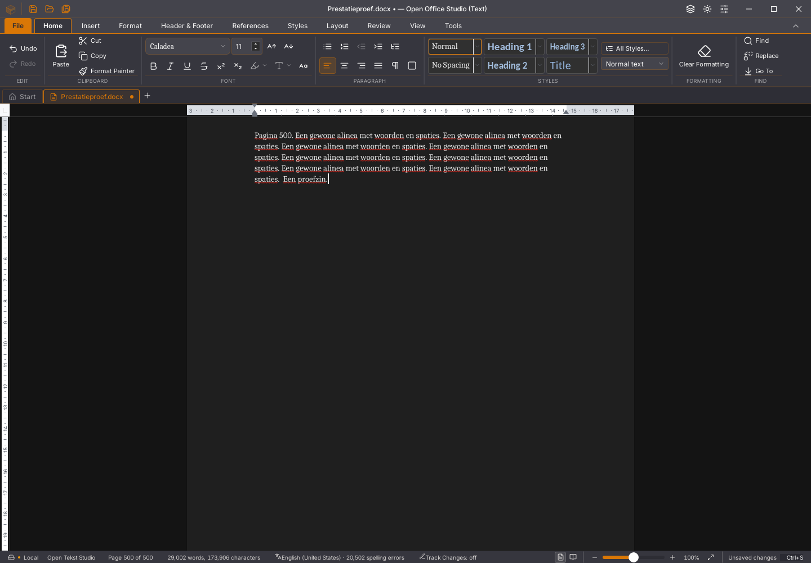
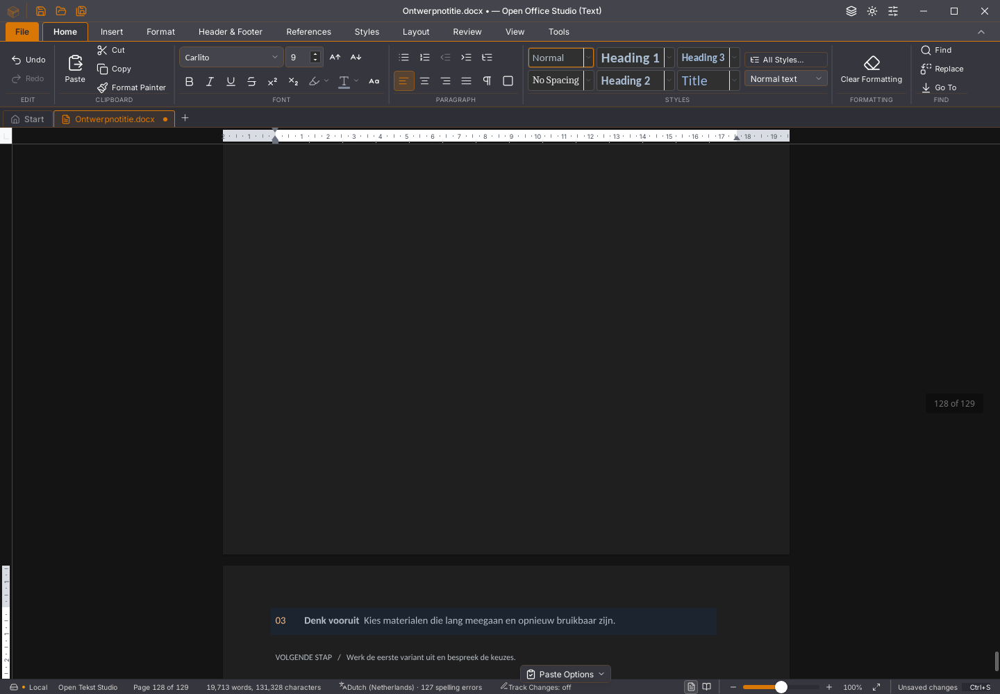

# Writer 45.31: oorspronkelijke invoertijd en minder herhaalde bronlezingen

De gedeelde Rust-plakcodec hergebruikt de alinea-eindmarkering die tijdens
dezelfde bewerking al is gelezen. De bestaande Tauri-interface geeft de
oorspronkelijke invoertijd door aan de automatische Undo-groepering. De
productversie is 2026.45.31 en de gedeelde kern 2026.45.0-alpha.52. Dit voltooit
de Rust-interface of de algemene Writer-snelheidsacceptatie niet.

## Snelle invoer bij een traag antwoord

De echte native tekstproef vond een fout die de eerdere handmatige
Undo-fixture miste: automatische groepering keek naar de terugbezorgtijd van
het antwoord. Een korte fysieke toetsreeks werd daardoor meerdere Undo-stappen.
Met de oude tussenbinary en een gecontroleerde antwoordvertraging van 1.000 ms
laat één Undo de eerste letter van `EERSTE` staan. Dezelfde proefcode slaagt
met de gecorrigeerde binary: één Undo verwijdert de hele toetsreeks en Redo
herstelt tekst en opmaak exact.

De SDK legt de eerste en laatste invoertijd bij toelaten vast. Een echte
pauze van minstens het bestaande capturevenster blijft een aparte bundel,
ook als eerder werk nog wacht. De tekstkoppeling pint deze tijden uitsluitend
rond de synchrone, gevalideerde bronmutatie. Zij verandert de capturemodus
niet en houdt geen klokpin vast tijdens transport. Gewone fouten ruimen de
pin op; een getrapte Wasm-instantie wordt niet opnieuw voor opruimen aangeroepen.
De bestaande bron-, selectie-, client- en levensduurbewaking blijft gelden,
inclusief de volledige terugvalroute.

Tien proeven met de werkelijke SDK/Wasm controleren groepering, echte pauzes,
handmatige modus, gewone fouten, een Wasm-trap, gewijzigde aanroepersarrays en
ongeldige tijden. Vier proeven voeren de echte SDK-toelatingscallback uit,
inclusief verdere invoer tijdens een wachtend antwoord. De oorspronkelijke
groeperingsproef en drie oorspronkelijke toelatingsproeven falen vóór de
correctie. Een eerdere volledige testronde faalde uitsluitend doordat een
geïsoleerde callback-fixture het bestaande SDK-capturevenster niet aanleverde;
die fixture leest nu de werkelijke constante zonder de verwachtingen te wijzigen.

## Dezelfde rijke bewerkingen met minder leeswerk

Tekstinvoer aan een alinea-einde gebruikt uitsluitend de actuele markering
precies op de cursor. Elders blijft de oorspronkelijke zoekroute gelden.
Zonder bladwijzers op die markering vervalt een herhaalde verhaalwandeling;
met bladwijzers blijft de bestaande volledige grensbewerking actief. Splitsen
hergebruikt dezelfde markering en leest na de laatste verhaalpositie geen
niet-bestaand volgend blok. De bewerkingsregels, publieke receipts en
definitieve cursorvalidatie blijven behouden; dit is geen nieuwe broncache.

De onafhankelijke SDK-/DOCX-vergelijking is uitgebreid van 31 naar 41 gevallen.
De tien extra gevallen omvatten bladwijzers aan het einde, revisies, lege
inline-objecten, afbeeldingen, tabellen, laatste alinea's en tabelcellen.
Alle verhalen, opmaak, identiteiten, cursor, Undo/Redo, uitgepakte DOCX-delen
en heropenen worden vergeleken. Ook acht afwijzingen zonder gedeeltelijke
delta slagen. De grote proef verdubbelt 128 naar 256 tabellen; alle veertien
DOCX-delen en de volledige DOCX-bytes zijn gelijk aan de onafhankelijke
referentie. De tijden van die correctheidsproef zijn onder eigen
compilatiebelasting gemeten en bewijzen geen snelheidswinst.

Een afzonderlijke rustige, afwisselende protocolmeting gebruikt vier verse
processen met exact dezelfde aanvraag. De referentie kost 14.501 en 13.546 ms;
alpha52 kost 10.820 en 10.898 ms. De gemiddelde voorbereiding daalt daarmee
van 14.023,5 naar 10.859 ms: 22,6%. Dit betreft alleen native voorbereiding
van deze grote batch, niet de volledige plakactie, normale invoer of FPS.

## Controles en grenzen

De volledige broncontrole slaagt met 1.752 frontendtests in 164 bestanden,
64 Python-tests, losse TypeScript-controle, acht Rust-protocoltests, twee
Rust-leesproeven en 196 tests van de gedeelde office-core. Weekversies,
bronpins, migratiemanifest, de vereiste CI-formatterselectie en de Linux-
productiebouw slagen. Een extra `cargo fmt --all --check` keurt 33 ongewijzigde
vendorbestanden af; die zijn bytegelijk aan de referentie en niet massaal
herformatteerd.

De echte vertraagde tekst- en plakantwoordproeven slagen ieder op drie
stappen: bronexacte geschiedenis, selecteren/vervangen/bewaren tijdens wachten,
en niet opslaan met een laat antwoord na het openen van een nieuw document.
Dit zijn volgorde- en gegevensproeven; de vertraging wordt uitdrukkelijk
opzettelijk aangebracht en is geen prestatiemeting.

De nieuwe binary doorstaat elf echte 500-pagina-/bewaar-/herstelstappen en
twintig extra selectie-/geschiedenisronden met garbagecollection. De
oorspronkelijke bron blijft behouden; een actuele herstelkopie wordt aangeboden,
Later laat verder bewerken en bewaren toe, en Herstellen opent een afzonderlijke
kopie die eveneens verder bewerkt en onafhankelijk teruggelezen wordt. De
toetsreeks tot actuele bron en spelling kost 3.555 ms; dat is nog geen soepele
invoer. Het bekeken getypte paginabeeld is leesbaar en verschilt in deze ene
toestand op achttien pixels; het lint heeft nul afwijkende pixels. Verschillende
processtarts en cursorfasen verhinderen een algemene pixelpariteitsclaim.

De acht rijke plakrondes slagen achtereenvolgens met een verse 45.30- en
45.31-testapp. Beide bewaren na ronde zeven, bewerken daarna verder en
verwerpen aan het einde zonder het nieuwe document te overschrijven. De
onafhankelijke DOCX-controle behoudt alle tekst, opmaak en tabelstructuur.
De genormaliseerde bodyhash is bij beide
`0808d3dcf34c8251d371d9e4c6eda470ed2597acd850062b5b5f70169333a302`.
De volledige DOCX-hashes verschillen door onder meer procesgebonden
identiteiten; die worden hier niet als bytegelijk voorgesteld.

| Laatste plakronde | Referentie 45.30 | Kandidaat 45.31 |
| --- | ---: | ---: |
| Plakken tot bron gereed | 32.659 ms | 20.309 ms |
| Native voorbereiding | 23.014 ms | 13.814 ms |
| Grootste hoofdthreadtimerpauze | 6.933 ms | 4.635 ms |
| Finale actuele pagina-indeling | 129 pagina's | 129 pagina's |
| Hoofdtekstalinea's / tabellen / cellen | 1.793 / 256 / 1.536 | 1.793 / 256 / 1.536 |

Dit is één rustig vergelijkingspaar met verschillende clientidentiteiten en
snapshots, geen herhaalde algemene prestatieacceptatie. Vooral de pauze van
4,6 seconden en de totale plakduur blijven onvoldoende. Een tussentijdse
paginatelling tijdens een ronde wordt niet als finale layout geaccepteerd.

De [meetgegevens en exacte hashes](2026-11-04-writer-invoertijd.json) leggen
ook de grote GUI-hertests en de eerdere afkeuringen vast. Algemene
invoervertraging, incidentele Wasm-trappen, de oorspronkelijke framebasisfout
van 45.29, volledige rijke Rust-WebView-bediening, platforminstallaties en
visuele suitepariteit blijven open. Alle 118 issues, tien migratiegebieden
en dertig acceptatievlaggen blijven open. De gebruikersstarter en bestaande
documenten zijn niet vervangen.
