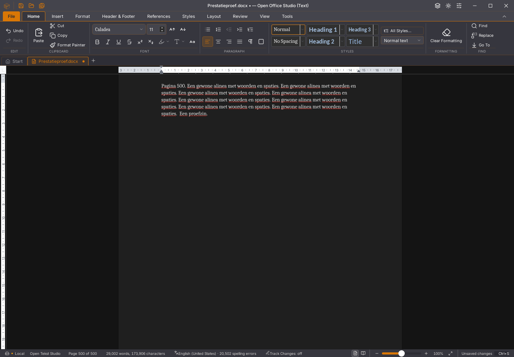

# Writer 45.30: pagina-indeling na Rust-invoer in de worker houden

De native tekstcodec uit 45.29 blijft actief. De bestaande layoutworker
synchroniseert nu ook een gewijzigde hostbron, zodat gewone invoer niet bij
iedere bronwijziging volledige pagina-indeling op de hoofdthread uitvoert.
Een uitdrukkelijk gevraagde hostlayout en de bestaande terugval blijven behouden.
De gedeelde Rust-kern blijft alpha51; dit is een aansluiting in de bestaande
Tauri/React-interface, geen voltooide Rust-interface.

## Oorzaak en afgekeurde eerste kandidaat

Een profiel van 45.29 bevat 754 hoofdthreadsamples met
`layoutDocumentWithRegionsRetainedJson`; de 45.28-referentie heeft daar nul
samples van. Een aparte native teller bevestigt elf volledige hostlayouts
tijdens één korte toetsreeks. Die tellerproef liep onder compilatiebelasting
en wordt niet als rustige tijdvergelijking gebruikt.

De eerste 45.30-kandidaat keurt een niet-gereed gemelde worker af. De echte
SDK-client zet zijn gereedheidsvlag echter juist na iedere bronwijziging uit,
omdat opnieuw synchroniseren nodig is. De diagnostische GUI-proef behoudt
dezelfde niet-gefaalde worker met layoutrevisie 2; alleen zijn gereedheidsvlag
verandert. Deze kandidaat voert nog negen hostlayouts uit en blijft afgekeurd.

De definitieve poort vereist een passende bron/levensduur, een bruikbare client,
verzonden bootstrap en een eerder ontvangen positieve layoutrevisie. Een viewer,
gefaalde client en nog niet opgebouwde worker worden uitgesloten. De bestaande
worker voert de eigenlijke synchronisatie uit. De nieuwe test met de echte
SDK-client bewijst dat invalidatie geen reden is om die synchronisatie over te
slaan; een onvoltooide bootstrap blijft geweigerd.

Zeven van de eerste tien routeproeven falen vóór de eerste wijziging. Twee
van de elf uitgebreidere proeven falen vóór de correctie van de gereedheidspoort.
Alle elf slagen daarna, inclusief een laat antwoord van een oudere layoutpass.

## Rustige native vergelijking

| Versie | Invoer tot bron/spelling gereed | Volledige hostlayouts | Grootste rAF-tussenpoos |
| --- | ---: | ---: | ---: |
| 45.30 | 3.766 ms | 0 | 303 ms |
| 45.29 | 3.752 ms | 6 | 1.047 ms |
| 45.30 | 2.795 ms | 0 | 267 ms |
| 45.29 | 4.377 ms | 8 | 975 ms |

Alle vier ronden behouden de acht bron-, selectie-/Backspace-, geschiedenis-,
bewaar- en heropenstappen van dezelfde 500-paginabron. De kandidaat gebruikt
aantoonbaar de native tekstcodec en echte worker-synchronisatie. De nieuwe
framecontrole vindt de toegevoegde tekst ook in het gerenderde frame.

Deze beperkte reeks toont het verdwijnen van de volledige hostlayouts en een
kleinere langste onderbreking in deze proeven. Het is geen fysieke FPS-meting
of algemene snelheidsacceptatie. De gemeten tussenpozen blijven te groot voor
de gewenste soepelheid.

Het getypte venster verschilt op 38 cursorpixels van de referentie; het lint
is pixelgelijk. Het kop-/voettekstlint is eveneens pixelgelijk. Een derde
lintuitsnede verschilt op twee pixels. Andere vensterdelen verschillen wel;
volledige pixelpariteit is niet aangetoond.

## Grote documenten en regressies

De vertraagde tekst- en plakantwoordproeven slagen, met fysieke vervolginvoer,
Shift-selectie, bewaren vóór antwoord, bronwijziging tijdens voorbereiden,
Niet opslaan en een nieuw document na een laat antwoord. De rendererfoutproef
behoudt bestaande pagina, selectie, bron, bewaring en heropenen. Zeven
lijststappen en elf herstel-/bewaarstappen met twintig extra GC-ronden slagen.

De grote plakproef behoudt 256 tabellen, 1.793 bodyalinea's en 1.536 celverhalen.
Na de achtste plakactie is 65 pagina's eerst een tussentijdse telling. De oude
proef kon juist die oude telling als gereed accepteren. De aangescherpte proef
wacht op de finale, actieve layout van de actuele bronversie. Na 1.430 ms
extra wachten zijn dat 129 pagina's, gelijk aan de referentie. De statusbalk
moet vervolgens dat actuele totaal tonen. Tekst, opmaak en tabelstructuur in
de onafhankelijk gelezen DOCX-body hebben dezelfde genormaliseerde SHA-256
als de referentie. Alleen paraId/textId en rsid-attributen zijn genormaliseerd.

De laatste grote plakactie vraagt nog 26.901 ms, waarvan 20.538 ms native
voorbereiding; de grootste onderbreking van de hoofdthreadtimer is 4.549 ms.
Ook dit blijft een ernstig snelheidsprobleem.

De rustige frontendronde slaagt met 1.728 tests in 161 bestanden; 58 Python-tests,
TypeScript, weekversie en de geoptimaliseerde Linux-bouw slagen. Een eerdere
ronde tijdens compilatie/diagnostiek had twee afgekeurde bestaande tests;
die uitkomst is bewaard. De rustige herhaling gebruikt dezelfde testgrenzen.

De definitieve binary is SHA-256
`f32346d6250d22c98c52be175d5c5fabb9e17f074e3a8e8e7f20930dc31423fc`.
De afgekeurde eerste kandidaat is
`7a0e9ad752fd34690436f938aba0e3e67aaa3618141733e2fd08bc8e2483087e`.
[Gegevens, controles en beeldverschillen](2026-11-04-writer-layout-hostsync.json)
leggen de afzonderlijke proeven vast.

## Open afkeuring en acceptatie

De brede 45.29-desktop-CI slaagt op Windows/macOS en faalt op Linux vóór
heropenen: `FrameDelta: position span shift requires retained positionSpan`.
De bronstappen slagen, maar de foutbewaking ziet de terugval naar de hoofdthread.
De exacte negatieve ELF, AppImage, proefcode en tien contextbestanden zijn op
checksums gecontroleerd. PR-head en merge-checkout hebben dezelfde bronboom.
[Exacte afkeuring](2026-11-04-writer-framebasis-45.29.json).
Deze fout en de oudere Wasm-geheugentrappen zijn niet door een groene lokale
ronde opgelost verklaard.

Nieuwe platform-, geheugen-, devpakket- en zeveneditiecontroles volgen op de
gepushte bron. Alle 118 issues, tien migratiegebieden en dertig acceptatievlaggen
blijven open. De bestaande gebruikersstarter en documenten blijven behouden.
