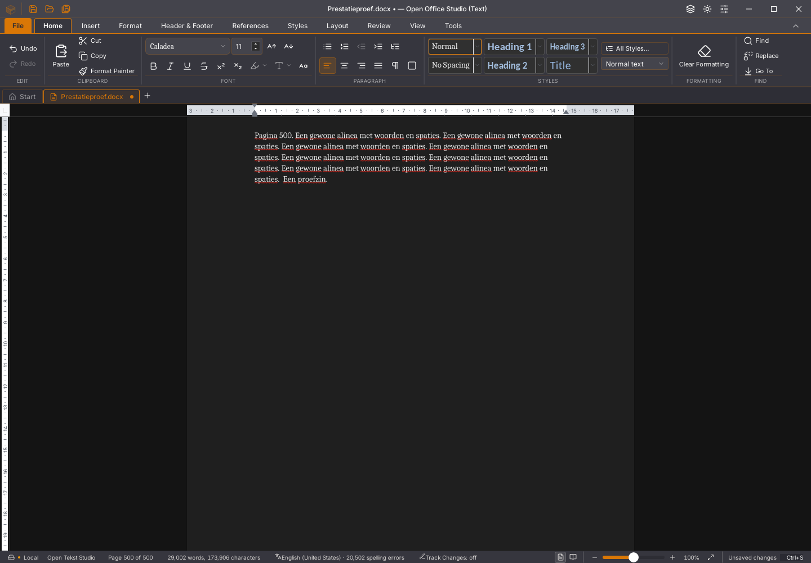

# Writer 45.35: volledige lettertypecontrole buiten de hoofdthread

De bestaande Tauri-interface gebruikt de reeds aanwezige Rust/Wasm-workerroute
nu ook voor de volledige lettertypebehoeften van een geschikte gewone hostbron.
De oude toelating was beperkt tot worker-/viewerbronnen, hoewel dezelfde actieve
worker de gewijzigde hostbron al opmaakte. Er worden geen families, stijlen,
scripts of volledige terugvalcontroles weggelaten. De gedeelde Rust-kern blijft
alpha52; dit is geen volledige Rust-interface of algemene Writer-acceptatie.

## Bronvolgorde en terugval

De poort vereist dezelfde actieve eigenaar, een geschikte renderer, een niet
mislukte client, verstuurde initialisatie en minstens één voltooide layout.
Zonder geregistreerde bron, geschikte worker, bruikbaar antwoord of bekende
bronversie blijft de volledige hostcontrole behouden. Bij een ontbrekende
bestandsbron blijft de bestaande layoutworker bovendien intact. Een gerichte
regressieproef faalt vóór deze laatste toelatingscorrectie en slaagt erna;
fontcontrole mag een geldige layoutworker niet resetten. Een uitdrukkelijk
verzochte hostlayout blijft op de host. De verplichte viewerroute en haar
foutafhandeling blijven staan.

Een antwoord van een vervangen layoutpass wordt genegeerd. Verandert de bron
binnen dezelfde pass, dan wordt de volledige controle opnieuw ingepland op de
actuele bron; het oude antwoord wordt niet toegepast. Een eerste veilige
terugval deed in die situatie alsnog één hoofdthreadcontrole en werd door de
nulgrens afgekeurd. De herplanningscorrectie behoudt die grens. Haar gerichte
raceproef faalt vóór en slaagt na de correctie.

De werkelijke workerplanner wordt afzonderlijk uitgevoerd met haar eigen
berichtbeleid. Een fontvraag leest pas na eerder toegelaten bronupdates en
laat geen latere hogere-prioriteitslayout voorgaan. Ook een lopende asynchrone
bronmutatie moet eerst gereed zijn. Deze tests bewijzen berichtvolgorde; zij
vervangen de native bron-/bewaar-/heropenproeven niet.

Een eerste lokale kandidaat kon niet openen doordat de compatibiliteitscallback
pas na haar nieuwe afhankelijkheidslijst werd geïnitialiseerd. De callback is
ongewijzigd naar voren verplaatst. Een nieuwe proef registreert de werkelijke
SDK-callbacks in hun werkelijke initialisatievolgorde en reproduceert deze fout.
Beide oorspronkelijke negatieve binaries en rapporten blijven behouden; zij
zijn niet als gebruikersapp geïnstalleerd of gepubliceerd.

## Afwisselende native vergelijking

Alle twaalf definitieve native proeven gebruiken binary SHA256
`9b7588486a14e0516e35bf25eac415e2981c65761bf09775ed929f2a3a45c7d2`
(of de afzonderlijk vermelde 45.33-referentie). De volledige proefreeks is na
de laatste toelatingscorrectie opnieuw uitgevoerd; eerdere kandidaten blijven
afzonderlijk bewaard. Vier rustige vergelijkingsronden gebruiken dezelfde eigen 500-paginabron en meetopzet,
zonder eigen compiler of gelijktijdige andere GUI-proef. De volgorde is
45.33 / 45.35 / 45.35 / 45.33. De meting stopt bij de laatste werkelijk
ontvangen toets, de invoerbarrière, actuele brontekst en aanwezige spellingsgolven.
De daadwerkelijke getypte rendererinhoud wordt daarnaast gecontroleerd.

| Ronde | Invoer tot bron/spelling (ms) | Host-fontvragen | Worker-fontvragen | rAF p95 (ms) | Grootste rAF-pauze (ms) | DOM-metingen |
| --- | ---: | ---: | ---: | ---: | ---: | ---: |
| 45.33 vóór | 1.677 | 7 | 0 | 182 | 187 | 1.205 |
| 45.35 eerste | 1.091 | 0 | 6 | 151 | 165 | 1.114 |
| 45.35 herhaald | 1.120 | 0 | 7 | 129 | 141 | 1.274 |
| 45.33 na | 1.568 | 6 | 0 | 167 | 174 | 1.033 |

Beide paren zijn sneller: 1.677 → 1.091 ms en 1.568 → 1.120 ms. De volledige
host-fontvragen verdwijnen en de lange rAF-pauzes nemen af. Het aantal
DOM-metingen daalt in het eerste paar en stijgt in het tweede, mede bij
andere bundeling van fysieke toetsen.
Daarom is dit geen algemene CPU-, fysieke FPS- of vaste snelheidsbelofte.
Invoer blijft ook in deze proef langer dan een seconde vragen.

Een aparte CPU-opname heeft 438 hoofdthreadsteekproeven en nul stacks met de
font-export, tegenover 128 van 788 in de eerder vastgelegde 45.33-opname.
De runtimekalibratie en exact opgehaalde scripts blijven bij het rapport.
Steekproefaantallen zijn geen proces-CPUduur. De bekeken getypte toestand
heeft drie afwijkende pixels in de navigatiebalk ten opzichte van haar
45.33-paar; document en overige pixels zijn gelijk. De eerdere kandidaat had
nul afwijkende pixels. Dit is één toestand en geen volledige UI-pixelpariteit.

## Functionaliteit en gegevens

De gewone acht bron-/geschiedenis-/bewaar-/heropenstappen slagen, inclusief
alle zeven spellingsvenstertoestanden met ongewijzigde volledige cache.
De afzonderlijke herstelproef behoudt Later, verder bewerken, Herstellen en
onafhankelijk bewaren. Twintig extra selectie-/Backspace-/Undo-/Redo-ronden
met expliciete garbagecollection slagen. Negen opgenomen bronberichten
(updates en synchronisaties) worden ook op een aparte replica nagespeeld; die proef reconstrueert niet de
oorspronkelijke workerheap of renderer.

Vier echte fontopmaakvarianten vergelijken het volledige workerantwoord met
de volledige hostreferentie op dezelfde actuele bron: Caladea, Carlito, vet en
cursief. Alle vier exports behouden alle vijfhonderd tekstalinea's exact en
bevatten de gekozen opmaak in onafhankelijk gelezen DOCX-XML. Undo herstelt
alle verhalen en hun opmaak. Dit toetst deze twee families en twee stijlen;
het is geen visuele acceptatie van alle lettertypen of schriftsystemen.

De vertraagde native tekstantwoordproef slaagt op automatische Undo, selecteren,
vervangen en bewaren tijdens wachten, verwerpen zonder antwoord en het niet
overschrijven van een nieuw document door een laat antwoord. De zeven native
kleur-/geschiedenis-/bewaar-/heropenstappen slagen eveneens. Dit bewijst geen
herstel van de eerdere afzonderlijke Linux-kleurvastloper.

Acht rijke plakronden behouden alle inhoud en opmaak, 1.793 hoofdtekstalinea's,
256 tabellen en 1.536 cellen; de finale actuele layout bevat 129 pagina's.
De genormaliseerde volledige bodyhash blijft gelijk aan de oude versies.
De laatste plakactie vraagt nog 19.222 ms en de grootste hoofdthreadtimerpauze
is 4.314 ms. Na verdubbelen van de bron met 128 tabellen blijft typen/selecteren
onderbreekbaar en bron-/structuurexact, maar vraagt vervolginvoer nog 5.594 ms.
Die vertraging en de grote-plakduur blijven onvoldoende.

## Controles en resterend werk

De kandidaat slaagt lokaal voor 1.793 frontendtests in 169 bestanden, 74
Python-tests, TypeScript, weekversie, gewijzigde workflow-YAML en de native
Linux-productiebouw. De kernelbron is ongewijzigd; haar eerdere controles
worden hierdoor niet als nieuw bewijs gepresenteerd. Desktop-, geheugen- en
zeveneditieproeven eisen voortaan de echte worker-fontvragen en nul volledige
fontcontroles tijdens gewone invoer. Desktop en zeven edities voeren ook de
vier fontvarianten uit.

Alle 118 opnieuw geïnventariseerde issues, tien migratiegebieden en dertig
acceptatievlaggen blijven open. De oorspronkelijke worker-/Wasm-afkeuringen,
algemene soepelheid, volledige Rust-interface en functionele/visuele/platformpariteit
zijn niet afgerond. Nieuwe platformcontroles volgen op de push; er wordt geen
officiële release gepubliceerd. De gebruikersstarter blijft 45.23 en bestaande
profielen, documenten en apps zijn behouden.

[Exacte bronnen, binaries, negatieve en positieve proeven en meetgrenzen](2026-11-04-writer-lettertypeworker.json).

## Afzonderlijke 45.33-geheugenafkeuring blijft open

De [brede desktopronde op de eerdere diagnosecommit](https://github.com/OpenAEC-Foundation/open-office-studio/actions/runs/41796744672)
is op Linux afgekeurd bij drie rijke plakrondes met werkelijk bewaren na ronde
een. De bron-/opmaakcontrole blijft correct, maar de console meldt
`Document worker trapped: Out of bounds memory access` in
`editsession_build_display_list_frame`. Windows en macOS slagen. De latere
75baaee-ronde met dezelfde productbron slaagt op alle drie platforms; dat is
geen verklaring of herstelbewijs voor de oorspronkelijke afkeuring.

Het exacte negatieve programma, de volledige foutcontext en de oorspronkelijke
proefcode zijn op checksum gecontroleerd. Head en CI-merge hebben dezelfde
bronboom. Dezelfde negatieve ELF met checksumgelijke oorspronkelijke proefcode
en bron doorstaat de route lokaal. De nieuwe 45.35 doorstaat dezelfde drie
ronden/bewaren-na-ronde-een-route eveneens. De oorspronkelijke geheugenfout
blijft open en wordt niet door de groene lettertype- of lokale hertestproeven
als opgelost gepresenteerd.

## Aanvullende tabeldiagnose en afzonderlijke 45.35-afkeuring

De [45.35-geheugenronde](https://github.com/OpenAEC-Foundation/open-office-studio/actions/runs/41815824535)
is afgekeurd na het verdubbelen van 128 tabellen en echte vervolginvoer tijdens
spelling. Bron en structuur blijven exact en de spelling is onderbreekbaar;
invoer vraagt 7.715 ms. De finale layout blijft echter bij een oude bronversie,
ook na de bestaande twee minuten wachttijd. Consolefouten ontbreken. Deze
verouderde-layoutfout is niet opgelost door de geslaagde devpakketproef. De
exacte negatieve binary, oorspronkelijke scripts, bron en volledige foutcontext
zijn op checksum gecontroleerd en bewaard. Dezelfde oorspronkelijke binary,
proefcode en bron slagen lokaal op dezelfde route; dat verklaart of herstelt
de oorspronkelijke afkeuring niet.

Een aanvullende CPU-diagnose na opnieuw openen gebruikt de echte modelspan
voor het alineaeinde. Een eerste verwachting gebruikte tekstlengte 72 terwijl
het tabelanker de modelspan op 73 brengt; die onjuiste verwachting faalt zowel
op 45.33 als op 45.35 en is geen bewezen productfout. De correcte positie 73
behoudt alle teksten in 1.537 verhalen. De gemeten invoer/inspectie vraagt
2.577 ms; deze diagnose wacht niet op spellingsgolven en is geen vergelijking
met de eerdere 500-paginameting of invoer tijdens hercontrole direct na plakken.
De opname wijst op extra werk in TabelGrepen/tabelBeelden; dat blijft een
onderzoekspunt. De bestaande acceptatieproeven zijn niet versoepeld.

[Afkeuring, exacte context en juiste/verkeerde diagnoseopzet](2026-11-04-writer-tabeldiagnose-45.35.json).

De [Linux-zeveneditieronde](https://github.com/OpenAEC-Foundation/open-office-studio/actions/runs/41815882769)
is daarnaast afgekeurd na bewaren en heropenen van de 500-paginabron. De app
meldt achter het herstelvenster `Out of bounds memory access` bij
`update_display_list`; de proef klikt die fout niet weg. Deze ronde gebruikt
exact dezelfde ELF als de afzonderlijke geheugenafkeuring. Beide foutcontexten
zijn volledig op checksums gecontroleerd. Dezelfde ELF met oorspronkelijke
proefcode, bytegelijke template en beginbron doorstaat de route lokaal, inclusief
de vier fontvarianten; ook dat verklaart of herstelt de afkeuring niet.
De eerste lokale startpoging miste alleen de template en heeft de app niet
gestart. De overige platform-/editieronden worden apart gevolgd.
