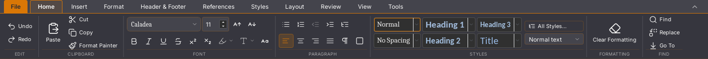
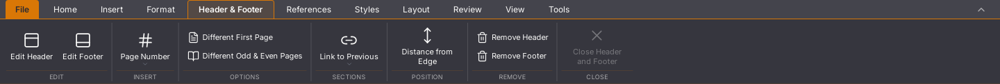

# Writer 45.18: onnodige documentuitlezing uit het verborgen lint

De kop-/voetteksttab maakte bij iedere render van het Writer-lint direct een
sectiestand aan. Die vroeg de volledige pakketstructuur op, ook terwijl Start
actief was. De tab levert nu een component; de sectiestand wordt pas gelezen
wanneer het lint die inhoud daadwerkelijk rendert. De bediening, teksten en
CSS blijven gelijk. Dit is een gerichte optimalisatie, geen oplossing voor
alle invoer- en plakvertraging.

## Oorzaak en regressieproeven

Een gekalibreerde WebKit-profielmeting bevat vóór de wijziging 201 samples
met `getDocument`, via `sectieStand`, `kopVoetTab` en het Writer-lint. In de
nieuwe meting zijn dat er nul. Samples zijn geen aanroepaantallen of
milliseconden; deze profielen dienen alleen voor de diagnose.

Drie regressieproeven gebruiken de echte React-lintweergave. De oude code
faalt op verborgen uitlezingen en verouderde opties tussen tabaanmaak en
weergave. Na herstel slagen alle drie: een niet-actieve tab leest geen
secties, de geopende tab leest de actuele opties en actieve opties volgen
nieuwe toestand en beschikbaarheid. Een actief maar ingeklapt lint is niet
met deze wijziging ontkoppeld.

## Vier native vergelijkingsproeven

Volgorde: oud, nieuw, nieuw, oud. Iedere proef start een eigen Linux/WebKit-
proces en geïsoleerd profiel met dezelfde gegenereerde bron van 500 pagina’s.
De proef typt veertien tekens met echte toetsen. Gereed betekent: de laatste
native keyup, een lege invoerwachtrij, zichtbare spellinggolven en eenmaal de
exacte laatste alinea. De overige 499 alinea’s worden apart volledig vergeleken.
Tijdens de meting draaien geen eigen bouw- of andere GUI-proeven.

| Ronde | Versie | Invoer tot bron en spelling | `getDocument`-aanroepen | Tijd in die aanroepen |
| --- | --- | --- | --- | --- |
| 1 | 45.17 | 4.022 ms | 3 | 113 ms |
| 2 | 45.18 | 3.834 ms | 0 | 0 ms |
| 3 | 45.18 | 3.907 ms | 0 | 0 ms |
| 4 | 45.17 | 4.609 ms | 5 | 195 ms |

De teller volgt de stabiele React-ref, inclusief vervanging van de API-
objecten. Een eerdere meetpoging op alleen het tijdelijke editorobject is
terecht afgekeurd en niet in deze vergelijking opgenomen. Alle vier geldige
proeven bevestigen dat de actieve API is gevolgd. De meetinstrumentatie zelf
is onderdeel van deze beperkte vergelijking.

Alle vier proeven behouden de volledige bron bij typen, selectie/Backspace,
undo/redo, werkelijk opslaan en heropenen in een nieuw proces. De onafhankelijke
DOCX-teruglezing en de volledige bronhashes van de controlestappen zijn gelijk
tussen de vier runs. GUI- en consolefoutenlijsten zijn leeg.

De frame-tussenpozen hebben maxima van 262/309 ms op 45.17 en 200/241 ms op
45.18. Dit zijn `requestAnimationFrame`-tussenpozen tijdens deze invoerproef,
geen fysieke beeldscherm-FPS. Twee runs per versie op één pc bewijzen geen
algemene snelheidswinst. **Bijna vier seconden blijft onvoldoende soepel.**

## Visuele vergelijking

Dezelfde native venstergrootte van 1440 × 1000 pixels, dezelfde bron en dezelfde
toestand na bewaren. Beide lintuitsneden zijn 1440 × 122 pixels. Knopnamen,
actieve/uitgeschakelde toestand en grenzen zijn tevens als gegevens vergeleken.
Voor zowel Start als Kop- en voettekst zijn er **nul verschillende pixels**.
Dit bewijst geen pixelgelijkheid van alle thema’s, venstergroottes, modules of
de afzonderlijke Rust-interface.

Start, vóór:



Start, na:


Kop- en voettekst, vóór:



Kop- en voettekst, na:


## Grote plakproef en bestandsbehoud

Acht echte verdubbelingen met een kopie van het meegeleverde document bereiken
129 pagina’s, 256 tabellen, 1.793 unieke alinea’s en 1.536 tabelcellen. De body
bevat 131.328 codepunten; de celteksten samen 49.408. Bewaren na de eerste ronde
en verder bewerken lukt zonder workerfouten. De export wordt onafhankelijk op
body, tabelvormen en celinhoud getoetst. Een aparte vergelijking met de
45.17-export vindt dezelfde opmaak, stijlen en genormaliseerde body; er zijn
geen marges wegge-normaliseerd. Verwerpen duurt in deze ronde 446 ms en daarna
opent een leeg document. GUI- en consolefoutenlijsten zijn leeg.

De achtste plakactie duurt **61,451 seconden**: groot plakken is niet voldoende
geoptimaliseerd. De eerdere 45.17-referentie had een ander tussenbewaarmoment;
dit is geen gecontroleerde snelheidsvergelijking tussen die twee plakproeven.
In het directe eindbeeld staat de totale paginatelling op 129, maar de
tekentelling nog op 65.664. Die telling is hier niet na rust opnieuw getoetst.

## Bouw- en platformgrenzen

1.616 frontendtests in 146 bestanden, 47 Python-tests, TypeScript en de native
Linux-productiebouw slagen. Drie van de frontendtests zijn de nieuwe lintproeven.
De vierde workerbouwproef controleert de gewone productiechunkkeuze.

De eerdere desktop-CI op bron `d348d6b` faalt op Windows doordat de negatieve
workerproef verwacht dat de bundelaar zelf de onveilige terugimport kiest.
Linux en macOS slagen daar wel. De negatieve Vite-proef legt die concrete
gedeelde knoop nu expliciet vast; een aparte proef behoudt controle op de
gewone productiechunkkeuze. De productiebescherming blijft gelijk. De nieuwe
Windows-/platformronde moet na push afzonderlijk worden beoordeeld.

De lokale kandidaat heeft SHA256
`7b36df8cfe7ec436c77fa01d8d0b29e08750c844756781cbb857953247cf4774`.
De eerdere [gecontroleerde Linux-devdownload van 45.17](https://github.com/OpenAEC-Foundation/open-office-studio/actions/runs/41633473423/artifacts/13229474620)
blijft een afzonderlijk pakket. Een gepushte 45.18-bron is nog geen goedgekeurde
45.18-devdownload. De gepubliceerde release blijft ongewijzigd.

[Meetgegevens, hashes, stappen en grenzen](2026-11-03-writer-lint-uitlezen.json)
bevatten de exacte uitkomsten. Alle migratiegebieden en acceptatievlaggen
blijven open; deze stap voltooit de suite niet.

## Herhalen

Voer de native proef na elkaar uit op de bewaarde oude en nieuwe binaries,
ieder met een nieuwe uitvoermap en overeenkomstige versie:

```sh
python scripts/test-writer-lang-native.py --programma /absoluut/pad/naar/open-office-studio --versie 2026.45.18 --uitvoer .local/proef-writer-lint
python scripts/test-writer-rijk-plakken-native.py --programma /absoluut/pad/naar/open-office-studio --versie 2026.45.18 --rondes 8 --bewaar-na-ronde 1 --maxduur 300 --uitvoer .local/proef-writer-lint-plakken
```

Gebruik de bestaande Linux-GUI-omgeving; de proeven maken eigen profielen en
bestanden en stoppen alleen hun eigen app.
