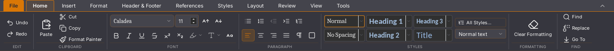
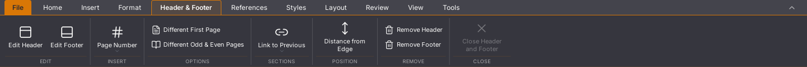

# Writer 45.21: stabiel paginaregister

De canvasreferentie werd bij een paginarender opnieuw aangemaakt. React meldde
daardoor dezelfde canvasnode af en weer aan. Bovendien werd het paginaregister
bij iedere render ongeldig, ook zonder gewijzigd documentframe. Op 500 pagina’s
veroorzaakt alleen zoomen 530 afmeldingen, 530 aanmeldingen en 1.072
cache-invalidaties. De strikte nieuwe native proef faalt hier op 45.20.

De gepinde React-patch bewaart de canvasreferentie zolang pagina-id en
registratiefunctie gelijk blijven. Het registratie-effect behoudt zijn cache bij
ongewijzigde document- en frameobjecten. Nieuwe frames en echte montage-/
structuurwijzigingen blijven invalidatie veroorzaken. De registerklasse en haar
DOM-volgordecontract zijn niet veranderd.

## Native vergelijking

Vier geïsoleerde Linux/WebKit-proeven zijn na elkaar uitgevoerd op dezelfde pc,
zonder gelijktijdige eigen bouw- of andere GUI-proeven. Iedere ronde gebruikt
dezelfde gegenereerde DOCX-bron van 500 pagina’s. Een lichte teller telt alleen
`compareDocumentPosition` tussen canvasnodes; de bestaande lezingen-, geometrie-
en invoercontroles blijven actief. Dit is geen ongemeten praktijksessie of
vergelijking met een ander tekstprogramma.

| Ronde | Versie | Invoer en spelling | Canvasvergelijkingen | Aan-/afmeldingen bij zoom |
| --- | --- | --- | --- | --- |
| 1 | 45.20 | 4.107 ms | 57.513 | 530 / 530 |
| 2 | 45.21 | 4.078 ms | 6.986 | 0 / 0 |
| 3 | 45.21 | 4.227 ms | 6.986 | 0 / 0 |
| 4 | 45.20 | 3.761 ms | 59.531 | 530 / 530 |

De kandidaat heeft bij zoomen één cache-invalidatie; de oude versie 1.072.
Het sorteer-/registerwerk neemt aantoonbaar af. **De totale invoertijd verbetert
in deze kleine reeks niet overtuigend**: de twee kandidaatmetingen zijn ook
gemiddeld hoger dan de twee oude metingen. Dit is geen goedkeuring van de
typ-/selectiesnelheid en geen bewezen algemene vertraging of versnelling.
Daarvoor zijn twee metingen per versie op één pc onvoldoende. De ernstige
invoerklacht blijft open.

Alle vier rondes behouden exact dezelfde bron bij typen, selectie/Backspace,
undo/redo, onafhankelijk teruggelezen native bewaring en heropenen in een nieuw
proces. Alle vier opdrachten eindigen met code 0; GUI- en consolefoutenlijsten
zijn leeg. De oude versie gebruikt uitsluitend voor deze historische vergelijking
de expliciete meetoptie die haar bekende registerwissels registreert. De
standaardproef en beide kandidaatrondes eisen nul aan-/afmeldingen bij zoomen.
De oorspronkelijke strikte afkeuring van 45.20 blijft bewaard.

## Ordening, geometrie en beelden

De proef vergelijkt alle geregistreerde canvasnodes en hun pagina-indices met
de werkelijke DOM-volgorde. Zij controleert 500 pagina’s op 115% zoom, voegt via
de echte editoropdracht een pagina in, controleert alle 501 nodes en draait de
paginaopdracht met native undo terug. Daarna zijn alle 500 bronalinea’s en
pagina-indices weer gelijk. Dit bewijst de register-/frameaansluiting, niet de
volledige sneltoets- of pagineringsmatrix. De aanvankelijke Ctrl+Enter-opzet gaf
geen nieuwe pagina en wordt niet als geslaagde sneltoetsproef gepresenteerd.

Vier lintvergelijkingen (twee rondesparen, Start en Kop- en voettekst) hebben
ieder nul verschillende pixels in een uitsnede van 1440 × 122 pixels. De
knoptoestanden en grenzen worden eveneens vastgelegd. Dit betreft deze linten,
niet de volledige suite of de oorspronkelijke Rust-migratievergelijkingen.

De [ruwe gegevens](2026-11-03-writer-paginaregister.json) bevatten de exacte
binary-/script-/patchhashes, oorspronkelijke afkeuring, vier volledige
broncontroles en pixelvergelijkingen. De kandidaatbinary heeft SHA256
`ffa87e4f82f35a47a344fdba50813a19a9abd6ef632600a1617e9c5547619529`.

## Aanvullende controles

1.628 frontendtests in 148 bestanden, 47 Python-tests, TypeScript, weekversie en
de module-opdrachten slagen. De eerste bouwlog meldt een voltooide releasebouw,
maar de omsluitende opdracht eindigt met code 143. De expliciet geïsoleerde
hertest eindigt met code 0 en levert bytegelijk dezelfde geteste binary.

De zeven native lijststappen van 45.20 slagen opnieuw op deze binary, inclusief
de onafhankelijk teruggelezen lijstdefinitie, undo/redo en een nieuw proces.
Acht rijke plakrondes behouden 129 pagina’s, 256 tabellen, 1.793 bodyalinea’s en
1.536 cellen. Bewaren na ronde één, verder bewerken, onafhankelijke DOCX-inhoud,
de statusbalk na rust, verwerpen en een nieuw document slagen. De laatste
plakactie duurt 61.046 ms en verwerpen 475 ms; groot plakken blijft te traag.

De aparte [45.20-devdownload](https://github.com/OpenAEC-Foundation/open-office-studio/actions/runs/41658684001/artifacts/13240879781)
is opgehaald en gecontroleerd op archief-/AppImage-checksums, interne metadata,
volledige uitpakking en de AppRun-/ELF-hashes van haar werkelijke GUI-proef.
De 45.21-dev- en platformbuilds moeten na push apart slagen. De gepubliceerde
release blijft ongewijzigd.

## Nieuwe afkeuring in de 45.20-platformronde

De [zeveneditiebouw van 45.20](https://github.com/OpenAEC-Foundation/open-office-studio/actions/runs/41658755587)
is op Linux afgekeurd. Haar native 500-paginaproef meldt vóór heropenen een
`dlmalloc`-assertie (`psize >= size + min_overhead`) en een Wasm-trap bij
`layout_document_with_regions_retained_json`. Het foutenrapport staat in
artifact `13242855759`, binary SHA256
`19a96ed27a705534f3d64cc7debd0ad32fe5e65cb7c63b4d5bb70b59900b908b`.
De lijstproef daarvoor slaagt wel voor alle zeven stappen.

De oorzaak van deze geheugenfout is nog niet bewezen. De lokale 45.21-proeven,
de aparte groene desktop-CI en de geslaagde devpakketproef bewijzen geen herstel.
De afkeuring is in de ruwe gegevens behouden en blijft een prioriteit voor de
stabiliteitscontrole. De foutbewaking of de vrijgave-eis wordt niet versoepeld.

## Resterend

De volledige Rust-interface, ernstige invoervertraging, groot plakken, eerdere
Writer-regressies en alle oorspronkelijke platform-/corpus-/pixelacceptatie
blijven open. Geen issue wordt op grond van deze registercorrectie gesloten en
geen migratievlag wordt afgevinkt. De controles van 45.20 of een andere binary
worden niet als vrijgavebewijs voor 45.21 gebruikt.
