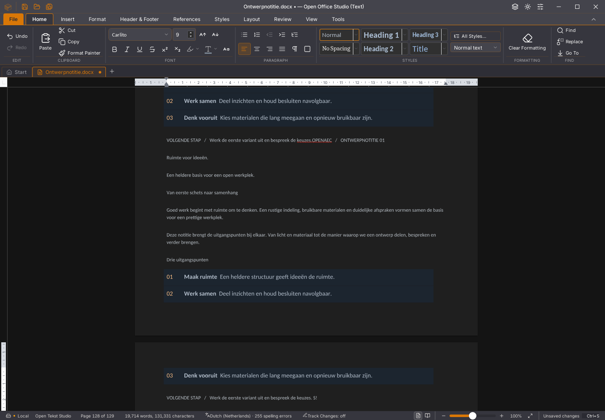

# Writer 45.26: minder herhaalde lezingen bij plakken

De gedeelde Rust-code vraagt niet meer na ieder tekstfragment opnieuw alle
alineagrenzen op om een eindcursor terug te geven. De plakbatch houdt haar
globale positie al bij. De volledige oorspronkelijke invoegbewerking wordt
gedeeld: opmaakovererving, revisies, bladwijzers, identiteiten en grensregels
blijven behouden. De gewone publieke Receipt-route levert haar volledige
bereik; de batch vraagt rechtstreeks het globale einde. De definitieve
broncursor wordt na de hele batch nog steeds gevalideerd.

Tabelvolgorde en eindcursor lezen daarnaast alleen de ingesloten objecten op
hun UTF-16-posities. Hiervoor wordt geen volledige tekst-/opmaakdelta meer
gekopieerd. De bron-, levensduur-, generatie- en hashbewaking van de desktop
is niet versoepeld; een verouderde delta wordt niet overgenomen.

## Gegevens en snelheid

De tabellezing alleen verandert de voorbereidingstijd nauwelijks:
16.097/16.301 ms tegenover 16.624/16.481 ms. Met het rechtstreekse teksteinde
vraagt dezelfde vaste protocolaanvraag in een afzonderlijke proef 14.563 ms.
Deze meting liep zonder andere eigen compilatie of GUI-proef. Dit is een
beperkte protocolmeting, geen algemene snelheids-, invoer- of FPS-acceptatie.

De kleine GDB-opname toont herhaalde positie- en opmaaklezingen als verdere
onderzoekspunten. Zij bevat 36 onderbrekingen en meet geen precieze CPU-tijden.
De inferior eindigt normaal; de GDB-opdrachtketen eindigt met code 1 omdat er
daarna nog stackopdrachten zonder actief proces volgen. Deze diagnose wordt
niet als functionele test gebruikt.

- Zeven gerichte Rust-/leesproeven slagen op alpha50.
- 31 onafhankelijke SDK-vergelijkingen behouden alle verhalen, opmaak,
  identiteiten, cursor, bronexacte undo/redo, alle DOCX-onderdelen en heropenen.
  Vier aanvullende gevallen toetsen lege inlines, Unicode naast tabellen,
  celtekst en revisieregistratie.
- Acht ongeldige aanvragen leveren geen gedeeltelijke delta op.
- De grote gegevensproef verdubbelt 128 tabellen/897 bodyalinea’s naar
  256/1.793. Alle 1.537 verhalen en alle veertien DOCX-onderdelen blijven gelijk;
  de volledige beide DOCX-bestanden zijn bytegelijk. SHA-256:
  `74d4c27fe44bc4b0326d1730f80a0578d634a68044f09c9098925174f7d2a820`.
- 1.666 frontendtests, 57 Python-tests, TypeScript via de productiebouw,
  weekversie, native broncontroles en de Linux-desktopbouw slagen.

De protocoldelta verschilt ook tussen twee processen met de oude binary.
Alleen een bytevergelijking van die delta zou dus onvoldoende zijn. De
afzonderlijke volledige verhaal-, identiteit-, geschiedenis- en
DOCX-vergelijkingen blijven verplicht.

## Echte desktopproeven

De vertraagde-antwoordproef en elf 500-pagina-/herstelstappen slagen op de
werkelijke 45.26-binary. Tekst en opmaak verdwijnen samen met één Undo en komen
bronexact terug met Redo. Snelle vervolginvoer, Shift-selectie, vervangen en
Save vóór beantwoording blijven in volgorde. Niet opslaan sluit zonder op het
antwoord te wachten; een nieuw document blijft na het late antwoord behouden.

De 500-paginaproef behoudt Backspace, geschiedenis, echte bewaring, een nieuw
proces, de periodieke herstelkopie en beide herstelkeuzes. Invoer tot bron en
golflijnen vraagt 4.334 ms; inclusief de daaropvolgende vaste nawacht is dit
6.397 ms. De overeenkomstige 45.25-waarden zijn 4.344/6.392 ms. Hieruit volgt
geen aantoonbare verbetering van de gewone typvertraging. Tijdens deze
functionele ronde liep tevens een andere eigen GUI-proef.

Het getypte 500-paginabeeld verschilt op vijf pixels van het gekozen
45.25-beeld: het vensterpictogram en twee pixels in de bovenrand van het lint.
Het documentvlak is gelijk. Dit is één toestand, geen volledige visuele
migratieacceptatie.

Acht echte plakrondes behouden 129 pagina’s, 256 tabellen, 1.793 bodyalinea’s
en alle 1.536 cellen. Bewaren na ronde zeven, verder bewerken, onafhankelijke
DOCX-controle, verwerpen en een nieuw document slagen. De laatste plakactie
vraagt 29.858 ms en de hoofdthreadtimer heeft een onderbreking van 5.392 ms.
Tijdens een deel van de ronde liepen frontendtests en een andere GUI-proef;
deze waarde bewijst geen algemene snelheidswinst.

De grote afzonderlijke bronproef behoudt tevens fysieke vervolginvoer,
Shift-selectie en vervanging, en controleert daarna de volledige spellingcache
van 3.329 alinea’s en 1.536 celverhalen. De eerste procesketen eindigt met
code 143 na een positief inhoudsrapport en wordt niet als volledig groene
procesproef geteld. Een afzonderlijke hertest met expliciete afsluitstempel
eindigt met code 0. Zij vraagt 23.681 ms voor plakken en 5.123 ms voor de
toetsreeks tot de bron-/invoerbarrière, zonder andere eigen bouw-/GUI-proeven.
De overeenkomstige eerdere rustige 45.25-proef had 28.597/6.671 ms. Dit is een
beperkte vergelijking, geen volledige praktijk- of paginapaintacceptatie.

Beide 45.26-exporten na vervolginvoer hebben dezelfde genormaliseerde
DOCX-bodyhash als 45.25. Het lint in het afzonderlijke grote beeldenpaar is
pixelgelijk; 33 pixels verschillen bij de cursor en onderste zoomindicator.

## Resterend

De ernstige algemene typ-/selectievertraging, verdere schaalbaarheid en
volledige paginapaint blijven open. Ook zichtbare stijlgetrouwheid bij intern
kopiëren en de actuele-paginamelding vragen verdere controle. De gedeelde
Rust-code is beschikbaar voor de bestaande desktop en kern; de volledige
Rust-interface heeft de rijke plakbediening nog niet overgenomen.

De oorspronkelijke 45.25-geheugenafkeuring en de afzonderlijk aangetoonde
timinggrens van haar herstelproef staan in het
[herstelverslag](writer-herstelinterval.md). Dat is geen bewezen oplossing
voor de historische allocator-, Wasm-geheugen- of rendererafkeuringen.

Ook de 45.25-zeveneditieroute is op Linux afgekeurd: de canvasrenderer meldt
een Wasm-geheugentoegang buiten bereik tijdens de lijstproef, terwijl vier
bronstappen slagen. De ELF is dezelfde als in de volledig gecontroleerde
geheugencontext. De lokale herhaling via de eigen 2.50.4-runtimekopie loopt
op een afzonderlijke opstarttimeout bij heropenen; het lijstenrapport bindt
daar alleen de launcher, zodat geen herstel van de oorspronkelijke trap is
bewezen. De gerichte 45.26-lijstproef slaagt op de hostruntime voor zeven
stappen. [Afkeuring en exacte grenzen](2026-11-04-writer-renderer-45.25.json).

Nieuwe platform- en zeveneditiecontroles horen bij de uiteindelijke gepushte
45.26-bron en worden afzonderlijk gevolgd. De volledige lokale native
werkruimtecontrole is niet opnieuw als groen bewezen; de eerdere onderbreking
blijft behouden. Alle 118 issues, tien migratiegebieden en dertig
acceptatievlaggen blijven open. Gebruikersapps en documenten zijn behouden.
De [exacte hashes en meetgegevens](2026-11-04-writer-plakken-lezingen.json)
binden de beperkte controles aan hun eigen bron en binary.
