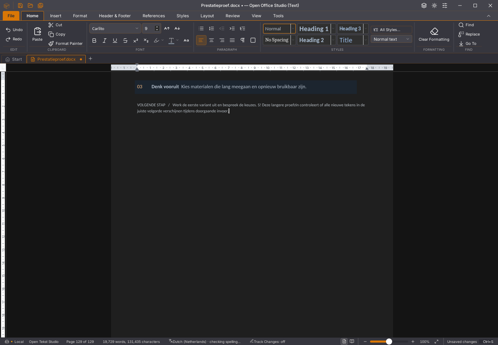

# Afgekeurde brongebonden queryafstemming

De lokale 45.44-proef is afgekeurd en teruggedraaid. De behouden appbron blijft
45.43 / Rust alpha57. Er is geen nieuwe snelheidsverbetering gepubliceerd.

De proef liet gewone native invoer na bronovername en de bestaande publicatie
wachten op een gereed queryobject met exact dezelfde bronversie. Sluiten,
bronwijziging en sessie-/scopewissel braken het wachten af. De gewone
queryresolver hield haar oorspronkelijke gedrag. Dertig gerichte callback- en
resolvertests, 1.831 volledige frontendtests en TypeScript slaagden, maar deze
proeven bewezen onvoldoende dat de echte renderer zulke metadata publiceert.

| Fysieke ronde | Resultaat |
| --- | --- |
| Behouden 45.43 | Volledige getypte alinea na 23.461 ms; alle 3.329 alinea-/celteksten exact |
| Eerste 45.44 | Al na deze ronde afgekeurd: na negentig seconden niet volledig gelijk getekend |
| Afzonderlijke diagnose op dezelfde 45.44-binary | 351 toetsen ontvangen; zeventien query-time-outs van ongeveer vijf seconden; slechts een deel verwerkt |

Een aparte referentiehertest na de afkeuring toont de volledige alinea na
23276 ms met alle 3.329 teksten exact. De teruggezette werkboom slaagt
ook voor alle 1.819 frontendtests in 173 bestanden.

De geplande vierledige vergelijking is na de eerste kandidaat afgebroken.
Er is dus geen volledige ABBA-meting en geen algemene snelheidsacceptatie.
De diagnose is een extra, apart gehashte proef; zij vervangt de oorspronkelijke
afkeuring niet. De negatieve ELF heeft SHA-256
`b376f2d0e17923512e16dfd6058a093cfb420f7d9949b9f3c5d3f4f234195222`
en blijft lokaal bewaard. De bronnen, tests, meetprogramma's, logs en beelden
zijn checksumgebonden opgenomen in het [bewijsmanifest](2026-11-05-writer-queryafstemming.json).

De vastgezette SDK geeft bij het opbouwen van legacy-weergavepagina's expliciet
`null` als documentVersion door aan de queryconstructie. De workerroute kan
daar wel bronmetadata doorgeven. De gemaakte aanname over de legacyroute was
daarom onjuist; dit ondersteunt het verwerpen van deze proef en verklaart niet
alle eerdere Writer-vertragingen. Een bronversie van een nieuwere sessie op een
oud frame stempelen zou onterecht gereed melden en is geen oplossing.

Er zijn twee afzonderlijke metadatafamilies: documentVersion (`QE`/`e8`) en
de layoutbronversie (`JE`/`Ci`). De oorspronkelijke layoutpublicatie en de
queryconstructie dragen die tweede versie met `b$3` over. Een volgende proef
moet deze binding toetsen; `c` is binnen de invoercomponent bovendien lokaal
overschreven door seedSelection. Geen van beide aanwijzingen bewijst alvast
een werkende of snellere runtime.

Volgend onderzoek: een eigenaargebonden melding vanuit de werkelijk behouden
layout/publicatie, met de versie die bij het bouwen is vastgelegd, annulering
bij vervanging en zonder alle onzichtbare weergavepagina's op te bouwen.
Daarna opnieuw echte toetsen, bronbehoud, selectie/Undo, sluiten/bewaren en
schermpixels controleren. De volledige Rust-interface, alle 118 issues en
dertig migratievlaggen blijven open.
