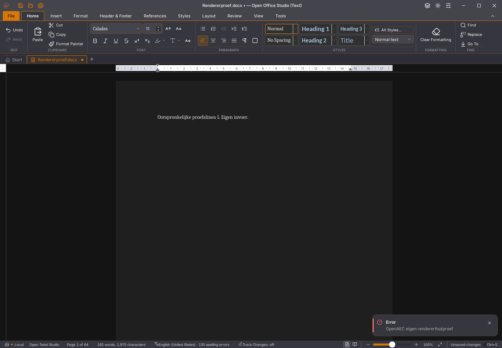

# Writer 45.28: rendererstatus in de interface

De 45.27-core stopte queryaanroepen na een Wasm-trap, maar de interface luisterde
niet naar die foutstatus. Bovendien werd een opgeloste `whenReady()`-belofte
onvoorwaardelijk als gereed behandeld. Drie van zes eerste proeven op de
werkelijk geïnstalleerde interfacehook reproduceren deze fouten.

De interface volgt nu de huidige querybron. Een laadantwoord wordt opnieuw
op bruikbaarheid gecontroleerd; een latere fout bereikt de bestaande foutmelding
met de bijbehorende gepresenteerde engine. Bron- en enginebinding voorkomen
dat een late melding aan een ander document wordt toegeschreven. Afmelden
beëindigt zowel de foutwaarnemer als de verwerking van late laadantwoorden.
Een reeds bestaande layoutfout behoudt haar eigen fout en enginebinding.

De oorspronkelijke pagina blijft beschikbaar; de defecte querybron wordt niet
meer als bruikbare klik-/selectiebron aangeboden. Er wordt geen editor
opnieuw gemonteerd en geen gebruikersbron vervangen. Automatisch herstel van
de volledige Wasm-instantie is hiermee niet geïmplementeerd.

Een visuele controle vond daarnaast dat de algemene rendereromsluiting bij
iedere fout de pagina verving door een openingsfoutscherm. Een eerdere 45.28-
kandidaat behield wel tekst/selectie en kon bewaren, maar die weergave werd
afgekeurd. De native proef controleert nu ook dat de canvaspagina blijft
bestaan. Alleen een queryfout met een bestaande display-list houdt dezelfde
paginacomponent; een echte indelingsfout of ontbrekende pagina behoudt het
foutscherm. Vijf extra omsluitingsproeven bewaken dit onderscheid.

## Geen extra render voor gewone vervolgframes

Een eerste 45.28-variant bewaarde voor ieder gezond vervolgframe een nieuw
statusobject. Een aanvullende regressie wees daardoor twee renders aan waar
één nodig was. De geaccepteerde variant bewaart de gereedheid als boolean en
maakt alleen bij een fout een brongebonden foutobject. Twintig gezonde
vervolgframes vereisen in de hookproef ieder één render. Dit bewaakt een
concrete regressie; het is geen algemene FPS- of snelheidsacceptatie.

De twaalf interfaceproeven voeren de echte vastgezette hook uit met
gecontroleerde effectfasen. Ze toetsen laden, reeds opgetreden en latere
fouten, bestaande layoutfouten, bronwissels, een onafhankelijke instantie,
ontbrekende bronnen, afmelden en het renderaantal. De eerdere zes
querylevensduurproeven blijven daarnaast verplicht.

## Echte desktopfout en bestandsbehoud

De nieuwe native proef gebruikt een eigen DOCX met 64 alinea’s/pagina’s en
fysieke toetsinvoer. Zij werpt bewust één `WebAssembly.RuntimeError` aan de
querygrens op. Bij de route paginavervanging gebeurt dit tijdens het
serialiseren vóór de Wasm-aanroep. Er wordt geen echte geheugencorruptie
veroorzaakt. De proef vereist één zichtbare foutmelding, dezelfde documentsessie
en selectie, alle onbewaarde tekst, fysiek Opslaan en onafhankelijke
DOCX-teruglezing. Daarna moet een nieuw eigen proces dezelfde DOCX zonder
fouten heropenen, verder bewerken en bewaren.

Dit bewijst de foutkoppeling en bronbehoud in deze geïnjecteerde situatie.
Bewaren na werkelijke Wasm-geheugencorruptie en de oorspronkelijke allocator-/
renderer-/documentworkertrappen zijn hiermee niet bewezen hersteld.

De brede Linux-desktopcontrole en zeveneditieroute voeren deze proef voortaan
ook uit. Het rapport en de beelden worden bewaard. Bij afkeuring koppelt de
foutcontextverzamelaar de exacte binary, proefcode, gedeelde basis en uitsluitend
de eigen vaste proefbestanden aan hun checksums.

## Vastgelegde controles

De volledige frontendronde heeft 1.696 geslaagde tests in 158 bestanden en
eindigt met procescode 0. De 58 Python-proeven, TypeScript via de productiebouw,
weekversie, YAML-controle en geoptimaliseerde Linux-desktopbouw slagen.

De native foutproef slaagt op de kandidaat met paginabehoud. In het gecontroleerde
viewportdeel verschillen vóór/na de fout slechts 36 cursorpixels. Dezelfde
sessie, selectie en onbewaarde tekst blijven behouden; bewaren, onafhankelijk
teruglezen en voortbewerken in een nieuw proces slagen. De oorspronkelijke
afgekeurde binary en de verbeterde proef blijven apart bewaard.

Ook de drie vertraagde Rust-antwoordstappen, zeven lijst-/bewaarstappen en elf
500-pagina-/herstelstappen slagen op dezelfde definitieve binary. De laatste
proef omvat twintig extra selectie-/geschiedenis-/GC-rondes. De
[volledige rapporten, hashes en procesuitkomsten](2026-11-04-writer-renderer-interface.json)
leggen deze beperkte acceptatie vast.

Dit is één zichtbaar paginadeel, geen bewijs van volledige pixelpariteit.
De [eerdere afgekeurde weergave](writer-renderer-interface/afgekeurd-pagina-verdwijnt-45.28.png)
wordt afzonderlijk behouden.

De bredere 45.27-desktoproute slaagt op Windows/macOS, maar wordt op Linux
afgekeurd in de vertraagde Rust-plakantwoordproef. De drie bron-/bewaar-/
verwerpstappen slagen; de foutbewaking vindt een Wasm-trap in
`editsession_apply_input` met terugval naar de hoofdthread. Deze workerfout
staat los van de huidige queryfoutkoppeling. De oorspronkelijke binary en
context zijn op checksums gecontroleerd: elf bestanden inclusief de exacte
proefcode en ELF. [Negatieve context](2026-11-04-writer-volgorde-45.27.json).
Een groene lokale hertest sluit die historische afkeuring niet af.

De [Linux-devdownload 45.27](../gebruik/ontwikkelbuild-linux.md) is afzonderlijk
op pakketbytes, metadata en uitvoerrechten gecontroleerd. De gerichte
AppRun-/ELF-pakketproef en aparte geheugenroute op die bron slagen. Historische
afkeuringen blijven behouden. De huidige 45.28-stap voegt geen rijke bediening
aan de volledige Rust-interface toe; geen issue of migratievlag is gesloten.
