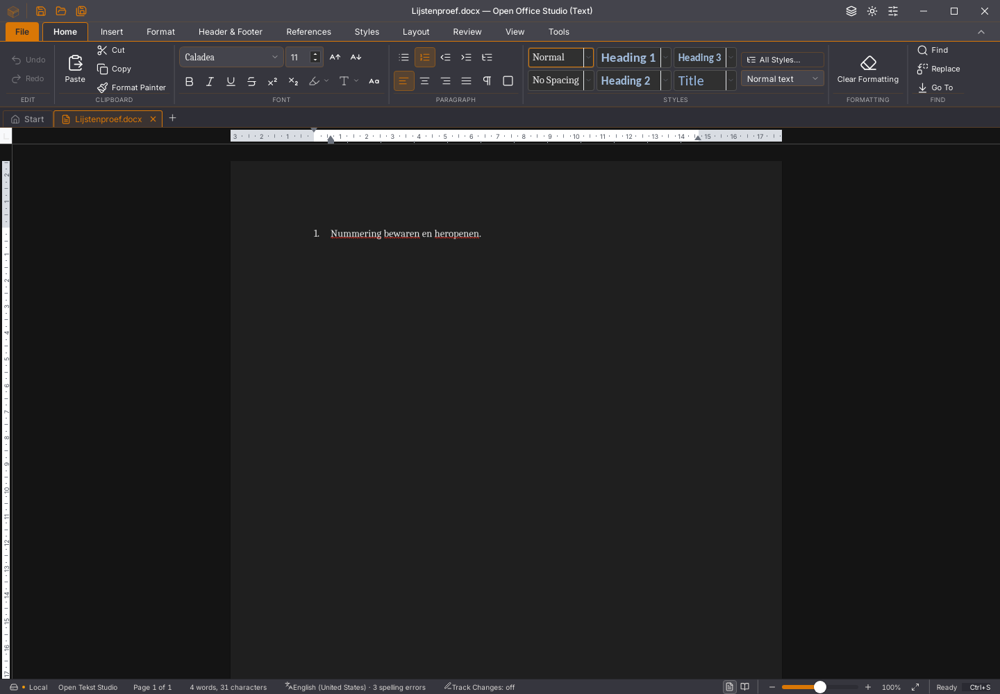

# Writer 45.27: foutstatus van gedeelde renderers

Bij het overnemen van een bestaande display-list-handle werd een Wasm-trap
als een gewone fout behandeld: de adapter probeerde de handle te sluiten en
opnieuw te openen in dezelfde beschadigde instantie. De andere querylezers
van die instantie bleven bovendien `ready` melden. Beide fouten zijn met
de werkelijk geïnstalleerde SDK-API gereproduceerd: twee van de eerste drie
regressiegevallen falen vóór de correctie.

De bronpatch onderscheidt nu ook tijdens handle-overdracht een Wasm-trap
van een gewone fout. Na een trap wordt dezelfde instantie niet opnieuw
aangeroepen. Een zwakke brongebonden foutregistratie laat bestaande en nieuwe
lezers dezelfde fout teruggeven en laat een onafhankelijke instantie werken.
Een gewone fout behoudt de bestaande nieuwe-handle-/JSON-terugval. De normale
paginaweergave, documentbron en invoerbediening zijn niet aangepast.

Zes gerichte regressies controleren de overdracht, paginalading, openen,
gedeelde bron, onafhankelijke bron, gewone terugval en afmelden van luisteraars.
Ze gebruiken bewust opgewekte fouten in de echte SDK-adapter. Dit bewijst
correcte foutclassificatie en levensduur, geen herstel van de onderliggende
Wasm-geheugenfout en geen automatische herbouw van de volledige sessie.

De React-consument meldt na `whenReady()` nog onvoorwaardelijk gereed en
abonneert zich nog niet op `onDisplayListQuerySourceFailure`. Die aansluiting
en veilig sessieherstel met behoud van selectie/invoer blijven open. De
gewijzigde core weigert verdere Wasm-queryaanroepen ook wanneer een consument
zijn oude facade nog vasthoudt.

## Gebouwde desktop en controles

De productiebouw, TypeScript en weekversie slagen. De zelfstandige volledige
Vitest-ronde eindigt met procescode 0: 1.679 tests in 156 bestanden slagen.
Een eerdere opdrachtketen had dezelfde positieve testsamenvatting maar eindigde
met code 143 vóór de aansluitende controles; die keten blijft afzonderlijk
bewaard en is niet als volledig groen geteld.

Op de echte Linux-binary slagen zeven lijst-/bewaarstappen, de drie stappen
met een daadwerkelijk vertraagd Rust-plakantwoord en elf 500-pagina-/herstel-
stappen. De laatste proef doorstaat bovendien twintig extra selectie-/
geschiedenisrondes met aangevraagde garbagecollection. Onafhankelijk gelezen
DOCX, heropenen en beide herstelkeuzes behouden de inhoud. Dit is één lokale
runtime en geen bewijs dat de eerdere incidentele geheugentrappen zijn hersteld.

Het heropende lijstbeeld verschilt op 36 cursorpixels van de gekozen
45.26-opname. Andere actiebeelden bevatten onder meer een andere opslagmelding
en lint-/bewaarstatus; de beelden zijn geen volledige pixelpariteitsacceptatie.
De [meetgegevens, hashes, echte GUI-rapporten en grenzen](2026-11-04-writer-renderer-levensduur.json)
leggen de precieze omvang vast. Er wordt geen nieuwe invoer- of FPS-verbetering
geclaimd.

## Afzonderlijke platformafkeuringen

De [45.26-geheugenroute](https://github.com/OpenAEC-Foundation/open-office-studio/actions/runs/41746035415)
doorstaat elf normale bewaar-/herstelstappen. De extra geschiedenis-/GC-proef
faalt in ronde acht op `editsession_materialize_docx`. Alle 500 bronalinea’s
zijn daar nog exact. De oorspronkelijke ELF, proefcode en tien contextbestanden
zijn bewaard en op checksums gecontroleerd. De huidige querycorrectie raakt
die afzonderlijke documentworkerroute niet. Zie [bewijs en omvang](2026-11-04-writer-geheugen-45.26.json).

De macOS-zeveneditieroute op dezelfde bron faalt vóór het bouwen op drie
ontbrekende versleutelde corpusbestanden. De verplichte downloadstap meldde
ten onrechte succes bij afzonderlijke downloadfouten. De downloader doet nu
maximaal drie pogingen bij tijdelijke verbindings-/HTTP-fouten en keurt een
onvolledig expliciet manifest af. Zowel Git-bronhash als vastgelegde SHA-256
blijven verplicht. Ontbrekende bestanden worden niet overgeslagen en de
corpusacceptatie wordt niet versoepeld.

Zeven afzonderlijke CLI-proeven met een echte lokale HTTP-server controleren
tijdelijke fouten, een blijvende afkeuring, een ontbrekend bestand, verkeerde
broninhoud/SHA-256, een geldige cache en een gedeeltelijk manifest. Een schone
download van de vier werkelijk vastgelegde proefbestanden slaagt daarnaast.
De oorspronkelijke en nieuwe CLI zijn ook rechtstreeks vergeleken met dezelfde
eigen HTTP-404: oorspronkelijk afsluitcode 0 ondanks `downloadfout`, na de
correctie afsluitcode 1. [Bewijs](2026-11-04-corpus-download.json).
De macOS-/editiecontrole moet op de nieuwe bron nog opnieuw worden uitgevoerd.

De gecontroleerde [Linux-devdownload 45.26](../gebruik/ontwikkelbuild-linux.md)
staat los van deze lokale 45.27-kandidaat. De officiële release en bestaande
gebruikersstarter zijn behouden. Geen issue of migratievlag is gesloten.
