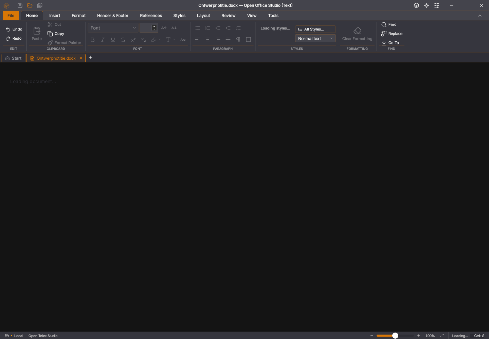

# Afgekeurde Linux-opstart van Writer 45.22

De [Linux-taak van de zeveneditiebouw](https://github.com/OpenAEC-Foundation/open-office-studio/actions/runs/41683811723/job/126084448888)
faalt bij de native bewaar-/plakproef met een eigen kopie van
`Ontwerpnotitie.docx`. De voorafgaande 500-paginaproef slaagt, inclusief bewaren
en heropenen. De nieuwe proef bereikt geen plakronde: de eerste inspectieopdracht
krijgt geen antwoord. Het rapport eindigt met `TimeoutError()`.

De [programmauitvoer](writer-renderer-opstart/programma-45.22.txt) meldt eerst `integer is too large: 2` tijdens de compilatie
van `sksl_shared` en daarna een fatale fout in `SkSLModuleLoader.cpp`.
De afbeelding toont een zwart documentvlak met “Loading document…” en een
nog ladend stijlenpaneel. Dit is een afzonderlijk waargenomen foutbeeld;
een verband met de eerdere Wasm-allocatorpanic of herstelstartfout is niet
bewezen. De oorzaak en een productcorrectie zijn nog niet vastgesteld.

## Herleidbaarheid en grenzen

- Bronrevisie: `547d9778433360604750a7df41beb8fa26557d31`.
- Werkelijk gestarte ELF volgens het rapport:
  `e82356a8fea7c4c98482a1fda7c41f7997298e10948df0ade98b9d6322f30f31`.
- Dezelfde ELF-checksum komt voor in de geslaagde 500-paginaproef en in de
  afzonderlijke geslaagde herstel-/geheugenronde. Groen in die proeven bewijst
  dus geen volledige stabiliteit.
- Het installatiegedeelte van de bouwlog vermeldt WebKitGTK en JavaScriptCore
  `2.50.4-0ubuntu0.22.04.1`. Het negatieve plakrapport registreert nog geen
  geladen bibliotheekpaden; dit is pakketinformatie van de runner.
- [Het negatieve plakartifact](https://github.com/OpenAEC-Foundation/open-office-studio/actions/runs/41683811723/artifacts/13253634481)
  bevat het rapport, de eigen proefbron, programmauitvoer en afbeelding.
  De [vastgelegde gegevens](2026-11-03-writer-renderer-opstart.json) bevatten hun
  checksums. De afbeelding en uitvoer zijn ongewijzigd overgenomen.
- De exacte raw binary is bij deze afkeuring **niet** gearchiveerd. De oude
  verzamelstap keek uitsluitend naar het groene 500-paginarapport en miste
  daardoor de latere afkeuring. Een lokale binary met hetzelfde versienummer
  is geen vervanging voor de ontbrekende oorspronkelijke bytes.
- De gewone desktop-DEB uit de geslaagde bouw is afzonderlijk opgehaald. Zijn
  uitvoerbare bestand heeft SHA256
  `bbeae602eeea98f7eeca84529c8e0644df9b8950cc73735acdf777330e15ce75`,
  dat afwijkt van de negatieve raw binary. Ook deze verpakking is dus geen
  bewijs voor een reproductie met exact hetzelfde uitvoerbestand.

## Verbetering van de foutregistratie

De desktop- en uitgaveworkflow bieden nu alle vijf vaste native Writer-rapporten
aan: kleur, klembord, lijsten, 500 pagina’s en bewaren/plakken. De verzamelaar
slaat groene of ontbrekende rapporten over en kiest de eerste afkeuring. Hij
weigert vóór het maken van bestanden een programma met een andere checksum.

Het primaire proefscript wordt uitsluitend herkend aan zijn gerapporteerde
checksum binnen een vaste lijst. Is het script sindsdien veranderd, dan meldt
het pakket dat de oorspronkelijke bytes ontbreken. Gedeelde hulpmiddelen uit
de huidige checkout worden afzonderlijk als zodanig aangeduid. Alleen vaste
eigen proefbestandsnamen worden meegenomen; willekeurige bestanden uit de
rapportmap blijven erbuiten. Ook de kleurproef legt voortaan haar scriptchecksum
vast.

De gerichte geheugenworkflow voert na de herstel-/geheugenstappen nu ook de
bestaande native voorbeeld-/plak-/bewaarproef uit. Een afkeuring daarvan wordt
eveneens aan de exacte raw binary gekoppeld. Dit voegt een controle toe; de
bestaande proeven en tijdgrenzen blijven gelden.

Negen gerichte unitproeven controleren onder meer de echte gemiste volgorde:
een groen 500-paginarapport gevolgd door een afgekeurd plakrapport. Ze bewijzen
dat de plakbron en het juiste proefscript worden gearchiveerd en dat een andere
binary wordt geweigerd. Dit herstelt de onderzoeksketen, **niet** de rendererfout.
Er zijn geen proefgrenzen versoepeld of renderfuncties uitgeschakeld.
