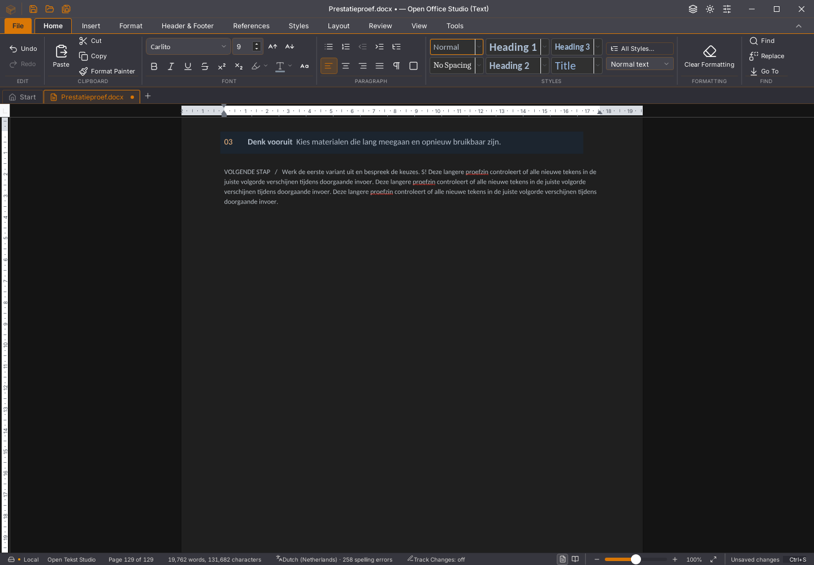

# Writer 45.39: hergebruik na exacte bronbevestiging

45.39 / Rust alpha54 vermindert de doorgaande-invoervertraging op de eigen
129-paginabron met 256 tabellen. De volledige getypte alinea verschijnt in
twee afwisselende ronden na 23.218 en 23.400 ms, tegenover 31.748 en
31.894 ms op 45.38: ongeveer 27% eerder in deze beperkte vergelijking.
Dat is nog steeds te traag. Geen snelheidsissue of migratievlag is gesloten.

## Oorzaak en wijziging

De aanvullende RPC-meting op 45.38 registreert 58 batches voor 351 tekens.
Rust besteedt samen 15.256 ms aan voorbereiding, tegenover 15.676 ms inclusief
transport en antwoordverwerking. Het telkens opnieuw importeren van de grote
bevestigde bron blijkt dus een belangrijke kostenpost. De eerste bronsnapshot
omvat 7.872.608 base64-tekens; vervolgdeltas zijn ongeveer 6.200 tekens.

Een afzonderlijke, nog onbevestigde replica blijft nu op een eigen Rust-werker
per document beschikbaar. Zij mag uitsluitend worden hergebruikt wanneer de
clientidentiteit, SHA-256 van de bewaarde bevestigde basis én alle ontvangen
deltabytes exact overeenkomen met het vorige voorstel. Alleen gelijke
CRDT-klokken of een gelijke vector volstaan niet. De inhoudelijke bronvector-
en afhankelijkheidscontrole blijven ook bij hergebruik verplicht.

De bevestigde bronbytes blijven strikt gescheiden van die replica. Een
afwijkende delta, een volledige nieuwe bron of een ontbrekende basis gebruikt
de bestaande reconstructieroute. Mislukte bewerkingen wijzigen de bevestigde
bron niet. De nieuwe threadgebonden documentobjecten gaan nooit door een
threadkanaal; alleen aanvragen en antwoorden doen dat. Iedere werker heeft
een begrensd aanvraagkanaal. Vensterbinding, LRU, maximaal vier bewaarde bronnen,
64 MiB geserialiseerde bron- plus voorstelbytes en het verbod op herregistratie van vergeten
werk blijven gelden. Dit is geen bewijs van een totale RSS-limiet.

In de 45.39-RPC-ronde kosten 67 batches samen 6.197 ms Rust-voorbereiding.
De invoerbarrière volgt na 15.793 ms, waarvan 11.941 ms na het afwachten van
de toetszender. De hogere batchtelling en resterende vertraging blijven
zichtbaar in het [volledige rapport](2026-11-04-writer-replica-hergebruik.json).
Dit is geen algemene prestatievergelijking of claim over andere documenten.

## Werkelijk getekende tekst en behoud

De reeks is oud/nieuw/nieuw/oud, met steeds een nieuwe eigen kopie en een
geïsoleerd profiel. Tijdens de pixelmeting lopen geen extra editorqueries of
geforceerde animatieframes. Alleen X11-pixels worden gelezen. Het neutrale
tekstmasker laat rode spellingsgolven en een kleine cursorzone buiten beschouwing.
De invoerbarrière wordt in deze proef pas daarna afgewacht; zij is dus geen
afzonderlijke wachtrijmeting.

| Ronde | Hele getypte alinea getekend |
| --- | ---: |
| 45.38 vooraf | 31.748 ms |
| 45.39 eerste | 23.218 ms |
| 45.39 tweede | 23.400 ms |
| 45.38 achteraf | 31.894 ms |

Alle 3.329 alinea- en celteksten in 1.537 verhalen blijven exact, met alleen
de bedoelde toevoeging. De foutregistraties van deze vier ronden zijn leeg.
De twee nieuwe volledige eindbeelden van 1440 × 1000 pixels zijn bovendien
exact gelijk aan de eerste referentie, dus ook buiten het tekstmasker. De laatste
referentie verschilt op 35 pixels: 30 van de knipperende cursor en vijf in
navigatie/status. Buiten de cursorzone is de documentpagina ook daar gelijk.
Dit bewijst één venstertoestand;
de volledige Rust-interface is hiermee niet visueel geaccepteerd.

Het eerdere prototype met SHA-256 `7bf66301…` en zijn meetgegevens blijft apart
bewaard. Pas de definitieve kandidaat telt ook de nog onbevestigde delta mee
in het cachebudget. Alle onderstaande native scenario's en de tabel hierboven
zijn opnieuw uitgevoerd op de definitieve binary.

## Controles en resterend werk

De 30 Rust-tests omvatten herhaalde bevestigde voorstellen tegenover volledige
reconstructie, andere tekst met dezelfde klokken, weigering van een verkeerde
vector vier gelijktijdige documentwerkers met foutisolatie en verdringing van een grote nog niet overgenomen delta, ook wanneer de bevestigde bron zelf klein is. De 1.819
frontendtests, 77 Python-tests, TypeScript/productiebouw, weekversie, gerichte
Clippy op de definitieve alpha54-bron en de zes eigen Rust-formatcontroles slagen.

Tien native scenario's op de exacte 45.39-binary slagen: bewust opgewekte
rendererfouten, 500 pagina's met lettertypen/paginering, vertraagde tekst-
antwoorden en selectie, twintig GC-/herstelronden, acht rijke plakronden,
vervolginvoer bij 256 tabellen, kleuren, bewaren/verwerpen, fysieke tabelgrepen
en de volgorde van asynchrone plakacties. De achtste rijke plakronde vraagt
nog 19.574 ms; vervolginvoer na het grote plakken 3.575 ms. De onafhankelijke
DOCX-bodyhash inclusief opmaak blijft bij acht plakronden
`0808d3dcf34c8251d371d9e4c6eda470ed2597acd850062b5b5f70169333a302`.

De eerste Rust- en desktopbouw en de eerste frontendronde raakten de volle
schijf. Hun negatieve logs blijven bewaard; zij tellen niet als groen. Daarna
zijn uitsluitend oude statische compilerarchieven vrijgemaakt, met behoud van
appbinaries, documenten en foutbewijzen. De definitieve desktopbouw eindigt
met code 0. De bevroren binary heeft SHA-256
`f25c6c3395781209f0d1760c035110c0e846f0b1e394d90860d5e8a526ccc75d`.

De eerdere 45.38-CI-ronden zijn inmiddels alle acht geslaagd, inclusief de
drie releaseplatforms en zeven edities. Publiceren is overgeslagen. Dat bewijst
de controles van die bronrevisie; de platform-/editieronden voor 45.39 volgen
afzonderlijk na push. De gecontroleerde 45.38-Linux-devdownload blijft
[apart beschikbaar](../gebruik/ontwikkelbuild-linux.md).

De volgende stap is de resterende voorbereiding, bronserialisatie en
layout-/lettertypewachtrij profileren, gevolgd door dezelfde bron-, selectie-,
Undo-, bewaar- en pixelcontroles. Algemene FPS, enorme documenten, native heap-
en threadlevensduur over veel vensters, eerdere incidentele workerfouten,
alle bestandsformaten en de volledige Rust-interface blijven open.
Alle 118 issues, tien migratiegebieden en dertig acceptatievlaggen blijven open.
Er is geen officiële release gepubliceerd of gebruikersstarter vervangen.
