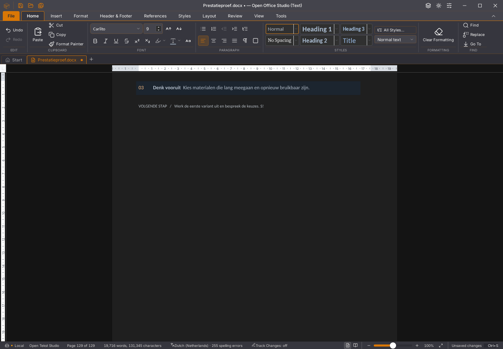
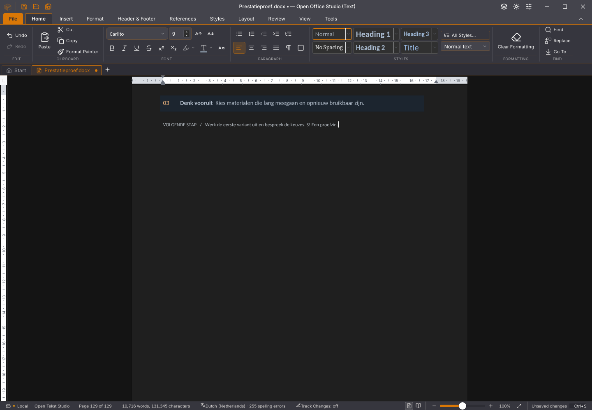
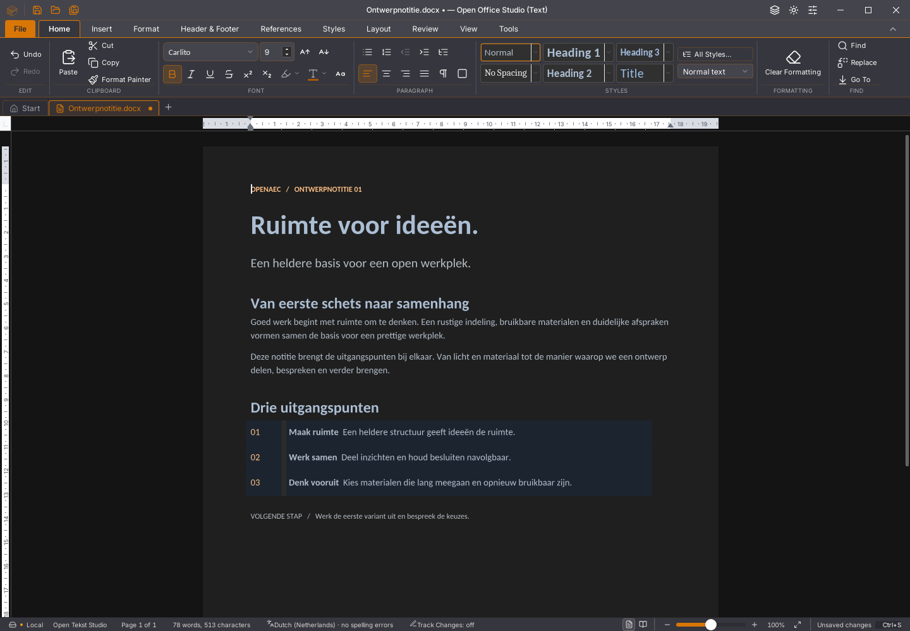

# Writer 45.38 / Rust alpha53: bevestigde bronspiegel

Gewone native tekstinvoer verstuurt na de eerste volledige bron alleen delta’s
tegen een door Rust bevestigde bronvector. Rust bewaart de bron vóór het
voorstel. Een niet-overgenomen of te laat antwoord komt daardoor niet ongemerkt
in volgende invoer terug. Nieuwe sessies en ontbrekende basissen worden
expliciet volledig gesynchroniseerd. In de echte 500-paginaproef bestaat de
eerste documentpayload uit 1.224.420 base64-/ASCII-bytes; de zes volgende
payloads bevatten ieder 48 bytes. Alle zeven tekstbatches gaan daadwerkelijk
via de native Rust-opdracht.

De samengevoegde bron wordt zonder identiteitsherstel geïmporteerd. Rust
decodeert en vergelijkt haar vector met de door de editor aangeleverde vector.
De bevestiging geeft die exacte aangeleverde vector terug. De bestaande
bronversie-, generatie-, levensduur-, selectie- en Undo-controles blijven actief.
De bron wordt eenmaal geïmporteerd; dezelfde lokale Rust-replica bereidt daarna
het voorstel voor. De bevestigde bytes blijven van vóór die bewerking.

De venstergebonden voorraad bewaart maximaal vier bronnen en 64 MiB bevestigde
bronbytes. Werkreplica’s en lopende opdrachten gebruiken daarnaast tijdelijk
geheugen. Een verdrongen bron wordt nooit als een leeg document gebruikt:
de aanroeper levert opnieuw de volledige bron. Sluiten laat de eigen bron los;
andere vensters houden hun eigen binding. Rijke plakacties gebruiken hun
bestaande protocol; hun onderliggende voorbereidingsbewerking blijft gedeeld.

## Tijd tot daadwerkelijk zichtbare tekst

Vier afwisselende ronden openen dezelfde eigen 129-paginakopie met 256 tabellen.
Echte toetsen en de invoerbarrière worden gevolgd door een actuele finale
layout. Daarna leest de proef uitsluitend X11-schermpixels tot het volledige
getypte tekstgebied exact overeenkomt met de 45.37-referentie. Geen extra
editorquery, RAF of vaste nawacht lokt de verfbeurt uit. Cursor en
spellingonderstreping vallen buiten dat vaste tekstgebied. Alle teksten in
1.537 verhalen worden vervolgens onafhankelijk van deze pixelcontrole getoetst.

| Ronde | Invoer/barrière (ms) | Actuele finale layout (ms) | Getekende tekst (ms) |
| --- | ---: | ---: | ---: |
| 45.37 vóór | 2.842 | 3.897 | 4.168 |
| 45.38 eerste | 1.995 | 3.058 | 3.473 |
| 45.38 herhaald | 1.848 | 2.891 | 3.305 |
| 45.37 na | 2.257 | 3.346 | 3.698 |

In deze twee paren verschijnt de volledige tekst ongeveer 11–17% eerder.
Dit is één bron en één Linux-pc onder geïsoleerde Xvfb/X11-softwareweergave, geen algemene FPS- of
platformacceptatie. Ruim drie seconden blijft te traag. Ook de extra 271–415 ms
tussen finale layout en zichtbaar resultaat blijft expliciet in de meting staan.

De eerdere vier bronmetingen blijven ongewijzigd bewaard: 2.349/1.955/1.935/2.215 ms
voor oud/nieuw/nieuw/oud, en 3.724/3.016/3.001/3.301 ms tot finale layout.
De kandidaatopnamen misten daar nog de getypte letters, ondanks correcte bron
en layout. De afzonderlijke verfdiagnose toont de tekst na volgende tekenframes.
Daarom zijn de sterkere passieve pixelmetingen toegevoegd; de oorspronkelijke
opnamen zijn niet vervangen of als volledige visuele acceptatie voorgesteld.

Na de passieve pixelcontrole is ook het tekstgebied in alle vier uiteindelijke
opnamen exact. Het volledige lint heeft nul afwijkende pixels. De kandidaat
verschilt over het hele venster op drie navigatiepixels; alle overige pixels
zijn gelijk. Dit is één toestand, geen volledige suite-UI-pariteit.

## Functies en gegevensbehoud

Twintig native ronden zijn terminal geslaagd: twaalf functionele ronden en
acht afwisselende bron-/verfmetingen. Veertien ronden gebruiken de kandidaat en
zes de referentie. De 500-paginaproef doorstaat acht bron-/geschiedenis-/bewaar-
en heropenstappen, zeven spellingstoestanden en vier volledige fontvarianten.
Invoer/spelling vraagt daar 932 ms. De herstel-/geheugenproef doorstaat elf
bronstappen en twintig extra selectie-/Backspace-/Undo-/Redo-ronden met expliciete
geheugenopruiming; invoer vraagt daar 1.102 ms. Ook de drie vertraagde
Rust-tekstantwoorden, oorspronkelijke queryfoutstack, zeven kleurstappen,
plakvolgorde, tussenbewaring en fysiek slepen van tabelranden met Undo/Redo,
onafhankelijk gelezen DOCX en heropenen slagen.

Acht rijke plakronden behouden 129 finale pagina’s, 256 tabellen en 1.536 cellen.
De onafhankelijke opmaakhash blijft
`0808d3dcf34c8251d371d9e4c6eda470ed2597acd850062b5b5f70169333a302`.
De laatste plakactie vraagt nog 19.671 ms. Vervolginvoer tijdens spelling na
verdubbelen van 128 tabellen vraagt 4.080 ms, met actuele finale layout en
exacte bron/structuur. Deze afzonderlijke proeven bewijzen geen algemene winst
voor rijke plakacties. De rijke plakproef bewaart en toetst voortaan ook de
bestaande opname van kritieke enginefouten.

25 Rust-proeven, 1.819 frontendtests, TypeScript, 77 Python-tests, weekversie,
werkruimte-rustfmt, gerichte clippy met alle targets en de Linux-productiebouw
slagen. De oorspronkelijke samengestelde bouwketen eindigde met code 143 nadat
de compiler al gereed was; zij geldt niet als geslaagde complete opdracht.
De directe CLI en herbouw na rustfmt sluiten schoon af met code 0 en leveren
bytegelijk de geteste ELF:
`6af66a21a9ec43db3c81a6b3c39cfa30971668007e185660e647055758f5b5e1`.
De volledige workspace-clippy, overige platformen en zeven edities volgen via CI.

## Aanvullende controles van de levensduur

De nieuwe gerichte route doorstaat 41 frontendgevallen, waaronder geldige
hydratie van dezelfde replica en versietokens met een ondoorzichtige vorm.
Een verkennende tweede `openDocx(..., true)` op een reeds gezaaide sessie gaf
“story body already exists”; dat was geen geldige vervangingsproef. Een tweede
verkennende aanname over tokenprefixen was evenmin een API-contract. Beide
gevallen blijven bewaard, maar gelden niet als productregressie. Er is geen
parsing van tokenprefixen toegevoegd. Geen productcorrectie is op die onjuiste
aannames gebaseerd.

## Open afkeuringen van 45.37

De [gerichte geheugenronde](https://github.com/OpenAEC-Foundation/open-office-studio/actions/runs/41834760855)
faalt tijdens drie rijke plakronden met bewaren na de eerste ronde. Bron-,
structuur- en actuele layoutcontroles slagen; de GUI meldt een workergeheugenfout
bij `editsession_materialize_docx`. De console meldt daarnaast `FrameDelta:
document epoch moved backwards`, gevolgd door terugval naar de hoofdthread.
Een gemeenschappelijke oorzaak met andere afkeuringen is niet bewezen.

De Linux-taak uit de [zeveneditieronde](https://github.com/OpenAEC-Foundation/open-office-studio/actions/runs/41834854995)
faalt al tijdens openen vóór de vertraagde plakvolgordeproef. Er zijn geen
voltooide proefstappen en de inspectie wacht vergeefs op de eerste sessie.
De vastgelegde screenshot toont “Loading document…”. Dit staat apart van de
geheugenfout; een langere tijdgrens is niet als oplossing toegepast.
Windows en macOS slagen in die ronde; publiceren is overgeslagen.

Beide afkeuringen gebruiken exact dezelfde oorspronkelijke ELF:
`3aa02024415aa676550c00d35f18bfc7318832e5567749b75d8997450ecd629f`.
De oorspronkelijke ZIP-bestanden, volledige contextinhoud en bron-/scriptbytes
zijn behouden en hun ingesloten checksums gecontroleerd. Beide bytegelijke
originele proefroutes slagen lokaal met die exacte negatieve ELF. Dat is geen
bewijs dat de oorzaken verklaard of hersteld zijn. De brede 45.37-desktop- en
WebView-routes slagen op alle drie platforms; de kleinere devpakketproef slaagt
ook. Hun scope sluit de afzonderlijke afkeuringen niet uit.

Alle 118 issues, tien migratiegebieden en dertig acceptatievlaggen blijven open.
De volledige Rust-interface en volledige functie-/formaat-/platformacceptatie
zijn niet afgerond. Gebruikersstarter 45.23, gebruikersdocumenten en lopende apps
zijn behouden. Er wordt geen officiële release gepubliceerd.

[Exacte rapporten, oorspronkelijke afkeuringen, hashes en meetgrenzen](2026-11-04-writer-rust-bronspiegel.json).
