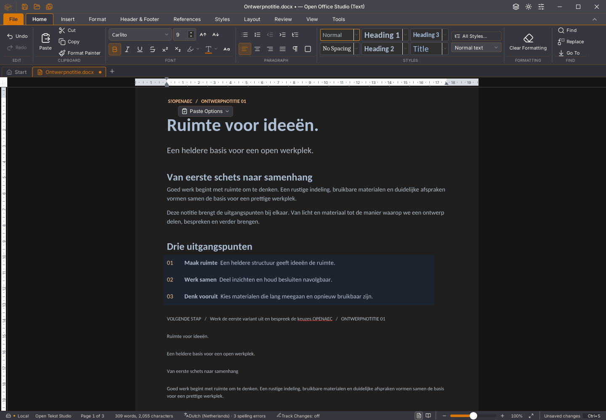
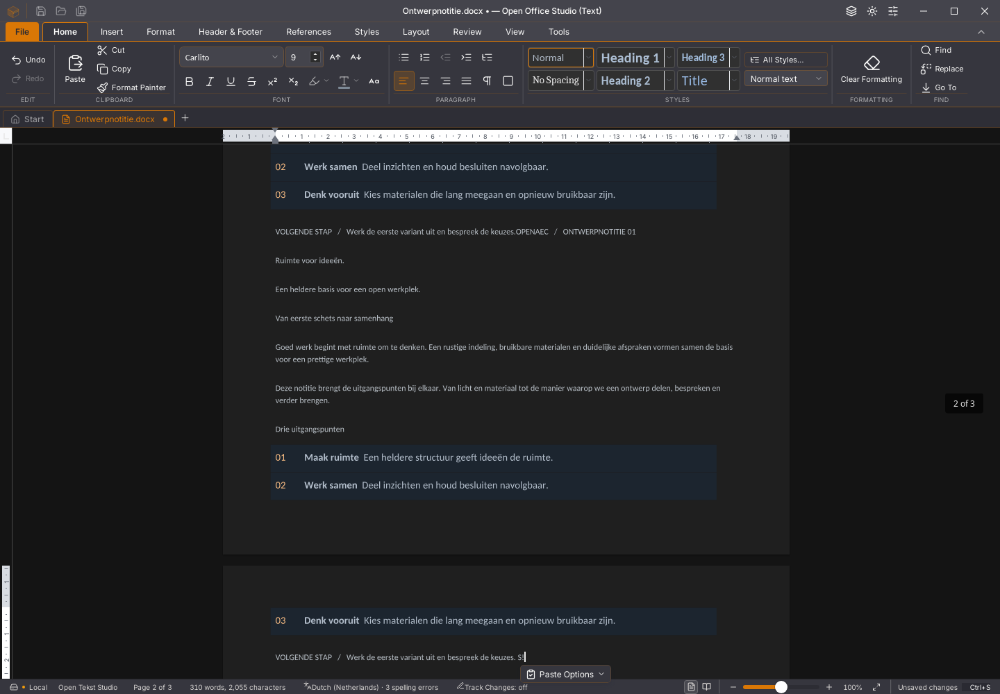
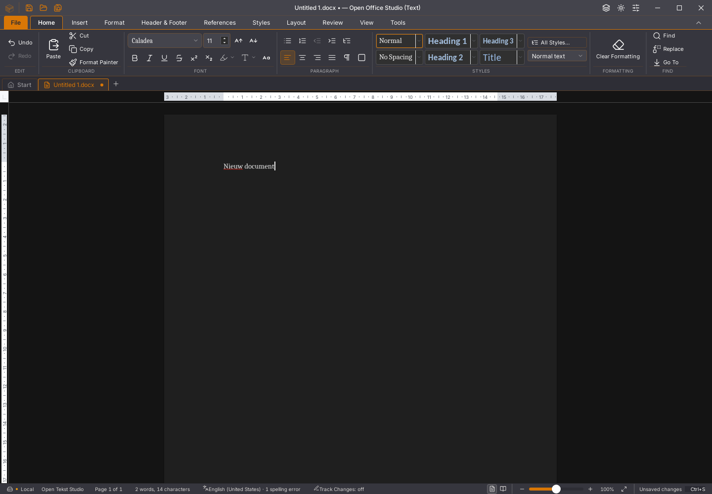

# Writer 45.24: gedeelde Rust-plakvoorbereiding

De Tauri-kandidaat bereidt rijke plakacties in hoofdtekst en tabelcellen buiten
de WebView voor. De bestaande invoerwachtrij wacht op de volledige brongebonden
bewerking, inclusief eigen plakopmaak. Volgende toetsen en bewaarsnapshots
blijven in volgorde. Dit is een concrete migratiestap; de volledige
Rust-WebView-interface gebruikt deze rijke route nog niet.

De gedeelde bibliotheek en gewijzigde leesprimitieven staan in `native`, met
vastgelegde bronherkomst, oorspronkelijke licentieteksten en wijzigingsmeldingen.
De desktopkoppeling controleert documentlevensduur, opdracht, bronversie,
wijzigingsgeneratie en snapshothash. Een oude delta wordt niet overgenomen.
Het oorspronkelijke plakdoel beweegt met de bron mee; sluiten maakt late
antwoorden ongeldig. Grote of voortdurend gewijzigde bronnen behouden de
volledige oorspronkelijke route, zonder tekst af te kappen.

## Gevonden en gerepareerde cursorfout

De nieuwe volgordeproef houdt uitsluitend de terugbezorging van een werkelijk
door Rust berekend antwoord vast. Tijdens het wachten voert zij fysieke
toetsen voor tekst, selectie, vervanging en Save in. De eerste kandidaat plakt
op de juiste plaats, maar schrijft de volgende tekst ten onrechte aan het
documentbegin. De trace toont dat de spellingwijzigingsmelding tussendoor
`getSelectionRange` leest. De oude SDK-leesroute kent de nieuwe alinea nog niet
via haar achterlopende weergavekaart en initialiseert de cursor schrijvend
opnieuw op de eerste alinea.

De correctie maakt de weergaveselectielezing niet-schrijvend. Een geldige
bronselectie wordt bij een ontbrekende kaartalinea tegen de werkelijke
alineaspans gecontroleerd en behouden. De gewone passende kaart vraagt geen
extra volledige alinealezing. Drie gerichte regressietests controleren deze
gevallen. De oorspronkelijke negatieve binary, proefbron, trace en het exacte
testscript blijven lokaal in een volledig gecontroleerd foutcontextpakket
bewaard; de afkeuring wordt niet door het groene rapport vervangen.

## Aantoonbaar gecontroleerd

- 1.656 frontendtests in 152 bestanden; TypeScript via de productiebouw,
  weekversie en module-opdrachten. De gerichte aansluitingstests bewaken ook
  latere selectie, verouderde bron, sluiten/reactiveren en een afwijkend antwoord.
- Vijf Rust-protocoltests en twee directe leeslaagentests tegen de werkelijke
  productiebronnen. De oorspronkelijke registerbronnen worden niet gewijzigd.
- De werkelijke desktopcodec doorstaat dezelfde 27 SDK-/DOCX-vergelijkingen,
  acht negatieve aanvragen en grote proef met 128 naar 256 tabellen als het
  afzonderlijke onderzoek. Alle 1.537 verhalen, opmaak, identiteiten, cursor,
  undo/redo en alle 14 DOCX-onderdelen blijven gelijk. De volledige bestanden
  zijn bytegelijk. Tijdens deze gegevensronde liep een compilatie; haar tijden
  worden niet als rustige snelheidsvergelijking gebruikt.
- De gecorrigeerde echte Linux/WebKit-volgordeproef slaagt: tekst en bronopmaak
  verdwijnen samen met één Undo en komen bronexact terug met Redo; snelle
  vervolginvoer en Shift-selectie blijven op de juiste plaats. Save vóór het
  antwoord bewaart ook die latere invoer, onafhankelijk teruggelezen uit DOCX.
- Niet opslaan sluit zonder op het plakantwoord te wachten. Een nieuw document
  behoudt zijn getypte tekst nadat het oude antwoord is vrijgegeven; geen late
  delta raakt de gesloten sessie en de eerder bewaarde bron blijft ongewijzigd.
- De 500-paginaproef behoudt alle acht bronstappen, inclusief Backspace,
  geschiedenis, werkelijke bewaring en heropenen in een nieuw proces. Foutenlijsten
  van GUI en engine blijven leeg. Ook hier liep compilatie: geen snelheidsclaim.

De testbinary is SHA-256
`ff697f583774b32be739cb4ba3a72717f4e8d78f90fa1f38eb31c99ebeb990be`.
De afgekeurde eerste kandidaat is
`e933360ed96677a5f2939150dc63aad9d2601efba6c9c76d37620660d31c6ee7`.
Versienamen alleen bewijzen dus niet welke kandidaat is getoetst.

De vergelijking met de bestaande 45.23-beelden heeft nul afwijkende pixels
in het kop-/voettekstlint, negen kleine pixelverschillen in het Startlint en
zes in het volledige getypte venster (logo en zoomlabel). Het documentvlak
van dat laatste beeldenpaar is gelijk. Dit is geen volledige pixelacceptatie
voor alle vensters, toestanden, modules of platforms.

## Openstaande grenzen

De rustige grote plakproef, volledige native werkruimtecontrole en nieuwe
platform-/zeveneditieronde worden afzonderlijk vervolgd. De eerdere allocator-,
Wasm-geheugen-, renderer- en opstartafkeuringen zijn hiermee niet opgelost.
Volledige zichtbare brongetrouwheid van intern gekopieerde kop-/alineastijlen
vraagt nog eigen onderzoek; gelijkheid aan de bestaande SDK-route bewijst die
getrouwheid niet. De huidige beelden laten die acceptatie uitdrukkelijk open.

Alle 118 GitHub-issues, tien migratiegebieden en dertig acceptatievlaggen blijven
open. De gebruikersstarter en al geopende documenten zijn niet vervangen.
De exacte gegevens en negatieve/positieve traces staan in
[het testverslag](2026-11-03-writer-rust-plakken-desktop.json).
