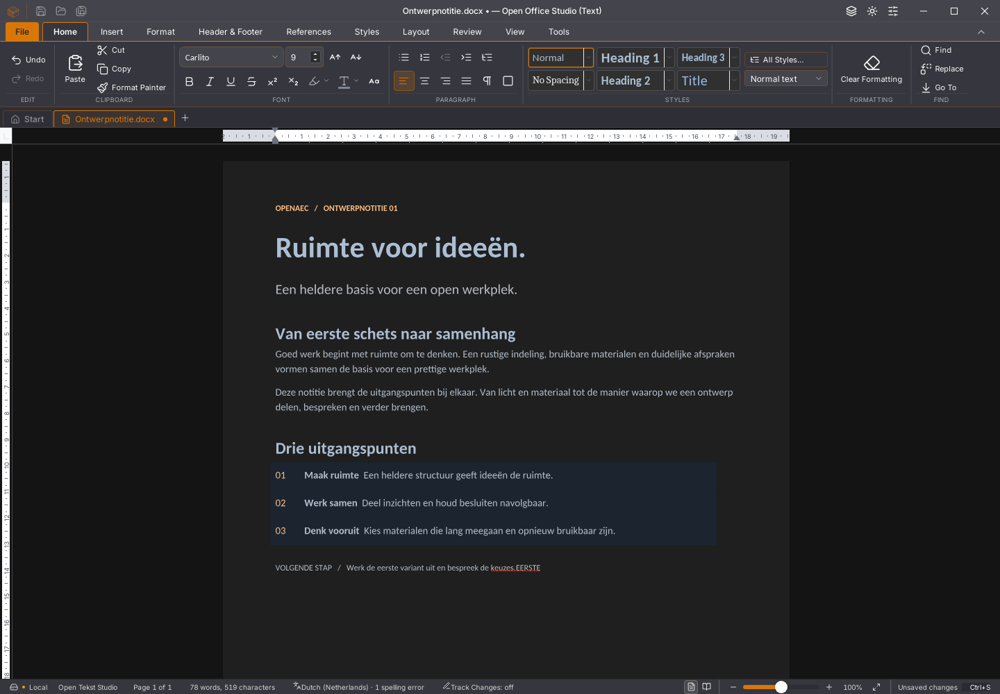
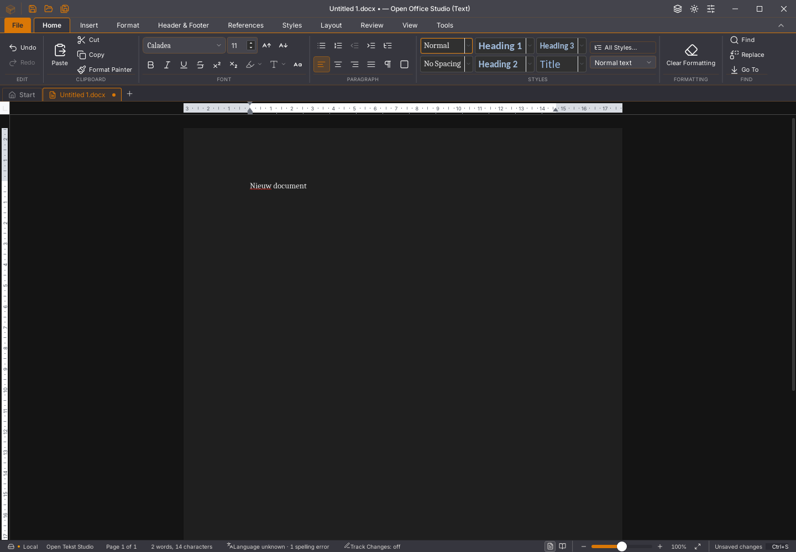

# Writer 45.29: gewone invoer voorbereiden in Rust

De bestaande Tauri-interface gebruikt de gedeelde Rust-kern nu ook voor gewone
ASCII-invoer in hoofdtekst en tabelcellen. Dat haalt deze invoegbewerking uit
de Wasm-werkerroute `editsession_apply_input`. De levende documentsessie,
layout en overige bediening zijn hiermee nog niet volledig naar Rust verhuisd.
Dit is geen oplossingverklaring voor alle geheugenfouten of de snelheidsklacht.

De opdracht `writer_tekst_voorbereiden` voert dezelfde volledige invoegbewerking
uit op een aparte replica. Het antwoord hoort bij precies één document,
levensduur, bronversie, snapshothash, client en opdracht. De bestaande invoerwachtrij
wacht op het antwoord. Een gewijzigde bron wordt opnieuw voorbereid; sluiten
maakt een laat antwoord ongeldig. Bestaande typgroepering en Undo-grenzen blijven
behouden. Er komt geen plakgrens tussen iedere letter.

Unicode, IME/compositie, geselecteerde tekst vervangen, revisie-invoer,
expliciete invoegopmaak en kop-/voetteksten behouden voorlopig hun bestaande
volledige afhandeling. Zonder desktopprovider blijft de oorspronkelijke webroute
actief. Grote of voortdurend wijzigende bronnen behouden ook de bestaande
terugval. Deze grenzen zijn geen afvinkbare volledige invoermigratie.

## Aantoonbare controles

- Acht Rust-tests slagen. Vijftien echte codecgevallen vergelijken onafhankelijk
  met SDK `insertText`: begin/midden/einde, opmaakgrens, spaties, Unicode,
  lege alinea, tabelcel, leidende tabel, bladwijzer en revisies. Alle verhalen,
  identiteiten, opmaak, cursor, Undo/Redo en DOCX-onderdelen komen overeen;
  opnieuw openen behoudt alle verhaalteksten. De levende bron blijft ongewijzigd.
- De invoercallback wordt uit de werkelijke vastgezette SDK uitgevoerd in de
  routeproeven. De tests controleren groepering, native prioriteit,
  afwezigheid van een worker, webterugval en de uitgesloten invoervormen.
  De levensduurproeven controleren onder andere een nieuwe selectie en een
  veranderde bron tijdens een vertraagd antwoord.
- Twee echte 500-paginaproeven op de kandidaat slagen voor alle acht bron-,
  selectie-/Backspace-, geschiedenis-, bewaar- en heropenstappen. De gemeten
  toetsreeks gaat volledig via respectievelijk acht en zeven Rust-antwoorden.
  Twee aparte 45.28-referentierondes slagen met nul native tekstopdrachten.
- De echte vertraagde-tekstantwoordproef slaagt: één Undo en exacte Redo,
  fysieke vervolginvoer en Shift-selectie, vervangen en Save vóór antwoord,
  onafhankelijke DOCX-uitlezing, Niet opslaan en verder typen in een nieuw
  document. Het late antwoord schrijft niet in de gesloten sessie.

De testbinary is SHA-256
`beefebc5b520e6ff5e8f9178494194c7210de9df37b7890bba924c659447cc2d`.
De 45.28-referentie is
`956b6573dd9cde60455b0da05776fe82af858c750f31aaa2b49f07e137380a04`.
[Gegevens, beeldenvergelijking en exacte grenzen](2026-11-04-writer-rust-tekst.json)
leggen de afzonderlijke proeven vast.

De definitieve ronde heeft 1.717 geslaagde frontendtests in 160 bestanden,
58 Python-tests, TypeScript, weekversie, YAML en een geslaagde geoptimaliseerde
Linux-bouw. De nieuwe Rust-code en desktopopdracht slagen voor hun gerichte
opmaakcontrole. Een bredere Rustfmt-controle van de Tauri-boom meldt bestaande
opmaakverschillen in andere bestanden; die zijn niet stilzwijgend aangepast.

De bestaande plakproef keurde aanvankelijk vier voorbereidingen voor drie
acties af, hoewel tekst, bewaring en verwerpen exact bleven. De aangescherpte
proef onderscheidt nu drie logische fasen, maximaal drie pogingen per fase,
verschillende snapshothashes bij een herpoging en precies twee toegepaste
plakdelta's. Een geforceerde echte bronopmaakwijziging tijdens het wachten
vereist aantoonbaar opnieuw voorbereiden en behoudt de gewijzigde opmaak.
Dat is een sterkere controle dan een vast totaal van drie verzoeken.
De oorspronkelijke afkeuring blijft bewaard. De rendererfoutproef behoudt
op dezelfde binary bron, selectie, paginabeeld, Opslaan en heropenen met
verder bewerken. De opzettelijke fout wordt vóór de Wasm-aanroep opgewekt;
dit bewijst geen herstel na echte heapbeschadiging.

## Snelheid en uiterlijk blijven open

De 45.28-referenties vragen 4.395 en 3.688 ms; de kandidaat 4.512 en 3.765 ms
tot de toetsreeks, bron en spellinggolven gereed zijn. Die variatie toont geen
snelheidswinst aan. Het is ook geen meting van fysieke FPS of de zichtbaarheid
van iedere losse letter. De ernstige vertraging blijft een prioriteit.

Twee lintuitsneden zijn pixelgelijk. Het getypte lint verschilt op twee pixels;
het documentdeel op 138 pixels. De volledige getypte vensters verschillen op
364 pixels. Dit is geen volledige pixelpariteit van de suite.

De eerste native teller werd afgekeurd: Tauri's `invoke` is alleen-lezen, zodat
een toewijzing geen teller plaatste. De verbeterde proef volgt de werkelijke
IPC-fetch en toetst de exacte aaneengesloten invoer én alle beantwoordingen.
Deze afkeuring blijft in het gegevensrapport staan. Debuggerpauzes leverden
daarnaast een foutmelding op; die geïnstrumenteerde onderzoeksrondes tellen
niet als normale GUI-acceptatie.

De nieuwe platform- en zeveneditiecontroles volgen op de gepushte bron.
Alle 118 open issues, tien migratiegebieden en dertig acceptatievlaggen blijven
open. De bestaande gebruikersstarter en documenten blijven behouden.
