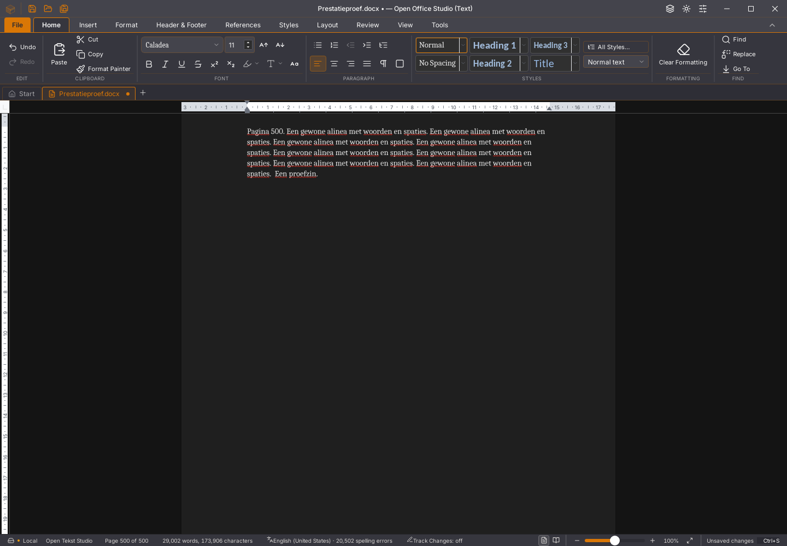

# Writer 45.32: snapshots door de runtime laten coderen

De gedeelde Rust-kern blijft alpha52. De Tauri-interface gebruikt voor de
volledige brongebonden snapshot de ingebouwde `Uint8Array.toBase64` wanneer
de WebView die aanbiedt. Oudere runtimes behouden de bestaande Buffer-encoder.
Aanvraagvelden, standaardalfabet, padding, hashcontrole, selectie, geschiedenis,
inhoudsgrens en de volledige terugvalroute veranderen niet.

## Aanleiding en onafhankelijke omzettingsproef

Het echte 45.31-invoerprofiel bevat ten minste 362 hoofdthreadsamples met de JavaScript-
base64helpers of hun afsluitende `join` tijdens `plak`. Dit zijn samples,
geen gemeten proces-CPUduur. Dezelfde runtime controleert de blad-eerstvolgorde
van de stacks met drie geneste functies. Andere React-, renderer-, worker-
en Wasm-kosten blijven eveneens zichtbaar.

Een afzonderlijke echte WebKit-proef gebruikt een bronkopie van 500 pagina's.
Voor dezelfde snapshot van 908.357 bytes vergelijkt zij de bestaande base64-
bibliotheek, de ingebouwde encoder en een afzonderlijke btoa-blokvariant.
Vijf afwisselende metingen geven gemiddeld 39,0, 0,6 en 65,4 ms. De btoa-route
wordt daarom niet ingevoerd. Alle acht gecontroleerde lengten, inclusief
lege bytes, beide paddinglengten, blokgrenzen en de volledige snapshot,
leveren exact dezelfde tekst op. Deze omzettingsmeting bewijst geen algemene
invoer- of FPS-verbetering. De runtimefunctie gebruikt zonder opties het
standaardalfabet en padding; zie de [API-documentatie](https://developer.mozilla.org/en-US/docs/Web/JavaScript/Reference/Global_Objects/Uint8Array/toBase64).

Negen gerichte bronproeven controleren vaste standaardvectoren, `+` en `/`,
padding, de oorspronkelijke view als ontvanger en een volledige MiB-view
met offset op de terugvalroute. De teruggelezen bytes en de ongewijzigde bron
worden volledig vergeleken. Een eerste fixture keurde op de tijdgrens af bij
een elementgewijze assertion over tweemaal een MiB; de definitieve fixture
vergelijkt dezelfde volledige bytes met `Buffer.equals`, zonder gegevens
over te slaan. De volledige ronde slaagt met 1.761 frontendtests in 165
bestanden, 64 Python-tests en losse TypeScript-controle.

## Werkelijke app en grenzen

De native 500-paginaproef registreert de beschikbare ingebouwde omzettingen,
zonder gegevens of resultaat te wijzigen. `--verwacht-native-base64` eist
dat de onderzochte runtime deze functie aanbiedt en dat iedere native
tekstbatch haar gebruikt. Zonder die optie blijft de proef geschikt voor
oude runtimes en referentieprogramma's. Iedere IPC-snapshot wordt tevens exact
vergeleken met de laatst teruggegeven ingebouwde omzetting. De teller wordt vóór
de verdere geschiedenis-/bewaarproeven uitgeschakeld. Bronexacte inhoud, bronbinding,
selectie en onafhankelijk bewaren blijven de afzonderlijke acceptatie-eisen.

De geoptimaliseerde Linux-bouw slaagt en de definitieve ELF is vastgezet op
`7a0b1048263df705e0c3a1977b73c95b898cb44a595d06434b8eb451c635b173`.
De oude 45.31-binary wordt door dezelfde nieuwe encoderpoort terecht afgekeurd:
de runtime biedt de functie aan, maar de app gebruikt haar nul keer. De
toetsreeks tot actuele bron en spelling kost daarbij 3.571 ms. Met 45.32 kost
deze reeks 2.300 ms. Alle zeven tekstbatches zijn exact aan hun ingebouwde
omzetting gebonden: in totaal 6.428.391 bytes in ongeveer 4 ms. Dit is één
vergelijkingspaar; de totale invoertijd blijft onvoldoende.

De nieuwe binary doorstaat elf 500-pagina-/bewaar-/herstelstappen en twintig
extra selectie-/geschiedenisronden met expliciete garbagecollection. De
grootste rAF-tussenpoos tijdens invoer is 232 ms en de p95 170 ms; dit is nog
geen vloeiende 60-FPS-bediening. De echte vertraagde-tekstantwoordproef behoudt
automatische Undo-groepering en alle drie bron-/bewaarstappen.

Dezelfde binary wordt daarnaast met uitsluitend de native encoder in haar
eigen WebView uitgeschakeld getest. De volledige gewone 500-pagina-, selectie-,
geschiedenis-, bewaar- en heropenproef slaagt, met nul native omzettingen en
3.557 ms voor de toetsreeks. Dit controleert de echte terugvalcode; het is
geen proef op een werkelijk oudere WebKit-versie. Een eerste lokale
proefkopie faalde vóór appstart door een ontbrekend importpad; die afkeuring
blijft bewaard en de productcode is daarvoor niet gewijzigd.

Alle acht rijke plakrondes slagen met bewaren na ronde zeven en verder
bewerken, onafhankelijke DOCX-controle, sluiten zonder opslaan en een nieuw
document. De finale actuele layout telt 129 pagina's, 1.793 hoofdtekstalinea's,
256 tabellen en 1.536 cellen. De genormaliseerde bodyhash blijft gelijk aan
45.30/45.31. De laatste plakactie vraagt 20.052 ms, waarvan 13.497 ms native
voorbereiding, met een hoofdthreadtimerpauze van 4.784 ms. Dat bewijst geen
nieuwe grote-plaksnelheidswinst tegenover 45.31.

Het nieuwe onafhankelijke invoerprofiel doorstaat dezelfde stackkalibratie en
broncontrole. Het bevat geen `join`-bladsamples binnen `plak`, tegenover 167
bij de referentie; drie bladsamples zitten in `toBase64`. Inspectiepolls blijven
onderdeel van deze opname en sampleaantallen zijn geen proces-CPUduur.
Het bekeken getypte paginabeeld verschilt in deze ene toestand op 53 pixels;
het lint heeft nul afwijkende pixels. Dit is geen volledige pixelpariteit.

De [meetgegevens, exacte bytes en GUI-uitkomsten](2026-11-04-writer-snapshotencoder.json)
leggen de uiteindelijke controle vast. De eerdere
[45.31-proeven](writer-invoertijd.md) blijven aan hun eigen bron en binary
gebonden. Algemene Writer-snelheid, incidentele Wasm-/framebasisfouten,
de volledige Rust-WebView-interface en functionele/visuele platformpariteit
blijven open. De gebruikersstarter, documenten en draaiende apps blijven
behouden; dit publiceert geen officiële release.
