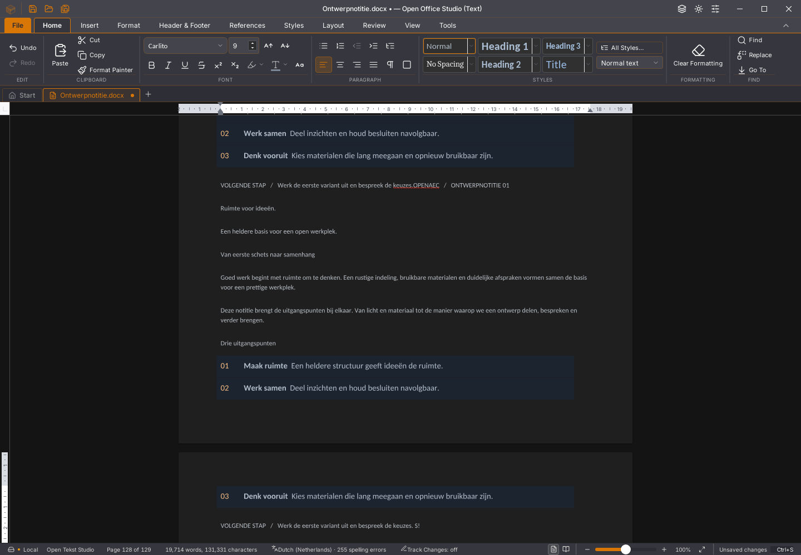

# Writer 45.25: invoer tijdens grote spellingcontroles

De spellingcontrole las alle verhalen onmiddellijk achter elkaar. Bij de
proef met 256 tabellen zijn dat 1.537 afzonderlijke synchrone Wasm-lezingen.
Daardoor konden nieuwe toetsen pas na de hele uitlezing aankomen. Een volgende
toets startte weer een volledige uitlezing.

De controle leest nu groepen van maximaal 32 verhalen, met een startbudget van
8 ms per groep, en geeft tussendoor de hoofdthread vrij. Een enkele uitlezing
kan langer duren dan dat budget. Wijzigingen, sluiten, taalkeuzes en nieuwe
hercontroles maken de oude controle ongeldig. Ook een laat woordenboekantwoord
mag nieuwe invoer niet als gecontroleerd markeren. Alle verhalen blijven in
de uiteindelijke controle opgenomen; mislukte of gemengde lezingen geven geen
gedeeltelijke foutentelling.

De eigen plakopmaak schrijft daarnaast de gezamenlijke eindwaarde van de
basis- en HTML-opmaak eenmaal per bereik. Voorheen werden dezelfde velden
tweemaal geschreven. Bijgehouden verwijderingen, hyperlinks, superscript en
andere beschermde marks blijven behouden.

## Gegevensbehoud en echte invoer

Zeven gerichte spellingtests controleren onderbreking, bronwijziging,
woordenboekvertraging, sluiten/herstarten, mislukte lezingen en verschillende
versies. Drie opmaakproeven vergelijken behouden, samenvoegen en alleen tekst
met een onafhankelijke tekenroute. Unicode, verwijderingsrevisies, hyperlinks,
alle verhalen en marks, één Undo/Redo en alle DOCX-onderdelen blijven gelijk.
De volledige frontendronde slaagt met 1.666 tests in 154 bestanden. TypeScript,
weekversie, module-opdrachten, 56 Python-tests en de Linux-desktopbouw slagen.

In de echte Linux/WebKit-proef wordt de vaste bron met 128 tabellen door fysiek
kopiëren/plakken verdubbeld. Vervolgens start een gewone spellinghercontrole.
Na 150 ms worden echte toetsen voor ` SNEL`, drie Shift-selectiestappen en
`!` gestuurd. De bron moet exact eindigen op ` S!`, met alle bestaande tekst,
tabelstructuur en cellen intact. De uiteindelijke spellingcache wordt apart
tegen alle bodyalinea’s en celteksten vergeleken. Een gewone pijltjestoets
vormt de afsluitende keyup-barrière: een Shift-teken kan bij keyup zijn
onverschoven toetsnaam dragen.

| Eerste bron-/invoerproef op dezelfde pc | 45.24 | 45.25 |
| --- | ---: | ---: |
| Verhalen gelezen vóór de eerste teksttoets | 1.537 van 1.537 | 64 van 1.537 |
| Toetsreeks tot verwerkte bron | 31.028 ms | 6.589 ms |
| Volledige bron en structuur behouden | ja | ja |
| Uiteindelijk gecontroleerde alinea’s | 3.329 | 3.329 |
| Uiteindelijk gecontroleerde celverhalen | 1.536 | 1.536 |

Dit is één vergelijking onder wisselende systeembelasting. Tijdens de eerste
kandidaatproef en een deel van de oude proef liep compilatie; dit is geen
rustige algemene snelheidsmeting, FPS-meting of bewijs van volledige
paginapaint. Dezelfde genormaliseerde DOCX-bodyhash na vervolginvoer controleert
ook tekst, run-/alineaopmaak, hyperlinks en tabelstructuur. Alleen paraId,
textId en rsid-attributen worden daarvoor weggelaten.

Het methodeprofiel ziet 897 opmaakopdrachten in plaats van 1.794. Dit is een
halvering van deze dubbele schrijfstappen, geen halvering van de totale
plaktijd. De Rust-voorbereiding en verdere hoofdthreadtaken blijven duur.
De profielopstelling is afzonderlijk op de oude binary vergeleken met een
uitvoering zonder methodeprofiel: de genormaliseerde DOCX-body is gelijk.

Een afzonderlijke hertest met de expliciete onderbrekingseis slaagt op dezelfde
45.25-binary: eerste toets na 32 lezingen, 6.671 ms tot de verwerkte bron en
opnieuw de volledige spellingcache en dezelfde genormaliseerde DOCX-body.
Tijdens die hertest liepen geen andere eigen bouw- of GUI-proeven. De plakactie
duurt daar nog 28.597 ms; ook dit is geen volledige snelheidsacceptatie.

Het lint is pixelgelijk in het beeldenpaar na vervolginvoer. In het volledige
venster verschillen elf pixels bij de onderste zoomindicator. Dit is één
toestand op Linux, geen volledige visuele migratieacceptatie.

## Aanvullende regressiecontroles

De echte 500-paginaproef slaagt voor elf bronstappen, inclusief selectie,
Backspace, geschiedenis, bewaren, nieuw proces, echte periodieke herstelkopie,
Later en Herstellen met vervolgbewerking. De gemeten invoer/spelling kost
4.344 ms tot bron en golflijnen, en 6.392 ms inclusief de vaste nawacht;
tegelijkertijd liep een andere GUI-proef. De vroegere aanduiding dat 4.344 ms
de nawacht al bevatte, was onjuist; de oorspronkelijke JSON-meetvelden zijn
ongewijzigd.
De vertraagde Rust-antwoordproef behoudt snelle invoer, selectievervanging,
één Undo/Redo, Save vóór beantwoording en Niet opslaan zonder wachten. Een
nieuw document blijft na de late beantwoording behouden.

Acht echte plakrondes behouden 129 pagina’s, 256 tabellen, 1.793 bodyalinea’s
en alle 1.536 cellen. Bewaren na ronde zeven, verder bewerken, onafhankelijk
DOCX teruglezen, verwerpen en een nieuw document slagen. De laatste ronde
duurt nog 46.281 ms, tegelijk met de herstelproef. De ernstige snelheidsklacht
is daarmee niet volledig opgelost.

De Linux-geheugenworkflow bevat voortaan ook de grote spelling-/invoerproef.
Die eist dat de eerste toets vóór de laatste celuitlezing aankomt, naast alle
bron-, export- en uiteindelijke spellingcontroles. Negatieve context wordt
ook voor deze proef met de exacte binary bewaard.

## Resterend

De eerdere allocator-, Wasm-geheugen-, renderer- en opstartafkeuringen blijven
open. De 45.24-CI-geheugenproef slaagt inmiddels, inclusief twintig extra
selectie-/geschiedenisrondes met aangevraagde garbagecollection. Dat vervangt
de historische afkeuringen niet. Ook alle drie platformtaken, de
zeveneditiebouw met publiceren overgeslagen, native Rust en Rust-WebView slagen
op de 45.24-bron; dit bewijst geen 45.25-platformacceptatie.

De lokale volledige geoptimaliseerde native werkruimtecontrole is onderbroken
met afsluitcode 143 vóór haar testuitslag; Clippy uit die keten is niet gestart.
Die controle wordt niet als geslaagd geteld. De productcode van de gedeelde
Rust-kern is in deze 45.25-stap niet gewijzigd.

Volledige zichtbare stijlgetrouwheid bij intern kopiëren, actuele-paginamelding,
snellere voorbereiding/opmaak/layout en de volledige Rust-interface blijven
open. Alle 118 issues, tien migratiegebieden en dertig acceptatievlaggen blijven
open; lopende gebruikersapps en documenten zijn behouden. De exacte hashes,
proefgegevens en platformuitslagen staan in
[het testverslag](2026-11-04-writer-spelling-onderbreken.json).
