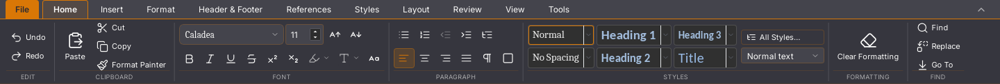
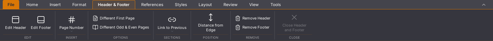

# Writer 45.19: spellingmarkering zonder synchrone tekstlezing

De spellingplug-in gebruikte bij iedere documentwijziging de volledige
cursorlezing, terwijl alleen de gewijzigde alinea-id nodig was. Die lezing
haalt ook geaccepteerde tekst op en bepaalt de vertaling van de ruwe offset
bij verwijderingen en tabellen. De wijzigingsmelding neemt nu alleen de
alinea-id uit de beschikbare cursorlocatie. De spellingcontrole blijft
gedebounced; de volledige offsetlezing voor autocorrectie, menu en venster
blijft bestaan. Zonder betrouwbare locatie blijft volledige hercontrole de
veilige terugval.

## Regressie en native vergelijking

Vijf nieuwe proeven gebruiken de publieke spellinglevenscyclus en zichtbare
fouten. De oude code faalt op onnodige tekstlezingen voor hoofdtekst en een
tabelcel. De nieuwe code slaagt op beide en op drie terugvalgevallen:
ontbrekende selectie, ontbrekende locatie en een locatie die een fout geeft.
De bestaande echte Rust/Wasm-offsetproeven voor Unicode, bijgehouden
verwijderingen en tabellen slagen eveneens.

Vier native Linux/WebKit-proeven lopen na elkaar op dezelfde pc, zonder
gelijktijdige eigen bouw- of GUI-proeven. Iedere run start een eigen proces
en geïsoleerd profiel met dezelfde gegenereerde bron van 500 pagina’s.

| Ronde | Versie | Invoer tot bron en spelling | Synchrone `readParagraphs` | `paragraphSpans` |
| --- | --- | --- | --- | --- |
| 1 | 45.18 | 4.038 ms | 20 | 28 |
| 2 | 45.19 | 3.703 ms | 8 | 28 |
| 3 | 45.19 | 3.506 ms | 6 | 28 |
| 4 | 45.18 | 4.273 ms | 26 | 28 |

De native sessie blijft aantoonbaar dezelfde tijdens elke meting. De API-
objecten mogen wisselen; de eerdere documentuitleesteller blijft die via de
stabiele React-ref volgen. Alle vier proeven behouden exact de volledige
bron bij typen, selectie/Backspace, undo/redo, werkelijk bewaren en heropenen
in een nieuw proces. Onafhankelijke DOCX-teruglezing en de bronhashes van de
controlestappen stemmen overeen. GUI- en consolefoutenlijsten zijn leeg.
Iedere run toont 83 spellinggolven bij de vastgelegde toestand.

De totale indexlezingen zijn niet afgenomen: de overige geometrie- en
cursorpaden gebruiken de index nog. Twee runs per versie op één pc bewijzen
geen algemene snelheidswinst. **Ook 3,5–3,7 seconden voor deze invoer is nog
onvoldoende soepel.** De oorzaak van de resterende hoofdthreadbelasting wordt
verder onderzocht.

In de afzonderlijke gekalibreerde profielmetingen bevat de oude
`bijWijziging → cursor → readParagraphs`-route 81 samples; na herstel nul.
De profielen hebben 1.886 respectievelijk 1.549 hoofdthreadsamples. Samples
zijn geen aanroepaantallen of milliseconden; deze profielen dienen alleen
voor de diagnose en zijn niet de vier vergelijkende proeven hierboven.

## Beeld en bediening behouden

Knopnamen, toestand en grenzen van Start en Kop- en voettekst zijn gelijk.
De native lintuitsneden bij dezelfde venstergrootte van 1440 × 1000 pixels
zijn ieder 1440 × 122 pixels: beide hebben nul verschillende pixels.
Dit is geen volledige visuele vergelijking van de suite of Rust-interface.

Start, vóór en na:




Kop- en voettekst, vóór en na:




## Groot plakken en de statusbalk

Acht rijke verdubbelingen, inclusief bewaren na ronde één en verder
bewerken, behouden 129 pagina’s en 256 tabellen. De onafhankelijke DOCX-
teruglezing bewaakt body, tabelvormen en alle celteksten. Een vergelijking
met de 45.18-export behoudt dezelfde body, stijlen en opmaak zonder
marge-normalisatie. Verwerpen duurt in die ronde 449 ms en een nieuw leeg
document opent; GUI- en consolefoutenlijsten zijn leeg.

De achtste plakactie duurt **60,924 seconden**. Dit bewijst geen versnelling
van grote of zeer snelle plakreeksen; die klacht blijft open.

Het directe beeld van oudere proeven toonde nog de vorige tekentelling.
Een extra functionele proef op 45.18 gebruikt een eigen verkorte kopie met
128 tabellen en behoudt de oorspronkelijke XML-prefixen. Na één verdubbeling
staat eerst nog de oude telling in beeld. Na één seconde zijn de totalen
bijgewerkt naar 129 pagina’s en 131.390 bodytekens; na drie seconden volgt
ook de zichtbare paginapositie. Een aparte geaccepteerde alinea-uitlezing
bevestigt de telling. Deze diagnose draaide tijdens bouwen en is daarom
geen snelheidsvergelijking. In dit geval is geen blijvend verkeerde telling
gereproduceerd; dit is geen algemene statusbalkgoedkeuring.

De openbare plakproef wacht nu begrensd op de werkelijke statusbalktotalen,
vóór het eindbeeld. De achtvoudige 45.19-proef bereikt zo **129 pagina’s en
131.328 bodytekens**. De verwachte tekentelling wordt in UTF-16-eenheden
bepaald, overeenkomstig de editor. Een aparte drie-rondenproef controleert
de definitieve, aangescherpte tekstbegrenzing van dezelfde statuscontrole.

## Bouw en downloaden

1.621 frontendtests in 147 bestanden, 47 Python-tests, TypeScript en de native
Linux-productiebouw slagen. De lokale kandidaat heeft SHA256
`4e4cdf8be9e3739dfdd6a3c189c05b6aef24b30ea24ea8ce9039efc51d2a9608`.
De nieuwe 45.19-dev- en platformpakketten moeten na push afzonderlijk worden
beoordeeld; deze lokale uitkomsten zijn geen goedkeuring van die pakketten.

De [45.18-devdownload](https://github.com/OpenAEC-Foundation/open-office-studio/actions/runs/41639997268/artifacts/13232883111)
is inmiddels wel opgehaald en gecontroleerd: archief-/AppImage-checksums,
uitvoerrechten, metadata en de succesvolle echte AppRun/ELF-GUI-proef.
De [45.18-desktop-CI](https://github.com/OpenAEC-Foundation/open-office-studio/actions/runs/41640012271)
slaagt op Linux, Windows en macOS. De zeveneditiebouw loopt afzonderlijk en
is geen fysieke platform-GUI-acceptatie. De gepubliceerde release verandert
niet.

[Meetgegevens, hashes en stappen](2026-11-03-writer-spelling-wijziging.json)
leggen de precieze omvang vast. Alle tien migratiegebieden en dertig
acceptatievlaggen blijven open. Geen issue is op grond van deze gedeeltelijke
optimalisatie gesloten.

## Herhalen

Gebruik de bestaande Linux-GUI-omgeving en bewaarde oude/nieuwe binaries,
telkens met een nieuwe uitvoermap. Voer de versies na elkaar uit:

```sh
python scripts/test-writer-lang-native.py --programma /absoluut/pad/naar/open-office-studio --versie 2026.45.19 --uitvoer .local/proef-writer-spelling
python scripts/test-writer-rijk-plakken-native.py --programma /absoluut/pad/naar/open-office-studio --versie 2026.45.19 --rondes 8 --bewaar-na-ronde 1 --maxduur 300 --uitvoer .local/proef-writer-spelling-plakken
```

De proeven maken eigen bestanden en profielen en stoppen alleen hun eigen app.
