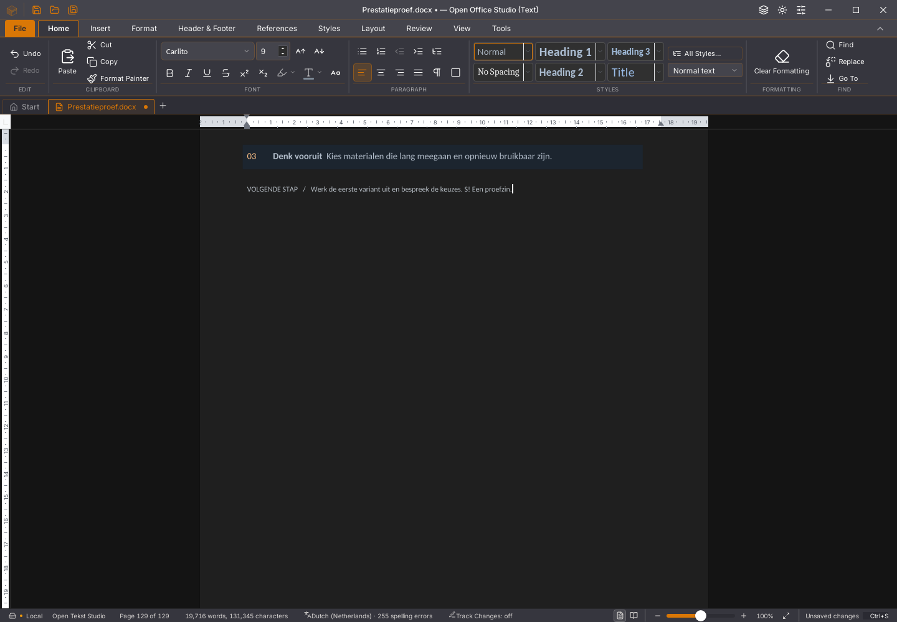
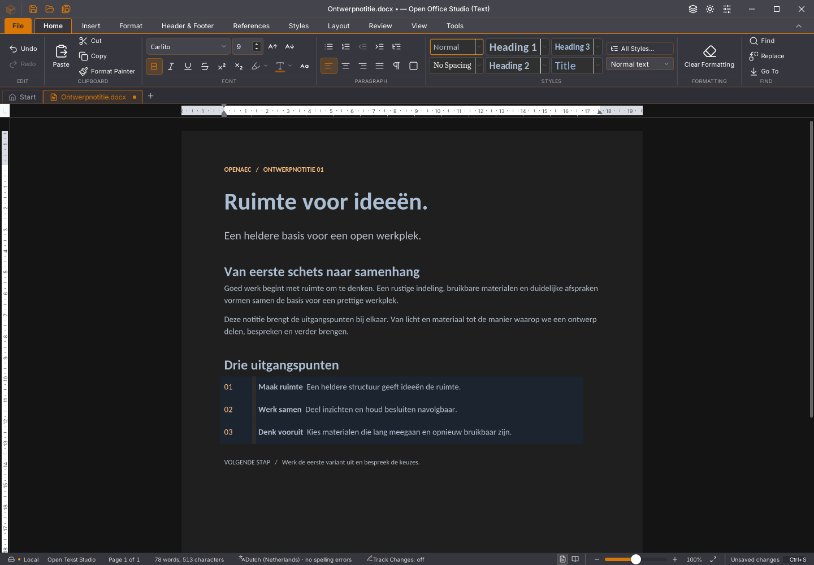

# Writer 45.37: geaccepteerde cursoralinea

De bewaarde CPU-opname van 45.36 bevat 175 `readParagraphs`-stacks. Daarvan
komen 76 via de spellingcursor en 33 via autocorrectie. Beide vragen dezelfde
geaccepteerde alinea opnieuw op. De positiezoekopdrachten zijn in deze opname
geen aangetoonde hoofdkostenpost.

De cursortekst wordt nu uitsluitend gedeeld zolang documentsessie, betrouwbare
bronversie, verhaal en alinea exact gelijk blijven. Een andere bronversie of
cursoralinea laat de vorige lezing los. Stoppen en laden wissen de cache.
Ontbrekende, afwijkende of tijdens lezen veranderde versies worden niet
gecachet. Een antwoord wordt alleen bewaard als precies de gevraagde alinea
uit het juiste verhaal terugkomt. Autocorrectie behoudt de bestaande controle
op bronversie en verwachte tekst vóór het wijzigen.

De volledige geaccepteerde tekst blijft beschikbaar: de omzetting van
bronoffsets bij tabelankers en bijgehouden verwijderingen wordt niet vervangen
door een geschatte tekstlengte. De cache houdt hoogstens één alinealezing vast.
De terminale snelheids- en functiecontroles staan hieronder. Dit document
verklaart geen volledige acceptatie.

## Nieuwe 45.36-afkeuring

De afzonderlijke [geheugenronde](https://github.com/OpenAEC-Foundation/open-office-studio/actions/runs/41827404196)
faalt op een zichtbare melding “The document changed while saving”. De actuele
finale paginering, alle bron- en structuurcontroles, onafhankelijk gelezen DOCX
en verwerpen/nieuw document slagen in die ronde wel. De vervolginvoer vraagt
1.377 ms. Er zijn geen consolefouten gemeld. Dit is een andere afkeuring dan de
verouderde layout en displaylijstgeheugenfout van 45.35; de oorzaak van het
bewaarconflict is nog niet bewezen.

De oorspronkelijke negatieve ELF heeft SHA256
`c31dd43bd173c58d5a094a018d0edada5facd6d8c46c5f6e567a5b7c761d7414`.
Het oorspronkelijke artifact 13322361291 en de exacte foutcontext zijn lokaal
behouden; alle 21 checksums uit die context zijn gecontroleerd. Het complete
rapport, de contextmetadata en het oorspronkelijke taaklog blijven ook als
gecomprimeerd bewijs in deze map beschikbaar. Een groene hertest bewijst niet
dat de oorspronkelijke fout is hersteld.

## Afwisselende metingen zonder profiler

Iedere ronde opent dezelfde eigen kopie van 129 pagina’s en 256 tabellen.
Echte toetsen, invoerbarrière, alle teksten in 1.537 verhalen en de finale
layout van de actuele bron worden gecontroleerd. Dezelfde begrensde tellers
zijn in beide versies actief. De layouttijd bevat de inspectiecontrole en
is geen meting van fysieke scherm-FPS.

| Ronde | Invoer/barrière (ms) | Tot actuele finale layout (ms) | Alinealezingen | Alinealezingen (ms) |
| --- | ---: | ---: | ---: | ---: |
| 45.36 vóór | 2.496 | 4.121 | 38 | 205 |
| 45.37 eerste | 2.578 | 3.632 | 34 | 158 |
| 45.37 herhaald | 2.459 | 4.091 | 34 | 151 |
| 45.36 na | 2.376 | 3.420 | 102 | 332 |

Alle vier ronden slagen met exacte teksten, actuele layout en lege foutenlijsten.
De cache voorkomt dubbele lezingen, maar **deze reeks bewijst geen totale
snelheidswinst**. De laatste oude ronde bereikt de finale layout juist eerder.
De ernstige invoervertraging blijft dus open. Geen meetronde is weggelaten.

Tien regressiegevallen controleren onder meer dezelfde tabelankeroffset in een
echte 256-tabelbron, autocorrectie met werkelijk uitgevoerde edit en
bronversiebewaking, wisselen van sessie/verhaal/alinea en onbekende, afwijkende
of tijdens lezen veranderende versies. Op de oorspronkelijke code falen vijf
van de acht aanvankelijke gevallen; die volledige negatieve ronde blijft
bewaard. De definitieve volledige ronde slaagt met 1.812 frontendtests in 172
bestanden en twee testprocessen. Een eerdere ronde tijdens gelijktijdig bouwen
gaf twee afkeuringen in de echte 256-tabelproeven; ook dat rapport blijft staan.
Tests en tijdgrenzen zijn niet versoepeld. TypeScript, 77 Python-tests,
weekversiecontrole en de geoptimaliseerde Linux-productiebouw slagen.

De volledige bekeken native tabelbrontoestand na dezelfde invoer is pixelgelijk
met de 45.36-referentie (nul afwijkende pixels). Dit is één toestand en bewijst
geen volledige UI-pariteit.

## Vervolgonderzoek voor invoer

Dezelfde bewaarde 45.36-CPU-opname bevat 160 `encode_state`-stacks, alle via
`plak` in de Rust-invoerbrug. Gewone tekst deelt die brug. Iedere opdracht
maakt momenteel een volledige snapshot, hash en base64 voordat Rust de
bewerking voorbereidt. Een bevestigde Rust-bronspiegel met incrementele
synchronisatie is een volgende onderzoekskandidaat. Dat is nog niet gebouwd
of als snelheidswinst bewezen. De bestaande bron-, levensduur-, selectie- en
Undo-bewaking mag daarvoor niet worden versoepeld.

## Native functies en resterend werk

Veertien native ronden zijn terminal geslaagd: elf op de 45.37-binary en drie
op de referenties. De 500-paginaproef doorstaat acht bron-/geschiedenis-/bewaar-
en heropenstappen, zeven spellingstoestanden en vier volledige fontvarianten.
Invoer/spelling vraagt daar 1.005 ms. De aparte herstel-/geheugenproef doorstaat
elf bronstappen en twintig extra selectie-/Backspace-/Undo-/Redo-ronden met
expliciete geheugenopruiming; invoer vraagt daar 1.171 ms. Ook de drie vertraagde
Rust-antwoordgevallen, oorspronkelijke queryfoutstack, zeven kleurstappen,
tussenbewaring en fysiek slepen van tabelranden met Undo/Redo, onafhankelijk
gelezen DOCX en heropenen slagen.

Acht rijke plakronden behouden 129 finale pagina’s, 256 tabellen en 1.536
cellen. De onafhankelijke opmaakhash blijft
`0808d3dcf34c8251d371d9e4c6eda470ed2597acd850062b5b5f70169333a302`.
De laatste plakactie vraagt nog 18.956 ms. Vervolginvoer tijdens spelling na
verdubbelen van 128 tabellen vraagt 4.250 ms, met actuele finale layout en
exacte bron/structuur. Dit zijn afzonderlijke proeven en geen rustige
paarsgewijze snelheidsvergelijkingen.

De exacte oorspronkelijke 45.36-afkeuring slaagt lokaal met de bytegelijke
proefcode en negatieve ELF; het bewaarconflict is daarmee niet opgelost.
Alle 118 GitHub-issues, tien migratiegebieden en dertig acceptatievlaggen
blijven open. De gedeelde Rust-kern blijft alpha52. Gebruikersstarter 45.23,
gebruikersbestanden en lopende apps zijn behouden. Nieuwe platform- en
zeveneditieronden volgen na push, zonder officiële release.

[Alle rapporten, oorspronkelijke afkeuringen, exacte hashes en meetgrenzen](2026-11-04-writer-spellingcursor.json).
