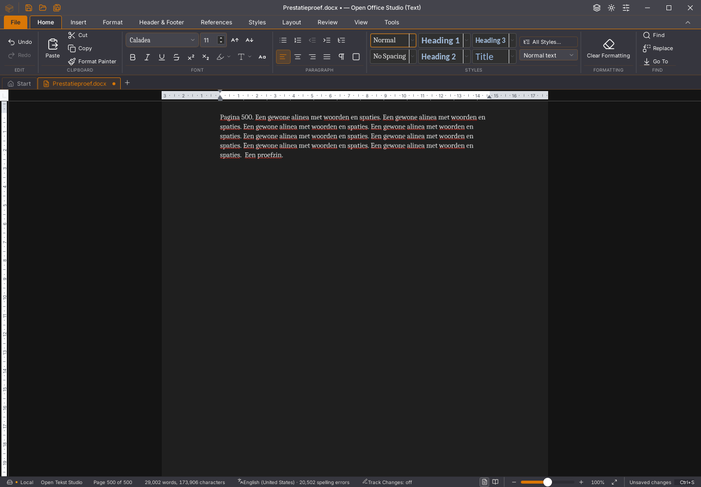
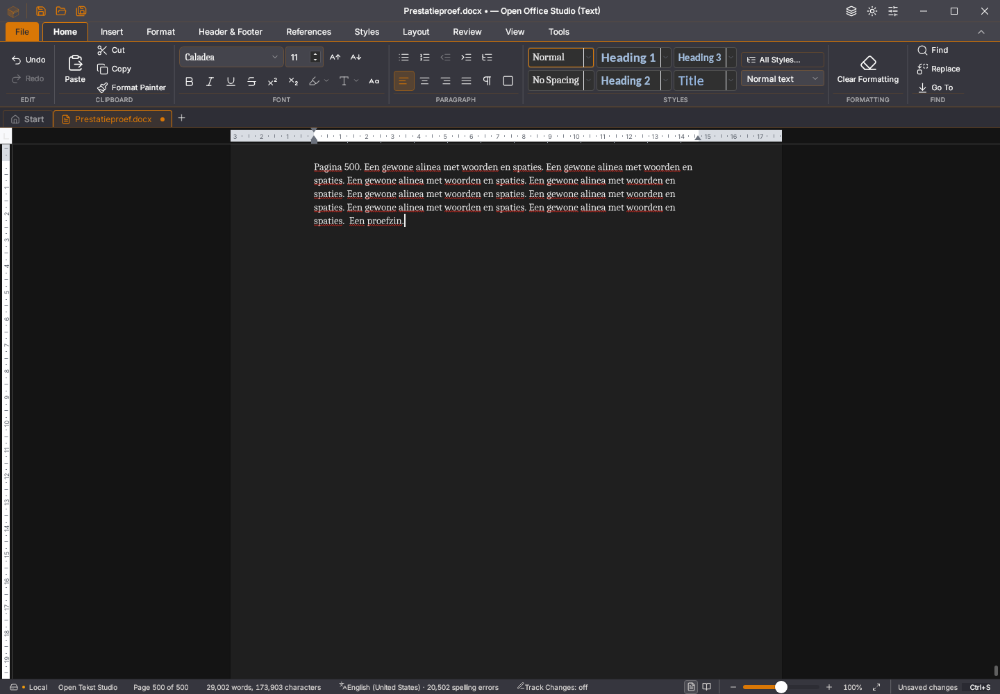

# Writer 45.33: minder herhaalde metingen voor spelling

De bestaande Tauri-interface behoudt de volledige spellingscache. Het bereik
van de pagina's in beeld wordt opnieuw gemeten bij een ander rendererbeeld,
scrollen, zoomen, formaat- of zichtbaarheidswijzigingen. Nieuwe plug-incontexten
met hetzelfde beeld vragen geen nieuwe paginaboxmeting. De gedeelde Rust-kern
blijft alpha52; deze stap voltooit de Rust-interface niet.

## Gedrag en gegevensbehoud

Een observerende proef met de oude 45.32-binary ziet negentien renders van de
spellinglaag, twee verschillende geometrieobjecten en twee rendererbeelden.
De oude code meet bij iedere render opnieuw. De nieuwe code bewaart het
paginabereik binnen hetzelfde beeld. ResizeObserver bewaakt het scrollvlak en
de paginakolom; scrollen en wijzigingen van de tabzichtbaarheid vernieuwen de
meting eveneens. De rechthoeken blijven bij een vensterwijziging bijgewerkt.

Een onzichtbaar paneel leest geen documentindeling of woordgeometrie en houdt
geen golfspans vast. De volledige foutencache blijft bestaan. Het bestaande
volledige terugvalpad bij onbekende paginagrenzen of een verschillend aantal
DOM-/layoutpagina's blijft behouden. Zeven gerichte vensterproeven controleren
zichtbaarheid, scrollen, fragmentgrenzen en deze terugval; drie oorspronkelijke
gevallen falen vóór de correctie.

De nieuwe echte native proef vergelijkt alle getekende golfspans met een
lineaire paginareferentie en de volledige foutencache. Zij controleert de
eerste/laatste pagina, 125% zoom, een kleiner venster, Start en terugkeer naar
het document, en het herstelde venster. Alle zeven stappen slagen met dezelfde
20.502 fouten. Het verborgen paneel bevat nul golfspans; na terugkeer staan er
weer 84. De oude binary houdt verborgen 84 spans vast en wordt door de nieuwe
poort afgekeurd. De onderliggende foutencache bleef ook daar correct.

De positiecontrole hanteert 0,05 px tolerantie en omvat de bestaande marge van
400 px rond het venster. Zij is geen volledige visuele acceptatie. Een eerste
versie van de proef accepteerde na navigeren te vroeg gereedheid bij nul
verwachte/gevonden golven; de definitieve proef wacht op de opbouw van de
werkelijk zichtbare pagina en blijft alle verwachte golven eisen. De oorspronkelijke
afkeuring is apart bewaard.

## Metingen en grenzen

De rustige volgorde is 45.32 / 45.33 / 45.33 / 45.32. Het eerste paar bevat
de herstelproef en twintig extra GC-ronden na de invoermeting; het tweede paar
bevat de gewone volledige bewaar-/heropenproef. Iedere vergelijking gebruikt
dezelfde beginbron en meetopzet binnen het paar.

| Meting | 45.32 eerste paar | 45.33 eerste paar | 45.32 herhaling | 45.33 herhaling |
| --- | ---: | ---: | ---: | ---: |
| Toetsreeks tot bron en spelling | 2.732 ms | 1.718 ms | 1.855 ms | 2.249 ms |
| Gemeten DOM-rechthoeken | 1.849 | 1.018 | 1.363 | 1.132 |
| Grootste rAF-tussenpoos | 252 ms | 173 ms | 180 ms | 175 ms |
| p95 rAF-tussenpoos | 194 ms | 159 ms | 176 ms | 155 ms |
| Native tekstbundels | 10 | 7 | 7 | 9 |

In beide paren zijn er minder DOM-metingen en kortere rAF-pauzes. De totale
invoertijd wisselt mede met de bundeling van toetsen; de herhaling is langzamer.
Daarom wordt geen vaste algemene invoersnelheidswinst of vloeiende 60-FPS-bediening
geclaimd. De overige Worker-/Wasm-/layoutkosten blijven open. Een afzonderlijke
protocolobservatie ziet tijdens typen nog negen volledige layout-JSON-antwoorden
van ongeveer 1,6 miljoen tekens. De SDK-meta-route is beperkt tot haar viewer;
haar samenvatting weigert fragmentlezing en is niet generiek voor de volledige
editor ingeschakeld.

Elf bron-/bewaar-/herstelstappen en twintig extra selectie-/geschiedenisronden
met garbagecollection slagen op de nieuwe ELF. De vertraagde-tekstantwoordproef
behoudt automatische Undo en selectie/bewaren tijdens wachten. Acht rijke
plakrondes behouden alle inhoud en opmaak, 1.793 hoofdtekstalinea's, 256 tabellen,
1.536 cellen en een finale actuele layout van 129 pagina's. De laatste ronde
kost nog 20.194 ms, met een hoofdthreadtimerpauze van 4.514 ms; dit bewijst geen
nieuwe grote-plaksnelheidswinst.

De bekeken getypte toestand verschilt op veertien pixels. Alle vier bekeken
lintdelen hebben nul afwijkende pixels; de andere toestanden verschillen en
bewijzen geen volledige pixelpariteit. Ook de oude 45.32 kan bij zoomen en
verkleinen een leeg paginadeel tonen terwijl de cursor buiten beeld ligt.
Dat gedrag is niet door deze spellingstap hersteld.

## Oorspronkelijke inspectiefout behouden

De [Linux-kleurafkeuring van 45.31](2026-11-04-writer-kleur-45.31.json) blijft
open. De testhulp kon haar oorspronkelijke fout vervangen door een tweede
timeout tijdens opruimen. Drie gerichte regressiegevallen falen vóór de
correctie. Bij een al mislukte opdracht wordt opruimen nu hoogstens één seconde
afgewacht en apart geregistreerd. Annulering blijft annulering. Een opruimfout
na een geslaagd antwoord blijft een afkeuring.

De kleurproef bewaart voortaan de framebasis vóór de eerder vastgelopen Undo,
controleert console-/GUI-fouten en exporteert de laatste framebasis bij afsluiten.
De exacte negatieve 45.31-ELF, de 45.32-referentie en de nieuwe 45.33 doorstaan
de aangescherpte kleur-/Undo-/Redo-/bewaar-/heropenproef lokaal. Dit is geen
aangetoond herstel van de oorspronkelijke vastloper. De desktop-, geheugen-
en zeveneditieproeven voeren de nieuwe spellingweergavecontrole voortaan uit.

De volledige lokale controle slaagt met 1.768 frontendtests in 166 bestanden,
69 Python-tests, TypeScript, weekversie, gewijzigde workflow-YAML en de
Linux-productiebouw. [Exacte bronnen, binaries, metingen, oorspronkelijke
afkeuringen en proefrapporten](2026-11-04-writer-spellingsweergave.json).
Alle 118 opnieuw geïnventariseerde issues, tien migratiegebieden en dertig
acceptatievlaggen blijven open. De oorspronkelijke framebasis-/Wasm-fouten,
algemene snelheid, volledige rijke Rust-WebView-interface en suitepariteit
zijn onvoltooid. Gebruikersstarter, documenten en bestaande vensters blijven
behouden.

## Aanvullende Linux-afkeuring op 45.32

De [zeveneditieronde van 45.32](https://github.com/OpenAEC-Foundation/open-office-studio/actions/runs/41783933461)
is terminal afgekeurd op Linux; Windows en macOS slagen. Tijdens de gewone
invoer meldt de worker `story "body" contains an unsupported embed at 174397`.
Daarna wordt de worker vernietigd en verschijnen zeven volledige layouts op
de hoofdthread. De bestaande nulgrens keurt dit terecht af en blijft staan.
De console bewaart de oorspronkelijke fout, naast de daaropvolgende assertie.

Het exacte negatieve programma en de oorspronkelijke proefcode zijn uit de
checksumgecontroleerde foutcontext gehaald. Dezelfde ELF en proefcode slagen
lokaal voor alle acht bron-/geschiedenis-/bewaar-/heropenstappen. Dit is geen
herstelbewijs: de oorspronkelijke workerfout blijft open. De lokale groene
45.33-proeven vervangen deze afzonderlijke negatieve CI-uitkomst niet.

