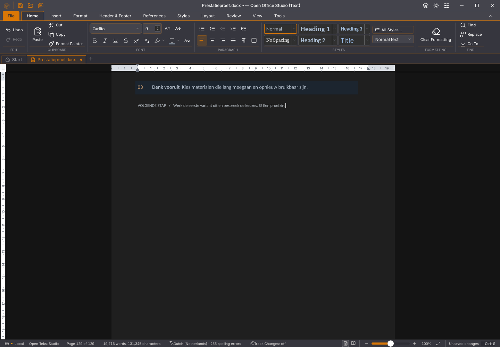
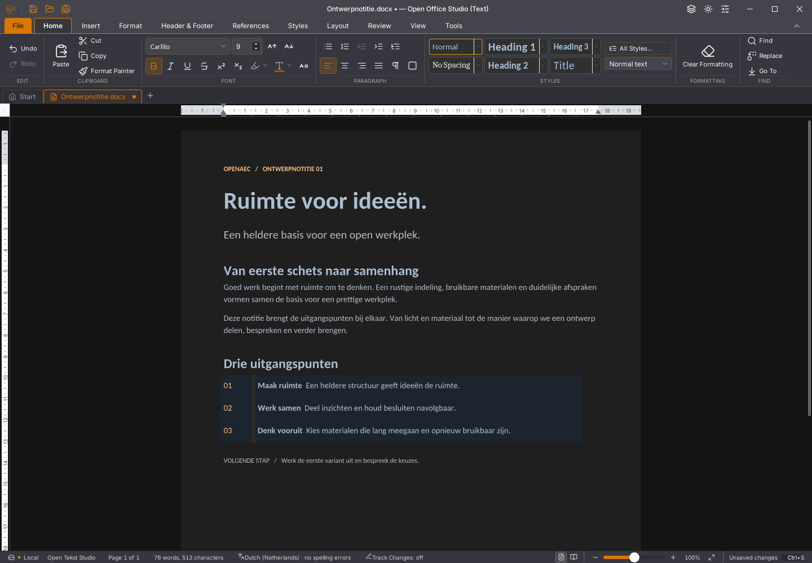

# Writer 45.36: tabelgegevens en oorspronkelijke enginefouten

Tabelgrepen vroegen dezelfde volledige tabel opnieuw op voor iedere cel. De
opname van een document met 256 tabellen liet extra werk in TabelGrepen en
tabelBeelden zien. De cache deelt nu de gevonden tabel binnen dezelfde
bronversie. Een nieuwe bronversie vervangt de oude cache. Iedere cel wordt
gecontroleerd tegen de payload, omdat celverhalen na splitsen nog dezelfde
oude tabelnaam kunnen hebben. Ook geneste en verplaatste tabellen worden
getoetst. De drie leesfrequentieproeven falen op de oorspronkelijke bron en
slagen na de wijziging; de echte zescellige tabel vraagt één in plaats van zes
volledige Wasm-lezingen.

Writer bewaart daarnaast de eerste vier Runtime-/geheugenfouten uit zijn
foutcallback als begrensde scalars in het eigen venster. De oorspronkelijke
Error gaat ongewijzigd naar de bestaande melding. Er worden geen Error-,
Wasm- of documentsessieobjecten vastgehouden en geen bestanden geschreven.
De native queryfoutproef bewijst de exacte oorspronkelijke stack, één zichtbare
melding, bron-/selectiebehoud, fysiek opslaan en verder werken na heropenen.
Zij wekt een fout aan de querygrens op en beschadigt geen Wasm-geheugen; de
oorspronkelijke geheugenafkeuringen zijn daarmee niet hersteld.

## Vergelijking zonder CPU-profiler

Vier rustige ronden gebruiken dezelfde eigen tabelbron, modelpositie 73
(inclusief het tabelanker), fysieke toetsen en invoerbarrière. Alle teksten
in 1.537 verhalen blijven exact. Na de invoermeting wordt apart een finale
layout van de actuele bron geëist; die controle blijft ongewijzigd streng.
De tijd tot dat signaal bevat ook de inspectiecontrole, geen fysieke scherm-FPS.

| Ronde | Invoer/barrière (ms) | Tot actuele finale layout (ms) | Volledige tabelvragen | Tabelvragen (ms) |
| --- | ---: | ---: | ---: | ---: |
| 45.35 vóór | 2.682 | 3.852 | 54 | 251 |
| 45.36 eerste | 2.271 | 3.378 | 9 | 48 |
| 45.36 herhaald | 2.205 | 3.283 | 9 | 41 |
| 45.35 na | 2.762 | 3.977 | 54 | 239 |

In deze twee paren is invoer ongeveer 15–20% sneller en het finale layoutsignaal
ongeveer 12–17% eerder gereed. Beide kandidaten doen zesmaal minder volledige
tabelvragen. Dit is één bron en één pc, geen algemene soepelheidsacceptatie.
Meer dan twee seconden voor invoer en drie seconden tot de actuele layout
blijft onvoldoende. De afzonderlijke invoerproef tijdens spelling direct na
verdubbelen van 128 tabellen vraagt nog 5.007 ms.

Alle vier voorafgaande CPU-diagnoses blijven eveneens bewaard. Die geven
2.488/4.053/2.361/2.517 ms voor oud/nieuw/nieuw/oud: de eerste kandidaat is
juist trager. De diagnoses bevestigen minder tabelvragen, maar leveren geen
betrouwbare totale snelheidswinst. Daarna zijn bovenstaande afzonderlijke
metingen zonder profiler uitgevoerd; geen ronde is weggelaten.

De bekeken tabeltoestand verschilt op drie navigatiepixels van haar 45.35-paar.
Document en overige pixels zijn gelijk. Dit is één toestand, geen volledige
visuele pariteit.

## Functies en gegevensbehoud

De native tabelgreepproef versleept fysiek een kolomrand. Het raster verandert
van `[624, 9014]` naar `[907, 8731]`; de totale breedte blijft gelijk. Alle
alinea- en celteksten blijven exact, de getekende greep volgt de nieuwe breedte,
fysieke Undo/Redo herstellen beide toestanden en fysiek opslaan behoudt de
breedtes in onafhankelijk gelezen DOCX-XML. Een nieuw proces heropent dezelfde
breedtes en teksten.

De 500-paginaproef slaagt in acht bron-/geschiedenis-/bewaar-/heropenstappen,
zeven spellingstoestanden en vier volledige font-/DOCX-/Undo-varianten.
Invoer/spelling vraagt in die gewone proef 1.007 ms. De aparte herstelproef met
twintig extra selectie-/Backspace-/Undo-/Redo-ronden en expliciete
geheugenopruiming slaagt eveneens. Ook de drie vertraagde Rust-antwoordgevallen,
zeven kleurstappen, acht rijke plakronden en bewaren na ronde één slagen.
De laatste rijke plakactie vraagt nog 18.766 ms; de actuele layout behoudt
129 pagina’s en de onafhankelijke DOCX-opmaakhash blijft gelijk.

## Controles en resterend werk

De definitieve binary heeft SHA256
`e2c47f2172aafc0c01236ac5deccebd115e4eea6a25ac69264c75940f0e9426c`.
1.802 frontendtests in 171 bestanden, 77 Python-tests, TypeScript, weekversie,
workflow-YAML en de native Linux-productiebouw slagen. Zeventien native ronden
slagen: dertien op deze kandidaat en vier op de 45.35-referentie. Desktop en
zeven edities eisen voortaan de oorspronkelijke stack in de opzettelijke
queryfoutproef en toetsen fysiek slepen/bewaren van tabelranden. De foutcontext
bewaart ook de vaste template voor het reconstrueren van eigen proefbronnen.

De [twee oorspronkelijke 45.35-Linux-afkeuringen](2026-11-04-writer-tabeldiagnose-45.35.json)
blijven open: een verouderde layout na vervolginvoer en een geheugenfout in
update_display_list na heropenen. Hun exacte oorspronkelijke routes slagen
lokaal, maar de oorzaken zijn niet verklaard of hersteld. De nieuwe opname
bewaart de oorspronkelijke stack voor toekomstig onderzoek; zij maskeert geen
fout en herstart geen document. Alle 118 issues, tien migratiegebieden en dertig
acceptatievlaggen blijven open. De gedeelde kern blijft alpha52 en de volledige
Rust-interface is niet afgerond. Platform- en editiecontroles volgen na push;
er wordt geen officiële release gepubliceerd. Gebruikersstarter 45.23,
gebruikersbestanden en lopende apps blijven behouden.

[Exacte bronnen, alle positieve/negatieve proeven en meetgrenzen](2026-11-04-writer-tabelgegevens.json).
