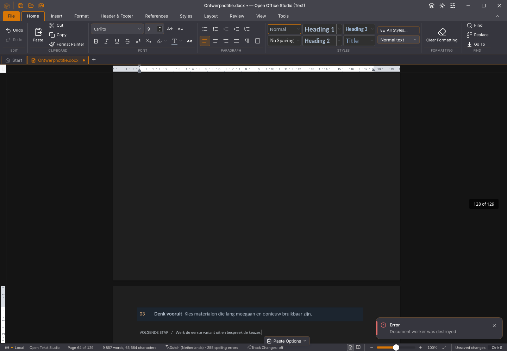
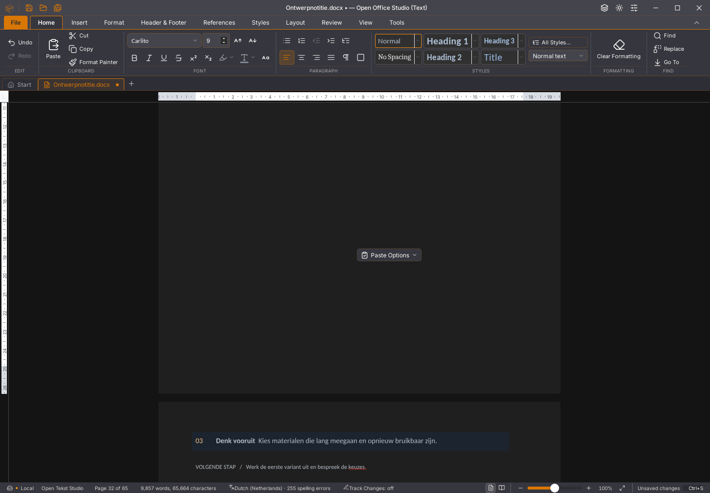

# Writer: worker behouden na bewaren

Versie **2026.45.17** herstelt een gereproduceerde oorzaak van de workerfout
bij bewaren. Dat is geen volledige oplossing voor de invoervertraging.
De [meetgegevens, hashes en afkeuringen](2026-11-03-writer-worker-ingang.json)
leggen de omvang van deze ronde vast.

## Oorzaak en wijziging

De worker laadt zijn opslagcode pas wanneer die nodig is. In de oude
productiebundel importeert die opslagcode gedeelde functies uit de ingang
van de worker. WebKit kan die ingang dan opnieuw uitvoeren en de
documentstatus wissen. Dit komt overeen met
[WebKit #324459](https://bugs.webkit.org/show_bug.cgi?id=324459).
De periodieke herstelkopie kan dit na dertig seconden uitlokken.

Een afzonderlijke proef op de werkelijk geïnstalleerde WebKitGTK 2.52.6
bevestigt het probleem: de oude opzet initialiseert tweemaal en levert twee
verschillende module-identiteiten. Een aparte ingang initialiseert eenmaal
en behoudt dezelfde identiteit. Dit is een kleine runtimeproef, geen
acceptatie van de kantoorapp.

De Vite-workerbouw gebruikt nu een Rollup-optiehook met
[`preserveEntrySignatures: "strict"`](https://rollupjs.org/configuration-options/#preserveentrysignatures).
De ingang van de gebouwde documentworker bestaat daardoor uit één import
van 38 bytes. De gedeelde code en late opslagmodules importeren de ingang
niet terug. Een bouwcontrole weigert alsnog iedere terugimport naar een
worker-ingang. Drie echte Vite-bouwproeven omvatten de oorspronkelijke fout,
de gescheiden opzet en een bewust verwijderde bescherming.

De aanvullende clientcorrectie wacht op een lopende initialisatie voor
weergave-, lees-, font- en synchronisatievragen. Gelijktijdige initialisaties
lopen op volgorde. Een uitgestelde synchronisatie boekt haar vector en
fontversie pas bij daadwerkelijk verzenden. Twaalf gerichte tests controleren
onder meer fouten, sluiten tijdens initialisatie en eigendom van buffers.

## Gerichte native hertest

De kleine bewaarproef opent een eigen kopie van `Ontwerpnotitie.docx`, plakt
drie keer en bewaart na de eerste ronde een afzonderlijke kopie, vóór de
volgende bewerking. De oude kandidaat 45.16 valt daarna terug op de
hoofdthread met “Document worker is not initialized”. De proef keurt dit
terecht af, ook wanneer geen foutmelding in beeld verschijnt.

De overeenkomstige 45.17-proef slaagt: tussenbewaring is aantoonbaar
uitgevoerd, verdere invoer blijft behouden, de uiteindelijke DOCX-inhoud
klopt en sluiten met ‘Niet opslaan’ gevolgd door een nieuw leeg document
werkt. Zowel de GUI- als de consolefoutenlijst is leeg.

De grote hertest doorloopt acht echte verdubbelingen. Bodytekst, tabelvormen,
celteksten en unieke identificaties blijven behouden. De bron blijft na
verwerpen ongewijzigd. De export heeft dezelfde pakketonderdelen als de
oorspronkelijke fixture; alleen `word/document.xml` en de wijzigingsdatum in
`docProps/core.xml` veranderen. De body en stijlen zijn onafhankelijk
vergeleken met de oude export: de inhoud en opmaak blijven gelijk na
normalisatie van vluchtige identificaties.

| Ronde | Pagina’s | Tabellen | Plakken tot bron/opmaak gereed |
| --- | ---: | ---: | ---: |
| 1 | 2 | 2 | 0,970 s |
| 2 | 3 | 4 | 1,149 s |
| 3 | 5 | 8 | 0,886 s |
| 4 | 9 | 16 | 0,903 s |
| 5 | 17 | 32 | 2,020 s |
| 6 | 33 | 64 | 4,350 s |
| 7 | 65 | 128 | 14,352 s |
| 8 | 129 | 256 | 59,573 s |

Verwerpen duurt in deze grote proef 490 ms. De foutbewaking vindt geen
worker-, console- of vensterfouten. **Dit is geen geslaagde prestatieacceptatie:**
een minuut wachten op de grootste plakactie blijft onaanvaardbaar.

De plakopmaak wordt daarnaast gebundeld in één bestaande Rust-transactie,
met een terugval voor onbekende velden of ongeldige grenzen. Vier tests
vergelijken met de oorspronkelijke tekenopmaak, inclusief Unicode-grenzen,
hyperlinks, revisiestempels, undo/redo en afwijkende geërfde tabelmarges.
De numerieke metingen ondersteunen geen algemene snelheidsclaim.

## Afkeuringen blijven meetellen

De eerste grote bronvergelijkingen van kandidaat 45.15 waren groen, maar
het oorspronkelijke beeld toont een workerfout. Dat was onvoldoende
GUI-bewaking en geen geldige goedkeuring:



De herhaalde 45.14-proef bereikt zeven gecontroleerde rondes; bij de achtste
antwoordt de testbesturing langer dan 90 seconden niet. Export en sluiten
zijn daar niet bereikt. Dit is een afkeuring, geen zelfstandig bewijs van
een crash. Ook kandidaat 45.16 blijft afgekeurd door de zichtbare workerfout.

Het nieuwe beeld bevat geen workerfout, maar de statusbalk toont direct na
plakken nog 65 pagina’s terwijl de bron en indeling 129 pagina’s bevatten.
Ook de tekentelling loopt achter. Herstel na een wachttijd is in deze ronde
niet gecontroleerd; de afbeelding bewijst geen volledige visuele juistheid:



## Overige controles en grenzen

- 1.612 frontendtests in 145 bestanden, 46 Python-tests, TypeScript,
  productie-/native Linux-bouw en de afzonderlijke Database-frontendbouw slagen.
- De aangescherpte native 500-paginaproef slaagt voor acht gerichte
  inhouds-/bewaar-/heropencontroles, met lege GUI- en consolefoutenlijsten.
  Invoer en zichtbare spelling vragen in die ene ronde **4,957 seconden**;
  dit bewijst geen verbetering van de typvertraging.
- Vijf productie-GUI-controles voor revisies en gewone opmerkingen slagen.
  De kaartgrenzen worden in fysieke pixels vergeleken; een afwijking van
  0,109375 CSS-pixel in oudere CI was geen zichtbare overschrijding.
- De Linux-devworkflow controleert de uitgepakte AppImage zelf met de
  bewaar-/vervolgproef en bindt het resultaat aan de hash van de bediende ELF.
  De vernieuwde CI-ronde moet na push afzonderlijk worden gevolgd; lokale
  proeven bewijzen niet dat de remote pakketten al zijn goedgekeurd.
- Alle 111 open issues, tien migratiegebieden en dertig acceptatievlaggen
  blijven open. Andere bestanden, snelle plakreeksen zonder barrières,
  fysieke andere platforms, volledige GUI-gelijkheid en alle functies zijn
  niet hiermee afgetest. De gepubliceerde release blijft ongewijzigd.

## Herhalen

Gebruik de bestaande Linux-GUI-omgeving volgens de andere native proeven:

```sh
python scripts/test-writer-rijk-plakken-native.py --programma /absoluut/pad/naar/open-office-studio --versie 2026.45.17 --rondes 3 --bewaar-na-ronde 1 --maxduur 180 --uitvoer .local/proef-writer-bewaren
python scripts/test-writer-rijk-plakken-native.py --programma /absoluut/pad/naar/open-office-studio --versie 2026.45.17 --rondes 8 --maxduur 300 --uitvoer .local/proef-writer-groot
```

Beide proeven maken eigen gegevens- en profielmappen en stoppen alleen hun
eigen app. Voor de aparte dev-identiteit is tevens
`--profiel org.openaec.office-studio.dev` vereist. Bewaarbestanden en
schermafbeeldingen blijven in de opgegeven uitvoermap staan.
