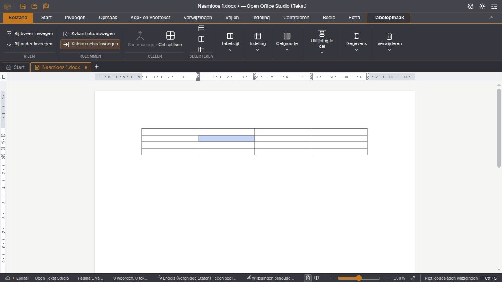

Ontwikkelrelease **2026-W45.1** van de bestaande **Tauri-suite**, met de volledige Office-app en zes afzonderlijke apps. Iedere app heeft een eigen installer, applicatie-id en lokaal profiel.

Deze uitgave bevat de geteste herstelronde uit [PR #148](https://github.com/OpenAEC-Foundation/open-office-studio/pull/148). Twintig concrete issues zijn daarmee gesloten.

- **Rekenblad:** een lege `ISOWEEKNUM()`-aanroep maakt de werkmap niet meer onbruikbaar; verder bewerken, opslaan en heropenen blijven mogelijk. Klikken en slepen vanuit de uitgebreide formulebalk behouden formule en doelcel.
- **Tekst:** markering, lettergroottepijltjes, lijstvervolg, opgeslagen nummering, paginanavigatie, lange hoofdletterconversies en het bewerken van hyperlinkadressen zijn hersteld. Automatische inhoudsopgaven tonen direct puntvulling en uitgelijnde paginanummers.
- **Tabellen:** duidelijke rij-/kolomacties, klikken in hoge cellen, zichtbare celselectie, Tab-navigatie en een nieuwe laatste rij. Splitsen houdt de eerdere geschiedenis beschikbaar; conversie en Undo/Redo laten geen verdwenen celverhalen in de workersnapshot staan.
- **Paginaopmaak:** de gereproduceerde A5-kolomoverlap is hersteld; de opgeslagen kolom- en alinea-instellingen blijven behouden.
- **Suite:** de telling van tekst in tabellen en de maatobserver van het notitiecanvas zijn hersteld. Er is een Laotiaanse interfacetaal toegevoegd; de editors gebruiken daarvoor hun Engelse terugval en vijftien functiebeschrijvingen zijn voorlopig Engels.

## Downloads

De onderstaande bestanden worden pas na geslaagde bouw-, pakket- en ondertekeningscontroles gepubliceerd.

| App | Windows x64 | Linux x64 | macOS Apple Silicon |
| --- | --- | --- | --- |
| Open Office Studio | [EXE](https://github.com/OpenAEC-Foundation/open-office-studio/releases/download/v2026.45.1/Open.Office.Studio_2026.45.1_x64-setup.exe) | [DEB](https://github.com/OpenAEC-Foundation/open-office-studio/releases/download/v2026.45.1/Open.Office.Studio_2026.45.1_amd64.deb) · [AppImage](https://github.com/OpenAEC-Foundation/open-office-studio/releases/download/v2026.45.1/Open.Office.Studio_2026.45.1_amd64.AppImage) | [DMG](https://github.com/OpenAEC-Foundation/open-office-studio/releases/download/v2026.45.1/Open.Office.Studio_2026.45.1_aarch64.dmg) |
| Open Writer Studio | [EXE](https://github.com/OpenAEC-Foundation/open-office-studio/releases/download/v2026.45.1/Open.Writer.Studio_2026.45.1_x64-setup.exe) | [DEB](https://github.com/OpenAEC-Foundation/open-office-studio/releases/download/v2026.45.1/Open.Writer.Studio_2026.45.1_amd64.deb) · [AppImage](https://github.com/OpenAEC-Foundation/open-office-studio/releases/download/v2026.45.1/Open.Writer.Studio_2026.45.1_amd64.AppImage) | [DMG](https://github.com/OpenAEC-Foundation/open-office-studio/releases/download/v2026.45.1/Open.Writer.Studio_2026.45.1_aarch64.dmg) |
| Open Spreadsheet Studio | [EXE](https://github.com/OpenAEC-Foundation/open-office-studio/releases/download/v2026.45.1/Open.Spreadsheet.Studio_2026.45.1_x64-setup.exe) | [DEB](https://github.com/OpenAEC-Foundation/open-office-studio/releases/download/v2026.45.1/Open.Spreadsheet.Studio_2026.45.1_amd64.deb) · [AppImage](https://github.com/OpenAEC-Foundation/open-office-studio/releases/download/v2026.45.1/Open.Spreadsheet.Studio_2026.45.1_amd64.AppImage) | [DMG](https://github.com/OpenAEC-Foundation/open-office-studio/releases/download/v2026.45.1/Open.Spreadsheet.Studio_2026.45.1_aarch64.dmg) |
| Open Presentation Studio | [EXE](https://github.com/OpenAEC-Foundation/open-office-studio/releases/download/v2026.45.1/Open.Presentation.Studio_2026.45.1_x64-setup.exe) | [DEB](https://github.com/OpenAEC-Foundation/open-office-studio/releases/download/v2026.45.1/Open.Presentation.Studio_2026.45.1_amd64.deb) · [AppImage](https://github.com/OpenAEC-Foundation/open-office-studio/releases/download/v2026.45.1/Open.Presentation.Studio_2026.45.1_amd64.AppImage) | [DMG](https://github.com/OpenAEC-Foundation/open-office-studio/releases/download/v2026.45.1/Open.Presentation.Studio_2026.45.1_aarch64.dmg) |
| Open Email Studio | [EXE](https://github.com/OpenAEC-Foundation/open-office-studio/releases/download/v2026.45.1/Open.Email.Studio_2026.45.1_x64-setup.exe) | [DEB](https://github.com/OpenAEC-Foundation/open-office-studio/releases/download/v2026.45.1/Open.Email.Studio_2026.45.1_amd64.deb) · [AppImage](https://github.com/OpenAEC-Foundation/open-office-studio/releases/download/v2026.45.1/Open.Email.Studio_2026.45.1_amd64.AppImage) | [DMG](https://github.com/OpenAEC-Foundation/open-office-studio/releases/download/v2026.45.1/Open.Email.Studio_2026.45.1_aarch64.dmg) |
| Open Notition Studio | [EXE](https://github.com/OpenAEC-Foundation/open-office-studio/releases/download/v2026.45.1/Open.Notition.Studio_2026.45.1_x64-setup.exe) | [DEB](https://github.com/OpenAEC-Foundation/open-office-studio/releases/download/v2026.45.1/Open.Notition.Studio_2026.45.1_amd64.deb) · [AppImage](https://github.com/OpenAEC-Foundation/open-office-studio/releases/download/v2026.45.1/Open.Notition.Studio_2026.45.1_amd64.AppImage) | [DMG](https://github.com/OpenAEC-Foundation/open-office-studio/releases/download/v2026.45.1/Open.Notition.Studio_2026.45.1_aarch64.dmg) |
| Open Database Studio | [EXE](https://github.com/OpenAEC-Foundation/open-office-studio/releases/download/v2026.45.1/Open.Database.Studio_2026.45.1_x64-setup.exe) | [DEB](https://github.com/OpenAEC-Foundation/open-office-studio/releases/download/v2026.45.1/Open.Database.Studio_2026.45.1_amd64.deb) · [AppImage](https://github.com/OpenAEC-Foundation/open-office-studio/releases/download/v2026.45.1/Open.Database.Studio_2026.45.1_amd64.AppImage) | [DMG](https://github.com/OpenAEC-Foundation/open-office-studio/releases/download/v2026.45.1/Open.Database.Studio_2026.45.1_aarch64.dmg) |

## Ondertekening en controle

De bouwstraat eist Authenticode op de Windows-installer, het geïnstalleerde programma en de uninstaller, met een geldige tijdstempel. Windows bevat de WebView2-bootstrapper. De macOS-apps krijgen Developer ID-ondertekening en notarisatie; de app uit iedere DMG wordt gecontroleerd met codesign, Gatekeeper en het notarisatieticket. Linux DEB- en AppImage-bestanden krijgen losse OpenPGP-handtekeningen (`.asc`).

De release bevat 28 installers, veertien Windows-/Linux-pakketrapporten, `SHA256SUMS`, de handtekening daarvan en de publieke OpenPGP-sleutel. Fingerprint: `13F6D414ADEE4ED4CD09AC60601D86C93C504D29`. Verifieer de sleutel en de handtekening voordat je de checksums van de downloads vergelijkt.

## Validatie en grenzen

De herstelronde is lokaal gecontroleerd met 142 testbestanden: 1.603 geslaagde tests en zeven overgeslagen corpusgevallen. Typecontrole en productiebuild slagen. De gerichte reparaties zijn in de productie-interface, met Undo/Redo, opslaan, onafhankelijke pakketinspectie en heropenen beproefd. De versie- en distributiecontroles slagen in 31 gerichte tests. De releasebouw voert de volledige platformcontroles opnieuw uit.

Dit is een ontwikkelrelease; nog niet alle open issues of native bedieningsroutes zijn afgetekend. #126 blijft open voor de native plakproef, #130 voor de overeenkomende visuele splitsproef, #135 voor de oorspronkelijke initialisatiemelding en #144 voor de nummerweergave van noten. De herstelronde bevat geen migratie naar de parallel ontwikkelde native interface.

**Profielen en updates:** Office en Notition hebben gescheiden notitieprofielen. Gebruik een `.openaec-notities`-back-up en **Back-up toevoegen** om notities over te zetten. E-mailaccounts worden niet automatisch gekopieerd. Werk afzonderlijke apps bij met hun eigen installer; de suite-updater vervangt die niet. IFCX-productieopslag voor Tekst, Rekenblad en Presentatie is vervolgwerk en wordt in deze uitgave nog niet aangeboden.

[Controleverslag](https://github.com/OpenAEC-Foundation/open-office-studio/blob/v2026.45.1/docs/tests/2026-11-05-tauri-issues.md) · [Openstaande meldingen](https://github.com/OpenAEC-Foundation/open-office-studio/issues) · [Overzicht van de studio’s](https://github.com/OpenAEC-Foundation/open-office-studio/blob/v2026.45.1/docs/studios.md)

