# Native Open Office Studio

De migratie verplaatst ook de volledige interface naar Rust. De gekozen vervolgrichting is **Rust/Dioxus met WebView en behoud van de oorspronkelijke HTML/CSS**; zie [de WebView-crate](crates/office-webview/README.md). Deze nieuwe route is nog een eerste aansluiting. De eerdere Iced-preview en gepinde OpenAEC Blueprint-bibliotheek blijven als tussenstap en gecontroleerde referentie beschikbaar. De beschrijvingen en afbeeldingen hieronder betreffen die Iced-preview, tenzij anders vermeld.
De bestaande release 2026-W44.8 blijft de referentie voor functionele en visuele gelijkwaardigheid. De laatste volledig lokaal gecontroleerde Iced-bouwstap is **2026.45.0-alpha.46**. De huidige ontwikkelbron is **2026.45.0-alpha.54**. De gedeelde Writer-kern bereidt gewone tekstinvoer voor de bestaande Tauri-interface voor en synchroniseert haar bron incrementeel met een venstergebonden bevestigde spiegel; de zelfstandige Rust-WebView-interface blijft een eerste aansluiting. Een apart voorstel mag nu alleen na bytegelijke bronbevestiging op een eigen documentwerker worden hergebruikt; de bevestigde bron blijft gescheiden. De [doorgaande-invoermetingen](../docs/tests/writer-replica-hergebruik.md) tonen verbetering, maar nog onvoldoende snelheid. De volledige migratie is nog open.

[De brongebonden Writer-tekstcodec](../docs/tests/writer-rust-tekst.md) is met onafhankelijke invoer-, geschiedenis- en DOCX-proeven gecontroleerd. Dat bewijst geen volledige interface- of snelheidsacceptatie.

[migratie.json](docs/migratie.json) legt de open acceptatiegebieden vast. Een stabiele native vrijgave is pas toegestaan als functies, controles en uiterlijk aantoonbaar gelijk zijn.

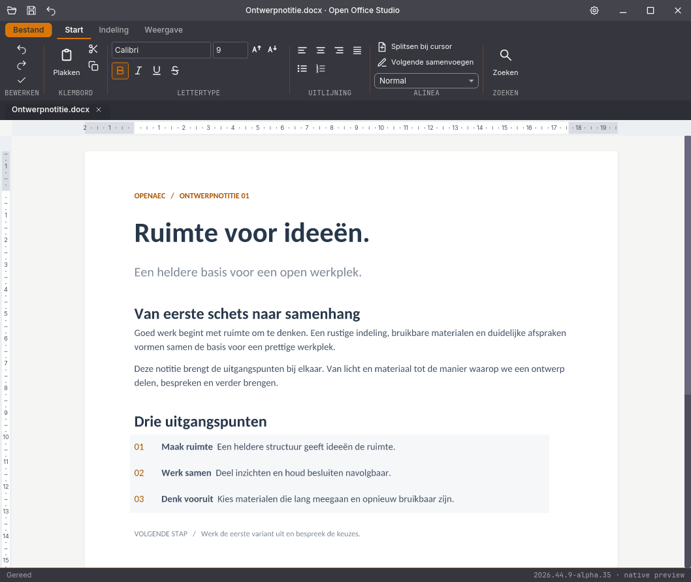

De afbeeldingen in `docs/screenshots` komen uit de echte native renderer met
synthetische documenten. Ze tonen deze preview, niet de bestaande webinterface.

## Starten en bouwen

```sh
cargo run --manifest-path native/Cargo.toml
cargo test --manifest-path native/Cargo.toml --workspace --locked
cargo build --manifest-path native/Cargo.toml --workspace --locked --release
python3 native/scripts/verpak.py
```

Op Linux vereist de reguliere X11-contracttest `Xvfb`: installeer het pakket `xvfb` of stel `OFFICE_XVFB` in op de eigen testbinary. De test start een apart tijdelijk scherm en gebruikt het bestaande bureaublad niet. De CI installeert deze testafhankelijkheid; Windows en macOS voeren deze Linux-contracttest niet uit.


De uitvoer staat in `native/target/release/open-office-studio-native` (Windows:
`.exe`). De workflow `native-rust.yml` controleert en bouwt Windows, Linux en
macOS. De zip is een draagbare preview met licenties en herbouwbare bron; dit is
nog geen ondertekende installer of vervanging van de bestaande suite.
In het uitgepakte pakket staat de bron onder `bron/`; voer de bouwopdrachten
vanuit die map uit. Het programma staat direct naast `LEESMIJ.md`.
Op Linux zijn een grafische sessie, de X11/Wayland-bibliotheken en libxkbcommon
nodig. Er wordt een software-renderer gebruikt. `--features gpu` is optioneel en
valt buiten de standaardtestmatrix.

## Huidige omvang

| Onderdeel | Native implementatie | Nog over te zetten |
|---|---|---|
| Venster | OpenAEC-ribbon, documenttabbladen, vijf thema’s, sneltoetsen, Bestand, openen/opslaan/opslaan als, sluitvragen | Herstelkopieën, recente bestanden, afgesplitste vensters, updater, vertalingen |
| Writer | Native paginering, klikbare alinea’s, linialen, zoom, tekstbereikopmaak en uitlijning, bestaande alineastijlen toepassen, splitsen bij de editorcursor en samenvoegen van aangrenzende alinea’s, woorden inclusief tabellen, Markdown-export, papierformaat/afdrukstand/marge- en kolomvoorkeuzes per sectie, zichtbare kop- en voetteksten (eerste/even/oneven), opmaakstatus uit dezelfde engine voor stijlen en Unicode-selecties, Ctrl/Cmd+B/I/U, letterlijk zoeken/vervangen en navigatie/markering op de echte trefferpagina, directe pagina-invoer en selectie binnen ondersteunde alinea’s met invoerwachtrij, gegroepeerde undo en brongebonden klikpunten, omhoog/omlaag en Home/End via echte documentregels en paginaovergangen | Volledige rijke paginacursor, invoegopmaak en selecties over alinea’s, kop/voet bewerken, aangepaste pagina-instelling en volledige alineabediening, velden/links/revisies bewerken, volledige ribbon, tabellen invoegen, spelling en afdrukken |
| Spreadsheet | Raster met vaste rij-/kolomkoppen, directe celbewerking via dubbelklik/F2/typen, Enter/Tab/Escape, enkele-celnavigatie met pijltjestoetsen en werkvensterverplaatsing, rechthoekige bereikselectie met slepen/Shift en vaste ankerpositie, formulebalk, bereikopmaak, rijen/kolommen invoegen/verwijderen, samenvoegen/splitsen, herberekenen en bladen wisselen, conservatieve alleen-lezencontrole op blad-/werkmapbeveiliging | Doorlopend virtueel raster, automatisch scrollen bij slepen, volledige rij-/kolomselectie, zoeken, sorteren/filteren, klembordbereiken, CSV-import en grafieken |
| Presentation | Native diaweergave, begrensde werkelijke diavoorbeelden op de achtergrond, een lichte gecentreerde werkruimte en aparte sprekersnotities onderaan, niet-geroteerde tekstvakken aanklikken, tekstbereikopmaak, dia’s toevoegen/verwijderen, tekstvakken invoegen, sprekersnotities bewerken | Directe cursor en vormbediening, geroteerde/gegroepeerde objecten, volledige ribbon en presentatiemodus |
| Notition | Versies 1–3 openen, boeken/secties/pagina’s toevoegen, vrij canvas met tekstvakken slepen/vergroten, Markdown-preview, bloktekst en vet/cursief, prullenbak herstellen; onbekende bronvelden behouden | Automatische lokale opslag/herstel, zoeken, boeken/secties hernoemen/verplaatsen, volledige blok- en taakbediening en import/export |
| Email | Losse Rust-mailkern, native accountformulier, IMAP-mappen/berichtlijst, zoeken en tekstlezer; volledige MIME-bron met bijlagen openen als IFCX-dossier | OAuth en automatisch serverzoeken in de GUI, opstellen/verzenden, concepten, antwoorden, berichtacties, bijlagen opslaan en HTML-weergave |
| Database | Bestaande aparte app blijft beschikbaar | Native database-interface; laagste prioriteit |
| Formaten | DOCX, XLSX, PPTX, notitie-JSON, EML, IFCX-bewaarprofiel; aparte conversie-export voor 34 doelkeuzes, waaronder PDF/PDF-A, ODF en oudere formaten | Overige import, afdrukken en conversie-instellingen aansluiten |

De native versie heeft dus nog **geen functiepariteit** met de bestaande suite.
Een uitgebreide documentweergave betekent niet dat elke zichtbare eigenschap al
bewerkbaar is. Writer weigert tekstvervanging bij inline objecten, velden, links en revisies;
de vorige bron blijft dan intact. Gewone tekst met meerdere opmaakruns houdt
de opmaak van ongewijzigde tekstdelen. De GUI registreert elke wijziging
met Unicode-grenzen en de verwachte brontekst. Daardoor behouden ook
tussenliggende tekstdelen hun eigen opmaak wanneer één concept meerdere
wijzigingen bevat. Herhaalde gelijke tekens worden op de echte cursorpositie
verwijderd. Het concept vormt één undo-stap; een foutieve of verouderde reeks
wordt zonder gedeeltelijke documentwijziging geweigerd. De pagina heeft nu directe invoer en selectie binnen ondersteunde alinea’s, met behoud van ongewijzigde runopmaak. De zijeditor blijft afzonderlijk toepasbaar. De volledige rijke paginacursor is nog niet af. Op de documentpagina maakt Enter een echte nieuwe alinea en Shift+Enter een zachte
regelovergang. Backspace/Delete voegen op de alineagrens aangrenzende alinea’s samen;
selectie verwijderen en splitsen is één brontransactie. De nieuwe lege alinea houdt
haar bestaande opmaak. Op volledig lege ondersteunde alinea’s kunnen acht invoegopmaakkeuzes al vóór de eerste letter worden bewaard; het lint toont de opgeloste lettervelden en de cursor volgt de puntgrootte. In de afzonderlijke zijeditor blijven regelovergangen tekstinvoer.
**Splitsen bij cursor** en **Volgende samenvoegen** zijn ook als lintopdrachten beschikbaar.
Deze opdrachten blijven binnen dezelfde tekst of tabelcel en weigeren revisies,
inhoudsbesturingen en samenvoegen over een sectie-einde.

Actieve documentbeveiliging wordt in Writer als alleen-lezen geopend. Het
lint en de tekstbewerking blijven geblokkeerd; selecteren en kopiëren blijven
mogelijk. Niet-afgedwongen instellingen blijven behouden bij gewone bewerkingen.
Beveiligde uitzonderingen, formulieren en het opheffen van beveiliging zijn
nog niet geïmplementeerd.

Ook actieve revisieregistratie en vergrendelde of onbekende inhoudsbesturingen
openen voorlopig alleen-lezen. De native editor mag zulke instellingen niet
stil negeren en ongeregistreerde wijzigingen bewaren. Bestaande alinea- en
runrevisies zijn niet rechtstreeks bewerkbaar. De uitzonderingen binnen een
gedeeltelijk beschermd document zijn nog niet overgezet.

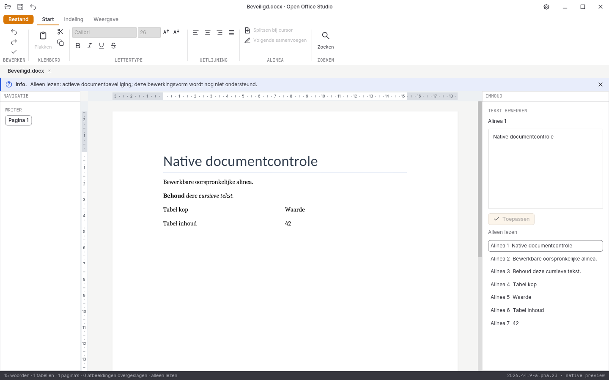

Het Writer-lint volgt nu de opgeloste opmaak van de expliciete selectie. Zonder
selectie bedienen de huidige opmaakopdrachten de hele alinea. Directe pagina-invoer binnen ondersteunde alinea’s is aangesloten; invoegopmaak binnen bestaande tekst en selecties over alinea’s blijven open.

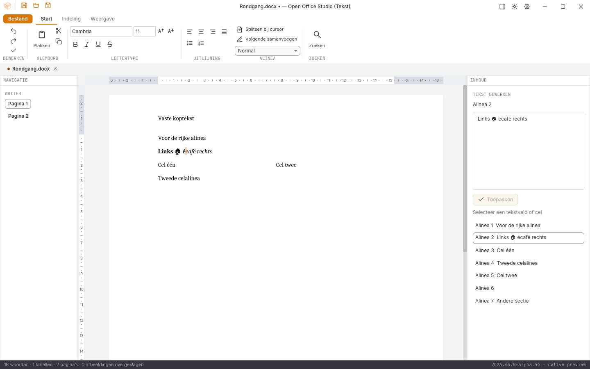

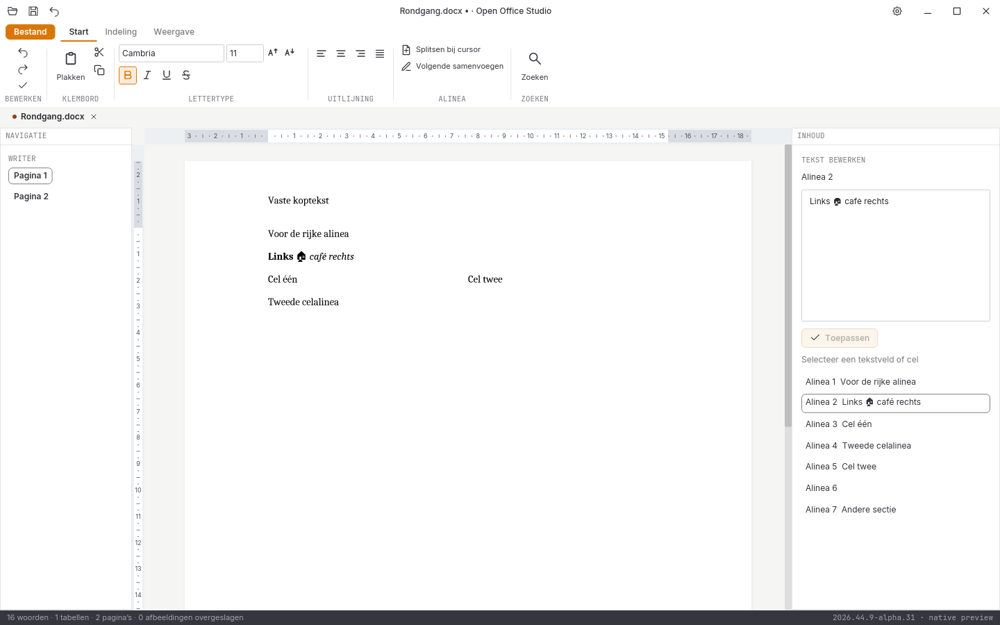

Het compacte lint heeft nu tekstklembordknoppen en letterstappen. Kopiëren,
Knippen en Plakken gebruiken uitsluitend platte tekst in de actieve editor;
rijke inhoud is nog niet overgezet. Spreadsheet heeft afzonderlijk platte celbereiken, gezamenlijk plakken en wissen; formuleverschuiving en bereik verplaatsen blijven open. Vertraagde plakantwoorden
mogen geen gewijzigd doel bewerken. Ook snel opeenvolgende selectie- en
klembordtoetsen worden in de volgorde van de applicatieberichten verwerkt;
knippen mag geen tekst verwijderen voordat de selectie is gekopieerd.
**Bestand** bevat export, Markdown en IFCX;
zoom en panelen staan voor de drie documentmodules onder **Weergave**.

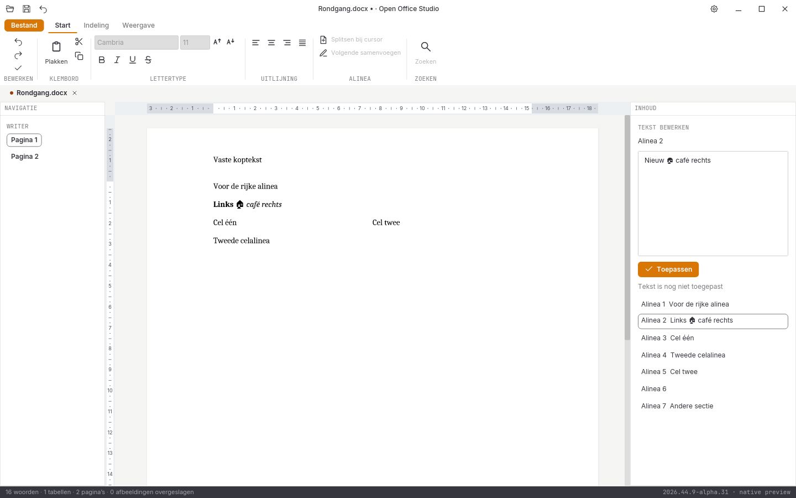

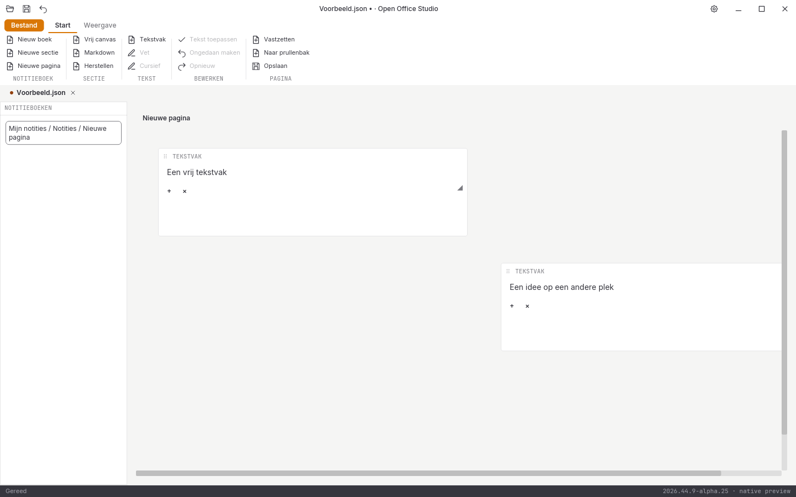

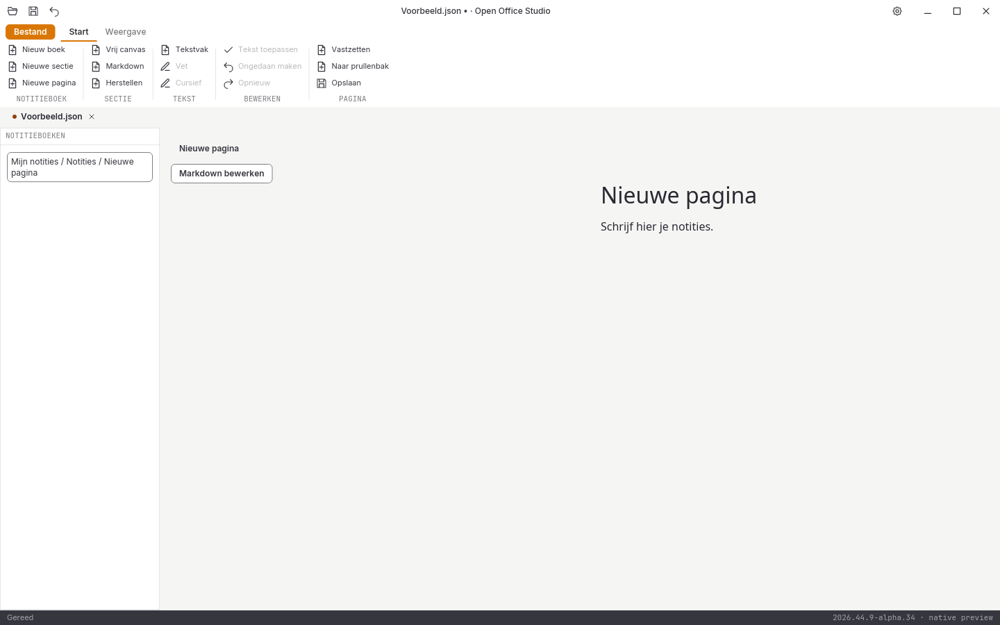

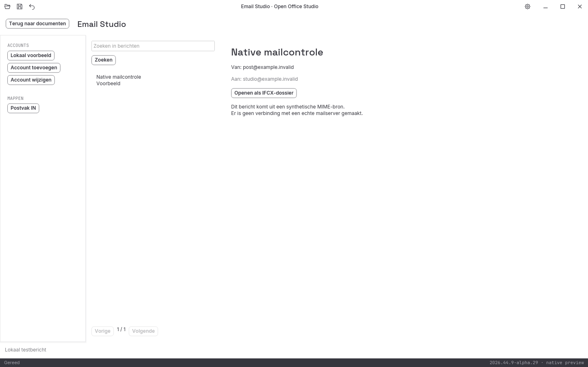

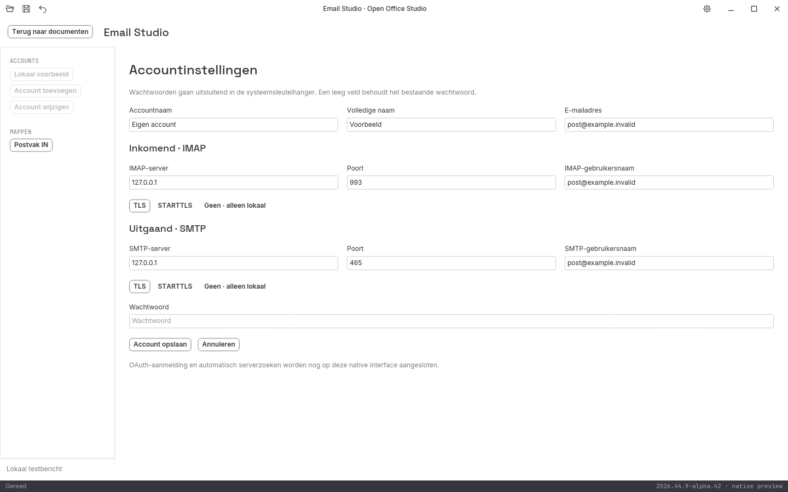

Het postvak opent via de Email-kaart, **E-mailaccounts en postvak** of
`--module email`. De native mailgegevens staan in een eigen map, gescheiden van
de bestaande suite. Een opgehaalde MIME-bron opent als nieuw IFCX-dossier;
**Opslaan** bewaart het dossier daadwerkelijk op schijf. HTML-weergave,
opstellen/verzenden, OAuth-aanmelding in de GUI en de overige berichtacties
zijn nog niet aangesloten. De netwerkproeven gebruiken lokale nepservers.

## Spreadsheet: direct bewerken en navigeren

Klik een cel aan en typ om haar inhoud te vervangen. Dubbelklik of F2 opent
de bestaande inhoud in een editor op de cel. Enter bevestigt en gaat omlaag;
Shift+Enter gaat omhoog. Tab en Shift+Tab bevestigen naar rechts en links.
Escape verwerpt het concept. De formulebalk en de cel gebruiken dezelfde
tekstinhoud. Herberekening en undo lopen door de documentwerkdraad.

Pijltjestoetsen verplaatsen de enkele-celselectie. Buiten het huidige
werkvenster verplaatst ook het zichtbare deel. Samengevoegde en verborgen
rij-/kolombereiken worden overgeslagen zonder elke cel afzonderlijk te openen.
Navigeren verandert geen bestandsbytes en maakt geen undo-stap.

Een onvolledige formule wordt vóór wijziging geweigerd en blijft als concept
in beeld. Een geldige formule met een rekenfout blijft toegestaan. Een cel met
tekstopmaak of invoer met een voorafgaande apostrof blijft letterlijke tekst.
Bereikselectie gebruikt muisslepen, Shift+klik en Shift+pijlen. Het oorspronkelijke anker blijft bij uitbreiden en verkleinen behouden; aangesneden samenvoegingen worden volledig meegenomen. Relatieve navigatietoetsen blijven tijdens een rasterwissel in volgorde bewaard. Een selectie of pure navigatie verandert geen bronbytes en maakt geen undo-stap. Bestaande bereikopmaak geldt voor het hele geselecteerde gebied. Een selectie boven 10.000 cellen wordt expliciet geweigerd. Bereikplakken, automatisch scrollen tijdens slepen, volledige rij-/kolomselectie en volledige bescherming blijven open. Actieve of onbekende blad-/werkmapbeveiliging opent voorlopig de gehele werkmap alleen-lezen; ook een verkeerde frontendstatus kan de kerncontrole niet omzeilen. Wachtwoorden, opheffen en bewerkbare uitzonderingen blijven open.

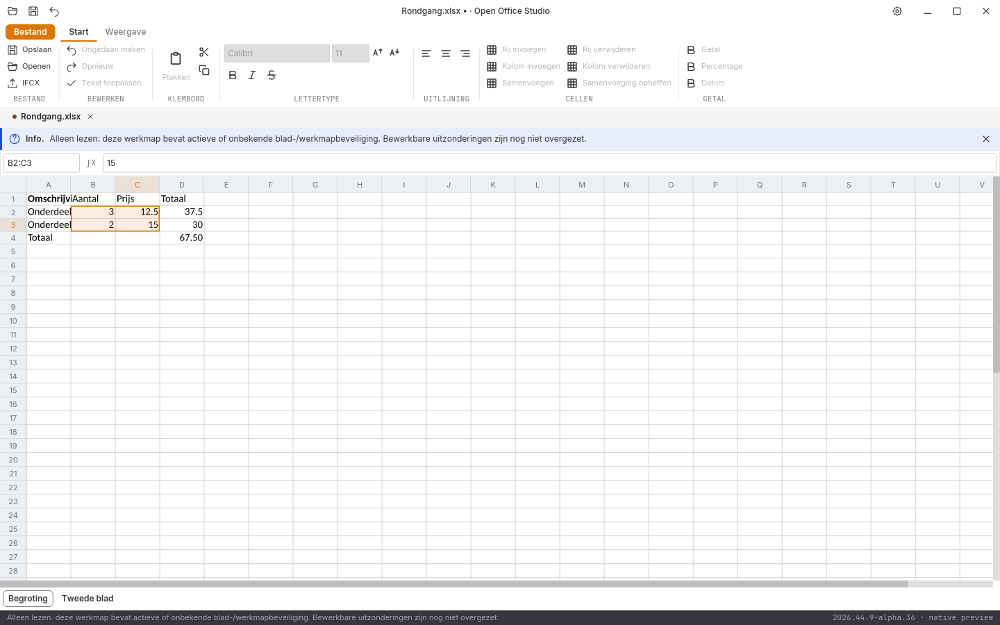

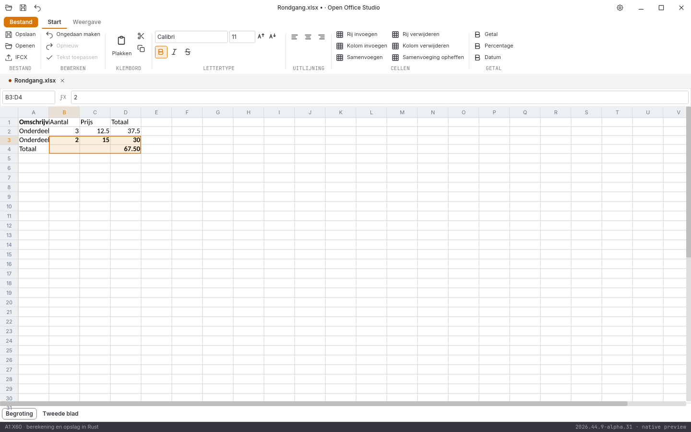

Het raster begint linksboven in het werkvlak. De rij- en kolomkoppen volgen
dezelfde geometrie als de cellen en blijven in beeld bij scrollen. De cellen
schalen met de documentzoom; de koppen houden hun leesbare UI-maat. Het
werkvenster bevat maximaal 60 rijen en 24 kolommen, met een rasterbeeld tot
1600 × 1400 pixels. Dit is nog geen volledige virtualisatie. Koppen selecteren
nog geen volledige rij of kolom.

Een identiek paginabeeld houdt zijn Iced-imagehandle, zodat selectienavigatie
geen nieuwe afbeeldingsdecoder maakt. Verborgen zijpanelen worden niet meer
opgebouwd. Een zeer brede voorafgaande kolom krijgt bij navigatie een tweede
poging vanaf de doelcel; onzichtbare doelen worden expliciet geweigerd.

De rasterizer gebruikt nu dezelfde vastgepinde lettertypefamilies als de
cel-editor, met echte vet-/cursiefgezichten waar die beschikbaar zijn. Meten,
regelterugloop, getalopmaak en tekenen gebruiken hetzelfde gekozen gezicht.
De ingebouwde standaardaanroep van de renderer blijft bytegelijk aan zijn vijf
oorspronkelijke bronbeelden. Twee families zijn elk met vier stijlen afzonderlijk
getest; dit bewijst geen volledige glyph-terugval, alle documentletters of
systeemlettertypen. Zie de [fontproeven](docs/spreadsheetletters-2026-10-31-alpha15.json).

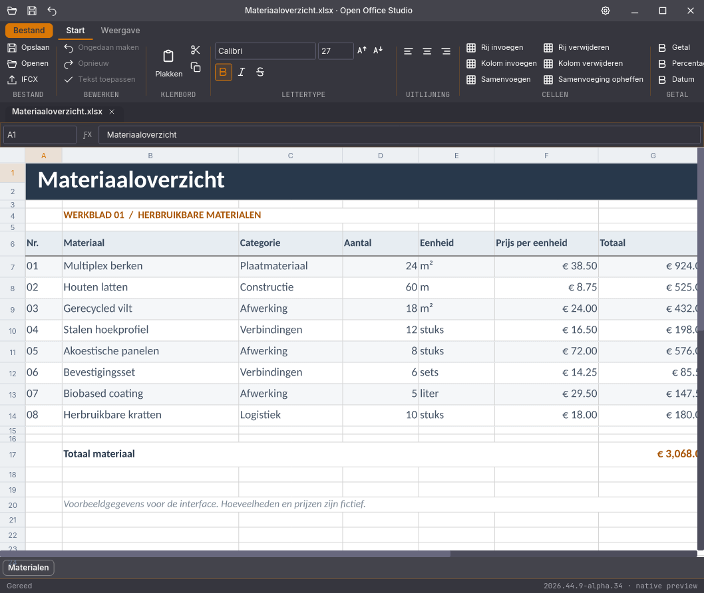

## Writer: opsommingen en nummering

Start → Uitlijning bedient gewone opsommingen en genummerde lijsten voor de actieve ondersteunde alinea. Nogmaals klikken beëindigt de lijst; Enter vervolgt haar en beëindigt een leeg item zonder extra alinea. Aangrenzende alinea’s delen de lijst binnen dezelfde body of tabelcel. De oorspronkelijke lijst-XML en directe runopmaak blijven behouden. Ook nummering uit een alineastijl kan echt worden uitgeschakeld.

De [lijstcontroles voor alpha 34](docs/lijsten-2026-11-01-alpha34/LEESMIJ.md) leggen vijftien nieuwe proeven, twee onafhankelijk teruggelezen DOCX en bronexacte undo vast. Volledig lijstbeheer, niveaus/herstart en selecties over meerdere alinea’s blijven open.

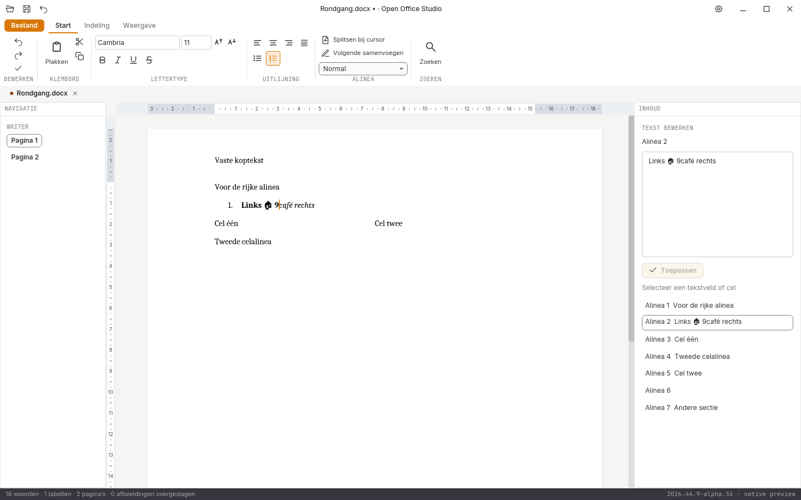

## Writer: alineastijlen

Start → Alinea toont de beschikbare alineastijlen uit het document. Een keuze
wijzigt de actieve ondersteunde alinea, ook zonder tekstselectie, leeg of in een
tabelcel. De engine berekent de overerving; directe opmaak en de oorspronkelijke
stijlbron blijven behouden. Een keuze is aan document, bronhash en alinea gebonden.
Oude keuzes mogen geen andere alinea, gewijzigde bron of nieuwe tab raken.

Dubbele stijl-ID’s worden uit de oorspronkelijke bron gelezen voordat de engine
ze samenvoegt. Dubbele of cyclische ketens, ontbrekende bases en tekenstijlen
worden geweigerd. Stijlketens zijn begrensd op 128 definities en opdracht-ID’s op
512 UTF-8-bytes. Aanmaken, hernoemen, verwijderen en volledig stijlbeheer,
complexe alinea’s en selecties over meerdere alinea’s blijven open.
De [gerichte proeven en oorspronkelijke afkeuringen](docs/alineastijlen-2026-11-01-alpha33/LEESMIJ.md)
leggen directe vervolginvoer, bewaren, heropenen, onafhankelijke DOCX-lezers en
bronexacte undo/redo vast. De [echte alpha-33-stijlvensterproeven](docs/vensterproeven-2026-11-01-alpha33/LEESMIJ.md) slagen op lokale en CI-Linux-programma’s voor twintig gerichte stappen; overige functie-, platform- en pixelacceptatie blijft open.

## Writer: pagina-indeling

Het tabblad **Indeling** heeft vijf papierformaten, staand/liggend, vier
margevoorkeuzes en één, twee of drie tekstkolommen. De opdrachten gelden voor
de sectie van de gekozen body-alinea, ook als die alinea in een tabel staat.
Andere secties en geërfde kop-/voettekstverwijzingen blijven behouden. De
sessie weigert deze opdrachten bij actieve documentbeveiliging, sectierevisies,
wijzigingen bijhouden of een alinea binnen een inhoudsbesturing. Ongedaan maken
herstelt de volledige vorige bron.

Kop- en voetteksten worden nu ook daadwerkelijk in het paginabeeld getekend.
De beeldproeven controleren overerving en de afzonderlijke eerste, even en
oneven varianten. Bewerken van deze tekstgebieden en volledige paginafuncties
blijven open.

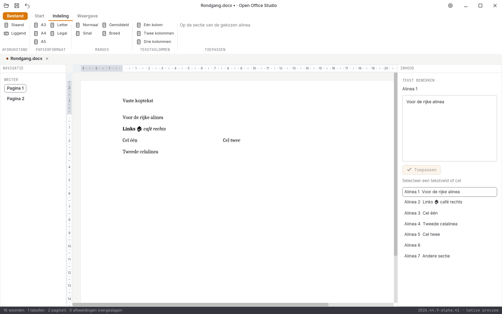

## Writer: zoeken en vervangen

**Start → Zoeken**, Ctrl/Cmd+F en Ctrl/Cmd+H openen het zoekpaneel.
Letterlijk zoeken omvat alle hoofdtekst- en tabelalinea's, met Unicode,
hoofdlettergevoeligheid en hele woorden. Vorige/Volgende doorloopt de resultaten;
een resultaat selecteert de gevonden tekst in de alinea-editor en navigeert
naar de bijbehorende documentpagina. Die pagina volgt uit dezelfde behouden
layout als het documentbeeld, ook voor tabelcellen en doorlopende alinea’s.
Unicode-posities worden vanuit tekens naar de UTF-16-grenzen van de engine
vertaald. Navigatie verandert geen bronbytes en maakt geen undo-stap.

Zoeken loopt buiten de documentwerkdraad. Paginanavigatie gebruikt die werkdraad
zonder de teksteditor te blokkeren; per paneel is hoogstens één navigatie
actief en blijft alleen het laatste wachtende doel behouden. Nieuw typen,
selecteren, scrollen, een ander venster of een andere bronversie maakt een
vertraagd navigatieantwoord ongeldig. Undo en redo gebruiken daarna de echt
getoonde pagina. De gevonden tekst krijgt nu een markering uit dezelfde
gevormde layout als de pagina. Zij schaalt met het document mee en vervalt
bij gewijzigde invoer, selectie of bronversie. Een onbetrouwbare of te grote
markering wordt expliciet geweigerd. De pagina springt voorlopig naar de
bovenkant; scrollen naar de gevonden regel ontbreekt nog. Een nieuwe
query, een andere bronversie of een gesloten paneel mag geen oud resultaat
overnemen. Per paneel loopt hoogstens één zoektaak; nieuwe invoer vervangt het
wachtende verzoek.

Vervangen en Alles vervangen gebruiken expliciete Unicode-tekststappen.
Ongewijzigde opmaak blijft behouden. Alle geraakte alineakopieën worden vóór
de eerste modelwijziging gecontroleerd; de gezamenlijke vervanging vormt één
undo-stap. Ook de rechtstreekse document-API blijft ongewijzigd bij een late
fout. Identieke vervangingen maken geen schijnbewerking. De volgende treffer
begint na de ingevoegde vervangtekst. Een alleen-lezen resultaat wordt niet
stil overgeslagen.

De limieten zijn 16 MiB doorzoekbare tekst, 4096 treffers en een begrensd
vervangbudget. Bij overschrijding volgt een fout, geen afgekapt resultaat dat
als volledige vervanging telt. Het paneel bouwt maximaal 75 resultaatknoppen;
Vorige/Volgende blijft de volledige resultatenlijst doorlopen.

Dit is nog geen volledige zoekpariteit: kop-/voetteksten, noten, tekstvakken,
zoeken over alineagrenzen, reguliere expressies, jokertekens en opmaakfilters
zijn niet aangesloten. De documentpagina gebruikt brongebonden klikpunten voor directe invoer en selectie binnen ondersteunde alinea’s. De volledige rijke cursor, selecties over alinea’s blijven open. Omhoog/omlaag en Home/End volgen nu de echte documentregels en pagina’s, inclusief de twee zichtbare posities op één bronpositie bij automatische regelafbreking.

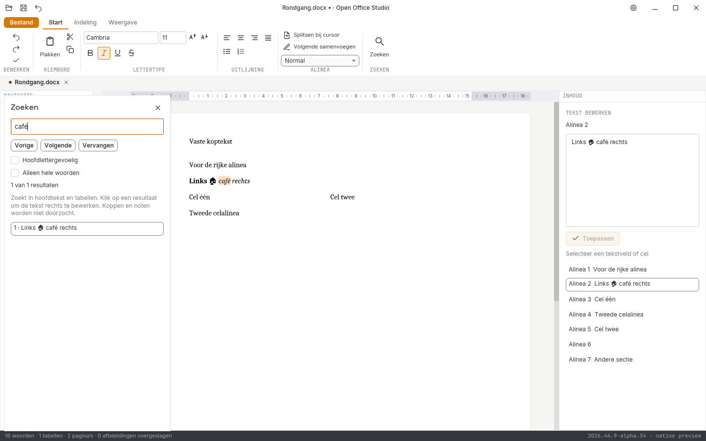

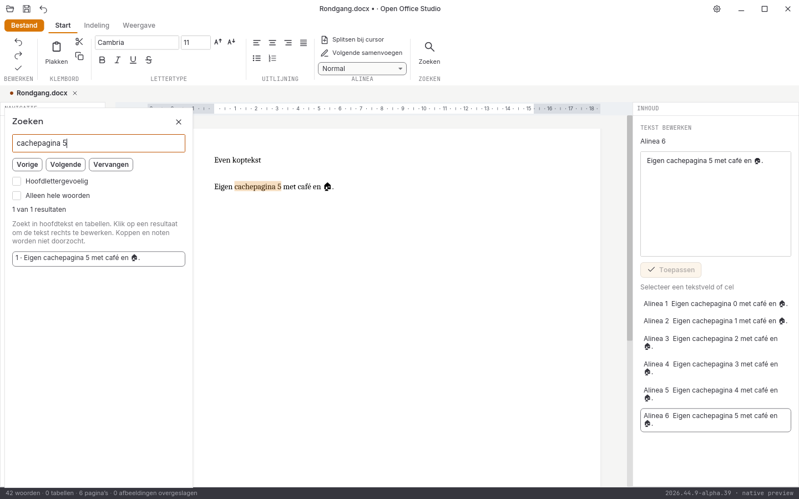

## Conversie-export

**Bestand → Exporteren** maakt voor Writer, Spreadsheet en Presentation een
apart bestand vanuit de vastgelegde documentbron. De dialoog biedt respectievelijk
13, 12 en 9 doelkeuzes. CSV ondersteunt scheidingsteken, codering en bladnummer;
TSV gebruikt altijd een tab. PDF ondersteunt paginabereik, bladwijzers en
PDF/A-1b, -2b of -3b. De export verandert de opslagstatus van het document niet
en weigert het oorspronkelijke bestand als exportdoel.

Hiervoor is een geïnstalleerde kantoorruntime nodig; die wordt automatisch
gezocht en zit niet in het draagbare pakket. De afzonderlijke Rust-kern gebruikt
hetzelfde afgeschermde profiel als de bestaande suite: macro-uitvoering uit,
externe koppelingen niet verversen en een tijdelijk profiel per opdracht.
De PDF-layout komt van die runtime en kan afwijken van de native paginering.
Dit is geen bewijs van foutloze conversie voor willekeurige documenten of
van een inhoudelijk volledige PDF/A-validatie. De overige importformaten zijn
nog niet met de native interface verbonden.

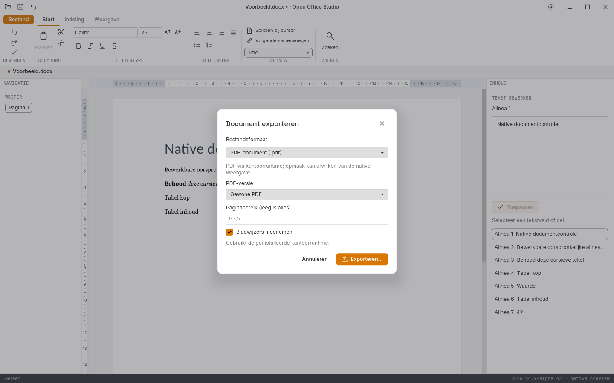

De daadwerkelijke runtimeproeven staan apart omdat zij een geïnstalleerd
conversieprogramma vereisen. De Linux-CI heeft hiervoor een eigen bouwtaak.

```sh
OFFICE_TEST_UIT=/tmp/native-conversie \
  cargo test --manifest-path native/Cargo.toml --workspace --locked -- --include-ignored --test-threads=1
cargo test --manifest-path native/Cargo.toml --workspace --locked \
  native_export_via_interface_en_werkdraad -- --include-ignored
```

## Bewaring en snelheid

Writer pagineert de hele bron, maar bouwt alleen de tekenopdrachten van de
gevraagde pagina. De paginatelling en documentvelden houden hun volledige
context. Regressieproeven vergelijken het beeld en alle klikgebieden exact met
de opbouw van alle pagina's; dit is geen vergelijking met de webinterface.

De engines werken op één aparte werkdraad. De interface ontvangt een begrensde
weergave en blijft los van parser, rasterizer en bestands-I/O. Writer hergebruikt
de lettertypecache per werkdraad zolang fontvereisten en registergeneratie gelijk
blijven. Daarnaast blijft maximaal één Writer-layoutengine per werkdraad behouden,
gebonden aan document, bronhash en fontgeneratie. Ook paginawissels buiten de drie
bewaarde paginabeelden hoeven dezelfde engine dan niet opnieuw op te bouwen.
Bewerken, undo, een andere bron of gewijzigde fonts dwingen een nieuwe opbouw af.
Zelfstandige documentcontroles blijven verse berekeningen. Bestanden worden
uit het volledige enginemodel opgeslagen, nooit uit de tekstvelden of afbeelding
van het venster. Ongedaan maken bewaart maximaal 32 bronnen en 64 MB per document.
Dit is een eerste betrouwbaarheidskeuze; grote documenten vragen nog gerichte
profilering en een overgang naar de eigen transactiegeschiedenis van de engines.

Bestandsopslag controleert de gelezen SHA-256, schrijft via een tijdelijk bestand
naast het doel en vraagt bij gewijzigde externe inhoud om Opslaan als. Dit is
geen bestandssysteemtransactie tussen onafhankelijke externe programma’s: een
extern proces dat precies tussen controle en vervangen schrijft, kan nog een
race veroorzaken. Sluiten vraagt ook naar nog niet toegepaste editorinvoer.

Het IFCX-bewaarprofiel `0.1.0-draft.1` is het eerdere eigen voorstel, geen
vastgestelde interoperabele Office-standaard. Alle bronbytes gaan mee in base64
met lengte en SHA-256. Bij e-mail zijn dat de volledige oorspronkelijke
EML/MIME-bytes. Deze preview opent één document per IFCX-dossier, verwerkt geen
imports/overerving en begrenst de bron tot 12 MB. Onbekende attributen blijven
bij herschrijven behouden. IFCX is archivering van de bron; de semantische
bewerking van tekst, cellen en dia’s blijft bij de documentengines.

## Controles

Alpha46 verbindt Start, de documentbalk en bestaande Office-iconen. De [volledige lokale ronde](docs/controle-2026-11-02-alpha46.md) slaagt met 447 reguliere Rust-proeven (194 UI), zes afzonderlijke runtimeproeven en zeven Python-tests op 736 bytegelijke bronbestanden. Veertig echte Linux-debugstappen controleren behoud van invoer, sluiten vanaf Start, werkelijk bewaren en terugkeer naar Writer. Alle oorspronkelijke UI-vergelijkingen en alpha46-platform-/releasevenstercontroles blijven open.

Alpha45 bewaart centrale en directe Writer-meldingen per document. De [volledige lokale ronde](docs/controle-2026-11-02-alpha45.md) slaagt met 442 reguliere Rust-proeven (189 UI), zes afzonderlijke runtimeproeven en zeven Python-tests op 733 bytegelijke bronbestanden. Twee echte Linux-debugproeven van elk negentien stappen tonen het foutbehoud vóór/na de correctie, met behoud van de externe wijziging en de eigen Writer-bron. Zeer snelle toetsen/tabwissels krijgen verdere controle. Alle vijf alpha45-CI-taken en de gerichte negentien-staps geoptimaliseerde Linux-releasevensterproef slagen: 122 native beeldparen, 5417 bronbestanden per pakket en 21 paginabezoeken zijn exact. Alle oorspronkelijke UI-vergelijkingen blijven afgekeurd.

Alpha44 sluit de Office-vensterbalk aan en herstelt actieve-tabkeuze, documentmetadata en Gereed na het laatste document. De [volledige lokale ronde](docs/controle-2026-11-02-alpha44.md) slaagt met 436 reguliere Rust-proeven (183 UI), zes afzonderlijke runtimeproeven en zeven Python-tests op 733 bytegelijke bronbestanden. De echte Linux-debugproef sluit 58 stappen af met bytegelijk behouden bronnen en opgeslagen notitie. Alle vijf alpha44-CI-taken slagen: 122 native beeldparen, 5168 bronbestanden per pakket en 21 paginabezoeken zijn exact. De geoptimaliseerde alpha44-Linux-releasevensterproef sluit 58 gerichte stappen af met behouden bronnen; alle oorspronkelijke UI-vergelijkingen blijven afgekeurd.

Alpha43 verbindt een klok per notitiesessie, werkelijke aanmaakdatums en een lokale kalenderdag, met vaste tijd/UTC voor widgetproeven. Ctrl+W gebruikt dezelfde sluitbeveiliging als de tabknop. De [volledige lokale ronde](docs/controle-2026-11-02-alpha43.md) slaagt met 430 reguliere Rust-proeven (177 UI), zes afzonderlijke runtimeproeven en zeven Python-tests op 731 bytegelijke bronbestanden. De echte Linux-debugvensterhertest behoudt concepttekst en de opgeslagen bron. Alle vijf alpha43-CI-taken en de geoptimaliseerde Linux-releasevensterproef slagen binnen hun gerichte omvang: 122 native beeldparen, 4956 bronbestanden per pakket en 21 paginabezoeken zijn exact. Alle oorspronkelijke UI-vergelijkingen blijven afgekeurd.

Alpha42 verbindt echte diavoorbeelden, een lichte presentatie-werkruimte en een afzonderlijke notitie-editor. De volledige lokale hertest slaagt met 418 reguliere Rust-proeven (172 UI), zes afzonderlijke runtimeproeven en zeven Python-tests op 729 bytegelijke bronbestanden. De echte Linux-debugvensterhertest behoudt het paneel bij navigatie en bewaart snelle undo/opslaan bronexact. De eerste afkeuringen blijven vastgelegd in [de controle](docs/controle-2026-11-01-alpha42.md). Alle vijf alpha42-CI-taken slagen: 122 native beeldparen, 4725 bronbestanden per pakket en 21 paginabezoeken zijn exact. De echte geoptimaliseerde Linux-vensterproef slaagt op zeventien gerichte stappen. Alle acht oorspronkelijke UI-vergelijkingen blijven afgekeurd; fysieke Windows/macOS-vensters, volledige functie- en installatiepariteit blijven open.

Het [afgesloten rapport voor alpha 41](docs/controle-2026-11-01-alpha41.md) bevat 408 geslaagde reguliere Linux-proeven, zes runtimeproeven en zeven Python-tests. Alle vijf CI-taken slagen: 120 native beeldparen zijn exact, drie pakketten bevatten elk 4439 bytegelijke bronbestanden en alle 21 paginabezoeken zijn exact. De geoptimaliseerde Linux-vensterproef omvat 28 afgebakende notitiestappen. De oorspronkelijke trage debugbeelden en alle acht oorspronkelijke UI-afkeuringen blijven behouden; Windows en macOS zijn uitsluitend in CI gecontroleerd.

Het [actuele controlerapport voor alpha 40](docs/controle-2026-11-01-alpha40.md) legt **406 reguliere Rust-tests**, waaronder **164 UI-tests**, zes afzonderlijke runtimeproeven en zeven Python-tests vast. Alle 694 bronbestanden blijven tijdens de afgesloten ronde bytegelijk; terminal, Rustfmt, Clippy, bronpins en onafhankelijke lezers slagen. Drie aanvullende runtimeproeven herstellen snelle muisinvoer en cachebehoud. Het echte debugvenster controleert twee snelle grepen met focus in een ander tekstvak, vrije dubbelklik, tekstinvoer en bronexacte undo. Achterlopende menu-/Escape-beelden blijven echter open; een afzonderlijke X11-proef reproduceert een ontbrekende verzending na presenteren. De prototypecorrectie is nog niet geïntegreerd. De alpha40-platformronde is afgekeurd op gewijzigde Windows-checkoutbytes in de nieuwe runtime; alpha41 herstelt de vendorregels. Een aanvullende aanraakproef vond bovendien hergebruik van de oude muispositie. Beide oorspronkelijke afkeuringen blijven behouden; alle acht oorspronkelijke UI-vergelijkingen blijven afgekeurd.

Het [werkrapport voor alpha 39](docs/controle-2026-11-01-alpha39.md) beschrijft de nieuwe Notities-kolommen, het lichte canvas, echte dubbelklik-invoer, sectiekopie via de typekeuze en live woordtelling. De volledige lokale ronde slaagt met 403 Rust-tests, waaronder 161 UI-tests, zes runtimeproeven en zeven Python-tests. Alle vijf CI-taken slagen: 3962 bronbestanden per platform, 120 exacte native beeldparen en 21 paginabezoeken. De definitieve desktopvergelijking daalt van 665709 naar 145039 afwijkende pixels en blijft afgekeurd. De extra echte vensterproef vindt echter nog een snelle-muisinvoerfout; de aanvullende runtime-regressietest faalt op alpha39 bij drie zoomniveaus. De afgesloten alpha40-controle staat hierboven; de weergavevertraging blijft open.

Het [eerdere controlerapport voor alpha 38](docs/controle-2026-11-01-alpha38.md) legt **398 reguliere Rust-tests**, waaronder **158 UI-tests**, zes runtimeproeven en zeven Python-tests vast. Alle 671 bronbestanden blijven tijdens de volledige ronde bytegelijk. De Notities-crash, zichtbare formaatgreep en preview-undo zijn hersteld; echte Linux-vensterproeven slagen op het debug- en releaseprogramma. De CI-herhaling slaagt op alle vijf taken, met 3951 verpakte bronbestanden per platform, 120 exacte native beeldparen en 21 paginabezoeken; de eerste schermtellingafkeuring blijft bewaard. Alle oorspronkelijke pixelafkeuringen en ontbrekende suitefuncties blijven open.

Het [controlerapport voor alpha 37](docs/controle-2026-11-01-alpha37.md) legt **395 reguliere Rust-tests**, waaronder **155 UI-tests**, zes runtimeproeven en zeven Python-tests vast. Rustfmt, Clippy, bronpins en onafhankelijke lezers slagen; **671 bronbestanden** en **57 volledige native widgetbeelden** zijn vastgelegd. Alle vijf CI-taken, 114 exacte native beeldparen en 21 paginabezoeken slagen. De echte geoptimaliseerde Linux-Notities-proef eindigt echter in een paginawisselcrash; ook de zichtbare formaatgreep blijft afgekeurd. De bewaarde bron blijft intact. Er is geen volledige GUI-, functie-, platform- of oorspronkelijke UI-pariteit.

De brede corpusronde heeft 579 geslaagde bronnen, 68 weigeringen en één overschrijding van 30 seconden. De afzonderlijke 120-secondenproef slaagt, maar maakt de oorspronkelijke ronde niet groen. Een extra ZIP-byte-eis legt herschreven kop-/voettekstwrappers vast; de inhoud blijft afzonderlijk gecontroleerd. De oorspronkelijke afkeuringen blijven in de [bewijsreeks](docs/zoeken-hertekenen-2026-11-01-alpha36/LEESMIJ.md) bewaard.

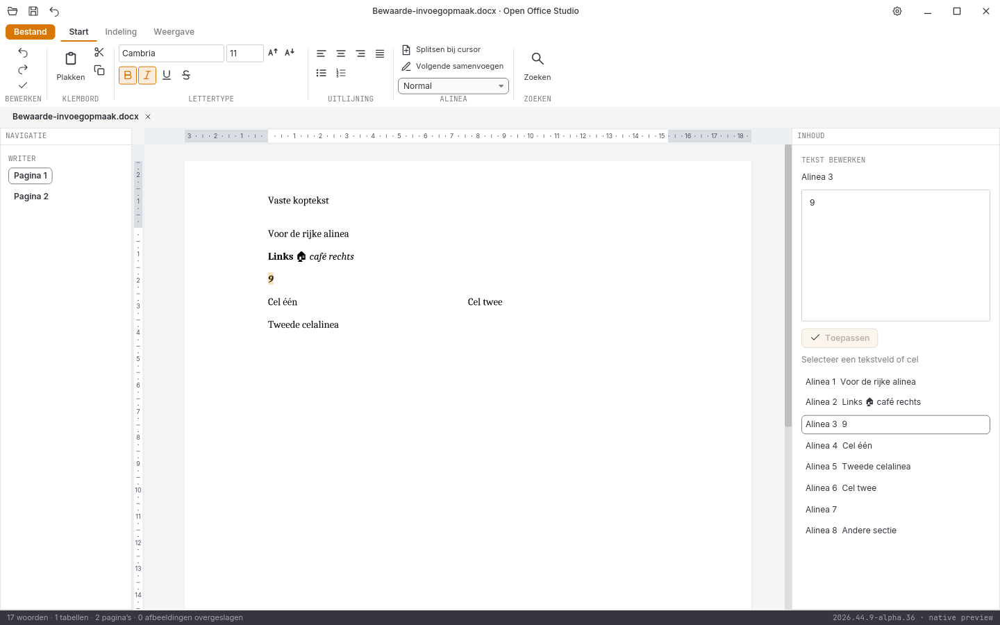

Het [controlerapport voor alpha 31](docs/controle-2026-11-01-alpha31.md) legt **344 reguliere Rust-tests**, inclusief **124 UI-tests**, zes runtimeproeven en zeven Python-tests vast. De [lokale releasebouw](docs/bouw-2026-11-01-alpha31-lokaal.json) slaagt in 34m31s met beide programma’s vastgezet. De [platformronde](docs/platformen-2026-11-01-alpha31.json) slaagt op vijf taken met 2095 bytegelijke bronbestanden per pakket, 106 exacte native beeldparen en 21 paginabezoeken. De [werkelijke CI-Linux-vensterproeven](docs/vensterafkeuring-2026-11-01-alpha31-ci/LEESMIJ.md) blijven afgekeurd: na een ontoereikende eerste bronvoorwaarde toont de strengere hertest daadwerkelijk toetsverlies vlak na een opmaakklik. De oude widgetproeven dekten die gebeurtenisvolgorde niet. De nieuwe alpha-32-widgetronde reproduceert het verlies vóór de correctie en controleert de gewijzigde route; een nieuw werkelijk releasevenster blijft nodig.

Het [vorige controlerapport voor alpha 30](docs/controle-2026-11-01-alpha30.md) legt **333 reguliere Rust-tests**, inclusief **118 UI-tests**, zes runtimeproeven en zeven Python-tests vast. Rustfmt, Clippy, bronhashcontroles en onafhankelijke lezers slagen. **51 volledige native widgetbeelden** en **660 productiebronbestanden** zijn vastgelegd. De [standaardrijcorrectie](docs/modeluitvoer-correctie-2026-11-01-alpha30/LEESMIJ.md) is gecontroleerd met vijf eigen proeven, 23 onafhankelijk teruggelezen XLSX-bestanden en afzonderlijk 382 oorspronkelijke parsertests vóór en na de wijziging. De [partiële opdrachtinventaris](docs/functie-inventaris-2026-11-01/LEESMIJ.md) is geen functiedekking. De [lokale alpha-30-releasebouw](docs/bouw-2026-11-01-alpha30-lokaal.json) slaagt in 31m51s. De [uiteindelijke platformronde](docs/platformen-2026-11-01-alpha30.json) slaagt op vijf taken met 1556 bytegelijke bronbestanden per pakket, 102 volledige native beeldparen zonder afwijking en 21 paginabezoeken. De [echte CI-Linux-Writer-vensterproef](docs/vensterproef-2026-11-01-alpha30-ci/LEESMIJ.md) slaagt op achttien gerichte stappen. De [schaarse spreadsheetproef](docs/vensterproef-2026-11-01-alpha30-schaars/LEESMIJ.md) blijft afgekeurd op beginfocus en lange rijkoppen; de afzonderlijke route na celklik slaagt op zes functionele stappen.

De [lokale alpha-29-releasebouw](docs/bouw-2026-11-01-alpha29-lokaal.json) slaagt in 27m06s met pakket-/bronregressiecontrole en beide programma’s vastgezet. De [lokale](docs/vensterproef-2026-11-01-alpha29-lokaal/LEESMIJ.md) en [CI-Linux-Writer-vensterproef](docs/vensterproef-2026-11-01-alpha29-ci/LEESMIJ.md) slagen ieder op achttien gerichte stappen. De gezamenlijke [alpha-29-CI-taak blijft afgekeurd](docs/ci-diagnose-2026-11-01-alpha29/LEESMIJ.md) wegens de oude verwachting van 49 beelden. Een afzonderlijke lokale hertelling slaagt op 102 volledige native beeldparen met nul tolerantie; 21 releasepaginabezoeken slagen afzonderlijk. Alpha 30 verwacht expliciet 51 beelden. Dit keurt de oorspronkelijke CI-taak niet alsnog goed.

De [lokale alpha-28-releasebouw](docs/bouw-2026-11-01-alpha28-lokaal.json) slaagt in 33m49s. De [platformronde](docs/platformen-2026-11-01-alpha28.json) slaagt op vijf taken met 1357 bytegelijke bronbestanden per pakket, 98 exacte native schermparen en 21 paginabezoeken. De [echte CI-Linux-vensterproef](docs/vensterproef-2026-11-01-alpha28-ci/LEESMIJ.md) slaagt op 21 gerichte stappen.
De [lokale alpha-27-releasebouw](docs/bouw-2026-11-01-alpha27-lokaal.json) slaagt in 31m12s, inclusief pakket-/broncontrole en beide programma’s vastgezet. De [echte CI-Linux-releasevensterproef](docs/vensterproef-2026-11-01-alpha27-ci/LEESMIJ.md) slaagt op achttien gerichte stappen: directe plak/Enter/bewaren, opeenvolgende celinvoer, bronexacte undo, Bestand zonder documentlint en Unicode na heropenen. De eerdere onvoldoende Bestand-controle blijft afzonderlijk afgekeurd. De [volledige alpha-27-platformronde](docs/platformen-2026-11-01-alpha27.json) slaagt op vijf taken met 1297 bytegelijke bronbestanden per pakket, 98 volledige native beeldparen en 21 releasepaginabezoeken.
De [lokale alpha-26-releasebouw](docs/bouw-2026-11-01-alpha26-lokaal.json) slaagt in 29m56s met pakketcontrole, bronregressie en beide programma’s vastgezet. De [platformronde](docs/platformen-2026-11-01-alpha26.json) slaagt op vijf taken: 1240 bytegelijke bronbestanden per pakket, 94 volledige native beeldparen zonder tolerantie en 21 releasepaginabezoeken. De [echte lokale vensterproef](docs/vensterproef-2026-11-01-alpha26-lokaal/LEESMIJ.md) slaagt op veertien gerichte stappen; de voorafgaande scriptfout blijft afgekeurd.
De [lokale alpha-25-releasebouw](docs/bouw-2026-11-01-alpha25-lokaal.json) slaagt in 28m03s, inclusief pakketcontrole en bronregressie; beide programma’s zijn vastgezet. De [echte CI-Linux-vensterproef](docs/vensterproef-2026-11-01-alpha25-ci/LEESMIJ.md) slaagt op twaalf gerichte stappen. Het huisteken is zichtbaar in het raster, ook na opslaan, sluiten en opnieuw openen. De [volledige alpha-25-platformronde](docs/platformen-2026-10-31-alpha25.json) slaagt op vijf taken met 1199 bronbestanden per pakket, 92 volledige native beeldparen zonder tolerantie en 21 releasepaginabezoeken. De [alpha-24-releasebouw](docs/bouw-2026-10-31-alpha24-lokaal.json) slaagt in 29m50s; beide programma’s zijn vastgezet en pakket-/broncontroles slagen. De [echte beschermingsproef](docs/vensterproef-2026-10-31-alpha24-release/LEESMIJ.md) slaagt na afgeronde navigatie, met eerdere mislukkingen en de snelle sleepsessie nog open. De [volledige alpha-24-platformronde](docs/platformen-2026-10-31-alpha24.json) slaagt op vijf taken met 1145 bronbestanden per pakket, 90 volledige native beeldparen en 21 paginabezoeken. De echte alpha-23-vensterproef met het ontbrekende huisteken blijft historisch visueel afgekeurd; de aparte alpha-25-releasevensterproef corrigeert en controleert dat concrete geval.

De [echte alpha-21-Linux-releasevensterproef](docs/vensterproef-2026-10-31-alpha21-release/LEESMIJ.md) slaagt op elf gerichte stappen met directe paginatoetsen, systeemklembord, Unicode, onmiddellijk bewaren, opmaakbehoud, bronexacte undo, knippen/plakken, zoekfocus na Escape, Bestand en schoon sluiten. De eerste afgekeurde proefopzet blijft toegelicht bewaard. Deze proef gebruikt een eigen Xvfb, D-Bus en XDG-mappen. Geen alpha-23-venstergoedkeuring, fysieke hardware, Windows/macOS-bediening, echte IME-compositie, systeemdialogen of schermlezers.

```sh
python3 native/scripts/controleer-bron.py
cargo fmt --manifest-path native/Cargo.toml -p office-core -p open-office-studio-native -p office-mail -p office-conversie --check
cargo clippy --manifest-path native/Cargo.toml --workspace --locked --all-targets -- -D warnings
OFFICE_TEST_UITVOER=/tmp/native-rondgang OFFICE_TEST_SCHERMEN=/tmp/native-schermen \
  cargo test --manifest-path native/Cargo.toml --workspace --locked
python3 native/crates/office-core/tests/fixtures/controleer.py /tmp/native-rondgang
```

Voor de onafhankelijke terugleescontrole zijn python-docx, openpyxl en python-pptx
nodig. De synthetische fixtures kunnen met `tests/fixtures/maak.py` opnieuw worden
gemaakt. Screenshots worden door de echte Iced software-renderer gemaakt; ze
bewijzen de layout, geen volledige fysieke GUI- of schermlezertest.

Nog niet vrijgegeven: volledige native GUI-bediening, schone installatie,
platformintegratie, toegankelijkheid met een echte schermlezer, realistische
mailaccounts, grote-documentprestaties en het volledige bestaande bestandencorpus.
De UI-bibliotheek bewaart toegankelijkheidsnamen maar heeft nog geen werkende
schermlezerbrug. Writer en Presentation gebruiken dezelfde 70 oorspronkelijke
fontbestanden als de bestaande suite, plus één afzonderlijk gepinde monochrome
symboolterugval, met stijl- en taalgebonden resolutie.
Onbekende families kunnen nog steeds een terugval krijgen. Systeemletters en
volledige visuele gelijkwaardigheid zijn nog niet aangetoond.

### Bestandscontrole zonder venster

De volledige werkruimte bouwt ook `controleer-bestand` (`.exe` op Windows).
Dit programma leest één bron, maakt de eerste werkweergave, bewaart in geheugen
en vergelijkt de zichtbare tekstvelden na opnieuw openen. Het wijzigt het
bronbestand niet. De JSON-uitvoer vermeldt versie, bouwprofiel, bronhash en fase
bij een fout. Dit is geen volledige inhouds-, formule-, stijl- of pixelcontrole.

```sh
native/target/release/controleer-bestand --version
native/target/release/controleer-bestand document.docx
python3 native/scripts/corpus.py \
  --programma native/target/release/controleer-bestand \
  --manifest .local/corpus/manifest.json \
  --uitvoer .local/native-corpus.json
```

Een corpusmanifest bevat `bestanden`, met per bron `bestand`, `extensie` en
`sha256`. Relatieve paden tellen vanaf `--bronmap` (standaard de huidige map).
De runner bewaart voortgang atomair en weigert hervatten met een ander programma
of manifest. `--hervat` vervolgt dezelfde ronde. Per bron geldt standaard
30 seconden; maximaal twee processen draaien tegelijk. Op Linux begrenst
`prlimit`, indien aanwezig, ook de adresruimte tot 3 GiB per kindproces. De
uitvoer vermeldt expliciet of die grens geldt. Een weigering, tijdslimiet of
afwijking geeft geen volledig geslaagde ronde. De debugtijden zijn geen bewijs
voor prestaties van de releasebuild.

De [laatste afgeronde brede releasecorpusronde, alpha 16](docs/corpus-2026-10-31-alpha16-release.json)
bevat 648 geselecteerde bronnen: 580 geslaagd, 68 geweigerd en geen time-outs,
met één proces, 30 seconden per bron en 3 GiB adresruimte. De geweigerde
bron-ID's zijn gelijk aan alpha 12. Alle drie
[grote bronnen slagen afzonderlijk](docs/corpus-2026-10-31-alpha16-grote-bronnen.json)
met 120 seconden en één proces. De looptijden zijn door verschillende
bouwbelasting geen onderlinge snelheidsvergelijking. De kop-/voettekstweigering uit alpha 7 is
hersteld en wordt apart als vaste bronregressie gecontroleerd. De andere 918
manifestbronnen vallen buiten deze native ronde. Dit is geen volledige
inhouds-, stijl- of functiecontrole.

## Bron en licenties

`vendor/blueprint-bron.json` legt alle 202 gedeelde UI-bestanden vast op
OpenAEC Blueprint `29471a376eaec40bfbadcf3f1d52b463c91ab561`. De verificatie weigert
wijzigingen. De applicatiecode staat onder Apache-2.0. De gedeelde UI heeft eigen
LGPL-3.0-only-, CC-BY-SA-4.0-, OFL-1.1- en Apache-2.0-onderdelen: lees
`vendor/openaec-ui/LICENSE.md`, `NOTICE.md` en `licenses/`. De bron, fontnotices en gevonden licentieteksten van de Rust-afhankelijkheden
gaan mee in het previewpakket. De native documentengines zijn Apache-2.0 en
vastgelegd op versie 0.5.1 in Cargo.lock. De DOCX-parser heeft één lokale
serializercorrectie voor geneste velden; oorspronkelijke hashes, revisie en
wijziging staan in `vendor/document-engine-bron.json`. De mailkern behoudt de
MIT-herkomstvermelding en licentie naast de Apache-2.0-licentie van de suite.
Ook de getypeerde presentatiefacade heeft één aansluiting voor de bestaande
glyph-terugvalregistratie; de bron en wijziging staan in `vendor/pptx-bron.json`.
`vendor/symbolen/bron.json` bevat revisie, hashes en OFL-licentie van het
aanvullende symboolfont. De bronbestanden blijven ongewijzigd. De spreadsheetrasterizer heeft een beperkte
fontaansluiting, vastgelegd in `vendor/xlsx-raster-bron.json`; de oorspronkelijke
goldenbeelden en standaardaanroep blijven behouden.
De software-renderer heeft twee afgebakende upstreamcorrecties voor schaduw-
en editorafkapping, plus één correctie voor identieke quad-randpixels bij
hertekenen. De oorspronkelijke bron, MIT-licentie en wijzigingen staan in
`vendor/iced-tiny-skia-bron.json`. De [hertekenproeven](docs/hertekenen-2026-10-31-alpha17.json)
vergelijken steeds volledige buffers zonder kleurtolerantie.
De layoutadapter volgt het openbare
native-viewer-voorbeeld van openooxml/betteroffice; de bronverwijzing staat in
`crates/office-core/src/writer_beeld.rs`.

## Visuele vergelijking en vrijgave

`native/scripts/vergelijk-schermen.py` vergelijkt echte PNG-bronbeelden op
hetzelfde viewportformaat, zonder schalen of uitlijnen. Het werkelijke bronformaat
moet PNG zijn; een JPEG met een andere extensie wordt geweigerd. Omzetten van een
JPEG naar PNG maakt die opname nog geen verliesvrije referentie. Ook verschillen
in transparantie tellen mee. Standaard is geen enkel afwijkend pixel toegestaan.
Hiervoor is Pillow nodig. Een geslaagde native
rendertest is dus geen bewijs dat het beeld gelijk is aan de bestaande suite.

```sh
python3 native/scripts/controleer-migratie.py
python3 native/scripts/controleer-migratie.py --vrijgave
python3 native/scripts/vergelijk-schermen.py referentie.png native.png --uitvoer pixelcontrole
```

De vrijgavecontrole is momenteel terecht **niet geslaagd**: de native suite mist
nog functies en de UI is nog niet pixelgelijk. Alpha-pakketten blijven als
preview beschikbaar; een stabiel pakket wordt door `verpak.py` geweigerd zolang
de acceptatiegebieden openstaan.

De in-app browserkoppeling levert JPEG-opnamen; die tellen niet als pixelbewijs.
Een afzonderlijke Chromium-testbrowser heeft inmiddels een oorspronkelijke
[Writer-PNG van de referentie](docs/referentie-2026-W44.8/writer.png) gemaakt op
1058 × 892 pixels, met hetzelfde document en thema. CSS-animaties zijn vóór
navigatie gepauzeerd om de knipperfase vast te leggen; meldingen zijn via hun
sluitknoppen gesloten. De opname is niet geschaald, uitgelijnd of nabewerkt.
Twee opeenvolgende referentieopnamen zijn pixelgelijk. De
[alpha-27-vergelijking](docs/pixelcontrole-alpha27/writer/rapport.json)
met de native Writer meet **108.314 afwijkende pixels van 943.736**.
Deze ene vastgelegde toestand bewijst dus expliciet dat de UI nog niet gelijk is.
De [herkomst](docs/referentie-2026-W44.8/writer.json) vermeldt bron-, bundel- en
beeldhashes, browser, viewport, thema en taal. Ook voor
[Spreadsheet](docs/referentie-2026-W44.8/spreadsheet.png),
[Presentation](docs/referentie-2026-W44.8/presentation.png) en
[Notition](docs/referentie-2026-W44.8/notition.png) zijn nu vaste PNG-referenties
vastgelegd. De [vier alpha-27-vergelijkingen](docs/pixelcontrole-alpha27/rapport.json)
falen; indeling, panelen en overige schermtoestanden blijven over te zetten.
De browser- en nativevenstertoestanden zijn vastgelegd. Een vergelijking in
dezelfde desktopvenstertoestand staat nog open.

De referentieopname gebruikt alleen een nieuw tijdelijk browserprofiel en eigen
luisterpoorten; bestaande browservensters blijven met rust. Hiervoor is Node 24
en een lokaal Chromium-programma nodig, naast een apart gebouwde webbundel van
de vastgelegde referentieversie. De tool controleert het versienummer van de
bundel en registreert de hoofdbestandhashes; dat vervangt geen buildattest.

```sh
node native/scripts/maak-webreferentie.mjs /pad/naar/webbundel /pad/naar/chromium .local/webreferentie
# Optioneel als vierde argument: writer, spreadsheet, presentation of notition.
```

### Writer-paginawissels meten

Gebruik dezelfde releasecontroleur voor twee afzonderlijke processen. De
vergelijking weigert afwijkende beelden, klikgebieden, velden of bronhashes;
de gemeten tijden hebben geen harde snelheidsgrens.

```sh
python3 native/scripts/meet-paginas.py \
  --programma native/target/release/controleer-bestand \
  --bron native/crates/office-core/tests/fixtures/writer-cachepaginas.docx \
  --paginas 0,1,2,3,4,0,5 --uitvoer native/target/paginameting.json
```

Op Windows heeft de controleur de extensie `.exe`. Dit is een paginaproef,
geen fysieke GUI-, volledige inhouds- of pariteitscontrole.

De [controle van alpha 37](docs/controle-2026-11-01-alpha37.md) legt de huidige lokale tests en nog open acceptatie vast. Historische platform- en vensterproeven blijven aan hun eigen broncommit en programmaversie gekoppeld.

### Ontbrekende symbolen in Spreadsheet

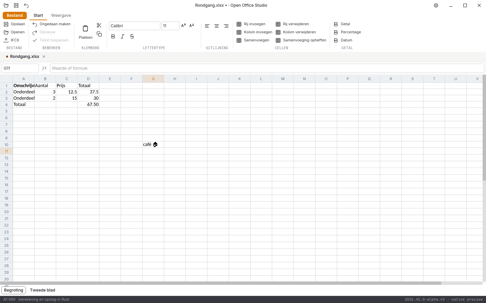

[De symboolproeven](docs/spreadsheet-symbolen-2026-10-31-alpha25.json) onderscheiden een werkelijk getekend huisteken van een ontbrekend-glyph. Vier stijlen, drie uitlijningen, celafkapping, stapeling, regelterugloop en zichtbare rotatie worden gecontroleerd. De bron houdt de Unicode-tekst, oorspronkelijke formules en het tweede blad. Dit is een monochrome aanvulling, geen volledige CJK-, BiDi-, emoji- of systeemletterdekking.

### Snelle celnavigatie en invoer

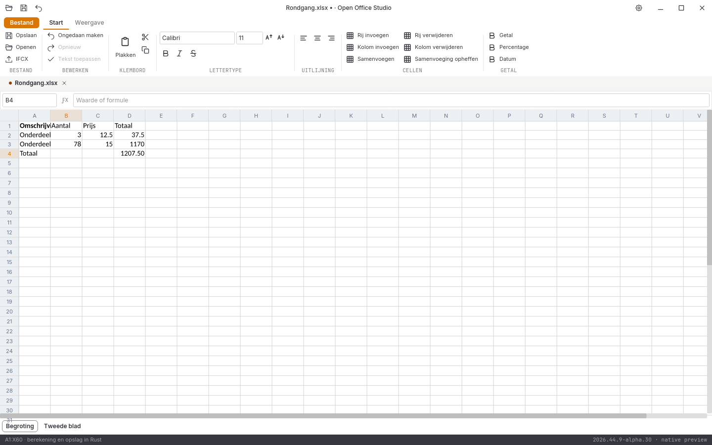

Zichtbare buurcellen gebruiken de bestaande rasterafbeelding en logische brongeometrie. Samenvoegingen en verborgen assen komen uit dezelfde engine. Niet-zichtbare, te kleine of dubbelzinnige doelen vallen terug op de werkmapkern. Dit is geen volledige rastervirtualisatie of volledige wachtrij voor invoer tijdens achtergrondbewerkingen.

### Celbereiken en geordende invoer

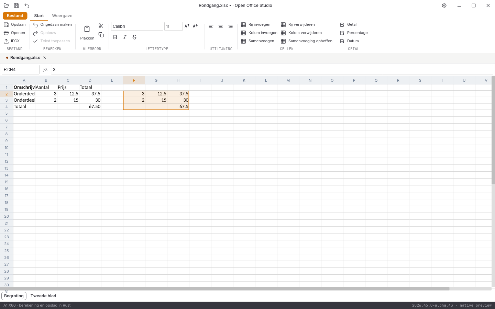

De rasterwachtrij bewaart inline-toetsen, klembordbarrières, bronwerk en bewaarsnapshots in volgorde. Waarden kopiëren leest de opgemaakte celtekst uit dezelfde werkmap; plakken en wissen zijn gezamenlijke bronbewerkingen met bronexacte undo. Ongeldige invoer schrijft geen gedeeltelijk blok. De herstelmelding bewaart de afgekeurde plaktekst en pauzeert vervolgopdrachten. Rijke opmaakoverdracht, formuleverschuiving, bereik verplaatsen, de volledige formulebalk-/zijpaneelwachtrij, fysieke IME en volledige suitepariteit blijven open.

De [werkelijke alpha-34-releasevensters](docs/vensterproeven-2026-11-01-alpha34/LEESMIJ.md) keuren gerichte lijst-, stijl- en rasterbediening goed op lokale en CI-Linux-programma’s. De afzonderlijke Writer-zoekroute blijft afgekeurd: focus/cursor en directe vervolginvoer vragen een correctie. Alle vijf platformtaken slagen, maar deze afkeuring en de oorspronkelijke pixelverschillen sluiten een stabiele native vrijgave uit.
