# Native Open Office Studio

De migratie verplaatst ook de volledige interface naar Rust. Deze afzonderlijke
preview gebruikt Iced en de gepinde native OpenAEC Blueprint-bibliotheek. Het
uitvoerbare bestand start zonder React, JavaScript, Tauri of een webview.
De bestaande release 2026-W44.8 blijft de referentie voor functionele en visuele gelijkwaardigheid. De huidige bouwstap is **2026.44.9-alpha.17**; de volledige migratie is nog open.

[migratie.json](docs/migratie.json) legt de open acceptatiegebieden vast. Een stabiele native vrijgave is pas toegestaan als functies, controles en uiterlijk aantoonbaar gelijk zijn.

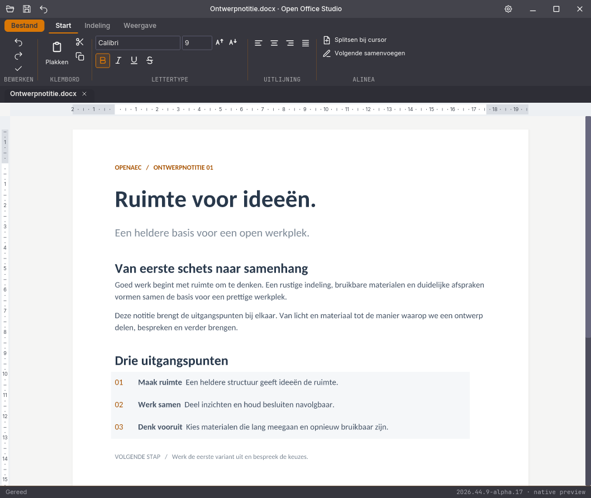

De afbeeldingen in `docs/screenshots` komen uit de echte native renderer met
synthetische documenten. Ze tonen deze preview, niet de bestaande webinterface.

## Starten en bouwen

```sh
cargo run --manifest-path native/Cargo.toml
cargo test --manifest-path native/Cargo.toml --workspace --locked
cargo build --manifest-path native/Cargo.toml --workspace --locked --release
python3 native/scripts/verpak.py
```

De uitvoer staat in `native/target/release/open-office-studio-native` (Windows:
`.exe`). De workflow `native-rust.yml` controleert en bouwt Windows, Linux en
macOS. De zip is een draagbare preview met licenties en herbouwbare bron; dit is
nog geen ondertekende installer of vervanging van de bestaande suite.
In het uitgepakte pakket staat de bron onder `bron/`; voer de bouwopdrachten
vanuit die map uit. Het programma staat direct naast `LEESMIJ.md`.
Op Linux zijn een grafische sessie, de X11/Wayland-bibliotheken en libxkbcommon
nodig. Er wordt een software-renderer gebruikt. `--features gpu` is optioneel en
valt buiten de standaardtestmatrix.

## Huidige omvang

| Onderdeel | Native implementatie | Nog over te zetten |
|---|---|---|
| Venster | OpenAEC-ribbon, documenttabbladen, vijf thema’s, sneltoetsen, Bestand, openen/opslaan/opslaan als, sluitvragen | Herstelkopieën, recente bestanden, afgesplitste vensters, updater, vertalingen |
| Writer | Native paginering, klikbare alinea’s, linialen, zoom, tekstbereikopmaak en uitlijning, splitsen bij de editorcursor en samenvoegen van aangrenzende alinea’s, woorden inclusief tabellen, Markdown-export, papierformaat/afdrukstand/marge- en kolomvoorkeuzes per sectie, zichtbare kop- en voetteksten (eerste/even/oneven), opmaakstatus uit dezelfde engine voor stijlen en Unicode-selecties, Ctrl/Cmd+B/I/U | Directe rich-text-cursor op de pagina, kop/voet bewerken, aangepaste pagina-instelling en volledige alineabediening, velden/links/revisies bewerken, volledige ribbon, tabellen invoegen, spelling en afdrukken |
| Spreadsheet | Raster met vaste rij-/kolomkoppen, directe celbewerking via dubbelklik/F2/typen, Enter/Tab/Escape, enkele-celnavigatie met pijltjestoetsen en werkvensterverplaatsing, formulebalk, bereikopmaak, rijen/kolommen invoegen/verwijderen, samenvoegen/splitsen, herberekenen en bladen wisselen | Doorlopend virtueel raster, bereikselecties en sleepbediening, zoeken, sorteren/filteren, klembordbereiken, CSV-import en grafieken |
| Presentation | Native diaweergave, niet-geroteerde tekstvakken aanklikken, tekstbereikopmaak, dia’s toevoegen/verwijderen, tekstvakken invoegen, sprekersnotities bewerken | Directe cursor en vormbediening, geroteerde/gegroepeerde objecten, volledige ribbon en presentatiemodus |
| Notition | Versies 1–3 openen, boeken/secties/pagina’s toevoegen, vrij canvas met tekstvakken slepen/vergroten, Markdown-preview, bloktekst en vet/cursief, prullenbak herstellen; onbekende bronvelden behouden | Automatische lokale opslag/herstel, zoeken, boeken/secties hernoemen/verplaatsen, volledige blok- en taakbediening en import/export |
| Email | Losse Rust-mailkern, native accountformulier, IMAP-mappen/berichtlijst, zoeken en tekstlezer; volledige MIME-bron met bijlagen openen als IFCX-dossier | OAuth en automatisch serverzoeken in de GUI, opstellen/verzenden, concepten, antwoorden, berichtacties, bijlagen opslaan en HTML-weergave |
| Database | Bestaande aparte app blijft beschikbaar | Native database-interface; laagste prioriteit |
| Formaten | DOCX, XLSX, PPTX, notitie-JSON, EML, IFCX-bewaarprofiel; aparte conversie-export voor 34 doelkeuzes, waaronder PDF/PDF-A, ODF en oudere formaten | Overige import, afdrukken en conversie-instellingen aansluiten |

De native versie heeft dus nog **geen functiepariteit** met de bestaande suite.
Een uitgebreide documentweergave betekent niet dat elke zichtbare eigenschap al
bewerkbaar is. Writer weigert tekstvervanging bij inline objecten, velden, links en revisies;
de vorige bron blijft dan intact. Gewone tekst met meerdere opmaakruns houdt
de opmaak van ongewijzigde tekstdelen. De GUI registreert elke wijziging
met Unicode-grenzen en de verwachte brontekst. Daardoor behouden ook
tussenliggende tekstdelen hun eigen opmaak wanneer één concept meerdere
wijzigingen bevat. Herhaalde gelijke tekens worden op de echte cursorpositie
verwijderd. Het concept vormt één undo-stap; een foutieve of verouderde reeks
wordt zonder gedeeltelijke documentwijziging geweigerd. Dit is nog steeds de
platte alinea-editor, geen rijke cursor op de pagina. Enter in de teksteditor blijft een zachte
regelovergang binnen de alinea. Gebruik **Splitsen bij cursor** voor een echte
nieuwe alinea; **Volgende samenvoegen** verwijdert de aangrenzende alineagrens.
Deze opdrachten blijven binnen dezelfde tekst of tabelcel en weigeren revisies,
inhoudsbesturingen en samenvoegen over een sectie-einde.

Actieve documentbeveiliging wordt in Writer als alleen-lezen geopend. Het
lint en de tekstbewerking blijven geblokkeerd; selecteren en kopiëren blijven
mogelijk. Niet-afgedwongen instellingen blijven behouden bij gewone bewerkingen.
Beveiligde uitzonderingen, formulieren en het opheffen van beveiliging zijn
nog niet geïmplementeerd.

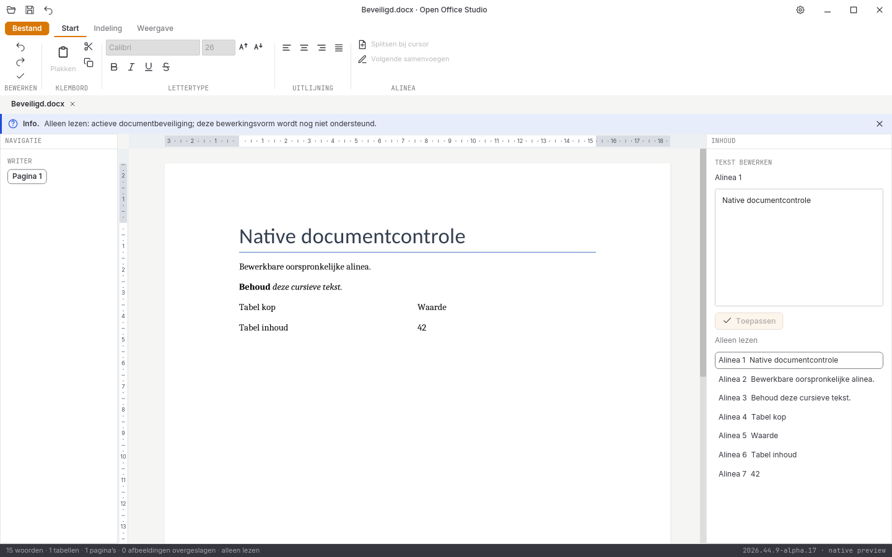

Het Writer-lint volgt nu de opgeloste opmaak van de expliciete selectie. Zonder
selectie bedienen de huidige opmaakopdrachten de hele alinea. Directe rijke
invoer op de pagina en invoegopmaak voor lege alinea's zijn nog niet overgezet.

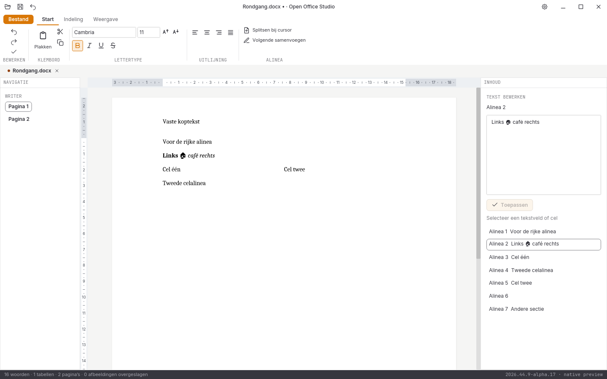

Het compacte lint heeft nu tekstklembordknoppen en letterstappen. Kopiëren,
Knippen en Plakken gebruiken uitsluitend platte tekst in de actieve editor;
rijke inhoud en celbereiken zijn nog niet overgezet. Vertraagde plakantwoorden
mogen geen gewijzigd doel bewerken. Ook snel opeenvolgende selectie- en
klembordtoetsen worden in de volgorde van de applicatieberichten verwerkt;
knippen mag geen tekst verwijderen voordat de selectie is gekopieerd.
**Bestand** bevat export, Markdown en IFCX;
zoom en panelen staan voor de drie documentmodules onder **Weergave**.

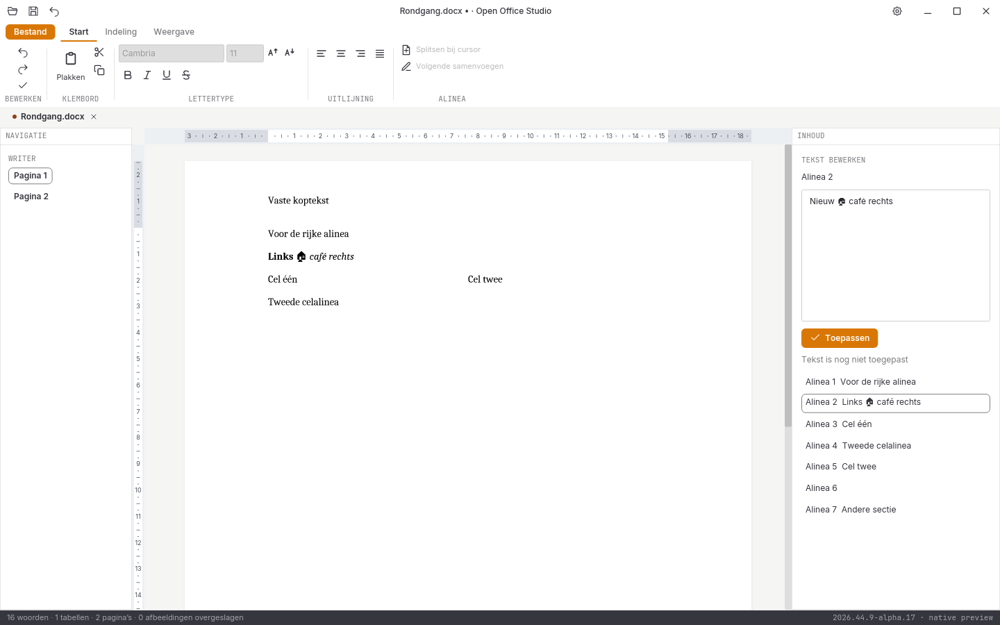

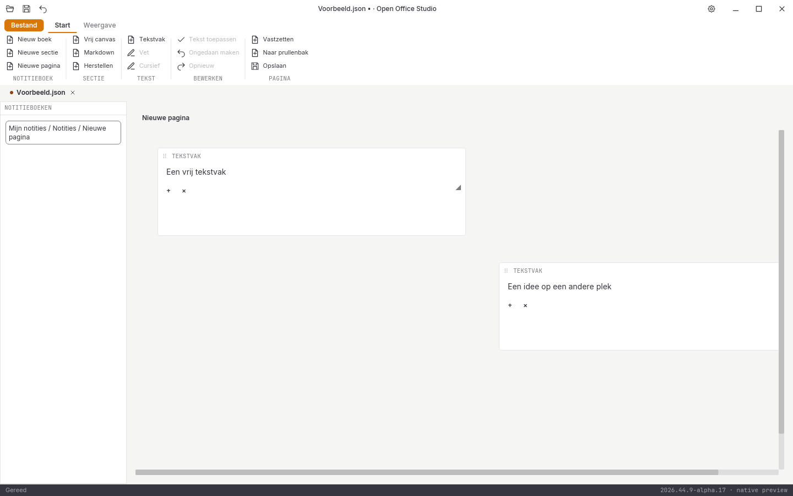

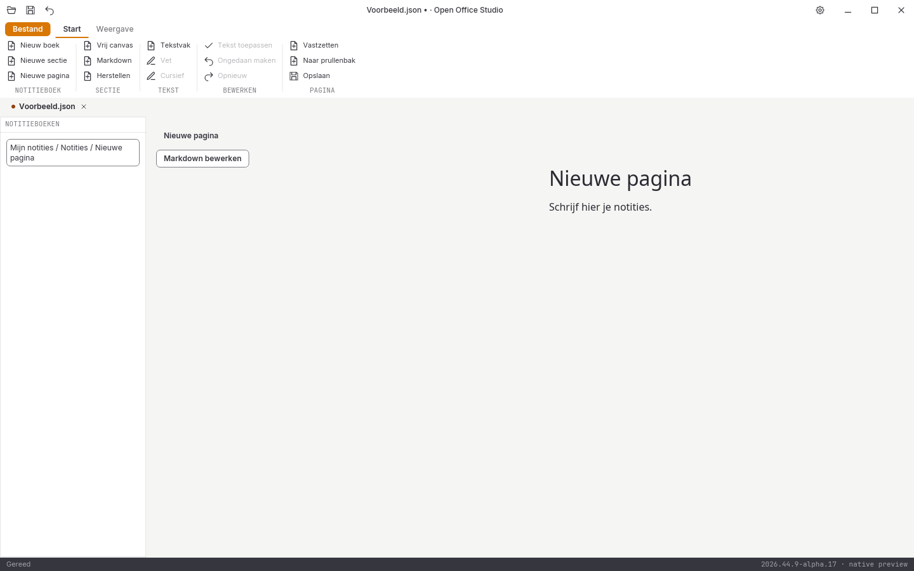

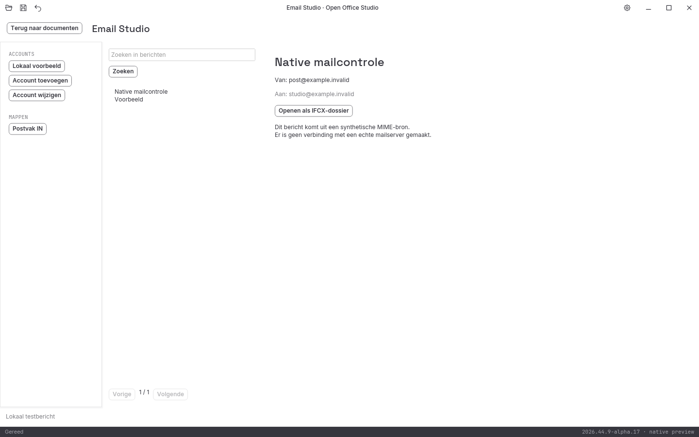

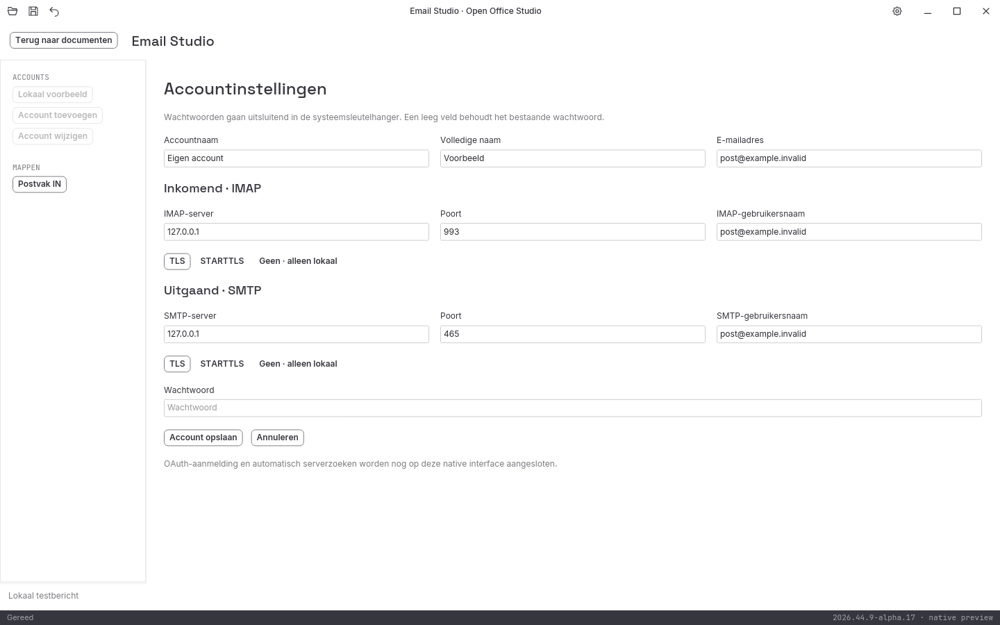

Het postvak opent via de Email-kaart, **E-mailaccounts en postvak** of
`--module email`. De native mailgegevens staan in een eigen map, gescheiden van
de bestaande suite. Een opgehaalde MIME-bron opent als nieuw IFCX-dossier;
**Opslaan** bewaart het dossier daadwerkelijk op schijf. HTML-weergave,
opstellen/verzenden, OAuth-aanmelding in de GUI en de overige berichtacties
zijn nog niet aangesloten. De netwerkproeven gebruiken lokale nepservers.

## Spreadsheet: direct bewerken en navigeren

Klik een cel aan en typ om haar inhoud te vervangen. Dubbelklik of F2 opent
de bestaande inhoud in een editor op de cel. Enter bevestigt en gaat omlaag;
Shift+Enter gaat omhoog. Tab en Shift+Tab bevestigen naar rechts en links.
Escape verwerpt het concept. De formulebalk en de cel gebruiken dezelfde
tekstinhoud. Herberekening en undo lopen door de documentwerkdraad.

Pijltjestoetsen verplaatsen de enkele-celselectie. Buiten het huidige
werkvenster verplaatst ook het zichtbare deel. Samengevoegde en verborgen
rij-/kolombereiken worden overgeslagen zonder elke cel afzonderlijk te openen.
Navigeren verandert geen bestandsbytes en maakt geen undo-stap.

Een onvolledige formule wordt vóór wijziging geweigerd en blijft als concept
in beeld. Een geldige formule met een rekenfout blijft toegestaan. Een cel met
tekstopmaak of invoer met een voorafgaande apostrof blijft letterlijke tekst.
Dit is geen volledige spreadsheetbediening: onder meer bereikselectie,
bereikplakken, slepen en volledige bescherming staan nog open.

Het raster begint linksboven in het werkvlak. De rij- en kolomkoppen volgen
dezelfde geometrie als de cellen en blijven in beeld bij scrollen. De cellen
schalen met de documentzoom; de koppen houden hun leesbare UI-maat. Het
werkvenster bevat maximaal 60 rijen en 24 kolommen, met een rasterbeeld tot
1600 × 1400 pixels. Dit is nog geen volledige virtualisatie. Koppen selecteren
nog geen volledige rij of kolom.

Een identiek paginabeeld houdt zijn Iced-imagehandle, zodat selectienavigatie
geen nieuwe afbeeldingsdecoder maakt. Verborgen zijpanelen worden niet meer
opgebouwd. Een zeer brede voorafgaande kolom krijgt bij navigatie een tweede
poging vanaf de doelcel; onzichtbare doelen worden expliciet geweigerd.

De rasterizer gebruikt nu dezelfde vastgepinde lettertypefamilies als de
cel-editor, met echte vet-/cursiefgezichten waar die beschikbaar zijn. Meten,
regelterugloop, getalopmaak en tekenen gebruiken hetzelfde gekozen gezicht.
De ingebouwde standaardaanroep van de renderer blijft bytegelijk aan zijn vijf
oorspronkelijke bronbeelden. Twee families zijn elk met vier stijlen afzonderlijk
getest; dit bewijst geen volledige glyph-terugval, alle documentletters of
systeemlettertypen. Zie de [fontproeven](docs/spreadsheetletters-2026-10-31-alpha15.json).

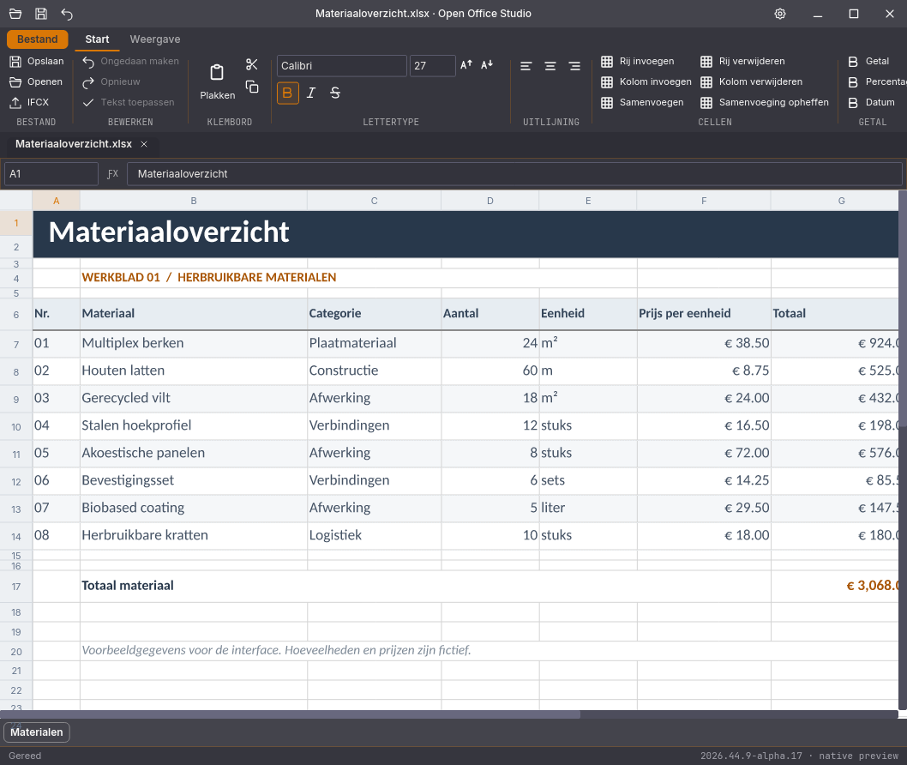

## Writer: pagina-indeling

Het tabblad **Indeling** heeft vijf papierformaten, staand/liggend, vier
margevoorkeuzes en één, twee of drie tekstkolommen. De opdrachten gelden voor
de sectie van de gekozen body-alinea, ook als die alinea in een tabel staat.
Andere secties en geërfde kop-/voettekstverwijzingen blijven behouden. De
sessie weigert deze opdrachten bij actieve documentbeveiliging, sectierevisies,
wijzigingen bijhouden of een alinea binnen een inhoudsbesturing. Ongedaan maken
herstelt de volledige vorige bron.

Kop- en voetteksten worden nu ook daadwerkelijk in het paginabeeld getekend.
De beeldproeven controleren overerving en de afzonderlijke eerste, even en
oneven varianten. Bewerken van deze tekstgebieden en volledige paginafuncties
blijven open.

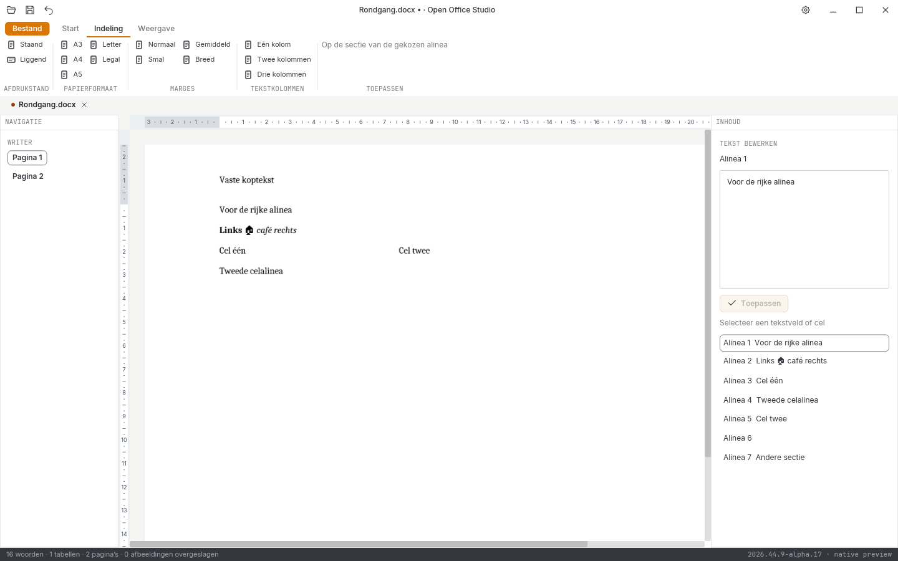

## Conversie-export

**Bestand → Exporteren** maakt voor Writer, Spreadsheet en Presentation een
apart bestand vanuit de vastgelegde documentbron. De dialoog biedt respectievelijk
13, 12 en 9 doelkeuzes. CSV ondersteunt scheidingsteken, codering en bladnummer;
TSV gebruikt altijd een tab. PDF ondersteunt paginabereik, bladwijzers en
PDF/A-1b, -2b of -3b. De export verandert de opslagstatus van het document niet
en weigert het oorspronkelijke bestand als exportdoel.

Hiervoor is een geïnstalleerde kantoorruntime nodig; die wordt automatisch
gezocht en zit niet in het draagbare pakket. De afzonderlijke Rust-kern gebruikt
hetzelfde afgeschermde profiel als de bestaande suite: macro-uitvoering uit,
externe koppelingen niet verversen en een tijdelijk profiel per opdracht.
De PDF-layout komt van die runtime en kan afwijken van de native paginering.
Dit is geen bewijs van foutloze conversie voor willekeurige documenten of
van een inhoudelijk volledige PDF/A-validatie. De overige importformaten zijn
nog niet met de native interface verbonden.

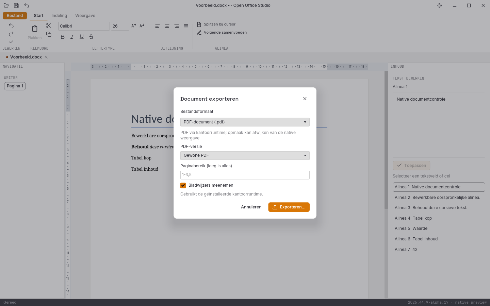

De daadwerkelijke runtimeproeven staan apart omdat zij een geïnstalleerd
conversieprogramma vereisen. De Linux-CI heeft hiervoor een eigen bouwtaak.

```sh
OFFICE_TEST_UIT=/tmp/native-conversie \
  cargo test --manifest-path native/Cargo.toml -p office-conversie --locked -- --include-ignored --test-threads=1
cargo test --manifest-path native/Cargo.toml -p open-office-studio-native --locked \
  native_export_via_interface_en_werkdraad -- --include-ignored
```

## Bewaring en snelheid

Writer pagineert de hele bron, maar bouwt alleen de tekenopdrachten van de
gevraagde pagina. De paginatelling en documentvelden houden hun volledige
context. Regressieproeven vergelijken het beeld en alle klikgebieden exact met
de opbouw van alle pagina's; dit is geen vergelijking met de webinterface.

De engines werken op één aparte werkdraad. De interface ontvangt een begrensde
weergave en blijft los van parser, rasterizer en bestands-I/O. Writer hergebruikt
de lettertypecache per werkdraad zolang fontvereisten en registergeneratie gelijk
blijven. Daarnaast blijft maximaal één Writer-layoutengine per werkdraad behouden,
gebonden aan document, bronhash en fontgeneratie. Ook paginawissels buiten de drie
bewaarde paginabeelden hoeven dezelfde engine dan niet opnieuw op te bouwen.
Bewerken, undo, een andere bron of gewijzigde fonts dwingen een nieuwe opbouw af.
Zelfstandige documentcontroles blijven verse berekeningen. Bestanden worden
uit het volledige enginemodel opgeslagen, nooit uit de tekstvelden of afbeelding
van het venster. Ongedaan maken bewaart maximaal 32 bronnen en 64 MB per document.
Dit is een eerste betrouwbaarheidskeuze; grote documenten vragen nog gerichte
profilering en een overgang naar de eigen transactiegeschiedenis van de engines.

Bestandsopslag controleert de gelezen SHA-256, schrijft via een tijdelijk bestand
naast het doel en vraagt bij gewijzigde externe inhoud om Opslaan als. Dit is
geen bestandssysteemtransactie tussen onafhankelijke externe programma’s: een
extern proces dat precies tussen controle en vervangen schrijft, kan nog een
race veroorzaken. Sluiten vraagt ook naar nog niet toegepaste editorinvoer.

Het IFCX-bewaarprofiel `0.1.0-draft.1` is het eerdere eigen voorstel, geen
vastgestelde interoperabele Office-standaard. Alle bronbytes gaan mee in base64
met lengte en SHA-256. Bij e-mail zijn dat de volledige oorspronkelijke
EML/MIME-bytes. Deze preview opent één document per IFCX-dossier, verwerkt geen
imports/overerving en begrenst de bron tot 12 MB. Onbekende attributen blijven
bij herschrijven behouden. IFCX is archivering van de bron; de semantische
bewerking van tekst, cellen en dia’s blijft bij de documentengines.

## Controles

Het [controlerapport voor alpha 17](docs/controle-2026-10-31-alpha17.md) beschrijft
207 reguliere Rust-tests, inclusief 53 GUI-tests, zes aparte runtimeproeven en
zeven Python-tests. De bestandsuitvoer is onafhankelijk teruggelezen en 37
native schermen zijn vastgelegd. Gerichte proeven vergelijken nu ook herhaalde
gedeeltelijke hertekeningen met verse volledige beelden. Dat vond fouten die
de oorspronkelijke losse screenshots niet controleerden.
De alpha-17-release- en platformronde zijn nog niet afgerond.
De [alpha-16-platformronde](docs/platformen-2026-10-31-alpha16.json) is volledig
geslaagd: vijf CI-jobs groen, alle 821 bronbestanden bytegelijk op elk platform,
74 exacte native beeldparen en zeven exacte paginabezoeken op alle drie
platforms. De platformvergelijking bewijst geen gelijkheid met de bestaande
interface. Eerdere rapporten blijven historische verslagen.

```sh
python3 native/scripts/controleer-bron.py
cargo fmt --manifest-path native/Cargo.toml -p office-core -p open-office-studio-native -p office-mail -p office-conversie --check
cargo clippy --manifest-path native/Cargo.toml --workspace --locked --all-targets -- -D warnings
OFFICE_TEST_UITVOER=/tmp/native-rondgang OFFICE_TEST_SCHERMEN=/tmp/native-schermen \
  cargo test --manifest-path native/Cargo.toml --workspace --locked
python3 native/crates/office-core/tests/fixtures/controleer.py /tmp/native-rondgang
```

Voor de onafhankelijke terugleescontrole zijn python-docx, openpyxl en python-pptx
nodig. De synthetische fixtures kunnen met `tests/fixtures/maak.py` opnieuw worden
gemaakt. Screenshots worden door de echte Iced software-renderer gemaakt; ze
bewijzen de layout, geen volledige fysieke GUI- of schermlezertest.

Nog niet vrijgegeven: volledige native GUI-bediening, schone installatie,
platformintegratie, toegankelijkheid met een echte schermlezer, realistische
mailaccounts, grote-documentprestaties en het volledige bestaande bestandencorpus.
De UI-bibliotheek bewaart toegankelijkheidsnamen maar heeft nog geen werkende
schermlezerbrug. Writer en Presentation gebruiken dezelfde 70 oorspronkelijke
fontbestanden als de bestaande suite, plus één afzonderlijk gepinde monochrome
symboolterugval, met stijl- en taalgebonden resolutie.
Onbekende families kunnen nog steeds een terugval krijgen. Systeemletters en
volledige visuele gelijkwaardigheid zijn nog niet aangetoond.

### Bestandscontrole zonder venster

De volledige werkruimte bouwt ook `controleer-bestand` (`.exe` op Windows).
Dit programma leest één bron, maakt de eerste werkweergave, bewaart in geheugen
en vergelijkt de zichtbare tekstvelden na opnieuw openen. Het wijzigt het
bronbestand niet. De JSON-uitvoer vermeldt versie, bouwprofiel, bronhash en fase
bij een fout. Dit is geen volledige inhouds-, formule-, stijl- of pixelcontrole.

```sh
native/target/release/controleer-bestand --version
native/target/release/controleer-bestand document.docx
python3 native/scripts/corpus.py \
  --programma native/target/release/controleer-bestand \
  --manifest .local/corpus/manifest.json \
  --uitvoer .local/native-corpus.json
```

Een corpusmanifest bevat `bestanden`, met per bron `bestand`, `extensie` en
`sha256`. Relatieve paden tellen vanaf `--bronmap` (standaard de huidige map).
De runner bewaart voortgang atomair en weigert hervatten met een ander programma
of manifest. `--hervat` vervolgt dezelfde ronde. Per bron geldt standaard
30 seconden; maximaal twee processen draaien tegelijk. Op Linux begrenst
`prlimit`, indien aanwezig, ook de adresruimte tot 3 GiB per kindproces. De
uitvoer vermeldt expliciet of die grens geldt. Een weigering, tijdslimiet of
afwijking geeft geen volledig geslaagde ronde. De debugtijden zijn geen bewijs
voor prestaties van de releasebuild.

De [laatste afgeronde brede releasecorpusronde, alpha 16](docs/corpus-2026-10-31-alpha16-release.json)
bevat 648 geselecteerde bronnen: 580 geslaagd, 68 geweigerd en geen time-outs,
met één proces, 30 seconden per bron en 3 GiB adresruimte. De geweigerde
bron-ID's zijn gelijk aan alpha 12. Alle drie
[grote bronnen slagen afzonderlijk](docs/corpus-2026-10-31-alpha16-grote-bronnen.json)
met 120 seconden en één proces. De looptijden zijn door verschillende
bouwbelasting geen onderlinge snelheidsvergelijking. De kop-/voettekstweigering uit alpha 7 is
hersteld en wordt apart als vaste bronregressie gecontroleerd. De andere 918
manifestbronnen vallen buiten deze native ronde. Dit is geen volledige
inhouds-, stijl- of functiecontrole.

## Bron en licenties

`vendor/blueprint-bron.json` legt alle 202 gedeelde UI-bestanden vast op
OpenAEC Blueprint `29471a376eaec40bfbadcf3f1d52b463c91ab561`. De verificatie weigert
wijzigingen. De applicatiecode staat onder Apache-2.0. De gedeelde UI heeft eigen
LGPL-3.0-only-, CC-BY-SA-4.0-, OFL-1.1- en Apache-2.0-onderdelen: lees
`vendor/openaec-ui/LICENSE.md`, `NOTICE.md` en `licenses/`. De bron, fontnotices en gevonden licentieteksten van de Rust-afhankelijkheden
gaan mee in het previewpakket. De native documentengines zijn Apache-2.0 en
vastgelegd op versie 0.5.1 in Cargo.lock. De DOCX-parser heeft één lokale
serializercorrectie voor geneste velden; oorspronkelijke hashes, revisie en
wijziging staan in `vendor/document-engine-bron.json`. De mailkern behoudt de
MIT-herkomstvermelding en licentie naast de Apache-2.0-licentie van de suite.
Ook de getypeerde presentatiefacade heeft één aansluiting voor de bestaande
glyph-terugvalregistratie; de bron en wijziging staan in `vendor/pptx-bron.json`.
`vendor/symbolen/bron.json` bevat revisie, hashes en OFL-licentie van het
aanvullende symboolfont. De bronbestanden blijven ongewijzigd. De spreadsheetrasterizer heeft een beperkte
fontaansluiting, vastgelegd in `vendor/xlsx-raster-bron.json`; de oorspronkelijke
goldenbeelden en standaardaanroep blijven behouden.
De software-renderer heeft twee afgebakende upstreamcorrecties voor schaduw-
en editorafkapping, plus één correctie voor identieke quad-randpixels bij
hertekenen. De oorspronkelijke bron, MIT-licentie en wijzigingen staan in
`vendor/iced-tiny-skia-bron.json`. De [hertekenproeven](docs/hertekenen-2026-10-31-alpha17.json)
vergelijken steeds volledige buffers zonder kleurtolerantie.
De layoutadapter volgt het openbare
native-viewer-voorbeeld van openooxml/betteroffice; de bronverwijzing staat in
`crates/office-core/src/writer_beeld.rs`.

## Visuele vergelijking en vrijgave

`native/scripts/vergelijk-schermen.py` vergelijkt echte PNG-bronbeelden op
hetzelfde viewportformaat, zonder schalen of uitlijnen. Het werkelijke bronformaat
moet PNG zijn; een JPEG met een andere extensie wordt geweigerd. Omzetten van een
JPEG naar PNG maakt die opname nog geen verliesvrije referentie. Ook verschillen
in transparantie tellen mee. Standaard is geen enkel afwijkend pixel toegestaan.
Hiervoor is Pillow nodig. Een geslaagde native
rendertest is dus geen bewijs dat het beeld gelijk is aan de bestaande suite.

```sh
python3 native/scripts/controleer-migratie.py
python3 native/scripts/controleer-migratie.py --vrijgave
python3 native/scripts/vergelijk-schermen.py referentie.png native.png --uitvoer pixelcontrole
```

De vrijgavecontrole is momenteel terecht **niet geslaagd**: de native suite mist
nog functies en de UI is nog niet pixelgelijk. Alpha-pakketten blijven als
preview beschikbaar; een stabiel pakket wordt door `verpak.py` geweigerd zolang
de acceptatiegebieden openstaan.

De in-app browserkoppeling levert JPEG-opnamen; die tellen niet als pixelbewijs.
Een afzonderlijke Chromium-testbrowser heeft inmiddels een oorspronkelijke
[Writer-PNG van de referentie](docs/referentie-2026-W44.8/writer.png) gemaakt op
1058 × 892 pixels, met hetzelfde document en thema. CSS-animaties zijn vóór
navigatie gepauzeerd om de knipperfase vast te leggen; meldingen zijn via hun
sluitknoppen gesloten. De opname is niet geschaald, uitgelijnd of nabewerkt.
Twee opeenvolgende referentieopnamen zijn pixelgelijk. De
[alpha-17-vergelijking](docs/pixelcontrole-alpha17/writer/rapport.json)
met de native Writer meet **107.809 afwijkende pixels van 943.736**.
Deze ene vastgelegde toestand bewijst dus expliciet dat de UI nog niet gelijk is.
De [herkomst](docs/referentie-2026-W44.8/writer.json) vermeldt bron-, bundel- en
beeldhashes, browser, viewport, thema en taal. Ook voor
[Spreadsheet](docs/referentie-2026-W44.8/spreadsheet.png),
[Presentation](docs/referentie-2026-W44.8/presentation.png) en
[Notition](docs/referentie-2026-W44.8/notition.png) zijn nu vaste PNG-referenties
vastgelegd. De [vier alpha-17-vergelijkingen](docs/pixelcontrole-alpha17/rapport.json)
falen; indeling, panelen en overige schermtoestanden blijven over te zetten.
De browser- en nativevenstertoestanden zijn vastgelegd. Een vergelijking in
dezelfde desktopvenstertoestand staat nog open.

De referentieopname gebruikt alleen een nieuw tijdelijk browserprofiel en eigen
luisterpoorten; bestaande browservensters blijven met rust. Hiervoor is Node 24
en een lokaal Chromium-programma nodig, naast een apart gebouwde webbundel van
de vastgelegde referentieversie. De tool controleert het versienummer van de
bundel en registreert de hoofdbestandhashes; dat vervangt geen buildattest.

```sh
node native/scripts/maak-webreferentie.mjs /pad/naar/webbundel /pad/naar/chromium .local/webreferentie
# Optioneel als vierde argument: writer, spreadsheet, presentation of notition.
```

### Writer-paginawissels meten

Gebruik dezelfde releasecontroleur voor twee afzonderlijke processen. De
vergelijking weigert afwijkende beelden, klikgebieden, velden of bronhashes;
de gemeten tijden hebben geen harde snelheidsgrens.

```sh
python3 native/scripts/meet-paginas.py \
  --programma native/target/release/controleer-bestand \
  --bron native/crates/office-core/tests/fixtures/writer-cachepaginas.docx \
  --paginas 0,1,2,3,4,0,5 --uitvoer native/target/paginameting.json
```

Op Windows heeft de controleur de extensie `.exe`. Dit is een paginaproef,
geen fysieke GUI-, volledige inhouds- of pariteitscontrole.

De [controle van alpha 16](docs/controle-2026-10-31-alpha16.md) legt de huidige lokale tests en nog open acceptatie vast. De laatste afgeronde platformronde betreft [alpha 14](docs/platformen-2026-10-31-alpha14.json).
