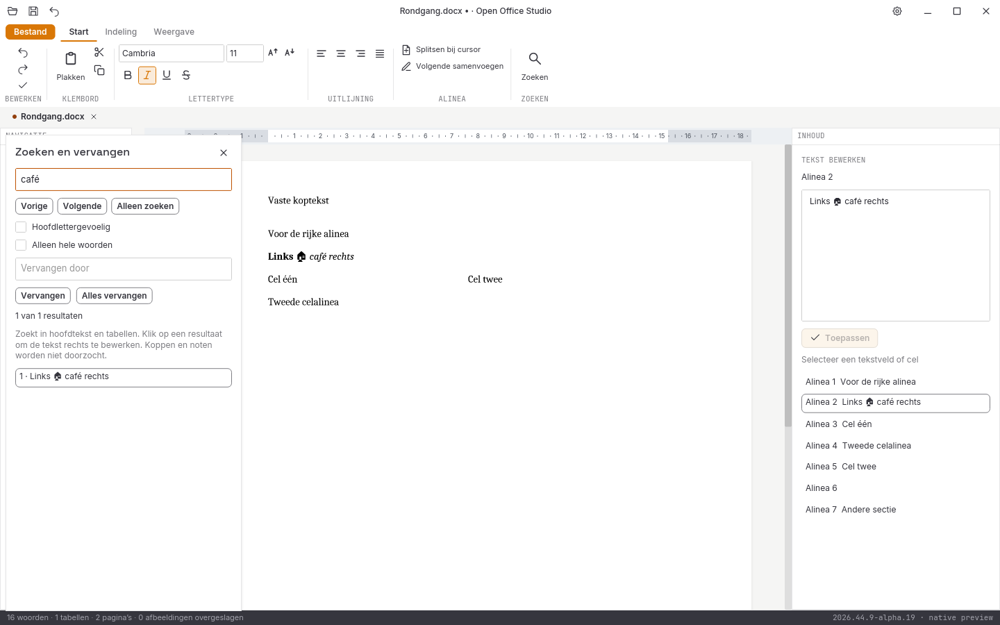

# Native controle, 31 oktober 2026: alpha 18

**2026.44.9-alpha.18** voegt letterlijk zoeken en vervangen in Writer toe en
sluit ongeoorloofde gewone bewerkingen bij actieve revisieregistratie en
inhoudssloten af. Alle tien acceptatiegebieden blijven open. Geen volledige
functie-, test- of pixelpariteit en geen stabiele native vrijgave.

## Zoeken en vervangen

De zoekopdracht leest alle hoofdtekst- en tabelalinea's, met hoofdletters,
hele woorden en Unicode-tekengrenzen. Een aparte zoektaak houdt de
documentwerkdraad vrij. Per paneel loopt één taak; nieuwe invoer vervangt het
wachtende verzoek. Oude resultaten mogen een andere query, bronversie of
nieuw geopend paneel niet overschrijven.

Een resultaat selecteert de exacte tekst in de alinea-editor. Enter in het
zoekveld gaat naar de volgende treffer; klikken op een resultaat zet de echte
editorfocus zodat daarna direct typen of plakken werkt. De volgende treffer
begint na de ingevoegde vervangtekst. Identieke vervangingen maken geen
schijnbewerking of extra undo-stap.

Alles vervangen bouwt een aparte alineakopie per geraakt veld en controleert
alle tekststappen vóór het eerste schrijven. De uiteindelijke wijziging
doorloopt de hoofdtekst en sectiebeelden eenmaal. De sessie serialiseert en
hertekent vervolgens eenmaal, als één undo-stap. Ook de rechtstreekse
document-API houdt bij een late fout alle voorafgaande alinea's ongewijzigd.
Ongewijzigde runs behouden hun eigen opmaak; tabelgrenzen blijven intact.

De zoeklimiet is 16 MiB tekst en 4096 treffers; vervangingen hebben daarnaast
een tekst- en werkbudget. Overschrijding of een alleen-lezen resultaat geeft
een fout in plaats van een stil gedeeltelijk resultaat. Het paneel bouwt
hoogstens 75 resultaatknoppen; de navigatie blijft alle resultaten doorlopen.

De [vijf nieuwe kernproeven, twee beveiligingsproeven en vijf GUI-proeven](writer-zoeken-2026-10-31-alpha18.json)
controleren onder meer astrale en gecombineerde tekens, Unicode-hoofdletters,
woordgrenzen, letterlijke patroontekens, opmaak en tabellen, een late fout,
dubbele alinea, verkeerde resultaattekst, budgetten, undo/redo, vertraagde
antwoorden en 256 gezamenlijke alineavervangingen. De uitvoer wordt ook met
een onafhankelijke DOCX-bibliotheek teruggelezen.

Dit doorzoekt nog geen kop-/voetteksten, noten of tekstvakken. Zoeken over
alineagrenzen, reguliere expressies, jokertekens en opmaakfilters ontbreken.
Een treffer opent in de alinea-editor; navigatie naar de bijbehorende pagina,
treffermarkeringen op de pagina en de rijke paginacursor blijven open.

## Bewerkingsbeperkingen

De broninstelling voor wijzigingen bijhouden werd nog niet als beperking
toegepast op gewone tekstbewerkingen. Die zouden nieuwe tekst zonder
revisieregistratie kunnen bewaren. Actieve of onbekende revisieregistratie
opent daarom voorlopig alleen-lezen. Expliciet uitgeschakelde registratie
blijft bewerkbaar. Vergrendelde of onbekende inhoudsbesturingen maken de bron
eveneens alleen-lezen; bewerkbare uitzonderingen zijn nog niet overgezet.
Bestaande alinea- en runrevisies blijven buiten de gewone bewerkingsroute.

Een afzonderlijke proef geeft de directe API een inhoudelijk geldige
gezamenlijke vervanging op een beveiligde bron. De weigering moet van de
bronbeveiliging komen; een ongeldige of lege testopdracht zou deze controle
niet bewijzen. De oorspronkelijke bytes en geschiedenis blijven intact.

## Uitgevoerde controles

- **219 reguliere Rust-tests geslaagd**, inclusief **58 GUI-tests**.
- **Zes runtimeproeven afzonderlijk geslaagd**; [zes conversierondgangen en drie PDF-handtekeningen](conversie-2026-10-31-alpha18-lokaal.json) onafhankelijk gecontroleerd.
- **Zeven Python-tests**, Rustfmt, Clippy met waarschuwingen als fouten en alle bronhashcontroles geslaagd.
- DOCX/XLSX/PPTX onafhankelijk teruggelezen, inclusief gezamenlijke vervanging, rijke Unicode-invoer en 256 alinea's.
- **38 native schermen** met [bron- en loghashes](schermen-2026-10-31-alpha18.json).
- [Dertien gedeelde documentbeelden](documentbeelden-2026-10-31-alpha18.json) blijven bytegelijk aan alpha 17; de acht spreadsheetletterbeelden blijven afzonderlijk gecontroleerd.

Dit zijn echte widget- en werkdraadgebeurtenissen met een eigen testklembord
en synthetische IME-Commit. De [echte Linux-releasevensterproef](vensterproef-2026-10-31-alpha18-release/LEESMIJ.md)
slaagt op twaalf gerichte stappen, inclusief zoeken, echt systeemklembord,
Unicode-vervanging, runopmaak en exacte bronherstelling. Dit keurt fysieke
platformbediening of andere modules niet goed.

De lokale alpha-18-release uit vast Git-archief is na 46 minuten en 21 seconden
afgerond. Beide binaries zijn met versie en SHA-256 vóór de volgende release
onveranderlijk vastgezet; pakketcontrole en de [echte bronregressie](bronregressie-2026-10-31-alpha18-lokaal.json)
slagen. De oorspronkelijke CI-ronde `41210659697` heeft drie geslaagde
platformbuilds en een geslaagde runtimecontrole. Alleen de laatste vergelijking
faalt op een verouderde verwachting van 37 schermen; het nieuwe zoekpaneel
maakt er 38. De telling is in een afzonderlijke commit aangepast; de
[herhaalde platformvergelijking](platformen-2026-10-31-alpha18.json) is geheel groen:
vijf CI-jobs, 911 bytegelijke bronbestanden per platform en 76 volledige native
beeldparen met nul verschil. Alle [21 paginabezoeken](paginametingen-2026-10-31-alpha18.json)
blijven gelijk aan verse berekeningen met dezelfde releasecontroleur. De geteste
mergebron is bytegelijk aan de PR-bron voor de verpakte native onderdelen.

De [alpha-17-platformronde](platformen-2026-10-31-alpha17.json) is geheel groen:
vijf CI-jobs, 877 bytegelijke bronbestanden per platform, 74 exacte native
beeldparen en zeven exacte paginabezoeken per platform. De lokale release
uit vast Git-archief is na 47 minuten afgerond; beide binaries zijn vóór de
volgende release onveranderlijk vastgezet. Het pakket en de echte
bronregressie slagen.

De [uitgebreide echte Linux-releasevensterproef van alpha 17](vensterproef-2026-10-31-alpha17-release/LEESMIJ.md)
slaagt op invoer, opmaakbehoud, systeemklembord inclusief snelle Ctrl+A/Ctrl+X,
bewaren, exacte bronherstelling via undo, Bestand zonder grijze resten,
Escape terug en sluiten. De eerder mislukte debugproef blijft afzonderlijk
bewaard. Dit vervangt de alpha-18-zoekvensterproef niet.

## Visuele vergelijking

De [vier volledige verliesloze referentievergelijkingen](pixelcontrole-alpha18/rapport.json)
blijven met nul tolerantie rood: Writer **108.314**, Spreadsheet **382.432**,
Presentation **560.039** en Notition **666.026** afwijkende pixels op elk
943.736 pixels. Geen maskers, herschaling of nieuwe referentiebeelden. Dit
zijn geen voltooiingspercentages en geen bewijs dat alle GUI-toestanden zijn
vergeleken.

Directe rijke Writer-invoer, de volledige ribbons, rastervirtualisatie en
bereikbediening, presentatieobjecten, notitieherstel, complete mailbediening,
database-interface, native installers/losse edities, fysieke IME-compositie,
systeemdialogen en schermlezers blijven open.
