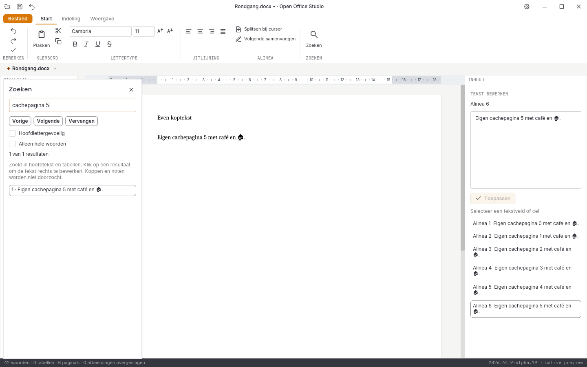

# Native controle, 31 oktober 2026: alpha 19

**2026.44.9-alpha.19** koppelt Writer-zoekresultaten aan de werkelijk getekende
documentpagina. Alle tien acceptatiegebieden blijven open. De volledige
migratie, functiepariteit en pixelpariteit zijn niet bereikt.

## Dezelfde layout voor beeld en navigatie

De nieuwe navigatieroute leest de getypeerde paginakaart van de behouden
layout-engine. Zij zoekt alinea-ID en UTF-16-positie in zichtbare
tekstfragmenten; herhaalde tabelkoppen tellen niet als de oorspronkelijke
tekstpositie. Unicode-selecties uit de editor worden vanuit scalaire tekens
vertaald. Een verouderde bronversie, ongeldige selectie of afgekapt resultaat
wordt geweigerd. Er wordt geen paginanummer geschat.

Tijdens het aansluiten bleek dat de laatste opgeloste documentsectie dubbel
aan de engine werd doorgegeven. De parser bevat deze sectie al; de losse
laatste broneigenschappen zijn alleen nog een terugval als de opgeloste lijst
leeg is. Een gerichte proef controleert twee bronsecties, twee metadatarecords
en een volledige getypeerde paginakaart met body- en tabeltekst.

De paginakaart wordt per bronversie naast de behouden layout bewaard.
Navigatie maakt geen documentbewerking en verandert geen undo-geschiedenis.
De actieve interface accepteert een antwoord pas als bron, paneel, query,
editorversie, selectie en scrollpositie nog overeenkomen. Nieuw typen wordt
niet geblokkeerd. Er loopt maximaal één navigatieopdracht; snelle nieuwe
keuzes vervangen alleen het laatste wachtende doel.

Ongedaan maken, opnieuw uitvoeren en Markdown-export krijgen expliciet het
getoonde onderdeel mee. Een verworpen oud navigatieantwoord kan zo geen
verborgen werkdraadpagina achterlaten die een volgende opdracht overneemt.
De pagina gaat voorlopig naar haar bovenkant. Exacte zoekmarkering op de
pagina, scrollen naar de gevonden regel en een directe rijke paginacursor
zijn nog niet geïmplementeerd.

## Uitgevoerde controles

- **227 reguliere Rust-tests geslaagd**, inclusief **61 GUI-tests**.
- **Zes runtimeproeven afzonderlijk geslaagd**; [zes conversierondgangen en drie PDF-handtekeningen](conversie-2026-10-31-alpha19-lokaal.json) onafhankelijk gecontroleerd.
- **Zeven Python-tests**, Rustfmt, Clippy met waarschuwingen als fouten en de bronhashcontroles geslaagd.
- De nieuwe [vijf kern- en drie GUI-proeven](writer-navigatie-2026-10-31-alpha19.json) toetsen pagina’s, tabellen, astrale tekens, bronbehoud, undo/redo en late antwoorden.
- DOCX/XLSX/PPTX onafhankelijk teruggelezen, inclusief alle bestaande opmaak- en zoekvervangingscontroles.
- **39 native schermen** met [bron- en loghashes](schermen-2026-10-31-alpha19.json).
- [Dertien gedeelde documentbeelden](documentbeelden-2026-10-31-alpha19.json) blijven bytegelijk aan alpha 18; [acht spreadsheetletterbeelden](spreadsheetletters-2026-10-31-alpha19.json) zijn afzonderlijk gecontroleerd.

Dit zijn echte Iced-widget- en werkdraadgebeurtenissen, met een testklembord
en synthetische IME-Commit. De alpha-19-releasebuild en platformronde zijn
nog niet afgerond. Een echte alpha-19-vensterproef is nog niet uitgevoerd.

De [alpha-18-platformronde](platformen-2026-10-31-alpha18.json) heeft vijf groene
CI-jobs: 911 bytegelijke pakketbronbestanden per platform, 76 exacte volledige
native beeldparen en [21 exacte paginabezoeken](paginametingen-2026-10-31-alpha18.json).
De testmergebron is voor deze onderdelen bytegelijk aan de PR-bron; alleen
het verwachte schermaantal verschilt van de eerste alpha-18-broncommit.
De afzonderlijke [lokale release](bouw-2026-10-31-alpha18-lokaal.json), pakketcontrole,
bronregressie en [echte Linux-vensterproef met twaalf stappen](vensterproef-2026-10-31-alpha18-release/LEESMIJ.md)
zijn afgerond. Deze historische bewijzen keuren alpha 19 niet goed.

## Visuele vergelijking en open werk

De [vier volledige verliesloze referentievergelijkingen](pixelcontrole-alpha19/rapport.json)
blijven met nul tolerantie rood: Writer **108.310**, Spreadsheet **382.427**,
Presentation **560.035** en Notition **666.027** afwijkende pixels op elk
943.736 pixels. Er zijn geen maskers, herschaling of nieuwe referentiebeelden.
De kleine telverschillen tegenover alpha 18 zijn geen bewijs van een
inhoudelijk herontworpen lint of een voltooid functiegebied.

Directe rijke Writer-invoer, volledige ribbons, rastervirtualisatie en
bereikbediening, presentatieobjecten, notitieherstel, complete mailbediening,
database-interface, native installers/losse edities, fysieke IME-compositie,
systeemdialogen en schermlezers blijven open. Geen volledige functie-, test-
of pixelpariteit en geen stabiele native vrijgave.
