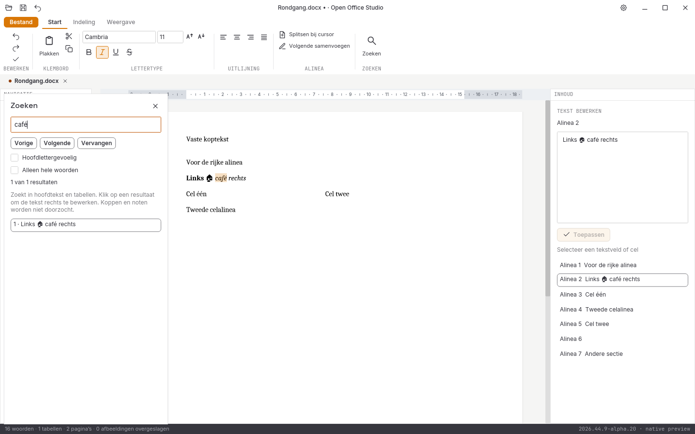

# Native controle, 31 oktober 2026: alpha 20

**2026.44.9-alpha.20** voegt tekstmarkeringen toe op de
documentpagina, brongebonden tekstpunten en een begrensde canonieke broncache.
Alle tien acceptatiegebieden blijven open; de suite is niet volledig
gemigreerd, functioneel gelijk of pixelgelijk aan de referentie.

## Geometrie van de werkelijk gevormde tekst

De nieuwe kern-API’s lezen de bestaande behouden layout en de tekstadressen
van dezelfde engine. Zij gebruiken geen tweede teksteditorlayout of geschatte
tekenbreedtes. Scalaire Unicode-posities worden op geldige UTF-16-grenzen
vertaald. Een positie midden in een surrogaat wordt geweigerd.

`Sessie::tekstmarkering` levert zichtbare markeervlakken en, waar zichtbaar,
het cursorvlak voor de gevraagde pagina. De tekstlengte van het engineadres
moet overeenkomen met de bronalinea. Een verkeerde bronversie, ongeldige
pagina, dubbele/overlappende adressen of niet-ondersteunde inhoud wordt niet
geschat. Het markeerbudget is 8192 UTF-16-eenheden en 8192 vlakken; bij
overschrijding volgt een fout in plaats van een afgekapt resultaat.
Aaneensluitende overlappende vlakken binnen dezelfde regel worden eenmaal
getekend, zodat de dekking niet plaatselijk donkerder wordt.

`Sessie::tekstpunt` vertaalt een gevormd klikpunt naar bronalinea en scalaire
positie. Kop-/voetteksten, noten en afbeeldingen zijn geen hoofdtekstdoel.
Deze route is een kern-API: directe rijke pagina-invoer en de volledige
paginacursor zijn nog niet in de interface aangesloten.

De zoekinterface bewaart de markering bij bronversie, editorversie, selectie
en pagina. Nieuw typen of selecteren laat geen oude oplichting achter.
De widget schaalt de enginevlakken met dezelfde paginageometrie en begrenst
ze tot het zichtbare document. Een ontbrekende betrouwbare markering wordt
in de status gemeld; bestaande paginanavigatie blijft beschikbaar.

## Bronhergebruik

De Writer-modelwrapper bewaart één canonieke layoutbron per modelversie voor
pakketten tot 16 MiB. Beeld, tekstadressen en zoekmarkeringen hoeven dan niet
bij iedere aanvraag opnieuw te serialiseren. Iedere mutabele modeltoegang
wist de cache, ook via de rechtstreekse document-API. De oorspronkelijke
sessiebron voor bewaren en undo blijft afzonderlijk behouden.
Dit is geen gemeten snelheidswinst voor alle documenten; grote pakketten
worden niet onbeperkt extra in geheugen vastgehouden.

## Reproduceerbare schermentijd

De [alpha-19-platformronde](platformen-2026-10-31-alpha19-afgekeurd.json)
blijft afgekeurd. Een [volledige lokale vervolgmeting](platformbeelden-2026-10-31-alpha19-vervolg.json)
vond 77 exacte volledige beeldparen en één verschil van 17 pixels: de
knipperende cursor in het nieuwe zoekveld. Alle 944 bronbestanden per platform
en de [21 afzonderlijke paginabezoeken](paginametingen-2026-10-31-alpha19.json)
zijn wel gecontroleerd.

De widgetproef krijgt daarom een vaste redraw-klok van vóór de focusoperatie.
De echte widget tekent zo haar eerste knipperfase, onafhankelijk van de
duur van layout op het platform. Productiebediening blijft haar normale klok
gebruiken. Er worden geen pixels verwijderd, gemaskeerd of met tolerantie
geaccepteerd. De nieuwe volledige platformronde moet dit nog bevestigen.

## Uitgevoerde controles

- **235 reguliere Rust-tests geslaagd**, inclusief **62 GUI-tests**.
- **Zes runtimeproeven afzonderlijk geslaagd**; [zes conversierondgangen en drie PDF-handtekeningen](conversie-2026-10-31-alpha20-lokaal.json) onafhankelijk gecontroleerd.
- **Zeven Python-tests**, Rustfmt, Clippy met waarschuwingen als fouten en alle bronhashcontroles geslaagd.
- De [zeven nieuwe kernproeven en één GUI-proef](writer-geometrie-2026-10-31-alpha20.json) controleren Unicode-bronposities, tabelcellen, kopteksten, ongeldige versies/pagina’s, budgetten, cacheverversing en werkelijk getekende markeringen.
- De bestaande proef met een lange alinea en astrale tekens controleert nu ook markeringen en klikpunten op de tweede pagina.
- De GUI-proef meet 475, 285 en 1064 veranderde pixels met de markering aan/uit op 100%, 75% en 150%. Alle veranderingen blijven in het document. De oppervlakbanden zijn een functionele zoomcontrole, geen tolerantie voor de legacy- of platformvergelijking.
- DOCX/XLSX/PPTX onafhankelijk teruggelezen; **40 native schermen** met [bron- en loghashes](schermen-2026-10-31-alpha20.json).
- [Dertien gedeelde documentbeelden](documentbeelden-2026-10-31-alpha20.json) blijven bytegelijk aan alpha 19; [acht spreadsheetletterbeelden](spreadsheetletters-2026-10-31-alpha20.json) zijn afzonderlijk gecontroleerd.

Er is nog geen alpha-20-release- of platformgoedkeuring en geen echte
alpha-20-vensterproef. De [echte alpha-19-twaalfstappenproef](vensterproef-2026-10-31-alpha19-release/LEESMIJ.md),
[afzonderlijke paginavensterproef](paginavenster-2026-10-31-alpha19-release/LEESMIJ.md)
en [lokale releasebouw](bouw-2026-10-31-alpha19-lokaal.json) blijven historisch
aan die bron en binaries gekoppeld. Zij bewijzen geen bediening van alpha 20.

## Visuele vergelijking en open werk

De [vier volledige verliesloze referentievergelijkingen](pixelcontrole-alpha20/rapport.json)
blijven rood met nul tolerantie: Writer **108.319**, Spreadsheet **382.437**,
Presentation **560.044** en Notition **666.030** afwijkende pixels op elk
943.736 pixels. Geen maskers, herschaling of vervanging van referentiebeelden.
Kleine veranderingen door versieletters zijn geen bewijs van herontworpen
ribbons of een voltooid functiegebied.

Directe rijke Writer-invoer, scrollen naar de gevonden regel, volledige
ribbons, rastervirtualisatie en bereikbediening, presentatieobjecten,
notitieherstel, complete mailbediening, database-interface, native installers/
losse edities, fysieke IME-compositie, systeemdialogen en schermlezers blijven
open. Geen volledige functie-, test- of pixelpariteit en geen stabiele vrijgave.
