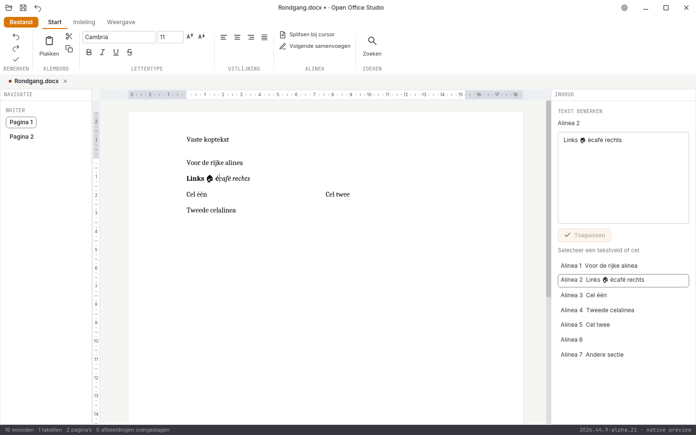

# Native controle, 31 oktober 2026: alpha 21

**2026.44.9-alpha.21** sluit directe tekstinvoer op de Writer-pagina aan voor ondersteunde hoofdtekstalinea’s en tabelcellen. De volledige migratie en alle tien acceptatiegebieden blijven open.

## Directe pagina-invoer

De pagina gebruikt een onveranderlijk interactieframe uit dezelfde gevormde layout als het documentbeeld: één zichtbare displaypagina, gedeelde tekstadressen en passende brontekst. Het frame blijft bruikbaar nadat een andere documentengine wordt geopend of een nieuw beeld wordt opgebouwd. De interface vormt geen tweede tekstlayout om klikposities of selecties te schatten.

Klikken, slepen binnen één alinea, links/rechts, woordstappen, Shift-selectie, selecteren van de huidige alinea, plattetekstklembord, verwijderen en zachte regelovergangen werken op de pagina. De markering en knipperende cursor gebruiken de enginegeometrie, zoom en zichtbare uitsnede. Japanse invoer is met gesimuleerde IME-preedit/commit gecontroleerd; echte IME-compositie en kandidaatvensters op fysieke platforms zijn nog niet goedgekeurd.

Een lopende documentaanvraag houdt nieuwe toetsen in volgorde vast. De twee seconden voor een nieuwe invoergroep tellen vanaf de aankomst van de invoer, niet vanaf het einde van een langzame herberekening. Selectie-, klembord-, opmaak-, bewaar- en undo-opdrachten onderbreken een groep. De kern bewaart maximaal 32 volledige bronnen en 64 MB undo-geschiedenis. Een laat klikpunt wordt uitsluitend via bekende eigen tekststappen naar een nieuwe bronversie vertaald; onbekende bronwijzigingen worden niet geschat.

Opmaaksneltoetsen bewaren de echte cursor/selectie en vormen een afzonderlijke undo-stap. Bewaren wacht op eerdere pagina-invoer; latere invoer blijft gewijzigd totdat zij zelf is bewaard. Bij een kernweigering blijven concept en wachtrij behouden. De interface vermeldt hoe Ctrl+Z dit niet toegepaste werk expliciet verwerpt. Een proef met opzettelijk onjuiste frontend-bewerkbaarheid bevestigt dat de kern bronbeveiliging zelfstandig handhaaft.

De zijeditor houdt haar eigen toepasbare concept. Een paginaklik past dat concept niet stil toe. Het sluiten van zoeken herstelt focus in de nieuwe widgetboom; achtergrondzoeken en dubbele/verouderde antwoorden nemen een actieve paginacursor niet over.

Dit is nog geen volledige rijke pagina-editor. Selecties over alinea’s, omhoog/omlaag en Home/End op documentregels, directe structurele Enter/Backspace-overgangen, invoegopmaak, spelling en object-/kop-/voetbediening blijven open. Zonder expliciete selectie bedienen de huidige opmaakopdrachten de hele alinea. Enter blijft een zachte regelovergang; de bestaande lintopdracht splitst een echte alinea.

## Uitgevoerde controles

- **250 reguliere Rust-tests geslaagd**, inclusief **72 GUI-tests**; zes apart uitgevoerde runtimeproeven geslaagd.
- Zeven Python-tests, Rustfmt, Clippy met waarschuwingen als fouten en alle vastgepinde bronhashcontroles geslaagd.
- Vijf nieuwe kernproeven controleren onveranderlijke frames, zesde pagina, astrale tekens, lege alinea’s, gegroepeerde bronexacte undo en onderbreking door fouten/gewone opdrachten.
- Tien nieuwe GUI-proeven controleren echte klik-/sleepgeometrie op drie zoomstanden, snelle toetsen, klembord, IME-commit, runopmaak, late klikken, focus, bronbeveiliging, herstel, opmaakcursor en bewaarsnapshots.
- [41 volledige native widgetbeelden en bron-/loghashes](schermen-2026-10-31-alpha21.json); de vaste testklok bewaart de echte eerste cursorfase zonder nabewerking van pixels.
- DOCX/XLSX/PPTX onafhankelijk teruggelezen, inclusief Japanse pagina-invoer, emoji, ongewijzigde runopmaak, secties, tabellen, kop/voet en een onbekend pakketdeel. [Zes conversierondgangen en drie PDF-handtekeningen](conversie-2026-10-31-alpha21-lokaal.json) zijn eveneens onafhankelijk teruggelezen.
- [Dertien bestaande documentbeelden](documentbeelden-2026-10-31-alpha21.json) blijven bytegelijk aan alpha 20. [Acht spreadsheetletterbeelden](spreadsheetletters-2026-10-31-alpha21.json) en vijf bron-goldens blijven gecontroleerd.

De [gerichte invoerproeven](writer-pagina-invoer-2026-10-31-alpha21.json) benoemen de scope en de exacte bron. Er is nog geen alpha-21-release-, platform- of echte venstergoedkeuring. De [alpha-20-platformronde](platformen-2026-10-31-alpha20.json) slaagt wel op alle vijf CI-taken, 987 bronbestanden per pakket, 80 volledige beeldparen zonder tolerantie en [21 paginabezoeken](paginametingen-2026-10-31-alpha20.json). De [twaalf echte Linux-vensterstappen](vensterproef-2026-10-31-alpha20-release/LEESMIJ.md), [afzonderlijke paginavensters](paginavenster-2026-10-31-alpha20-release/LEESMIJ.md) en [lokale releasebouw](bouw-2026-10-31-alpha20-lokaal.json) blijven historisch aan alpha 20 gekoppeld.

## Open acceptatie

De [vier volledige verliesloze referentievergelijkingen](pixelcontrole-alpha21/rapport.json) blijven rood: Writer **108.316**, Spreadsheet **382.433**, Presentation **560.041** en Notition **666.029** afwijkende pixels op elk 943.736 pixels. Geen maskers, herschaling of tolerantie. De bestaande referenties zijn niet vervangen.

Volledige Writer-bediening, ribbons, rastervirtualisatie en bereikbewerking, presentatieobjecten, notitieherstel, complete mailbediening, database-interface, overige import/afdrukken, native installers/losse edities, fysieke platformbediening, IME, systeemdialogen en schermlezers blijven open. Geen volledige functie-, test- of pixelpariteit en geen stabiele native vrijgave.
