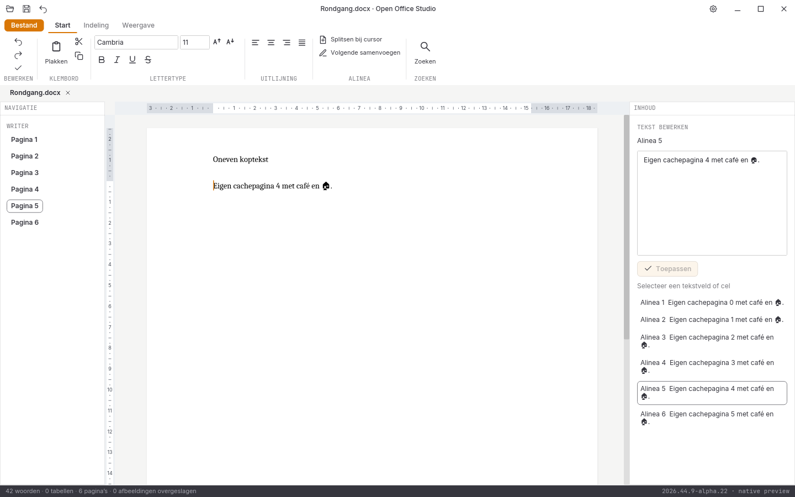
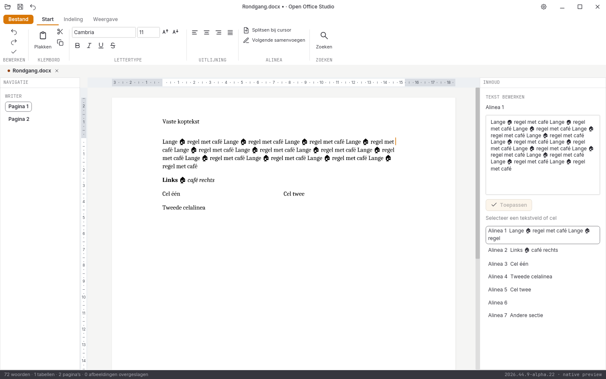

# Native controle, 31 oktober 2026: alpha 22

**2026.44.9-alpha.22** sluit verticale cursornavigatie en Home/End aan op de echte Writer-documentregels. De volledige suite en alle tien acceptatiegebieden blijven open.

## Documentregels en paginaovergangen

Omhoog/omlaag gebruikt dezelfde gevormde layout en de publieke verticale navigatie van de documentengine. De bewaarde horizontale doelpositie volgt de cursor over regels en aangrenzende pagina’s. Binnen een tabel blijft eerst de eigen cel aan de beurt. Home/End gebruikt de echte regelgrenzen; de terugloop van de zijeditor bepaalt deze grenzen niet.

Bij automatische regelafbreking kan één bronpositie twee zichtbare cursorplaatsen hebben: het einde van de vorige regel en het begin van de volgende. Een cursorvoorkeur bewaart de werkelijke regelgeometrie, gekoppeld aan bronhash, alinea, tekstpositie en pagina. De kern controleert die voorkeur tegen de gevormde tekst. Een NaN-doel, vervalste cursor, verkeerde bronhash of ongeldige pagina wordt geweigerd zonder bronwijziging.

De interface zet navigatie en daaropvolgende invoer in dezelfde wachtrij. Snel typen na meerdere pijltjestoetsen bewerkt daardoor de werkelijk bereikte tekstpositie. Undo herstelt na invoer op een automatische regelgrens ook de zichtbare cursorzijde. Zuivere navigatie verandert geen bronbytes, maakt geen undo-stap en maakt het document ook tijdens een lopende aanvraag niet onterecht gewijzigd.

Shift-selectie en klembord zijn binnen dezelfde alinea gecontroleerd. Selectie over alinea’s, structurele Enter/Backspace, invoegopmaak en volledige rijke pagina- en objectbediening blijven open. Er is geen volledige goedkeuring van cursorherstel over herpaginering.

## Uitgevoerde controles

- **258 reguliere Rust-tests geslaagd**, inclusief **76 GUI-tests**; zes afzonderlijke runtimeproeven en zeven Python-tests geslaagd.
- Rustfmt, Clippy met waarschuwingen als fouten en vastgepinde bronhashcontroles geslaagd.
- [Vier nieuwe kernproeven en vier nieuwe GUI-proeven](writer-regelnavigatie-2026-10-31-alpha22.json) controleren zes pagina’s in beide richtingen, documentranden, tabelcelvolgorde, gedeelde bronposities, Home/End, Shift-selectie, klembord, snelle invoer en bronexacte undo met cursorvoorkeur.
- [43 volledige native widgetbeelden](schermen-2026-10-31-alpha22.json), met bron- en loghashes. De bestaande directe pagina-, klembord-, IME- en bewaartests blijven geslaagd.
- DOCX/XLSX/PPTX onafhankelijk teruggelezen. [Zes conversierondgangen en drie PDF-handtekeningen](conversie-2026-10-31-alpha22-lokaal.json) onafhankelijk gecontroleerd.
- [Dertien documentbeelden](documentbeelden-2026-10-31-alpha22.json) blijven bytegelijk aan alpha 21. [Acht spreadsheetletterbeelden en vijf bron-goldens](spreadsheetletters-2026-10-31-alpha22.json) blijven gecontroleerd.

De releasebouw en platformronde voor alpha 22 zijn nog niet afgerond. De [alpha-21-platformronde](platformen-2026-10-31-alpha21.json) slaagt op alle vijf CI-taken met 1039 bronbestanden per pakket, 82 volledige native beeldparen zonder tolerantie en [21 releasepaginabezoeken](paginametingen-2026-10-31-alpha21.json). De [lokale alpha-21-releasebouw](bouw-2026-10-31-alpha21-lokaal.json) slaagt in 38m02s; beide programma’s zijn voorafgaand aan volgende builds vastgezet. De [echte alpha-21-Linux-vensterproef](vensterproef-2026-10-31-alpha21-release/LEESMIJ.md) slaagt op elf gerichte stappen. Dit is historische goedkeuring van alpha 21, geen fysieke Windows/macOS-bediening of volledige suitegoedkeuring.

## Open acceptatie

De [vier volledige verliesloze referentievergelijkingen](pixelcontrole-alpha22/rapport.json) blijven rood: Writer **108.318**, Spreadsheet **382.435**, Presentation **560.043** en Notition **666.030** afwijkende pixels op elk 943.736 pixels. Geen maskers, herschaling of tolerantie; de bestaande referenties zijn niet vervangen.

Volledige Writer-bediening, ribbons, rastervirtualisatie en bereikbewerking, presentatieobjecten, notitieherstel, complete mailbediening, database-interface, overige import/afdrukken, native installers/losse edities, fysieke platformbediening, echte IME, systeemdialogen en schermlezers blijven open. Geen volledige functie-, test- of pixelpariteit en geen stabiele native vrijgave.
