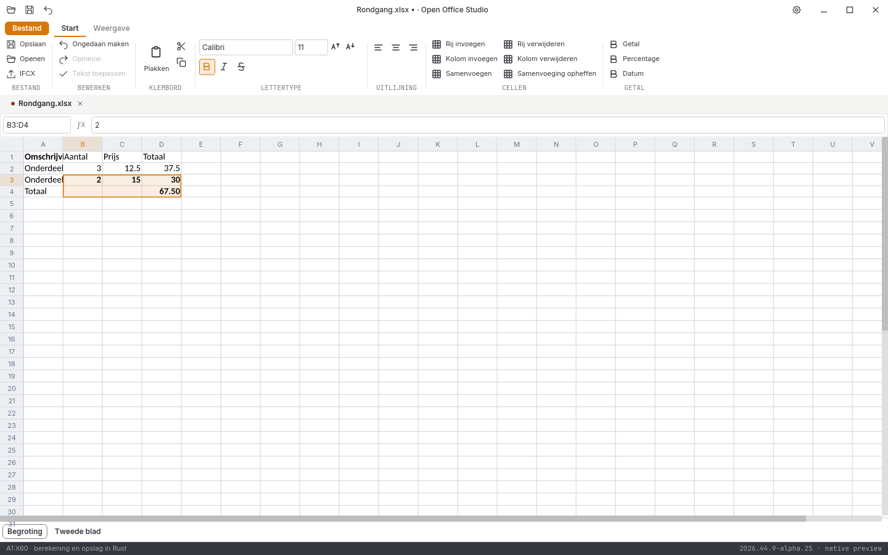

# Native controle, 31 oktober 2026: alpha 23

**2026.44.9-alpha.23** voegt rechthoekige bereikselectie in Spreadsheet toe. De volledige suite en alle tien acceptatiegebieden blijven open.

## Bereikselectie en ankerpositie

Muisslepen, Shift+klik en Shift+pijlen selecteren vanuit een vast anker. De actieve doelcel blijft afzonderlijk bekend, ook bij achteruit selecteren. De markering gebruikt de echte rastergeometrie en schaalt met het werkblad mee. De documentkern neemt aangesneden samenvoegingen volledig mee, ook wanneer het uitbreiden weer een andere samenvoeging raakt. Een resultaat boven 10.000 cellen wordt geweigerd zonder bronwijziging of gedeeltelijke selectie.

Relatieve toetsen blijven tijdens een lopende rasteraanvraag in volgorde bewaard. Opeenvolgende sleepmeldingen bewaren het laatste absolute doel. Een gewone celkeuze of celbewerking heft de bereikselectie op; gewone pijltjestoetsen gaan vanaf de actieve doelcel verder. De bestaande bereikopmaak geldt voor alle gekozen cellen en houdt de actieve doelcel vast. Undo herstelt de oorspronkelijke bestandsbytes.

Dit is nog geen volledig raster: automatisch scrollen tijdens slepen, volledige rij-/kolomselectie, bereikplakken, sorteren/filteren, grafieken, fixeren, validatie en volledige bescherming blijven open. Het werkvenster blijft maximaal 60 × 24 cellen en het rasterbeeld maximaal 1600 × 1400 pixels.

## Uitgevoerde controles

- **265 reguliere Rust-tests geslaagd**, inclusief **80 GUI-tests**; zes afzonderlijke runtimeproeven en zeven Python-tests geslaagd.
- Rustfmt, Clippy met waarschuwingen als fouten en vastgepinde bronhashcontroles geslaagd.
- [Drie kernproeven en vier GUI-proeven](rekenblad-selectie-2026-10-31-alpha23.json) controleren omgekeerde selectie, samenvoegingsketens, budget en documentranden, navigatie buiten het werkvenster, geordende toetsen, slepen op drie zoomstanden, Shift+klik, echte bereikopmaak, undo en modale focus. De eerste diagnose had één onjuiste laatste adresverwachting; die is verklaard en gecorrigeerd, zonder de inhouds- en herstelcontroles te verwijderen.
- [44 volledige native widgetbeelden](schermen-2026-10-31-alpha23.json), met bron- en loghashes.
- DOCX/XLSX/PPTX onafhankelijk teruggelezen, inclusief de zes opgemaakte bereikcellen, oorspronkelijke formules en tweede werkblad. [Zes conversierondgangen en drie PDF-handtekeningen](conversie-2026-10-31-alpha23-lokaal.json) onafhankelijk gecontroleerd.
- [Dertien documentbeelden](documentbeelden-2026-10-31-alpha23.json) blijven bytegelijk aan alpha 22. [Acht spreadsheetletterbeelden en vijf bron-goldens](spreadsheetletters-2026-10-31-alpha23.json) blijven gecontroleerd.

De [lokale alpha-23-releasebouw](bouw-2026-10-31-alpha23-lokaal.json) slaagt in **33m15s**; pakketcontrole en [bronregressie](bronregressie-2026-10-31-alpha23-lokaal.json) slagen. Beide programma’s zijn met versies, bronmanifest en hashes vastgezet. De [echte Spreadsheet-vensterproef](vensterproef-2026-10-31-alpha23-spreadsheet/LEESMIJ.md) heeft negen geslaagde automatische functionele stappen, maar is **visueel afgekeurd**: de opgeslagen tekst bevat het juiste huisteken, terwijl het raster een ontbrekend-glyph toont. De oorspronkelijke automatische uitvoer en de afzonderlijke afkeuring blijven bewaard. De [volledige alpha-23-platformronde](platformen-2026-10-31-alpha23.json) slaagt op alle vijf CI-taken: Linux, Windows, macOS, conversies en de onderlinge pakket-/beeldvergelijking. Elk pakket heeft 1099 bytegelijk gecontroleerde bronbestanden; 88 volledige native beeldparen zonder tolerantie en [21 releasepaginabezoeken](paginametingen-2026-10-31-alpha23.json) slagen. Dit heft de afzonderlijke visuele afkeuring van het huisteken niet op. De alpha-22-ronde is eveneens vastgelegd; de [alpha-21-platformronde](platformen-2026-10-31-alpha21.json), [lokale releasebouw](bouw-2026-10-31-alpha21-lokaal.json) en [elf echte Linux-vensterstappen](vensterproef-2026-10-31-alpha21-release/LEESMIJ.md) blijven historisch aan die bron en programmahashes gekoppeld. Geen fysieke Windows/macOS-bediening of volledige suitegoedkeuring.

## Referenties en open acceptatie

De [vier oorspronkelijke volledige browserreferentievergelijkingen](pixelcontrole-alpha23/rapport.json) blijven rood: Writer **108.316**, Spreadsheet **382.434**, Presentation **560.041** en Notition **666.028** afwijkende pixels op elk 943.736 pixels. Geen maskers, herschaling of tolerantie; de bestaande referenties zijn niet vervangen.

Een [aanvullende oorspronkelijke Writer-desktopreferentie](referentie-desktop-2026-W44.8/LEESMIJ.md) is nu ook vastgelegd uit de officiële Linux-AppImage, met Nederlands, Forge, hetzelfde voorbeeld en twee volledige identieke opnamen zonder meldingen of actieve cursor. De oorspronkelijke desktopweergave heeft voor deze Xvfb-proef softwareweergave nodig; de proefomgeving en de afgekeurde eerdere opzetten zijn beschreven. De afzonderlijke [vergelijking met alpha 22](pixelcontrole-alpha22-desktop/writer/rapport.json) blijft rood met **106.572 afwijkende pixels**. Dat is een aanvullende meetbasis, geen vervanging van de browserreferentie of goedkeuring van de Rust-interface.

Volledige Writer-bediening, ribbons, rastervirtualisatie en bereikplakken, presentatieobjecten, notitieherstel, complete mailbediening, database-interface, overige import/afdrukken, native installers/losse edities, fysieke platformbediening, echte IME, systeemdialogen en schermlezers blijven open. Geen volledige functie-, test- of pixelpariteit en geen stabiele native vrijgave.
