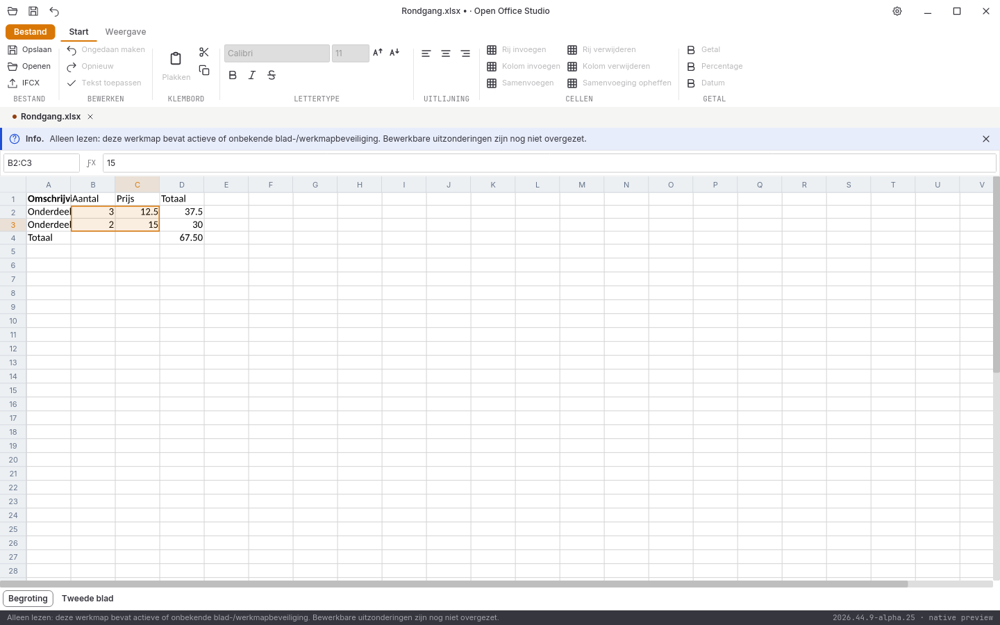

# Native controle, 31 oktober 2026: alpha 24

**2026.44.9-alpha.24** handhaaft bestaande blad-/werkmapbeveiliging in Spreadsheet. De volledige suite en alle tien acceptatiegebieden blijven open.

## Bladbeveiliging en bronbehoud

Actieve of onbekende bladbeveiliging maakt voorlopig de hele werkmap alleen-lezen, ook wanneer een ander blad beschermd is. Actieve of onbekende werkmapvergrendeling wordt eveneens conservatief geblokkeerd. Een expliciet uitgeschakelde bladstatus blijft bewerkbaar. De interface toont de reden en schakelt bewerkingen uit. De getypeerde documentkern controleert zelfstandig: een foutief bewerkbaar frontendveld kan de beperking niet omzeilen.

Werkbladpaden volgen dezelfde relaties en standaardpaden als de engine. Daardoor wordt bescherming ook op een afwijkend deelpad gevonden; een ongebruikt beschermd brononderdeel blokkeert de werkmap niet. De controle van blad-XML leest gebeurtenissen zonder een tweede celboom te maken. Een proef scant 50.000 cellen. Dit is geen geïsoleerde prestatiebenchmark. Alle ongewijzigde bronkenmerken blijven behouden.

Een geweigerde opdracht verandert geen bronbytes of undo-geschiedenis. Selectie en navigatie blijven beschikbaar. Een geweigerd lokaal concept blijft zichtbaar en kan met Escape worden verworpen. Ook ongeldige bladindices mogen door omzetting naar een kleiner getal nooit naar een bestaand blad verwijzen.

Wachtwoordverificatie, opheffen van bescherming, bewerkbare uitzonderingen en afzonderlijke vormen van werkmapbescherming zijn nog niet volledig overgezet. De gehele werkmap wordt daarom bewust strenger behandeld dan een editor die deze uitzonderingen volledig ondersteunt.

## Uitgevoerde controles

- **272 reguliere Rust-tests geslaagd**, inclusief **82 GUI-tests**; zes afzonderlijke runtimeproeven en zeven Python-tests geslaagd.
- Rustfmt, Clippy met waarschuwingen als fouten en vastgepinde bronhashcontroles geslaagd.
- [Vijf kernproeven en twee GUI-proeven](rekenblad-beveiliging-2026-10-31-alpha24.json) controleren actieve, onbekende en inactieve status, werkmapvergrendeling, andere bladen, alle bestaande wijzigingsvormen, exacte bron/geschiedenis, afwijkende relatiedoelen, ongebruikte delen, indexgrenzen, 50.000 celrecords en kernweigering bij een foutieve frontendstatus.
- [45 volledige native widgetbeelden](schermen-2026-10-31-alpha24.json), met bron- en loghashes. Het manifest omvat nu ook alle fixtures, templates en voorbeelden: **178 bestanden**.
- DOCX/XLSX/PPTX onafhankelijk teruggelezen. De bron na beveiligde GUI-weigeringen is bytegelijk aan de fixture; het tweede blad is beschermd, de oorspronkelijke formules en het eerste blad blijven intact. [Zes conversierondgangen en drie PDF-handtekeningen](conversie-2026-10-31-alpha24-lokaal.json) onafhankelijk gecontroleerd.
- [Dertien documentbeelden](documentbeelden-2026-10-31-alpha24.json) blijven bytegelijk aan alpha 23. [Acht spreadsheetletterbeelden en vijf bron-goldens](spreadsheetletters-2026-10-31-alpha24.json) blijven gecontroleerd.

De [lokale alpha-24-releasebouw](bouw-2026-10-31-alpha24-lokaal.json) slaagt in **29m50s**, inclusief pakketcontrole en [bronregressie](bronregressie-2026-10-31-alpha24-lokaal.json). Beide programma’s zijn met versies en hashes vastgezet. De [echte Linux-vensterproef](vensterproef-2026-10-31-alpha24-release/LEESMIJ.md) slaagt op zeven gerichte beschermingsstappen na afgeronde navigatie; eerdere mislukte proeven blijven bewaard en snelle sleepsessies tijdens antwoorden zijn niet goedgekeurd. De [volledige alpha-24-platformronde](platformen-2026-10-31-alpha24.json) slaagt op alle vijf taken: 1145 bronbestanden per pakket, 90 volledige native beeldparen zonder tolerantie en [21 paginabezoeken](paginametingen-2026-10-31-alpha24.json). De [lokale alpha-23-releasebouw](bouw-2026-10-31-alpha23-lokaal.json) slaagt in **33m15s**, inclusief pakketcontrole en [bronregressie](bronregressie-2026-10-31-alpha23-lokaal.json). Beide programma’s zijn vóór volgende builds vastgezet. De alpha-23-platformronde wordt afzonderlijk vastgelegd.

De [volledige alpha-22-platformronde](platformen-2026-10-31-alpha22.json) slaagt op alle vijf CI-taken met **1074 bronbestanden** per pakket, **86 volledige native beeldparen** zonder tolerantie en [21 paginabezoeken](paginametingen-2026-10-31-alpha22.json). De [lokale alpha-22-releasebouw](bouw-2026-10-31-alpha22-lokaal.json) slaagt in **34m15s**. De [echte Linux-vensterproef](vensterproef-2026-10-31-alpha22-release/LEESMIJ.md) slaagt op achttien gerichte stappen met zes pagina’s in beide richtingen, Home/End, Unicode-systeemklembord, snelle toetsen, invoer, bewaren en bronexacte undo. Geen fysieke Windows/macOS-bediening of volledige suitegoedkeuring.

## Gevonden visuele fout en open acceptatie

De [echte alpha-23-Spreadsheet-vensterproef](vensterproef-2026-10-31-alpha23-spreadsheet/LEESMIJ.md) heeft **negen geslaagde functionele stappen**, maar is **visueel afgekeurd**: de XML bevat het juiste huisteken U+1F3E0, terwijl het raster een ontbrekend-glyph toont. De oorspronkelijke automatische uitvoer, echte opnamen en afzonderlijke visuele afkeuring blijven behouden. De beperkte fontproeven zijn dus geen bewijs voor volledige glyph-terugval. Deze afwijking moet worden opgelost en opnieuw met het echte programma worden gecontroleerd.

De [vier volledige browserreferentievergelijkingen](pixelcontrole-alpha24/rapport.json) blijven rood: Writer **108.312**, Spreadsheet **382.431**, Presentation **560.037** en Notition **666.025** afwijkende pixels op elk 943.736 pixels. Geen maskers, herschaling of tolerantie; de bestaande referenties zijn niet vervangen. Versieletters beïnvloeden deze telling ook; de afname is geen bewijs van volledige UI-gelijkheid.

Volledige Writer-bediening, ribbons, rastervirtualisatie en bereikplakken, presentatieobjecten, notitieherstel, complete mailbediening, database-interface, overige import/afdrukken, native installers/losse edities, fysieke platformbediening, echte IME, systeemdialogen en schermlezers blijven open. Geen volledige functie-, test- of pixelpariteit en geen stabiele native vrijgave.
