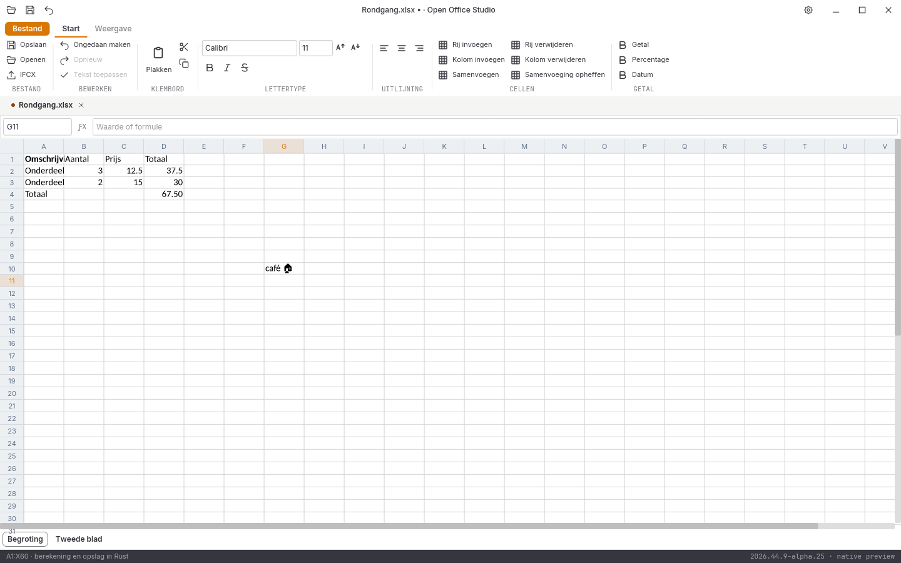

# Native controle, 31 oktober 2026: alpha 25

**2026.44.9-alpha.25** corrigeert de ontbrekende monochrome symbolen in het Spreadsheet-raster. De volledige suite en alle tien acceptatiegebieden blijven open.

## Symbolen in de echte celweergave

De [echte alpha-23-vensterproef](vensterproef-2026-10-31-alpha23-spreadsheet/LEESMIJ.md) is terecht visueel afgekeurd: het huisteken stond correct in het bestand, maar ontbrak in het raster. De oorspronkelijke bron, afbeeldingen, automatische functionele uitvoer en afzonderlijke afkeuring blijven behouden.

De documentletterleverancier biedt nu het vastgepinde aanvullende symboolgezicht aan wanneer de hoofdletter ontbreekt. Alleen ontbrekende gevormde clusters worden vervangen. Bestaande glyphs en kerning blijven behouden. Het aanvullende gezicht gebruikt zijn eigen eenheden en beschikbare stijl; breedtemeting, uitlijning, regelterugloop, gedraaide en gestapelde tekst gebruiken dezelfde glyphkeuze. De standaardfacade behoudt de ingebouwde letter en de vijf oorspronkelijke bronbeelden.

Een eerste strenge vergelijking met het eigen symboolgezicht vond nog 84 randpixels met één kanaalstap verschil door een extra alfalaag. Die mislukte proef is bewaard. Volledig binnen de cel passende glyphs worden nu rechtstreeks geschilderd; alleen tekst die afkapping nodig heeft gebruikt een tijdelijke afbeelding en een celgroot masker. Een tweede vergelijking vond nog 78 randpixels met één kanaalstap verschil bij stapeling; ook de fontdaling telt nu mee in de keuze voor de afkaplaag. De [twee afkeuringen en de aparte rendererproef](symbolen-diagnose-alpha25/LEESMIJ.md) blijven vastgelegd. De vergelijking heeft geen kleurtolerantie gekregen.

De GUI-proef bevestigt celinvoer, het raster na Enter, dezelfde afbeelding na opnieuw openen en bronexacte undo. De opgeslagen astrale Unicode en oorspronkelijke formules/overige werkblad zijn onafhankelijk teruggelezen. Dit is geen volledige dekking van CJK, BiDi, samengestelde emoji, systeemletters of alle lettertypen.

## Uitgevoerde controles

- **275 reguliere Rust-tests geslaagd**, inclusief **83 GUI-tests**; zes afzonderlijke runtimeproeven en zeven Python-tests geslaagd.
- Rustfmt, Clippy met waarschuwingen als fouten en vastgepinde bronhashcontroles geslaagd.
- [De symboolproeven](spreadsheet-symbolen-2026-10-31-alpha25.json) controleren vier stijlen, drie uitlijningen, celafkapping, rotatie, stapeling en regelterugloop; het afzonderlijke symbool moet bytegelijk worden getekend aan zijn eigen font. Alle drie de documentmodules tekenen het symbool anders dan een werkelijk ontbrekend teken.
- [46 volledige native widgetbeelden](schermen-2026-10-31-alpha25.json), met bron- en loghashes. Het bronmanifest omvat **606 repositorybestanden**, inclusief gepinde renderer-, font- en fixturebron, scripts, templates en voorbeelden. Bronbytes zijn vóór en na de controles gelijk. De 178 paden uit alpha 24 bevatten ook 29 lokale gegenereerde uitvoerbestanden; die historische vastlegging blijft behouden. De nieuwe vastlegging sluit zulke uitvoer uit en neemt de volledige gepinde code mee.
- DOCX/XLSX/PPTX onafhankelijk teruggelezen. [Zes conversierondgangen en drie PDF-handtekeningen](conversie-2026-10-31-alpha25-lokaal.json) onafhankelijk gecontroleerd.
- [Dertien gedeelde documentbeelden](documentbeelden-2026-10-31-alpha25.json) en [acht spreadsheetletterbeelden](spreadsheetletters-2026-10-31-alpha25.json) blijven bytegelijk aan alpha 24. Twee aanvullende rasterbeelden onderscheiden het huisteken van een ontbrekend teken.

De alpha-25-releasebouw en platformronde moeten nog worden afgerond. Een echte releasevenster-hertest van het huisteken staat nog open; de widgetopname is geen vervanging daarvan. De [lokale alpha-24-releasebouw](bouw-2026-10-31-alpha24-lokaal.json) slaagt in **29m50s**, met pakketcontrole, bronregressie en beide programma’s vastgezet. De [echte beschermingsproef](vensterproef-2026-10-31-alpha24-release/LEESMIJ.md) slaagt op zeven stappen na afgeronde navigatie; drie eerdere mislukte proeven blijven bewaard. De [volledige alpha-24-platformronde](platformen-2026-10-31-alpha24.json) slaagt op alle vijf taken: 1145 bronbestanden per pakket, 90 volledige native beeldparen en [21 paginabezoeken](paginametingen-2026-10-31-alpha24.json).

De [volledige alpha-23-platformronde](platformen-2026-10-31-alpha23.json) slaagt op alle vijf taken: 1099 bronbestanden per pakket, 88 volledige native beeldparen zonder tolerantie en [21 paginabezoeken](paginametingen-2026-10-31-alpha23.json). De [lokale alpha-23-releasebouw](bouw-2026-10-31-alpha23-lokaal.json) slaagt in 33m15s. De toen gevonden visuele fout is daarmee niet achteraf goedgekeurd.

## Open acceptatie

De [vier volledige browserreferentievergelijkingen](pixelcontrole-alpha25/rapport.json) blijven rood: Writer **108.318**, Spreadsheet **382.436**, Presentation **560.043** en Notition **666.030** afwijkende pixels op elk 943.736 pixels. Geen maskers, herschaling of tolerantie; bestaande referenties zijn niet vervangen. Versieletters beïnvloeden de telling ook, dus een kleiner aantal is geen bewijs voor volledige UI-gelijkheid.

Volledige Writer-bediening, ribbons, rastervirtualisatie en bereikplakken, presentatieobjecten, notitieherstel, complete mailbediening, database-interface, overige import/afdrukken, native installers/losse edities, fysieke platformbediening, echte IME, systeemdialogen en schermlezers blijven open. Geen volledige functie-, test- of pixelpariteit en geen stabiele native vrijgave.
