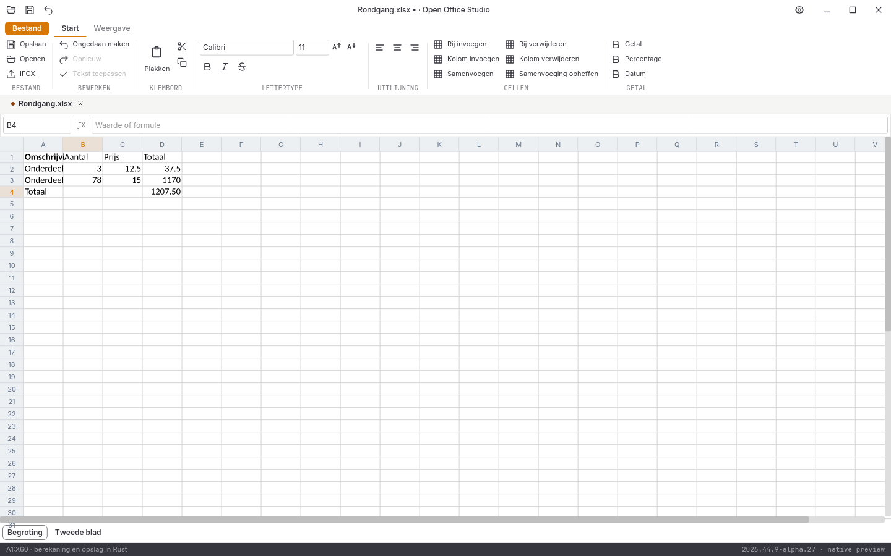

# Native controle, 1 november 2026: alpha 26

**2026.44.9-alpha.26** versnelt gewone celsprongen en corrigeert celinvoer die in dezelfde oude widgetronde na een pijltoets aankomt. De volledige suite en alle tien acceptatiegebieden blijven open.

## Directe celsprongen en juiste invoervolgorde

Reeds zichtbare buurcellen gebruiken dezelfde bewaarde rasterafbeelding. Bereikgrenzen, volledige samenvoegingen en verborgen rij-/kolomspannen komen uit dezelfde werkmapweergave. De interface raadt geen doel uit afgeronde pixels. Een onbekend, onzichtbaar, te klein of dubbelzinnig doel blijft een opdracht voor de documentkern; sprongen buiten het werkvenster blijven eveneens via de kern lopen. Dit is geen volledige virtualisatie.

De oorspronkelijke negatieve regressie bevestigde het probleem: een pijl veroorzaakte nog rasterwerk, terwijl een gezamenlijke pijl/7/8/Enter-reeks op B2 bleef in plaats van de nieuwe cel te bewerken en B4 te bereiken. Tekentoetsen en F2 bepalen nu tijdens het verwerken de actuele cel. Volgende tekentoetsen sluiten aan bij de reeds geopende editor. Enter/Tab bevestigen de dan actuele cel; pijltoetsen werken in een inmiddels geopende editor als cursorbeweging. De bron wijzigt uitsluitend op bevestiging. B2 blijft 3, B3 wordt 78, de oorspronkelijke formules en het tweede blad blijven behouden. Undo herstelt de oorspronkelijke bronbytes.

De extra negatieve focusproef vond dat een oude lokale navigatietaak nog focus kon afpakken na het openen van een nieuwe editor. Focusverzoeken controleren nu document, editorversie en de actuele modale toestand. De modaliteitsproef blijft zowel een lokale sprong als een echte asynchrone werkvensterverplaatsing testen. [De eerdere afkeuringen](invoerdiagnoses-2026-11-01-alpha26.json) blijven bewaard.

## Gecontroleerd

- **284 reguliere Rust-tests geslaagd**, inclusief **88 tests in de UI-crate**; zes afzonderlijke runtimeproeven en zeven Python-tests geslaagd.
- Rustfmt, Clippy met waarschuwingen als fouten en alle vastgepinde bronhashcontroles geslaagd. De **608 repositorybronbestanden** blijven vóór en na de controles bytegelijk.
- [Vier kernproeven en vijf nieuwe UI-proeven](spreadsheet-navigatie-2026-11-01-alpha26.json). Achttien bronvensters leveren **54.430** lokale doelen die exact met de werkmapkern overeenkomen; **1.362** gevallen gebruiken de kernroute. Normale cellen, merges, verborgen assen, afgekapte grote en zeer kleine positieve afmetingen, vrijwel volledig verborgen bladen en hoge werkbladindices zijn inbegrepen. Geen kwantitatieve functiedekking of geïsoleerde snelheidsbenchmark.
- [47 volledige native widgetbeelden](schermen-2026-11-01-alpha26.json), zonder nabewerking; geen fysieke GUI-proef. [Vijftien gedeelde documentbeelden](documentbeelden-2026-11-01-alpha26.json) en acht letterbeelden blijven bytegelijk aan alpha 25; de vijf oorspronkelijke renderer-goldens blijven gecontroleerd.
- DOCX/XLSX/PPTX onafhankelijk teruggelezen. De snelle GUI-invoer bewaart B2=3, B3=78 en de formules; D3 wordt 1170 en D4 1207,5. Een bestaande `zeroHeight`-bron behoudt die instelling en twee zichtbare hoogte-uitzonderingen na Unicode-invoer en bewaren; undo is bronexact.
- [Zes conversierondgangen en drie PDF-handtekeningen](conversie-2026-11-01-alpha26-lokaal.json) onafhankelijk gecontroleerd.

De [lokale alpha-26-releasebouw](bouw-2026-11-01-alpha26-lokaal.json) slaagt in **29m56s**, met 1240 bytegelijke verpakte bronbestanden, pakketcontrole en [bronregressie](bronregressie-2026-11-01-alpha26-lokaal.json). Beide programma’s zijn met versies en hashes vastgezet. De [volledige alpha-26-platformronde](platformen-2026-11-01-alpha26.json) slaagt op vijf taken met **1240 bytegelijke bronbestanden per pakket**, **94 volledige native beeldparen** zonder tolerantie en **21 releasepaginabezoeken**. De [echte lokale releasevensterproef](vensterproef-2026-11-01-alpha26-lokaal/LEESMIJ.md) slaagt op **veertien gerichte stappen**, inclusief snelle Down/78/Enter-invoer, bronexacte undo en Unicode na heropenen. Eén voorafgaande scriptfout blijft afzonderlijk afgekeurd en verklaard. De [lokale alpha-25-releasebouw](bouw-2026-11-01-alpha25-lokaal.json) slaagt in **28m03s** met pakketcontrole, bronregressie en beide programma’s vastgezet. De [echte CI-Linux-vensterproef](vensterproef-2026-11-01-alpha25-ci/LEESMIJ.md) slaagt op twaalf gerichte stappen; het huisteken staat ook na bewaren en opnieuw openen zichtbaar in het raster. De [volledige alpha-25-platformronde](platformen-2026-10-31-alpha25.json) slaagt op alle vijf taken: **1199 bronbestanden per pakket**, **92 volledige native beeldparen** zonder tolerantie en **21 releasepaginabezoeken**. Die goedkeuring geldt voor de vastgelegde alpha-25-binaries en vervangt de nieuwe alpha-26-vensterproef niet.

## Open beperkingen

De [vier volledige browserreferentievergelijkingen](pixelcontrole-alpha26/rapport.json) blijven rood: Writer **108.318**, Spreadsheet **382.437**, Presentation **560.043** en Notition **666.026** afwijkende pixels op elk 943.736 pixels. Geen maskers, herschaling of kleurtolerantie. Versieletters beïnvloeden deze telling ook; geen telling van voltooide functies.

De nieuwe modeluitvoer draagt [sheetFormatPr nog niet volledig over](modeluitvoer-diagnose-2026-11-01/LEESMIJ.md), waaronder `zeroHeight`. De mislukte modelbron blijft afgekeurd. De gewone bewerking van een bestaande bron met die instelling heeft een afzonderlijke positieve bewaar-/undo-proef; dat lost de nieuwe constructor-/exportroute niet op.

Een volledige wachtrij voor verdere tekst tijdens bronbewerkingen, directe asynchrone plak/Enter/bewaarreeksen, bereikplakken, echte rastervirtualisatie, Writer-rijketekstbediening en volledige ribbons, presentatieobjecten, notitieherstel, complete mailbediening, database-interface, overige import/afdrukken, native installers/losse edities, fysieke platformbediening, echte IME, systeemdialogen en schermlezers blijven open. Geen volledige functie-, test- of pixelpariteit en geen stabiele native vrijgave.
